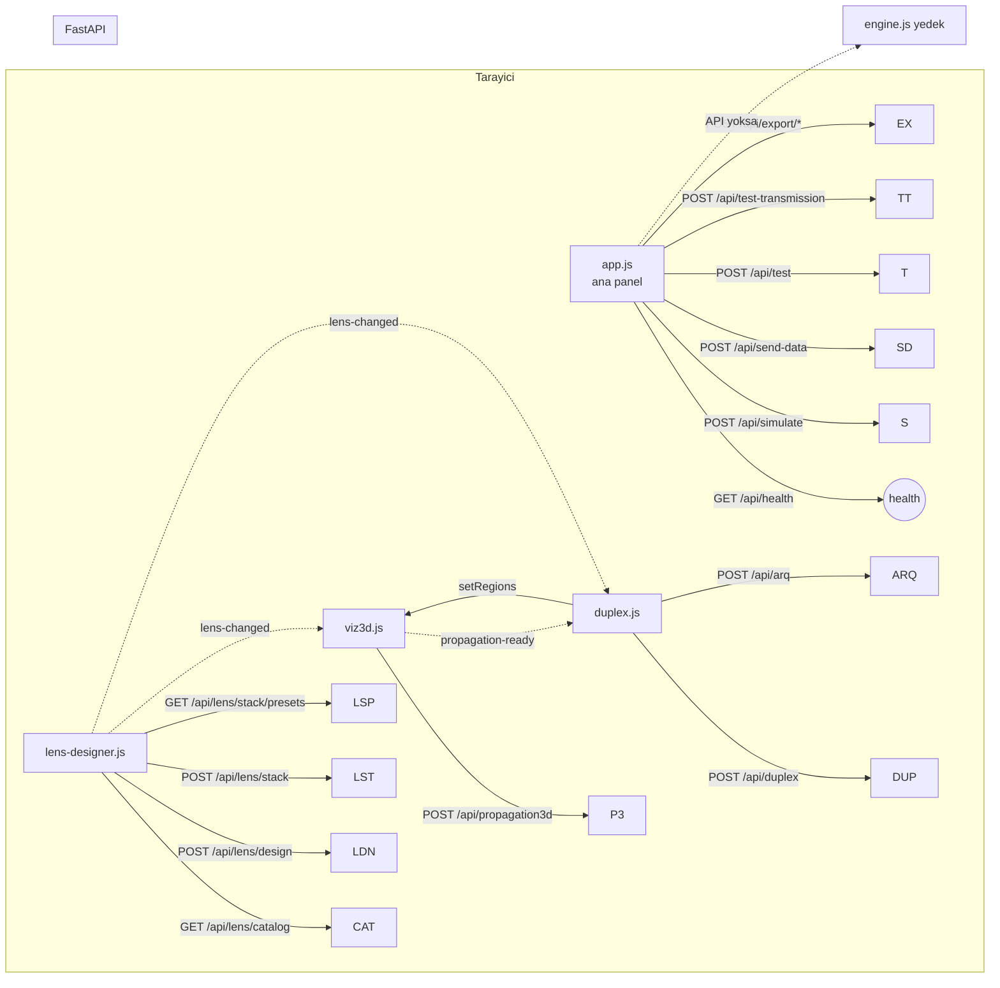
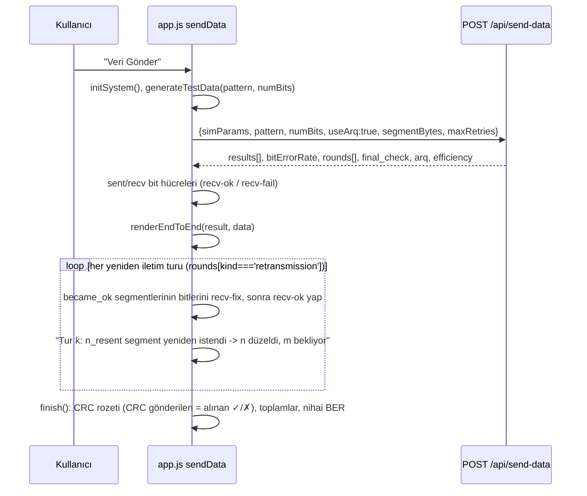
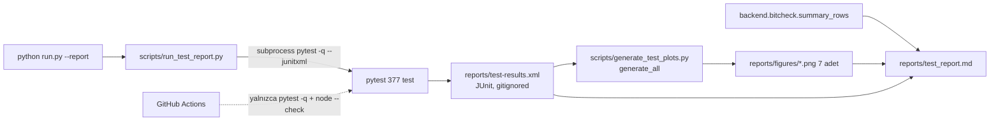

# Optical FSO Physics — Ayrıntılı Proje Raporu

*Tarih: 23 Kasım 2026 · Kapsam: çalışma ağacının güncel hali (son commit `897b4e6` + commit edilmemiş CRC-32 geçişi)*

Bu rapor projeyi kod düzeyinde, en ince ayrıntısına kadar anlatır. Üç bölümden oluşur. Her bölüm kaynak kod satır satır okunarak yazıldı. Rakamlar ya koddan ya da projenin kendi Python ortamında yapılan hesaplama ve ölçümlerden alındı.

| Bölüm | İçerik |
|---|---|
| **A — Fizik ve Matematik** | Atmosfer ızgarası, kırılma indisi (Edlén), zayıflama, türbülans, ışın izleme, ABCD/Gauss optiği, malzemeler ve lens tasarımı, lens yığını, 3B yayılım ve bozunum skoru, sayısal yöntemler, hesaplanmış örnekler, fizik hataları |
| **B — İletişim ve API** | CRC-32, çerçeve yapısı, BER kanal modeli, seçici tekrar (ARQ), uçtan uca gönderim, full-duplex, tüm API uç noktaları ve ölçümleri, iletişim katmanı hataları |
| **C — Arayüz, Test, Altyapı** | Tarihçe, kurulum, dizin yapısı, her arayüz dosyası, COMSOL, test altyapısı, CI, kalite ve güvenlik, performans, yol haritası |

---

## Yönetici Özeti

### Proje ne yapıyor?
Serbest uzay optik (FSO) haberleşme bağlantısını uçtan uca simüle eder:

1. Atmosferde zayıflama ve türbülans hesaplanır.
2. Lens sistemleri ışını şekillendirir.
3. Işın 3B olarak yayılır ve bozunum bulutu çıkarılır.
4. Bit hata oranı hesaplanır.
5. Veri CRC-32 ile korunur ve seçici tekrar (ARQ) ile güvenilir biçimde iletilir.
6. İki terminal aynı anda iki yönlü (full-duplex) haberleşir.

Hepsi bir web arayüzünde 2B ve 3B görselleştirilir. Projenin hesap katmanı Python/FastAPI, arayüzü JavaScript ve three.js ile yazılmıştır.

### Sayılarla
| Ölçüt | Değer |
|---|---|
| Python kodu | ≈7 300 satır (10 backend modülü) |
| JavaScript kodu | ≈5 500 satır (7 dosya) |
| Test kodu | ≈2 650 satır; **377 test, tamamı geçiyor** (≈8 s) |
| API | 22 uç nokta + 10 statik dosya yolu |
| Malzeme veritabanı | 14 optik malzeme (Sellmeier, kaynaklı) |
| Sayısal yöntemlerin ölçülen mertebeleri | merkezi fark 2.00 · Simpson 4.0 · RK4 4.03 · Euler 1.01 |

### Güçlü yönler
- **Fiziksel optik:** ABCD ve Gauss ışın optiği doğru çalışıyor. Coddington sapma formülü, tam ışın izlemeyle %0.5–2.8 farkla uyuşuyor.
- **Malzeme verisi:** kırılma indisleri yayınlanmış değerlerle doğrulandı.
- **İletişim katmanı:** CRC-32 `zlib` ile birebir aynı sonucu veriyor. 32 bite kadar ardışık hataların hepsini yakalıyor. ARQ tur tur izlenebiliyor.
- **Test altyapısı:** kapsamlı ve hızlı. Grafikli test raporu otomatik üretiliyor.
- **Görselleştirme:** 3B sahne, lens kesiti ve duplex zaman çizelgesi etkileşimli.

### Kritik bulgular (öncelik sırasıyla)
| # | Bulgu | Etki | Bölüm |
|---|---|---|---|
| 1 | **Kim/Kruse birim hatası:** `3.91/V` km⁻¹ (neper) cinsinden ama dB/km gibi kullanılıyor (×4.343 eksik) | Sis 7.82 dB/km hesaplanıyor, doğrusu ≈33.96. 1 km sisli bağlantı "+16 dB marj" gösteriyor, gerçekte bağlantı kopuk (−10 dB) | A.8.1 |
| 2 | **Edlén nem katsayısı ≈110 kat büyük** | Kırılma indisi 1'in altına düşebiliyor. 6 km'de 3B sapma 1.72 m, doğrusu ≈0.20 m | A.8.2 |
| 3 | **Duplex marj ile BER çelişkisi:** marj −40 dBm hassasiyete, BER −30 dBm gürültü tabanına göre hesaplanıyor | 6 km'de "+13.4 dB marj, bağlantı uygun" görünüyor ama BER ≈0.14 ve teslimat başarısız | B.7 |
| 4 | **Eski ızgara ışın izleyici gerçek kırılma üretmiyor** | Eksen boyunca giden ışında sapma tam 0. Gerçek bükülme yalnızca yeni 3B yayılım modülünde var | A.8.3 |
| 5 | **Ana simülasyon hâlâ eski sabit lens tablosunu kullanıyor** | Kırınım sınırının altında, fiziksel olarak imkânsız ıraksama değerleri | A.8.4 |
| 6 | **Sintilasyon adlandırması ve süreksizliği:** Rytov varyansı "indeks" diye raporlanıyor; ceza σR²=5'te 3.9'dan 10 dB'e sıçrıyor | Sönümleme marjı olması gerekenden düşük çıkıyor (6 km'de 0.93 dB, olması gereken ≈4.5–7.4 dB) | A.8.5 |
| 7 | **Kaynak sınırları zayıf:** zaman aşımı yok, eski `send-data` modunda yanıt çok büyük | 1M hücreli simülasyon ≈15 s. Eski modda 10 000 bit 39 s ve 328 MB | B.7, C.7 |
| 8 | **CRC-32 geçişi commit edilmedi**, CI yeni JS dosyalarını kontrol etmiyor | CI bu kodu hiç çalıştırmadı | C.1, C.6 |

### Küçük bulgular
- `random` deseni tohum değerini dikkate almıyor.
- `ascii_hello` her zaman 40 bit döndürüyor.
- Full-duplex hesabı yayılım gecikmesini yok sayıyor.
- Teslim başarısız olsa da `goodput_ratio` sıfırdan farklı kalıyor.
- Eski uç noktalarda `ValueError` 500 dönüyor, yenilerde 422.
- Lens odak uzaklığı ve açıklık alanlarında üst sınır yok.
- Işın demeti (ray-fan) yardımcı fonksiyonları iki dosyada tekrarlanmış.
- Git'te 3 tane `.pyc` dosyası izleniyor.
- `datetime.utcnow` kullanımı (kullanımdan kaldırılıyor).

### Doğrulama notu
Rapor taslağında COMSOL dışa aktarımında "dalga boyu 1000 kat küçük" diye bir iddia vardı. Kontrol edildi ve yanlış çıktı: dönüşüm doğru (1550 nm → 1.55e-6 m), ilgili satırlar düzeltildi. Bölüm A'daki Kim/Kruse, Edlén ve marj/BER bulguları ise koddan ayrıca doğrulandı.

### Önerilen ilk adımlar
1. Kim/Kruse ve Edlén düzeltmeleri `engine.py` ve `engine.js`'te yapılmalı, regresyon fixture'ı güncellenmeli.
2. Alıcı modeli tek bir gürültü/hassasiyet tanımında birleştirilmeli (marj = BER hedefi).
3. Ana simülasyon `optics.py`'deki fiziksel lens modeline taşınmalı.
4. CRC-32 geçişi commit edilmeli, CI'ya JS kontrolleri ve testler eklenmeli.
5. Ağır uç noktalara zaman aşımı ve boyut sınırı konmalı.

---

# BÖLÜM A — Fizik ve Matematik Katmanı (Ayrıntılı Teknik Rapor)

Proje: `optical-fso-physics` (serbest uzay optiği, FSO, bağlantı fizik simülatörü).
Kapsam: `backend/engine.py`, `backend/optics.py`, `backend/numerics.py`, `backend/materials.py`, `backend/lens_stack.py`, `backend/propagation3d.py` (+ `backend/duplex.py:rescale_propagation`, `backend/app.py:_grid_for_distance`).
İletişim katmanı/API (Bölüm B) ve arayüz/test/altyapı (Bölüm C) burada yalnızca çapraz referans olarak anılır.

---

## A.0 Okuma Kılavuzu, Yöntem ve Notasyon

**Yöntem.** Her satır `cat -n` ile okundu; her sayısal değer ya koddan (sabit) ya da `.venv/bin/python` (Python 3.9) ile salt-okunur içe aktarma yapılarak hesaplandı. Hiçbir proje dosyası değiştirilmedi. Düzeltilmiş formül karşılaştırmaları (ör. Edlén nem terimi) süreç içinde bellekte yapılan "monkeypatch" ile ölçüldü; diske yazılmadı. Hesaplama betikleri oturum scratchpad dizinindedir (`c1.py` … `c15.py`).

**Notasyon.**

| Simge | Anlam | Birim |
|---|---|---|
| $\lambda$ | dalga boyu | m (kodda bazen nm/µm) |
| $k=2\pi/\lambda$ | dalga sayısı | rad/m |
| $n$ | kırılma indisi | – |
| $C_n^2$ | kırılma indisi yapı sabiti | m$^{-2/3}$ |
| $\sigma_R^2$ | Rytov varyansı | – |
| $\sigma_I^2$ | normalize ışık şiddeti (scintilasyon) varyansı | – |
| $w$ | $1/e^2$ ışın yarıçapı | m |
| $z_R=\pi w_0^2/(M^2\lambda)$ | Rayleigh aralığı | m |
| $\theta=M^2\lambda/(\pi w_0)$ | uzak alan yarım-açı ıraksama | rad |
| $\alpha$ | zayıflama katsayısı | dB/km (Np/m ayrıca belirtilir) |

**Dosya boyutları (satır):** `engine.py` 1206, `optics.py` 828, `numerics.py` 514, `materials.py` 851, `lens_stack.py` 525, `propagation3d.py` 389.

**Genel mimari özeti.**

```
engine.py ─ AtmosphereGrid (n, T, P, RH, wind, Cn²) ─┬─ RayTracer (hücre-hücre Snell; eski yol, /api/simulate)
          ─ AtmosphericLoss (absorpsiyon, geometri,   │
             scintilasyon, linkBudget)                 └─ propagation3d.py (Gauss ışını + RK4 ışın denklemi, v2 yol)
          ─ LensSystem (eski tablo)  ──[yerine]──►  optics.py (ABCD, Gauss q) ─► materials.py (n(λ), tasarım) ─► lens_stack.py
numerics.py ─ türev/integral/ODE/kök; optics, materials, propagation3d tarafından kullanılır
```

---

## A.1 `backend/engine.py` — Atmosfer, Snell Yasası, Kayıp Modeli, Işın İzleyici

### A.1.1 `Vec3` (engine.py:73–114)

Değişmez-tarzı 3 boyutlu vektör sınıfı (her işlem yeni `Vec3` döndürür). Alanlar `x, y, z` (float). Yöntemler:

| Yöntem | Formül | Not |
|---|---|---|
| `clone` | kopya | |
| `add`, `sub`, `scale` | bileşen bazında | |
| `dot` | $\mathbf a\cdot\mathbf b=\sum a_ib_i$ | |
| `cross` | $\mathbf a\times\mathbf b$ | kodda standart bileşen açılımı (engine.py:94–99) |
| `length` | $\sqrt{x^2+y^2+z^2}$ | |
| `normalize` | $\mathbf v/\|\mathbf v\|$; $\|\mathbf v\|<10^{-12}$ ise sıfır vektör | satır 104–108 |
| `to_dict`, `__str__` | `{"x","y","z"}`; `(x.xxxx, …)` | |

Koordinat konvansiyonu (grid ile): $x$ = link ekseni (kaynak $x=0$, hedef $x=g_x\cdot cs$), $y$ = yanal, $z$ = yükseklik.

### A.1.2 `ATM_CONSTANTS` (engine.py:117–143)

| Anahtar | Değer | Birim | Anlam / kaynak | Kullanım |
|---|---|---|---|---|
| `P0` | 101325.0 | Pa | ISA deniz seviyesi basıncı | basınç profili, Edlén (satır 210) |
| `T0` | 288.15 | K | ISA standart sıcaklık (15 °C) | basınç profili, Edlén |
| `g` | 9.80665 | m/s² | standart yerçekimi | barometrik formül |
| `M` | 0.0289644 | kg/mol | kuru hava molar kütlesi | barometrik formül |
| `R` | 8.31447 | J/(mol·K) | evrensel gaz sabiti (ISA'da 8.31432; CODATA 8.314462 — kod 8.31447 kullanır, fark ~$10^{-6}$ göreli, ihmal edilebilir) | barometrik formül |
| `Lapse` | 0.0065 | K/m | ISA troposfer sıcaklık düşüş oranı | sıcaklık ve basınç profili |
| `c` | 299792458.0 | m/s | ışık hızı | **kullanılmıyor** |
| `A` | 8342.54e-8 | – | Edlén/Birch–Downs: $(n_s-1)$ sabit terim | satır 205 |
| `B` | 2406147e-8 | µm⁻² | Birch–Downs ikinci terim payı | |
| `C` | 130.0 | µm⁻² | ikinci terim kutbu | |
| `D` | 15998e-8 | – | üçüncü terim payı | |
| `E` | 38.9 | µm⁻² | üçüncü terim kutbu | |
| `alpha_clear` | 0.2e-3 | dB/m (= 0.2 dB/km) | açık hava | **Python'da kullanılmıyor** (`engine.js:66` aynalı) |
| `alpha_haze` | 4.0e-3 | dB/m | hafif pus | kullanılmıyor |
| `alpha_fog` | 40.0e-3 | dB/m | orta sis | kullanılmıyor |
| `alpha_rain` | 6.0e-3 | dB/m | orta yağmur | kullanılmıyor |
| `Cn2_weak` | 1e-17 | m⁻²ᐟ³ | zayıf türbülans (yer seviyesi A) | `applyThermalProfile` |
| `Cn2_moderate` | 1e-15 | m⁻²ᐟ³ | orta | |
| `Cn2_strong` | 1e-13 | m⁻²ᐟ³ | güçlü | |

Notlar:
* Edlén katsayıları (8342.54; 2406147; 130; 15998; 38.9) Birch & Downs (1993/94) güncellemesiyle birebir uyumludur: $(n_s-1)\times10^{8}=8342.54+\dfrac{2406147}{130-\sigma^2}+\dfrac{15998}{38.9-\sigma^2}$, $\sigma=1/\lambda[\mu m]$. (Kod içinde kaynak yazılı değildir; eşleşme sayısal karşılaştırmayla belirlendi.)
* `alpha_*` dört sabit Python tarafında **ölü koddur**: `absorptionLoss` bunları kullanmaz, değerlerini `if/elif` zincirinde yeniden yazar (engine.py:437–450).
* Barometrik üs: $gM/(R\,L)=5.25578$ (hesaplandı).

### A.1.3 `AtmosphereGrid` (engine.py:146–385)

**Depolama ve indeksleme.**

* Varsayılan: `gridX=60, gridY=10, gridZ=10, cellSize=100 m` → 6000 hücre; toplam uzunluk $L=g_x\cdot cs=6$ km (`totalDistanceM`, satır 168–174).
* Düz (flat) diziler: `grid` (n; float64), `temperature` (float32, °C), `pressure` (float32, Pa), `humidity` (float32, %RH), `wind` (float32, m/s), `Cn2` (float64).
* İndeks: $\text{idx}=i_x+g_x\,(i_y+g_y\,i_z)$ (engine.py:165–166) — x en hızlı değişen eksen; `propagation3d` bunu `reshape((gz,gy,gx))` ile okur (propagation3d.py:119–123).
* Hücre merkezi irtifası: $h_k=(i_z+\tfrac12)\,cs$. Varsayılan 50, 150, …, 950 m.
* `n_base=1.000293` (15 °C, 101325 Pa, ~550 nm civarı değer), `initializeDefault` hepsini bu değerle ve $T=20$ °C, RH=50 %, $C_n^2=10^{-15}$ ile doldurur (satır 176–187).
* `getRefractiveIndex/getTemperature/getCn2` indeksleri sınırlara **kıstırır** (clamp). `worldToGrid` $\lfloor x/cs\rfloor$. `inBounds` katı sınır testi.

**Barometrik basınç** (engine.py:189–196):

$$P(h)=P_0\left(1-\frac{L\,h}{T_0}\right)^{\frac{gM}{RL}}$$

Sayısal: $P(0)=101325$, $P(50)=100725.8$, $P(550)=94890.0$, $P(1000)=89874.8$, $P(5000)=54020.5$ Pa.

**Sıcaklık** (satır 198–199): $T(h)=T_{base}-L\,h$ (hücre merkezi için). Örn. 550 m'de $-3.575$ K.

**Edlén kırılma indisi — adım adım** (`refractiveIndexEdlen`, engine.py:201–220), $\lambda=1.55\,\mu m$, 15 °C, 101325 Pa, kuru örnek:

1. $T_K=T_C+273.15$; $\sigma^2=1/\lambda^2=0.416233\ \mu m^{-2}$.
2. Standart hava dispersiyonu:
$$n_s-1=A+\frac{B}{C-\sigma^2}+\frac{D}{E-\sigma^2}$$
$A=8.34254\times10^{-5}$; $B/(C-\sigma^2)=2.406147\times10^{-2}/129.58377=1.85683\times10^{-4}$; $D/(E-\sigma^2)=1.5998\times10^{-4}/38.48377=4.1571\times10^{-6}$; toplam $=2.73265\times10^{-4}$ ($n_s=1.000273265$).
3. Yoğunluk ölçekleme (ideal gaz):
$$n_{tp}-1=(n_s-1)\,\frac{P}{P_0}\,\frac{T_0}{T_K}$$
(Edlén'in $P$ ve $t$ düzeltme polinomu yerine saf yoğunluk oranı; $n_s$ zaten 15 °C/101325 Pa içindir.)
4. Doygun buhar basıncı (Buck tipi, Pa): $e_s=611.21\exp\!\Big[\big(18.678-\tfrac{T_C}{234.5}\big)\tfrac{T_C}{257.14+T_C}\Big]$; $e=\dfrac{RH}{100}e_s$. 20 °C'de $e_s=2338.34$ Pa, RH=50 % için $e=1169.17$ Pa.
5. Nem düzeltmesi (kodda): $\Delta n_{wv}=-4.15\times10^{-8}\,e$ (satır 218). **Bu katsayı hatalıdır; bkz. A.8.2.**
6. $n=1+(n_{tp}-1)+\Delta n_{wv}$.

Sayısal örnekler (kod çıktısı): 15 °C kuru → $n=1.00027327$; 20 °C/%50 → $1.00022008$ (düzeltmeli değil: kuru-esnek değerden $-4.85\times10^{-5}$ nem etkisi).

`refractiveIndexSimple` (satır 222–223): $n=1+2.93\times10^{-4}\,\dfrac{288.15}{T_K}\dfrac{P}{101325}$ (dalga boyundan bağımsız; yalnızca `useEdlen=False` iken; `app.build_atmosphere` her zaman `useEdlen=True` verir).

**Hufnagel–Valley $C_n^2(h)$** (`Cn2HufnagelValley`, engine.py:225–229):

$$C_n^2(h)=0.00594\Big(\frac{v}{27}\Big)^{2}(10^{-5}h)^{10}e^{-h/1000}+2.7\times10^{-16}e^{-h/1500}+A\,e^{-h/100}$$

* $v$: kodda `v_rms = windSpeed + |windPert|` (yerel rüzgâr hızı; klasik HV5/7'de 21 m/s "yüksek irtifa rms rüzgârı"dır — **anlamsal kayma**).
* $A$: `Cn2Base` (weak/moderate/strong $=10^{-17}/10^{-15}/10^{-13}$); klasik HV5/7'de $A=1.7\times10^{-14}$. $h$: zemin üstü yükseklik (hücre merkezi).
* Sayısal örnek (moderate): $h=50$ m → $8.68\times10^{-16}$; 150 m → $4.67\times10^{-16}$; 550 m → $1.91\times10^{-16}$; 950 m → $1.43\times10^{-16}$. Varsayılan grid için aralık $1.43\times10^{-16}\ldots8.68\times10^{-16}$.
* Önemli sonuç: $A$ terimi $e^{-h/100}$ ile düştüğünden $h\gtrsim500$ m'de baskın terim $2.7\times10^{-16}e^{-h/1500}$ olur. Kaynak/hedef 500 m'deyken (varsayılan: $z=g_z\,cs/2$) **Cn2Level seçimi yol ortalamasını az etkiler**: ışın izleyici `avgCn2` = weak $1.87\times10^{-16}$, moderate $1.91\times10^{-16}$, strong $5.96\times10^{-16}$ (ölçüldü). Yani weak ≈ moderate.

**Gürültü ve rastgelelik** (engine.py:245–287):

* `rand()` — doğrusal eşlenik üreteç: $x_{n+1}=(1664525\,x_n+1013904223)\bmod 2^{32}$, çıktı $x/4294967295$; tohum `seed=42` (Numerical Recipes sabitleri). Her hücre için bir kez çağrılır (z, y, x sırasıyla). Kullanım: nem gürültüsü $RH=\text{clip}_{[0,100]}\big(RH_0+(u-\tfrac12)\cdot10\big)$ → ±5 %RH beyaz gürültü (satır 350).
* `hashVal(ix,iy,iz)`: tamsayı hash $h=ix\cdot374761393+iy\cdot668265263+iz\cdot1274126177$ (int64 → int32'ye indirgenir), $h'=(h\oplus(h\gg13))\cdot1274126177$ (int32 taşmalı), sonuç $\frac{h'\,\&\,\mathtt{0x7fffffff}}{2147483647}\in[0,1]$. Yorum satırı JS'in imzalı 32-bit taşmasını birebir taklit ettiğini söyler (engine.js ile eşleşme).
* `noise3D`: yumuşak (smoothstep) üç-doğrusal değer gürültüsü. $s(f)=f^2(3-2f)$; 8 köşe hash'i $s_x,s_y,s_z$ ile enterpole edilir.

**Isıl profiller** (engine.py:295–357). $T_L(h)=T_{base}-0.0065\,h$ (ISA düşüşü) kısaltması; $\Delta=\Delta T$; $g_x,g_y,g_z$ grid boyutları:

| Profil | Formül (hücre $ix,iy,iz$) |
|---|---|
| `uniform` | $T=T_L(h)$. (Adı "düzgün" olsa da irtifayla düşer.) |
| `gradient` | $T=T_L(h)+\Delta\,(1-iz/g_z)$ — yerde $+\Delta$, tepede $+0.1\Delta$ |
| `turbulent` | $s_1=\text{noise}(0.1ix,0.2iy,0.15iz)-\tfrac12$, $s_2=\text{noise}(0.3ix,0.5iy,0.4iz)-\tfrac12$, $s_3=\text{noise}(0.7ix,1.0iy,0.9iz)-\tfrac12$; $turb=0.6s_1+0.3s_2+0.1s_3$; $T=T_L(h)+2\Delta\cdot \text{turbulenceScale}\cdot turb$ (varsayılan ölçek 0.3) |
| `hotspot` | Gauss kabarcığı: $c_x=0.4g_x$, $c_y=0.5g_y$; $d^2=\big(\tfrac{ix-c_x}{0.15g_x}\big)^2+\big(\tfrac{iy-c_y}{0.3g_y}\big)^2+\big(\tfrac{iz}{0.3g_z}\big)^2$; $T=T_L(h)+\Delta e^{-d^2}$; ardından $+e^{-d^2}\,0.2\Delta\cdot 2(\text{noise}(0.2ix,0.3iy,0.2iz)-\tfrac12)$. Merkez yer seviyesindedir ($iz=0$). |
| `layered` | Katman kalınlığı $\ell=g_z cs/4$; $a=h/\ell$; $m=\lfloor a\rfloor$; $f=a-m$; $T_m=0.5\Delta$ (m çift) veya $-0.3\Delta$ (m tek); $T_{m+1}$ aynı kuralla; $s=f^2(3-2f)$; $T=T_{base}+T_m+(T_{m+1}-T_m)s+3(\text{noise}(0.15ix,0.2iy,0.1iz)-\tfrac12)$ (±1.5 K). Lapse uygulanmaz. |
| `coastal` | $\tau=ix/g_x$; $T_{sea}=T_{base}-0.3\Delta$, $T_{land}=T_{base}+0.5\Delta$; $s=\tau^2(3-2\tau)$; $T=T_L$ (taban sıcaklığı $T_{sea}+(T_{land}-T_{sea})s$ olmak üzere); $\tau>0.4$ ise $+0.4\Delta\,\frac{\tau-0.4}{0.6}(\text{noise}(0.2ix,0.3iy,0.25iz)-\tfrac12)$ |

Her profilden sonra ortak adımlar (satır 343–357):

1. $\text{windPert}=(\text{noise}(0.1ix+7.3,0.2iy+3.1,0.15iz+5.7)-\tfrac12)\cdot0.5\,v_w$; $wind=v_w+\text{windPert}$ (±%25 rüzgâr).
2. **Rüzgâr–sıcaklık eşleşmesi:** $T\mathrel{+}=0.2\,\text{windPert}$ (yaklaşık ±0.25 K bir anlamsız-fiziksel eşleme; yalnızca yüzeysel gürültü katar).
3. $P=P(h)$, $RH$ gürültülü (yukarıda), $n=$ Edlén (veya basit), $C_n^2=HV(h,\;v_w+|\text{windPert}|,\;C_{n,base})$.

Varsayılan test (baseTemp 25, ΔT 15, RH 50, rüzgâr 5): profil başına $T_{min}/T_{max}$ (°C): uniform 18.61/24.91; gradient 20.11/39.91; turbulent 16.70/27.63; hotspot 18.61/39.60; layered 19.12/32.73; coastal 14.11/33.99. Rüzgâr 3.83–6.21 m/s; nem 45.0–55.0 %.

### A.1.4 Vektörel Snell Yasası (`vectorialSnellLaw`, engine.py:388–416)

**Türetim.** Birim gelen ışın yönü $\hat{\mathbf i}$, yüzey birim normali $\hat{\mathbf n}$ (gelen ortama doğru işaret edecek biçimde seçilir: $\hat{\mathbf n}\cdot\hat{\mathbf i}<0$), $c_i=-\hat{\mathbf i}\cdot\hat{\mathbf n}=\cos\theta_i\ge0$, $r=n_1/n_2$.

Snell: $n_1\sin\theta_i=n_2\sin\theta_t$ ve teğet bileşenin korunumu: $n_1\,\hat{\mathbf i}_\parallel=n_2\,\hat{\mathbf t}_\parallel$. $\hat{\mathbf i}_\parallel=\hat{\mathbf i}+c_i\hat{\mathbf n}$ olduğundan
$$\hat{\mathbf t}_\parallel=r(\hat{\mathbf i}+c_i\hat{\mathbf n}),\qquad \hat{\mathbf t}_\perp=-c_t\hat{\mathbf n},\quad c_t=\sqrt{1-r^2(1-c_i^2)}$$
$$\boxed{\hat{\mathbf t}=r\,\hat{\mathbf i}+\big(r\,c_i-c_t\big)\hat{\mathbf n}}$$
Doğrulama: $\hat{\mathbf t}\cdot\hat{\mathbf n}=-rc_i+rc_i-c_t=-c_t$ ✓ ve $|\hat{\mathbf t}|^2=r^2+2r(rc_i-c_t)(-c_i)+(rc_i-c_t)^2=r^2(1-c_i^2)+c_t^2=1$ ✓.

**Kodun adımları** (satır 389–416): normalize; $\cos\theta_i=-\hat{\mathbf i}\cdot\hat{\mathbf n}$; negatifse normal çevrilir ($\hat{\mathbf n}\to-\hat{\mathbf n}$, $c_i\to-c_i$); $c_i\le1$ kıstırılır (satır 400); $\sin^2\theta_t=r^2(1-c_i^2)$.

**Tam iç yansıma (TIR) koşulu:** $\sin^2\theta_t>1\iff \sin\theta_i>n_2/n_1$ (yalnız $n_1>n_2$ iken mümkün). Kritik açı $\theta_c=\arcsin(n_2/n_1)$. Atmosferde $\Delta n\sim2\times10^{-5}$ için $\cos\theta_c\approx\sqrt{2\Delta n}=6.3\times10^{-3}$ → TIR yalnızca yüzeye $\sim0.36°$'den küçük sıyırma açısında olur. Fonksiyon TIR'de `None` döndürür (TIR'de yansıma yönü çağıran tarafta $\mathbf d-2(\mathbf d\cdot\hat{\mathbf n})\hat{\mathbf n}$ olarak hesaplanır, engine.py:646).

**Normal gelişte kimlik:** $c_i=1\Rightarrow\hat{\mathbf t}=r\hat{\mathbf i}+(r-1)\hat{\mathbf n}=\hat{\mathbf i}$ (örn. $\hat{\mathbf i}=(1,0,0),\ \hat{\mathbf n}=(-1,0,0)$: $r(1,0,0)+(r-1)(-1,0,0)=(1,0,0)$). Bu, A.8.3'teki bulgunun nedenidir.

**`verifySnellLaw`** (satır 418–430): $n_1\sin\theta_i$ ile $n_2\sin\theta_t$'yi, `vectorialSnellLaw`'ın zaten kendi döndürdüğü $\cos\theta_i,\cos\theta_t$'den yeniden hesaplar, $|{\rm fark}|<10^{-10}$ ise `valid`. $c_t$ Snell'den türetildiği için bu doğrulama **totolojiktir** (yönün gerçek açısını ölçmez); yalnızca kayan nokta tutarlılığını sınar. Gerçek bir doğrulama $\hat{\mathbf t}$ vektöründen $\theta_t=\arccos(-\hat{\mathbf t}\cdot\hat{\mathbf n})$ hesaplamalıdır.

### A.1.5 `AtmosphericLoss` (engine.py:433–568)

#### (a) Soğurma/saçılma — `absorptionLoss` (satır 435–484)

Akış: önce hava durumuna göre sabit $\alpha_{dB/km}$ atanır; "haze"/"fog" için Kruse/Kim formülü bunun **üzerine yazılır**; "storm" bileşik formülle hesaplanır.

| Hava | İlk atama (dB/km) | Sonuç (1550 nm) | Not |
|---|---|---|---|
| clear | 0.2 | **0.2** | dalga boyundan bağımsız |
| haze | 4.0 | **0.37348** (V=4 km) | Kruse ile ezilir |
| fog | 40.0 | **7.82** (V=0.5 km) | 40 dB/km ölü atama; Kruse ile ezilir |
| rain | 6.0 | **6.0** | |
| snow | 20.0 | **20.0** | |
| storm | 62.0 | **71.1** | $3.91/0.1+12+20$; yorumdaki "~62" yanlış |

**Kruse/Kim bloğu** (satır 452–463): görüş mesafesi $V$ km: fog $V=0.5$, haze $V=4.0$. $\lambda>500$ nm için
$$q=\begin{cases}1.3,&V>6\\0.585\,V^{1/3},&1<V\le6\\0,&V\le1\end{cases},\qquad
\alpha=\frac{3.91}{V}\Big(\frac{550}{\lambda_{nm}}\Big)^{q}\quad[\text{kodda dB/km sayılır}]$$
($\lambda\le500$ nm için $q=1.6$.)

* Haze: $q=0.585\cdot4^{1/3}=0.92863$; $(550/1550)^{q}=0.38202$; $\alpha=0.9775\times0.38202=0.37348$. Dalga boyu bağımlılığı: 850 nm 0.6525, 1310 nm 0.4366, 1550 nm 0.3735 dB/km.
* Fog: $V=0.5\le1\Rightarrow q=0\Rightarrow\alpha=3.91/0.5=7.82$ (dalga boyundan bağımsız, gerçekte de sis için $q\approx0$ geçerli).
* Storm (satır 464–471): $V=0.1$, $q=0$: sis bileşeni $3.91/0.1=39.1$; yağmur sabit 12; kar sabit 20 → 71.1 dB/km.
* **Birim sorunu (A.8.1):** $3.91/V$ Koschmieder/Kruse formülünde **Napier tabanlı** katsayıdır (km⁻¹, $T=e^{-\beta z}$); dB/km için $\times4.343$ gerekir.

Ardından (satır 473–475):
$$\alpha_{Np/m}=\alpha_{dB/km}\frac{\ln10}{10}\frac{1}{1000},\quad T=e^{-\alpha_{Np/m}\,d},\quad L_{abs}=-10\log_{10}T=\alpha_{dB/km}\,\frac{d}{1000}\ [\text{dB}]$$
(Yani sonuç $\alpha\cdot d$ ile birebir aynıdır; üstel dönüşüm yalnızca iletim oranını verir.)

Dönüş sözlüğü: `alpha_dB_km, alpha_Np_m, transmission, loss_dB, distance_m, weather`.

#### (b) Geometrik kayıp — `geometricLoss` (satır 487–506)

Parametreler: $\theta$ (`beamDivergenceRad`, varsayılan $10^{-3}$ rad), $D_{rx}=0.1$ m, $D_0=0.004$ m, $\varepsilon$ (işaretleme hatası).

1. Alıcıdaki ışın çapı (doğrusal toplam): $D_b(d)=D_0+2\theta d$.
2. Yakalanan oran (**top-hat varsayımı**): $f=\min\!\big(1,(D_{rx}/D_b)^2\big)$.
3. İşaretleme ofseti: $\delta=d\tan\varepsilon$; $r_b=D_b/2$; bağlaşım $\eta_p=\exp\!\big(-2(\delta/r_b)^2\big)$ (Gauss yoğunluğunun merkezdeki değeri gibi; yakalama diskinin sonlu boyutunu hesaba katmaz).
4. $f_{eff}=f\,\eta_p$; $L_{geo}=-10\log_{10}f_{eff}$.
5. `beamSpreadArea` $=\pi (D_b/2)^2$ (`math.PI` yoktur; `hasattr` dalı sabit $\pi$'ye düşer — işlevsiz kısaltma).

Örnek ($\theta=1$ mrad): $D_b$ = 2.004 m (1 km), 6.004 m (3 km), 12.004 m (6 km); $L_{geo}$ = 26.038, 35.569, 41.587 dB.

#### (c) Scintilasyon / Rytov — `scintillationIndex` (satır 509–526)

Düzlem dalga Rytov varyansı:
$$\sigma_R^2=1.23\,C_n^2\,k^{7/6}\,d^{11/6}$$
$k=2\pi/\lambda$. Rejim: $\sigma_R^2<0.3$ "weak", $<1$ "moderate", aksi "strong". Dönüş: `sigma2_R, sigma_R, regime, Cn2, description`. ($k^{7/6}(1550\,nm)=5.1187\times10^{7}$.) Sayısal ($C_n^2=10^{-15}$): $d$=1 km → 0.01991; 3 km → 0.14921; 6 km → 0.53171.

#### (d) `linkBudget` (satır 529–568)

Girdiler ve varsayılanlar: $d=6000$ m, $P=0.01$ W, `weather="clear"`, $\lambda=1550$ nm, $\theta=10^{-3}$, $D_{rx}=0.1$, $D_0=0.004$, $\varepsilon=0$, $C_n^2=10^{-15}$, $S_{rx}=-40$ dBm.

$$P_{tx}[dBm]=10\log_{10}(P_W\cdot1000)$$
$$\text{Penalty}_{scint}=\begin{cases}5\log_{10}(1+\sigma_R^2),&\sigma_R^2<5\\10,&\sigma_R^2\ge5\end{cases}\ [\text{dB}]$$
$$L_{tot}=L_{abs}+L_{geo}+\text{Penalty}_{scint},\quad P_{rx}=P_{tx}-L_{tot},\quad M=P_{rx}-S_{rx},\quad \text{viable}=M>0$$
$P_{rx}[W]=10^{P_{rx}/10}/1000$. (Lens iletim kaybı, aşağıdaki gibi çağıran tarafta eklenir: `app.py:252`.)

Not: sert eşikte süreksizlik: $\sigma_R^2=4.999\to3.89$ dB, $\geq5\to10$ dB.

### A.1.6 `RayTracer` (engine.py:571–759)

**Veri:** `maxSteps = 50000`. Girdi: kaynak `Vec3`, yön `Vec3`.

**Algoritma (hücre geçişli DDA benzeri, her adımda sıfırdan çözülen):**

1. Yönü normalize et; başlangıç hücresi `worldToGrid`; sınır dışıysa `success=False`, `reason="Origin out of bounds"`.
2. `currentN = n(hücre)`; ilk `path` kaydı. Kayıt aralığı $\max(1,\lfloor g_x/500\rfloor)$ (gridX<1000 için her adım).
3. Döngü ($\text{steps}<50000$):
   * `findNextBoundary(pos, dir, cell)`: hücre kutusu $[i\,cs,(i+1)cs]$; her eksen için $t_x=\dfrac{x_{max}-p_x}{d_x}$ ($d_x>0$) veya $\dfrac{x_{min}-p_x}{d_x}$ ($d_x<0$), yalnızca $|d_x|>10^{-10}$ ve $10^{-10}<t<t_{min}$ ise kabul. En küçük $t$ eksenini seçer (eşitlikte sıra x,y,z ve katı `<` ⇒ yalnız bir yüz geçilir, köşede ikincisi sonraki adımda). Döner: $t=t_{min}+10^{-10}$ (ışını bir sonraki hücrenin içine iter), yüz normali (ışına karşı yönlü), `stepX/Y/Z` $\in\{-1,0,1\}$. Hiçbir bileşen sıfırdan farklı değilse `None` → döngüden çık.
   * `newPos = pos + dir·t`; `totalDistance += t`; `accumulatedCn2 += Cn2(hücre)·t`.
   * Sonraki hücre sınır dışıysa son noktayı kaydet, çık.
   * $|n_{next}-n_{cur}|>10^{-15}$ ise `vectorialSnellLaw(dir, normal, n_cur, n_next)`: `None` → TIR: sayaç++, yansıt $\mathbf d\leftarrow\mathbf d-2(\mathbf d\cdot\hat{\mathbf n})\hat{\mathbf n}$, olay kaydı, **hücre değiştirilmeden** `continue` (aynı hücrede yeniden denenir); aksi halde yön güncellenir, `verifySnellLaw` çalıştırılır, ilk 1000 kırılma olayı saklanır, `currentN=nextN`.
   * Konum ve hücre güncellenir; yol kaydı aralığa göre eklenir.
4. Çıkış: `success = (son path hücresinin ix ≥ gridX)` — yani yalnızca $+x$ yüzünden çıkarsa başarılı; `avgCn2 = accumulatedCn2/totalDistance`; `exitPosition/exitDirection`.

**Sonlandırma koşulları:** (i) `findNextBoundary=None`; (ii) hücre grid dışına çıkar; (iii) 50000 adım. Varsayılan grid için tam 60 adım (her $x$ hücresi bir adım).

**Davranış sınırları (ölçüldü, A.8.3):** $\mathbf d=(1,0,0)$ ile bir ışın $y,z$ sınırlarını hiç geçmez; her $x$-yüzünde normal gelişle $\hat{\mathbf t}=\hat{\mathbf i}$ döner. Tüm profillerde (uniform/gradient/hotspot/turbulent; ΔT=0…35 K) çıkış konumu tam $(6000,500,500)$, yanal sapma $=0$, 57–59 "kırılma olayı" kaydedilir (hepsi $\Delta\theta=0$). Ufak eğik ışın ($d_y=10^{-4}$): çıkış $y=500.6$ m — bu, kırılmadan değil, doğrudan geometrik eğimden gelir ($6000\times10^{-4}=0.6$ m).

### A.1.7 `DataTransmissionSimulator` (legacy, engine.py:762–884)

* Girdi: `rayTracer`, `sourcePos`, `targetPos`, `receiverRadius=0.5` m; `beamDivergence=0.001`. İzleme ve link bütçesi önbelleğe alınır; link bütçesi `distance`, `Cn2=avgCn2 (>0 ise)` ile varsayılan diğer parametrelerle hesaplanır (hava "clear", lens yok).
* `sendBit(bit)`: yanal sapma $\Delta_\perp=\sqrt{(y_{exit}-y_t)^2+(z_{exit}-z_t)^2}$;
  $$\text{channelAvailable}=\text{success}\ \wedge\ \Delta_\perp\le r_{rx}\ \wedge\ \text{linkViable}$$
  `received = bit if channelAvailable else 0`; `correct = channelAvailable ∧ received==bit` — kanal yoksa **sıfır bitleri de "yanlış"** sayılır, yani BER 0.5 değil 1.0 olur. Kod yolu tamamen deterministiktir (rastgelelik yok).
* `sendPacket`: doğru bit sayısı, `bitErrorRate = 1 − correct/len`, `successRate`, bir/sıfır istatistikleri.
* `generateTestData(pattern, length)`: `alternating`, `all_ones`, `all_zeros`, `random`, `burst` (8'lik bloklar), `ascii_hello` (sabit 40 bit "HELLO"-benzeri dizi, uzunluğu yok sayar), `prbs7` (7 bit LFSR, tohum 0x7F, `fb = bit0 ⊕ bit1`, sağa kaydırıp `fb<<6` eklenir; ölçülen periyot 127).
* `/api/send-data` (`app.py:375–386`) sınıfı **önceden hesaplanmış** `trace`/`linkBudget` ile ve `rayTracer=None` vererek kullanır (yani `sendBit/sendPacket` ve `generateTestData` canlıdır); sonra sonuçlar ARQ hattında yeniden yazılır (Bölüm B). `ComprehensiveTransmissionTest` yalnızca `generateTestData` kullanır.

### A.1.8 Eski `LensSystem` tablosu (engine.py:887–993)

Yalnızca çarpanlara dayalı sezgisel model — fiziksel optik içermez (yeni fizik: A.2).

| Tür | `divergenceReduction` | `apertureBoost` | `transmittance` | `focalLength_m` | Etkin sapma (θ₀=1 mrad) | Etkin alıcı çapı ($D_{rx}=0.1$) |
|---|---|---|---|---|---|---|
| none | 0.0 | 1.0 | 1.0 | – | 1.0 mrad | 0.10 m |
| collimating | 0.85 | 1.2 | 0.96 | 0.05 | 0.15 mrad | 0.12 m |
| focusing | 0.70 | 1.8 | 0.94 | 0.10 | 0.30 mrad | 0.18 m |
| galilean_telescope | 0.92 | 2.5 | 0.90 | 0.20 | 0.08 mrad | 0.25 m |
| cassegrain | 0.95 | 4.0 | 0.88 | 0.50 | 0.05 mrad | 0.40 m |
| diverging | −0.5 | 0.8 | 0.92 | −0.08 | 1.5 mrad | 0.08 m |

`apply_to_beam`: $\theta'=\max\big(\theta(1-r)\ [r\ge0]\ \text{veya}\ \theta(1+|r|),\ 10^{-6}\big)$; $D'_{rx}=D_{rx}\cdot\text{boost}$; `transmittance` ayrıca döner. `get_link_budget_gain_dB(d)`: geometrik kayıp farkı $-$ lens iletim kaybı ($-10\log_{10}T$). Ölçülen kazançlar (θ₀=1 mrad, $D_{rx}=0.1$, $D_0=4$ mm): 

| Tür | 1 km | 5 km |
|---|---|---|
| collimating | +17.79 dB | +17.86 |
| focusing | +15.25 | +15.29 |
| galilean_telescope | +25.58 | +29.40 |
| cassegrain | +25.48 | +37.44 |
| diverging | −5.82 | −5.82 |

`custom_focal_length_m`/`custom_aperture_m` yalnızca `repr`'e girer; hesapla ilgisi yoktur (`aperture_m` hiçbir yerde kullanılmaz). Fiziksel olmama gerekçesi A.8.4'tedir.

### A.1.9 `EnvironmentPresets` ve `ComprehensiveTransmissionTest` (engine.py:996–1206)

| Anahtar | Ad | thermalProfile | weather | Cn2Level | baseTemp °C | ΔT K | wind m/s | RH % | Çözülmüş α (1550) dB/km |
|---|---|---|---|---|---|---|---|---|---|
| urban | Şehir İçi | hotspot | haze | moderate | 28 | 20 | 3 | 60 | 0.3735 |
| maritime | Deniz/Kıyı | coastal | haze | weak | 18 | 8 | 12 | 85 | 0.3735 |
| desert | Çöl/Arid | hotspot | clear | strong | 42 | 35 | 8 | 10 | 0.2 |
| mountain | Dağlık | layered | clear | weak | 8 | 12 | 15 | 45 | 0.2 |
| industrial | Endüstriyel | turbulent | fog | strong | 32 | 25 | 5 | 75 | 7.82 |
| arctic | Arktik | uniform | snow | weak | −15 | 5 | 20 | 80 | 20.0 |
| storm | Fırtına | turbulent | storm | strong | 10 | 8 | 28 | 98 | 71.1 |

`get_preset(key)` bilinmeyen anahtarda `urban` döner (sessiz geri düşüş).

`ComprehensiveTransmissionTest.run_all(base)` (satır 1099–1206): varsayılan grid 30×6×6, hücre 200 m (6 km), 10 mW, 32 bit, alıcı 0.10 m, θ=1 mrad; her ortam × 6 lens için tek ışın izi, link bütçesi (lens sapması/alıcı çapı), lens iletimi dB cinsinden eklenir, `channel_available = success ∧ lateral ≤ r_rx(lens) ∧ viable`; başarı oranı ya 0 ya 100 %. Ölçülen sonuç (hepsi 100 % veya 0 %): urban/maritime/desert/mountain — tüm lensler **100 %**; industrial/arctic/storm — hepsi **0 %** (lens fark etmez; $P_{rx}$ sırasıyla ~−79…−41 dBm, −152…−114 dBm, −458…−421 dBm). Bu sınıf, ışın kayması hiçbir zaman oluşmadığından (A.8.3) pratikte yalnızca bütçe eşiğini sınar.

### A.1.10 CRC fonksiyonları (engine.py:7–69) — kısa

`crc32`: IEEE 802.3, ayna polinom `0xEDB88320`, tablo güdümlü, `init=0xFFFFFFFF`, `xorout=0xFFFFFFFF`; `b"123456789"` → `0xCBF43926`; `zlib.crc32` ile aynı. `crc16_ccitt` (CCITT-FALSE, poly 0x1021, init 0xFFFF) artık kullanılmaz (legacy). Ayrıntı Bölüm B'dedir.


---

## A.2 `backend/optics.py` — Paraksiyel Optik (ABCD) ve Gauss Işını

### A.2.1 Konvansiyonlar (optics.py:8–20)

* Işın vektörü $(y,\theta)^T$: yükseklik [m], paraksiyel açı [rad]. Matris $\mathbf M=\begin{pmatrix}A&B\\C&D\end{pmatrix}$, $(y,\theta)_{out}=\mathbf M(y,\theta)_{in}$.
* Sistem: $\mathbf M=\mathbf M_n\cdots\mathbf M_2\mathbf M_1$ (`OpticalSystem.matrix`, satır 216–221: `m = el.matrix @ m`).
* Yüzey yarıçapı $R>0$: eğrilik merkezi sağda (ışık soldan sağa); düz yüzey $R=\infty$. Aynalar **açılmış (unfolded) geometride**: içbükey ayna $R>0,\ f=R/2$.
* Gauss ışını: $q=z+iz_R$, $\dfrac1q=\dfrac1{R(z)}-i\dfrac{M^2\lambda}{\pi w^2(z)}$, yayılım $q'=\dfrac{Aq+B}{Cq+D}$ (hava, $n=1$ varsayımıyla $w$ çıkarımı).
* Determinant: $\det\mathbf M=n_{in}/n_{out}$ (`determinant_ok`, tol $10^{-9}$).

### A.2.2 Elemanların ABCD matrisleri

| Fonksiyon (satır) | Matris | det | Not |
|---|---|---|---|
| `free_space(d)` (89) | $\begin{pmatrix}1&d\\0&1\end{pmatrix}$ | 1 | $d\ge0$ |
| `thin_lens(f)` (95) | $\begin{pmatrix}1&0\\-1/f&1\end{pmatrix}$ | 1 | $f<0$ ıraksak |
| `refraction_interface(n_1,n_2,R)` (101) | $\begin{pmatrix}1&0\\\dfrac{n_1-n_2}{R\,n_2}&\dfrac{n_1}{n_2}\end{pmatrix}$ | $n_1/n_2$ | türetim aşağıda |
| `curved_mirror(R)` (112) | $\begin{pmatrix}1&0\\-2/R&1\end{pmatrix}$ | 1 | $f=R/2$, düz ayna $R=\infty$ |
| `thick_lens(n,R_1,R_2,d,n_s)` (118) | $\mathbf M_{R_2}\;\mathbf F(d)\;\mathbf M_{R_1}$ | 1 ($n_s$ çevre) | kırılma→cam→kırılma |

**Küresel yüzey türetimi:** yüzeyde yükseklik $y$ için yüzey normaline göre gelen açı $\theta_1+y/R$, Snell (paraksiyel): $n_1(\theta_1+y/R)=n_2(\theta_2+y/R)$ ⇒ $\theta_2=\dfrac{n_1}{n_2}\theta_1+\dfrac{n_1-n_2}{n_2R}\,y$ ✓ (C ve D kaynağı).

**Mercek yapıcı denklemleri** (satır 134–151):
$$\frac1f=(n-1)\Big(\frac1{R_1}-\frac1{R_2}\Big)\quad[\text{ince}],\qquad
\frac1f=(n-1)\Big[\frac1{R_1}-\frac1{R_2}+\frac{(n-1)\,d}{n\,R_1R_2}\Big]\quad[\text{kalın, havada}]$$
Kalın formül, $\mathbf M_{R_2}\mathbf F(d)\mathbf M_{R_1}$ çarpımından $C=-1/f$ okunarak elde edilir (kontrol: PCX $R_2=\infty$ için $d$'den bağımsız $f=R_1/(n-1)$).

### A.2.3 `OpticalElement`, `RayState`, `OpticalSystem`

* `OpticalElement(name, matrix, aperture_radius, length, transmittance, obstruction_radius)`: doğrulama: matris 2×2; $a>0$ (∞ olabilir); $\ell\ge0$; $T\in[0,1]$; $r_{obs}<a$.
* `OpticalSystem` özellikleri (satır 202–311):

| Özellik | Formül | Satır |
|---|---|---|
| `matrix` | $\mathbf M_n\cdots\mathbf M_1$ | 216 |
| `total_length` | $\sum\ell_i$ | 224 |
| `transmittance` | $\prod T_i$ | 228 |
| `determinant` / `determinant_ok` | $\det\mathbf M$ vs $n_{in}/n_{out}$ | 235–240 |
| `power` | $-C$ [1/m] | 243 |
| `is_afocal` | $|C|\le10^{-12}\max(1,|A|,|D|)$ | 248 |
| `efl` | $f=-1/C$ (afokal: ∞) | 253 |
| `bfl` | $-A/C$ (çıkış düzleminden arka odağa) | 258 |
| `ffl` | $-D/C$ (ön odaktan giriş düzlemine; ön odak giriş düzleminin önündeyse +) | 266 |
| `principal_planes` | $P=\dfrac{D-1}{C}$ (giriş düzleminden), $P'=\dfrac{1-A}{C}$ (çıkış düzleminden), sağa +) | 274 |
| `angular_magnification` | $D$ | 285 |
| `linear_magnification` | $A$ | 291 |

**Türetim (EFL/BFL/FFL/ana düzlemler).** Giriş düzleminde $y_1$, ışın açısı $\theta_1=0$ (eksene paralel) ⇒ çıkışta $y_2=Ay_1,\ \theta_2=Cy_1$. Arka odak: $y=0$ olduğu yer; çıkış düzleminden uzaklık $s=-y_2/\theta_2=-A/C$ ⇒ **BFL$=-A/C$**. Eşdeğer ince mercek tanımıyla $f_{eff}=-y_1/\theta_2=-1/C$ ⇒ **EFL$=-1/C$**. Arka ana düzlem, odaktan $f$ geriye ölçülür: $P'=\text{BFL}-f=(1-A)/C$ ✓. Ön odak için ters yönde tanım $\Rightarrow$ FFL$=-D/C$, ön ana düzlem $P=f-\text{FFL}\to(D-1)/C$ ✓ (kod, satır 282).

**Örnek (kontrol):** PCX ($n=1.5007$, $f=50$ mm, $R_1=f(n-1)=25.035$ mm, $R_2=\infty$, $d=3$ mm): EFL 50.000 mm; BFL 48.001 mm ($=f-d/n$); FFL 50.000 mm; $P=0$, $P'=-1.999$ mm ($=-d/n$); $\det=1$. İnce ve kalın $f$ eşit (PCX'te $d$ etkisizdir).

**`trace_ray`** (295–307): her elemanda $(y_{in},\theta_{in})\to$ matris; `clipped = |y_{in}|>a` veya ($r_{obs}>0$ ve $|y_{in}|<r_{obs}$). Ince-eleman yaklaşımı: giriş yüksekliği aperture testi için kullanılır. `vignetted` = herhangi bir eleman kesiyorsa.

### A.2.4 Gauss ışını formülleri (optics.py:318–377)

$$z_R=\frac{\pi w_0^2}{M^2\lambda},\quad w(z)=w_0\sqrt{1+(z/z_R)^2},\quad R(z)=z\Big[1+(z_R/z)^2\Big],\quad \theta=\frac{M^2\lambda}{\pi w_0}$$
* `q_from_waist`: $q=z+iz_R$. `q_beam_radius`: $w=\sqrt{-M^2\lambda/(\pi\,\Im(1/q))}$ ($\Im(1/q)\ge0$ ise hata: fiziksel olmayan kiriş). `q_radius_of_curvature`: $1/\Re(1/q)$.
* `propagate_q`: $q'=(Aq+B)/(Cq+D)$.
* **`beam_through_system`** (380–435): $q_0=z_{before}+iz_R$; her eleman için $w_{el}$ (eleman girişinde) kaydedilir; **kırpma (clipping)**:
$$T_{clip,el}=\max\Big(0,\ \big[1-e^{-2a^2/w_{el}^2}\big]-\big[1-e^{-2r_{obs}^2/w_{el}^2}\big]\Big)$$
  (a=∞ ise dış terim 1). Sonra $q\leftarrow$ `propagate_q`. Çıkış: $w_{0,out}=\sqrt{\Im(q_{out})M^2\lambda/\pi}$, $z_{waist,out}=-\Re(q_{out})$ (negatif ⇒ sanal bel çıkış düzleminin **önünde**), $\theta_{out}=M^2\lambda/(\pi w_{0,out})$, `w, R` `q_end=q_out+z_after` konumunda. `total_transmission = clip × Π T_i`.
* Yaklaşım notu: Gauss kırpması her eleman girişinde tek $w$ ile yapılır (kalın mercek sagitası ve profilin eğriliği ihmal).

### A.2.5 Fresnel ve AR kaplama (satır 443–466)

$$R=\Big(\frac{n_1-n_2}{n_1+n_2}\Big)^2,\quad T_{surf}=1-R\ \ (\text{veya } 1-R_{AR}),\quad T_{lens}=(1-R)^{N_{surf}}$$
Soğurma ihmal edilir (soğurma `materials.design_lens`'te eklenir). Örn. $n=1.5007$ çıplak yüzey: $R=0.04009$, iki yüzey $T=0.9214$; AR $R=0.005$ ile $T=0.990025$.

### A.2.6 Önayarlar (presets) (optics.py:474–684)

Üreticiler: `keplerian_expander` ($d=f_1+f_2$, $M=f_2/f_1$, ters), `galilean_expander` ($f_1<0$, $d=f_1+f_2$, $M=f_2/|f_1|$, dik), `collimator`, `focusing_receiver`, `diverging_lens`, `cassegrain_telescope` (odaklayıcı), `cassegrain_expander` (afokal; ikincil önce, ardından birincil; $d=f_1+f_2$ ($f_2<0$), $M=f_1/|f_2|$; birincilde merkez engel $r_{obs}=r_{sec}$). Varsayılan: $n=1.5007$, AR $R=0.005$/yüzey. `_afocal_pair`, $f_1+f_2\ge0$ koşulunu zorlar. `LensPreset.magnification` = $|A|$ (afokal), yoksa NaN.

Cassegrain odaklayıcı: $\dfrac1f=\dfrac1{f_1}+\dfrac1{f_2}-\dfrac d{f_1f_2}$, $f=\dfrac{f_1f_2}{f_1+f_2-d}$; varsayılan $f_1=0.4,f_2=-0.1,d=0.32$ ⇒ $f=2.000$ m ✓.

**Önayar tablosu** (hesaplandı; $\lambda=1550$ nm, $M^2=1$, alıcı yarıçapı varsayılan 0.025 m; `lens_link_budget`):

| Anahtar | Rol | $w_0$ | Parametreler | EFL | Büyütme $|A|$ | $\prod T$ | Uzunluk | $w_{out}$@1 km | Kazanç 1 km | Kazanç 5 km |
|---|---|---|---|---|---|---|---|---|---|---|
| none | – | 2 mm | – | – | 1 | 1 | 0 | 0.2467 m | 0 dB | 0 dB |
| collimating | tx | 5.2 µm (SMF-28) | $f=50$ mm, $a=12.5$ mm, ofset 50 mm | 50 mm | – | 0.99003 | 0 | 0.1041 m (taban: 94.89 m) | **+58.90** | **+59.15** |
| focusing | rx | 2 mm | $f=200$ mm, $a=50$ mm | 200 mm | – | 0.99003 | 0 | 0.2467 | +5.84 | +5.97 |
| keplerian_telescope | tx | 2 mm | $f_1=50,f_2=250$ mm, $a_1=12.5,a_2=37.5$ mm | ∞ (afokal) | 5.0 | 0.98015 | 300 mm | 0.05027 m | +12.75 | +13.85 |
| galilean_telescope | tx | 2 mm | $f_1=-50,f_2=250$ mm | ∞ | 5.0 | 0.98015 | 200 mm | 0.05039 m | +12.73 | +13.84 |
| cassegrain | tx | 6 mm | $f_p=600,f_s=-60$ mm, $r_p=100,r_s=20$ mm | ∞ | 10.0 | 0.7653 (aynalar 0.9604 × kırpma 0.797) | 540 mm | 0.06057 m | +1.20 | +13.40 |
| diverging | tx | 2 mm | $f=-80$ mm, $a=25$ mm | −80 mm | – | 0.99003 | 0 | 25.00 m | **−40.12** | **−40.16** |

Matrisler: Kepler $\begin{pmatrix}-5&0.3\\0&-0.2\end{pmatrix}$; Galileo $\begin{pmatrix}5&0.2\\0&0.2\end{pmatrix}$; Cassegrain-expander $\begin{pmatrix}10&0.54\\0&0.1\end{pmatrix}$; collimator $\begin{pmatrix}1&0\\-20&1\end{pmatrix}$; focusing $\begin{pmatrix}1&0\\-5&1\end{pmatrix}$; diverging $\begin{pmatrix}1&0\\12.5&1\end{pmatrix}$.

Ek bilgiler (hesap): ıraksama $\theta_{out}$ kolimatörde 0.104 mrad, Kepler/Galileo 0.0493 mrad (=0.2467/5 mrad), Cassegrain 8.22 µrad (=82.2/10 µrad), diverging 25 mrad. `source_offset_m`: collimating için 0.05 m (lif ucu ön odakta).

### A.2.7 Link kazancı (optics.py:692–774)

* `received_power_fraction(w,a)`: $\eta=1-e^{-2a^2/w^2}$.
* `geometric_loss_dB`: $L=-10\log_{10}\eta$ ile $w=w(z)$.
* `lens_link_budget(preset, d)`: **tx** presetlerinde $z_{base}=z_{off}+\ell_{sys}+d$; taban $w_{base}=w(z_{base})$ (lens yok), $\eta_{base}=\eta(w_{base},a_{rx})$; lensli $\eta_{with}=\eta(w_{with},a_{rx})\cdot T_{clip}T_{surf}$, $w_{with}$ `beam_through_system(...,z_after=d)`. **rx** presetinde ışın değişmez; yalnızca alıcı yarıçapı $a_{rx}\to a_{lens}$ ve ×$T_{sys}$. Kazanç: $G=10\log_{10}(\eta_{with}/\eta_{base})$; dönüş: $w_{without},w_{with}$, kesirler, kayıplar, $G$, iletim, ıraksamalar.

### A.2.8 Küresel sapma ve Airy yarıçapı (optics.py:782–828)

İnce mercek, sonsuz nesne için üçüncü derece **boylamsal küresel sapma** (Coddington biçimi):
$$\text{LSA}=-\frac{h^2}{8n(n-1)f}\Big[\frac{n+2}{n-1}q^2-4(n+1)q+(3n+2)(n-1)+\frac{n^3}{n-1}\Big],\quad q=\frac{R_2+R_1}{R_2-R_1}$$
$R_1$ veya $R_2=\infty$ için $q=\pm1$; negatif LSA: kenar ışın odağı eksene daha yakın (az düzeltilmiş pozitif mercek). Airy: $r_{Airy}=1.22\lambda f/D$ ($f=100$ mm, $D=25$ mm, 1550 nm: 7.564 µm).

**Doğrulama (bu rapor için ölçüldü):** `lens_stack._trace_exact` ile tam Snell ışını izlenip formüle karşılaştırıldı ($f=100$ mm, $D=25$ mm, N-BK7, $n=1.50065$, $h=0.99\,h_{max}$): PCX (q=+1) tam −1.807 mm vs formül −1.782 mm (%1.4); düz yüz önde (q=−1) −7.075 vs −6.879 mm (%2.8); çift dışbükey (q=0) −2.574 vs −2.560 mm (%0.5). PCX'in "eğri yüz önde" yönü düz-yüz-önde yöne göre ≈3.9× daha az sapmalıdır — beklenen davranış.

---

## A.3 `backend/numerics.py` — Sayısal Analiz Araçları

Yalnız `numpy` (scipy yok). Makine epsilonu `EPS = sys.float_info.epsilon` $=2.22\times10^{-16}$. Doğrulayıcılar: `_check_pos` (pozitif ve sonlu), `_check_n` (tamsayı ≥ min; `bool` reddedilir).

### A.3.1 Türev (satır 36–116)

| Yöntem | Formül | Hata mertebesi | Not |
|---|---|---|---|
| `optimal_step(x, order)` | merkezi: $\varepsilon^{1/3}\max(1,|x|)=6.055\times10^{-6}$; ileri/geri: $\sqrt\varepsilon\max(1,|x|)=1.49\times10^{-8}$ | – | yuvarlama–kesilme dengesi |
| `forward_diff` | $\dfrac{f(x+h)-f(x)}{h}$ | $O(h)$ | |
| `backward_diff` | $\dfrac{f(x)-f(x-h)}{h}$ | $O(h)$ | |
| `central_diff` | $\dfrac{f(x+h)-f(x-h)}{2h}$ | $O(h^2)$ | |
| `second_derivative` | $\dfrac{f(x+h)-2f(x)+f(x-h)}{h^2}$ | $O(h^2)$ | |
| `richardson_derivative(f,x,h,levels)` | $D_i=\text{central}(h/2^i)$; $D_i^{(k)}=\dfrac{4^kD_{i+1}^{(k-1)}-D_i^{(k-1)}}{4^k-1}$ | $O(h^{2\cdot levels})$ | |
| `gradient` | bileşen başına merkezi fark (h=1e-5) | $O(h^2)$ | |
| `laplacian` | $\sum_i\dfrac{f(\mathbf x+h\mathbf e_i)-2f+f(\mathbf x-h\mathbf e_i)}{h^2}$ (h=1e-3) | $O(h^2)$ | |

### A.3.2 İntegral (satır 121–248)

| Yöntem | Formül / algoritma | Mertebe / durdurma |
|---|---|---|
| `trapezoid(f,a,b,n)` | $h[\tfrac12(f_0+f_n)+\sum f_i]$ | $O(h^2)$ |
| `simpson` (n çift) | $\tfrac h3[f_0+4\sum f_{odd}+2\sum f_{even}+f_n]$ | $O(h^4)$ |
| `romberg(f,a,b,tol=1e-10,max_levels=12)` | $R_{k,j}=R_{k,j-1}+\dfrac{R_{k,j-1}-R_{k-1,j-1}}{4^j-1}$; yeni orta noktalar toplamı | hata tahmini $|R_{k,k}-R_{k-1,k-1}|<tol$ ya da 12 seviye |
| `gauss_legendre(n=5)` | `leggauss` düğüm/ağırlıkları, $[a,b]$'ye ölçekleme | $2n-1$ dereceye kadar kesin |
| `adaptive_simpson(tol=1e-8,max_depth=40)` | özyinelemeli; $\delta=S_{left}+S_{right}-S$; $|\delta|\le15\epsilon\Rightarrow S_{l}+S_r+\delta/15$ (Richardson), $\epsilon/2$ bölme | derinlik 40 |
| `integrate_2d` | tensör Gauss–Legendre (n=16) | |
| `integrate_disk(f,R,nr,ntheta)` | $\int\!\!\int f\,r\,dr\,d\theta$; r'de Gauss–Legendre, $\theta$'da orta nokta (periyodik, spektral doğruluk) | |
| `path_integral(f,points,n_seg)` | her doğru parçasında 8-nokta Gauss–Legendre; uzunluk ağırlıklı | parça başına $2n-1$ derece |

### A.3.3 ODE çözücüler (satır 254–341)

* `euler`: $y_{i+1}=y_i+hf(t_i,y_i)$, $O(h)$ (global).
* `rk4`: klasik, $k_1\ldots k_4$; $y_{i+1}=y_i+\tfrac h6(k_1+2k_2+2k_3+k_4)$, $O(h^4)$.
* `rk45`: Dormand–Prince 5(4). Tablo `_DP_A,_DP_B5,_DP_B4,_DP_C` (7 aşama; FSAL yapısal olarak var fakat k7 her adımda yeniden hesaplanır). Hata normu (RMS): $e=\sqrt{\text{mean}\big((y_5-y_4)/s\big)^2}$, $s=atol+tol\max(|y|,|y_5|)$. Kabul $e\le1$. Adım güncelleme: $h\leftarrow h\cdot\min(5,\max(0.2,\,0.9\,e^{-1/5}))$ ($e\ge10^{-10}$ ile alttan sınırlı). `h0` varsayılan $(t_1-t_0)/100$; adım < $10^{-15}\max(1,|t|)$ ⇒ `RuntimeError`; `max_steps=100000`.
* **`ray_equation_rhs(n,\nabla n)`** (satır 344–356). Işın denklemi $\dfrac{d}{ds}\Big(n\dfrac{d\mathbf r}{ds}\Big)=\nabla n$. $\mathbf T=n\,\dfrac{d\mathbf r}{ds}$ tanımlayarak 1. dereceye indirgenir:
$$\frac{d\mathbf r}{ds}=\frac{\mathbf T}{n(\mathbf r)},\qquad \frac{d\mathbf T}{ds}=\nabla n(\mathbf r),\qquad |\mathbf T|=n\ \text{(eikonal)}$$
  $|\mathbf T|=n$ korunumu: $\frac{d|\mathbf T|^2}{ds}=2\mathbf T\cdot\nabla n=2n\frac{d\mathbf r}{ds}\cdot\nabla n=\frac{d(n^2)}{ds}$ ✓. Işın eğriliği $\kappa\approx\nabla_\perp n/n$, ışın **yüksek $n$'ye doğru** bükülür.

### A.3.4 Kök bulma (satır 362–448)

| Yöntem | Algoritma | Yakınsama | Durdurma |
|---|---|---|---|
| `bisection` | yarılama; $f(a)f(b)\le0$ gerekir | doğrusal (hata/2) | $\tfrac12(b-a)<tol$ (1e-12), 200 yineleme |
| `newton` | $x\leftarrow x-f/f'$; $f'$ yoksa `central_diff` ($h=\varepsilon^{1/3}\max(1,|x|)$) | ikinci derece | $|dx|<tol\max(1,|x|)$, 100 |
| `secant` | $x_2=x_1-f_1\dfrac{x_1-x_0}{f_1-f_0}$ | ≈1.618 | aynı |
| `brent` | **Adı yanıltıcı:** gerçekte Illinois regula falsi + her 4. adımda yarılama güvencesi (`i%4==3` veya parantez dışı); Brent'in ters ikinci derece enterpolasyonu yoktur | süperdoğrusal (Illinois), garantili parantez | $|b-a|<tol$, 200 |

### A.3.5 Yakınsama analizi (satır 454–479)

* `convergence_order(errors,hs)`: $\log e=p\log h+c$ en küçük kareler uyumu ($\texttt{np.polyfit}$ derece 1); $p$ döner. (Hatalar/adımlar pozitif ve ≥2 nokta olmalı.)
* `convergence_study(method,f,exact,ns,a,b)`: her $n$ için `{n,h,value,abs_error}`.

**Ölçülen yakınsama mertebeleri** (bu raporda hesaplandı):

| Yöntem | Test | Ölçülen $p$ | Beklenen | Örnek hatalar |
|---|---|---|---|---|
| `forward_diff` | $\sin'(1)$, $h=0.1/2^i$ | 1.005 | 1 | – |
| `backward_diff` | aynı | 0.994 | 1 | – |
| `central_diff` | aynı | 1.9999 | 2 | – |
| `second_derivative` | $-\sin(1)$ | 1.9999 | 2 | – |
| `richardson` (levels=2) | $\exp'(1)$, $h=0.4/2^i$ | 4.002 | 4 | lvl1 7.3e-2, lvl2 1.5e-4, lvl3 3.5e-8, lvl4 1.2e-12 ($h=0.4$) |
| `richardson` (levels=3) | | 6.10 | 6 | |
| `trapezoid` | $\int_0^1e^x$, $n=4\ldots128$ | 1.9998 | 2 | 8.94e-3 → 8.74e-6 |
| `simpson` | aynı | 3.998 | 4 | 3.70e-5 → 3.56e-11 |
| `gauss_legendre` | n=1..5 | spektral | – | 6.96e-2, 3.85e-4, 8.24e-7, 9.33e-10, 6.54e-13; n≥6: makine hassasiyeti |
| `romberg` | $\int_0^1e^x$ | – | – | değer 1.7182818284590455, tahmini hata 3.3e-14 |
| `adaptive_simpson` | $e^x$ tol 1e-10; $\sqrt x$ tol 1e-8 | – | – | hata 6.7e-16; $\sqrt x$: −2.6e-11 |
| `euler` | $y'=-y$ $[0,1]$, $n=10\ldots160$ | 1.014 | 1 | 1.92e-2 → 1.15e-3 |
| `rk4` | aynı | 4.027 | 4 | 3.33e-7 → 4.70e-12 |
| `rk45` | $y'=-y$; tol 1e-4, 1e-6, 1e-8, 1e-10 | – | – | adım: 5, 6, 11, 24; hata: 2.6e-5, 1.6e-7, 1.9e-9, 2.0e-11 |

Ek: `rk4` ile 10 periyotluk harmonik osilatör ($n=2000$): enerji sapması $2.7\times10^{-8}$, faz hatası $1.3\times10^{-8}$. Kök bulma ($x^3-2x-5$): bisection $2.1\times10^{-13}$, newton $0$, secant $0$, brent $5.5\times10^{-13}$; Newton hataları $5.4\times10^{-3}\to1.7\times10^{-5}\to1.6\times10^{-10}\to0$ (ikinci derece). Merkezi fark adımı: $h=0.1$: 4.5e-3; $10^{-3}$: 4.5e-7; **$h_{opt}=6.06\times10^{-6}$: 1.3e-11**; $10^{-8}$: 6.6e-9; $10^{-12}$: 2.1e-4 (yuvarlama baskın; U-biçimli eğri). Işın denklemi testi ($n=1+10^{-3}y$): RK4 analitik zincirçizgisi $y=\tfrac{n_0}{g}(\cosh(gx/n_0)-1)$ ile $n=10,20,40,80$ adımda hata 2.0e-10, 1.3e-11, 7.2e-13, 1.1e-13 (mertebe 4); $|\mathbf T|-n=0$.

### A.3.6 Fiziksel yardımcılar (satır 485–514)

* `optical_path_length`: $\text{OPL}=\int n\,ds$ (path_integral).
* `total_attenuation_dB(\alpha[1/m],pts)`: $10\log_{10}(e)\int\alpha\,ds=4.3429\,\tau$ (örn. $\alpha=10^{-3}$ m⁻¹, 1 km → 4.343 dB).
* `gaussian_power_in_aperture(w,R,numeric)`: analitik $1-e^{-2R^2/w^2}$ ve $\int_0^R\!\!\int \tfrac{2}{\pi w^2}e^{-2r^2/w^2}\,r\,dr\,d\theta$ sayısal (nr=64, ntheta=4); $w=0.05,R=0.025$: 0.39346934028736 (fark $2.2\times10^{-16}$).


---

## A.4 `backend/materials.py` — Malzemeler, Şekiller, Tasarım, Filtre ve Kaplama

Birimler: açık fonksiyonlara dalga boyu **metre** verilir; dispersiyon formülleri iç hesapta **µm** kullanır (materials.py:3–4). Yüzey yarıçapı işareti: $R>0$ eğrilik merkezi $+z$ tarafında. Şekil faktörü $q=(R_2+R_1)/(R_2-R_1)$: simetrik çift dışbükey $q=0$; PCX eğri yüz önde $q=+1$; düz yüz önde $q=-1$. Verilen $f,n,q$ için: $R_1=\dfrac{2f(n-1)}{q+1}$, $R_2=\dfrac{2f(n-1)}{q-1}$ (ince mercek).

### A.4.1 Dispersiyon formülleri (`_n_um`, satır 283–302)

| Tür | Formül | Katsayı düzeni |
|---|---|---|
| `sellmeier` | $n^2=1+K+\sum_i\dfrac{B_i\lambda^2}{\lambda^2-C_i}$ ($C_i$ µm²) | `[K,B1,C1,B2,C2,B3,C3]` |
| `sellmeier_sq` | $n^2=1+K+\sum_i\dfrac{B_i\lambda^2}{\lambda^2-C_i^2}$ ($C_i$ µm) | aynı |
| `polynomial_n2` | $n^2=c_0+\sum c_i\lambda^{p_i}$ | `[c0,c1,p1,…]` |
| `cauchy_n2` | $n^2=a_0+a_1\lambda^{-2}+a_2\lambda^{-4}$ | PC için uyum |
| `tabulated` | doğrusal enterpolasyon $n(\lambda)$ | Si (35 satırlık tablo, 1.2–14 µm) |

`refractive_index(key, λ[m])`: λ `range_um` dışındaysa `ValueError` (formül doğrulama aralığı). `is_transparent`: `transmission_um` içinde mi. `dn_dlambda`: `central_diff` ile adım $h=\min(10^{-3}\lambda,\lambda-\lambda_{lo},\lambda_{hi}-\lambda)$. `group_index`: $n_g=n-\lambda\,dn/d\lambda$. `abbe_number`: $V_d=\dfrac{n_d-1}{n_F-n_C}$ ($d=587.5618$, $F=486.1327$, $C=656.2725$ nm); formül bu hatları kapsamıyorsa `None`.

**Isıl katsayı** `dn_dT` (355–367): Schott/Ohara camlar için termal dispersiyon formülü ($\Delta T=0$): $\dfrac{dn_{abs}}{dT}=\dfrac{n^2-1}{2n}\Big(D_0+\dfrac{E_0}{\lambda^2-\lambda_{TK}^2}\Big)$; kristaller için tabloda saklı üretici değeri (belirli dalga boyunda alıntılanır). Modül yüklenirken (370–373) her malzemeye `dn_dT_per_K` (1550 nm) ve `abbe` yazılır.

### A.4.2 Malzeme tablosu (hesaplanan değerler)

| Anahtar | Formül | $n_{850}$ | $n_{1310}$ | $n_{1550}$ | Abbe $V_d$ | $dn/dT$ [1/K] | Geçirgenlik [µm] | Geçerlilik [µm] | $\rho$ [g/cm³] | CTE [1/K] | $\alpha_{1550}$ [1/cm] |
|---|---|---|---|---|---|---|---|---|---|---|---|
| n_bk7 | sellmeier | 1.50984 | 1.50358 | **1.50065** | 64.17 | +8.52e-7 (Schott, 1550) | 0.35–2.0 | 0.3–2.5 | 2.51 | 7.1e-6 | 8.08e-3 |
| fused_silica | sellmeier_sq | 1.45250 | 1.44680 | 1.44402 | 67.82 | — | 0.185–2.1 | 0.21–6.7 | 2.20 | 0.52e-6 | — |
| caf2 | sellmeier_sq | 1.43004 | 1.42716 | 1.42602 | 95.00 | −1.06e-5 | 0.13–10 | 0.23–9.7 | 3.18 | 18.85e-6 | — |
| baf2 | sellmeier_sq | 1.46983 | 1.46693 | 1.46604 | 81.61 | −1.52e-5 | 0.15–12 | 0.2652–10.346 | 4.89 | 18.1e-6 | — |
| mgf2 (o) | sellmeier_sq | 1.37464 | 1.37182 | 1.37052 | 106.22 | +1.7e-6 | 0.12–7 | 0.2–7 | 3.18 | 8.9e-6 | — |
| sapphire (o) | sellmeier_sq | 1.75887 | 1.75026 | 1.74618 | 72.31 | +1.31e-5 | 0.17–5.5 | 0.2–5.0 | 3.97 | 5.3e-6 | — |
| n_sf11 | sellmeier | 1.76193 | 1.74797 | 1.74340 | 25.68 | −1.84e-6 | 0.40–2.5 | 0.37–2.5 | 3.224 | 8.52e-6 | 6.05e-3 |
| n_sf6 | sellmeier | 1.78155 | 1.76728 | 1.76270 | 25.36 | −2.69e-6 | 0.40–2.5 | 0.37–2.5 | 3.369 | 9.03e-6 | 8.9e-3 |
| s_lah64 | sellmeier | 1.77440 | 1.76410 | 1.75990 | 47.37 | +1.91e-6 | 0.38–2.4 | 0.32–2.4 | 4.30 | 6.1e-6 | 7.0e-3 |
| znse | sellmeier_sq | 2.51272 | 2.46500 | 2.45564 | — (F hattı aralık dışı) | +6.1e-5 (10.6 µm'de) | 0.6–21 | 0.54–18.2 | 5.27 | 7.1e-6 | 5e-3 |
| germanium | sellmeier | **geçersiz** | **geçersiz** | **geçersiz** | — | +3.96e-4 | 1.8–23 | 2.5–12 | 5.33 | 6.1e-6 | — |
| silicon | tabulated | geçersiz | 3.50030 | 3.47570 | — | +1.6e-4 | 1.2–15 | 1.2–14 | 2.33 | 2.6e-6 | — |
| pmma | polynomial_n2 | 1.48591 | 1.48202 | 1.48089 | 59.37 | — | 0.38–1.6 | 0.42–1.62 | 1.18 | — | 0.275 |
| polycarbonate | cauchy_n2 | 1.57556 | 1.56540 | 1.56293 | — (aralık 0.7–1.65) | — | 0.40–1.6 | 0.7–1.65 | 1.20 | — | 0.142 |

Sellmeier katsayıları (koddan, `LENS_MATERIALS`): N-BK7 $[0;\ 1.03961212,0.00600069867;\ 0.231792344,0.0200179144;\ 1.01046945,103.560653]$; füzyon silika $[0.6961663,0.0684043;\ 0.4079426,0.1162414;\ 0.8974794,9.896161]$; CaF₂ $[0.5675888,0.050263605;\ 0.4710914,0.1003909;\ 3.8484723,34.649040]$; BaF₂ $[0.643356,0.057789;\ 0.506762,0.10968;\ 3.8261,46.3864]$; MgF₂ $[0.48755108,0.04338408;\ 0.39875031,0.09461442;\ 2.3120353,23.793604]$; safir $[1.4313493,0.0726631;\ 0.65054713,0.1193242;\ 5.3414021,18.028251]$; N-SF11 $[1.73759695,0.013188707;\ 0.313747346,0.0623068142;\ 1.89878101,155.23629]$; N-SF6 $[1.77931763,0.0133714182;\ 0.338149866,0.0617533621;\ 2.08734474,174.01759]$; S-LAH64 $[1.83021453,0.0090482329;\ 0.29156359,0.0330756689;\ 1.28544024,89.3675501]$; ZnSe $[4.45813734,0.200859853;\ 0.467216334,0.391371166;\ 2.89566290,47.1362108]$; Ge $[K=8.28156;\ 6.72880,0.44105;\ 0.21307,3870.1]$; PMMA polinom $[2.1778;\ 6.1209e{-3}\lambda^2;\ -1.5004e{-3}\lambda^4;\ 2.3678e{-2}\lambda^{-2};\ -4.2137e{-3}\lambda^{-4};\ 7.3417e{-4}\lambda^{-6};\ -4.5042e{-5}\lambda^{-8}]$; PC Cauchy $[2.42182174,\ 0.05309076,\ -0.00674124]$.

Termal Schott parametreleri $(D_0,D_1,D_2,E_0,E_1,\lambda_{TK})$: N-BK7 $(1.86e{-6},1.31e{-8},-1.37e{-11},4.34e{-7},6.27e{-10},0.17)$; N-SF11 $(-3.56e{-6},9.2e{-9},-2.1e{-11},9.65e{-7},1.44e{-9},0.294)$; N-SF6 $(-4.93e{-6},7.02e{-9},-2.4e{-11},9.84e{-7},1.54e{-9},0.29)$; S-LAH64 $(3.03e{-6},1.2e{-8},-3.49e{-11},4.09e{-7},4.61e{-10},0.277)$. (Kodda yalnızca $D_0,E_0,\lambda_{TK}$ kullanılır.)

Grup indisi 1550 nm: N-BK7 $n_g=1.52007$ ($dn/d\lambda=-1.253\times10^{4}$ m⁻¹), füzyon silika 1.46260, ZnSe 2.5023.

Notlar: (i) `OPAQUE_BELOW_UM = {germanium:1.8, silicon:1.1}` (273) **kodda başka hiçbir yerde kullanılmaz**; opaklık `transmission_um` ile belirlenir (Si için 1.2 µm). (ii) Ge'nin dispersiyon formülü 2.5–12 µm geçerlidir; 850/1310/1550 nm istekleri `ValueError`. (iii) Soğurma yalnız 1550 nm'de `alpha_1550_per_cm` ile uygulanır, diğer λ için aynı değer kullanılır.

### A.4.3 Kaplamalar ve filtreler

**Kaplama modeli** `coating_reflectance` (418–444): tek yüzey yansıması.
* `none`: `None` (Fresnel kullanılır).
* **V-kaplama** (`v_coat_1550`: $R_0=0.25\%$, merkez 1550, yarı genişlik 75 nm; `v_coat_850`: 850 nm, 50 nm): $t=\min\!\big(1,((\lambda-\lambda_0)/\Delta)^2\big)$, $R=R_0+(R_F-R_0)\,t$ (parabolik yükseliş, çıplak Fresnel'e doyar).
* **Geniş bant**: bant içinde $R_0$; dışında $R_0+(R_F-R_0)\min(1,\text{dist}/(0.1\lambda_{c}))$, $\lambda_c=\tfrac12(\lambda_{lo}+\lambda_{hi})$. Kayıtlar: `mgf2_single` (1.75 %, 400–700), `bbar_nir_600_1050` (0.5 %), `bbar_swir_900_1700` (1.0 %), `bbar_telecom_1200_1600` (0.25 %).
* $R_0=\min(R_{band},R_F)$. N-BK7 1550 nm için: Fresnel $R_F=4.009\%$; `v_coat_1550` 0.25 %; `bbar_telecom` 0.25 %; `bbar_swir` 1.0 %; `v_coat_850`/`mgf2_single`/`bbar_nir` (bant dışı) 4.009 %; 850 nm'de `bbar_nir` 0.5 %, `v_coat_850` 0.25 %, `bbar_telecom` 4.126 % ($R_F$ n(850)).

**Filtre modeli** `filter_transmittance` (496–525): $T=\max(T_{model},10^{-OD})$.
* Bant geçiren: $x=2|\lambda-\lambda_c|/\text{FWHM}$, $T=T_{pk}\,e^{-\ln2\,x^{2\cdot order}}$ ($x\ge60$ ise 0): $\lambda=\lambda_c\pm\text{FWHM}/2\Rightarrow T=T_{pk}/2$ (süper-Gauss). Kayıtlar: `bp_1550_10nm` ($T_{pk}=0.85$, FWHM 10, mertebe 2), `bp_1550_2nm` (merkez 1550.6, FWHM 2, 0.90, mertebe 3; 1550 nm'de 0.8714), `bp_850_10nm`.
* Uzun/kısa geçiren: lojistik kenar, genişlik $0.003\lambda_{edge}$: $s=1/(1+e^{-z})$, $z=(\lambda-\lambda_{edge})/w$ (±60'a kıstırılır); $T=T_{pk}\,s$ (long) veya $T_{pk}(1-s)$ (short). `lp_1400`, `sp_1000`: genel model, **doğrulanmamış** (`verified: False`).
* Nötr yoğunluk (`nd_od1/2/3`): $T=10^{-OD}$.

**Teleskop yardımcıları** (614–652): Keplerian $(\text{spacing}=f_1+f_2,\ M=-f_2/f_1)$; Galilean $(f_1<0$: spacing$=f_1+f_2,\ M=f_2/|f_1|)$; `telescope_parameters(0.05,0.25)` → 0.30 m, −5; Galileo $(-0.05,0.25)$ → 0.20 m, +5. (Not: `TELESCOPES` metin alanındaki Galilean "L = f2 − |f1|" aynı sonuçtur.)

### A.4.4 `LENS_SHAPES` (532–612)

| Anahtar | $q$ | işaret | Konvansiyon | Tasarlanabilir |
|---|---|---|---|---|
| plano_convex | +1 | + | $R_1=f(n-1),\ R_2=\infty$ | evet |
| plano_convex_flat_front | −1 | + | $R_1=\infty,\ R_2=-f(n-1)$ | evet |
| biconvex | 0 | + | $R_1=-R_2=2f(n-1)$ | evet |
| plano_concave | −1 | − | $R_1=\infty,\ R_2=-f(n-1)>0$ | evet |
| biconcave | 0 | − | $R_1=-R_2=2f(n-1)<0$ | evet |
| positive_meniscus | +2 | + | $R_1=2f(n-1)/3,\ R_2=2f(n-1)$ | evet |
| negative_meniscus | −2 | − | $R_1=-2f(n-1)>0,\ R_2=-2f(n-1)/3>0$ | evet |
| aspheric | −1 | + | düz yüz önde; eğri yüz $k=-n^2$ (hiperbolik) | evet |
| ball | 0 | + | $R=2(n-1)f/n$, $d=2R$, $D=2R$ | evet |
| fresnel | −1 | + | düz yüz önde, arka halka bölgeli; eşdeğer $R_2=-f(n-1)$ | evet |
| cylindrical | +1 | + | PCX ile aynı kesit | evet |
| achromatic_doublet | – | + | iki malzeme | **hayır** (açıklayıcı) |
| grin | – | + | $n(r)=n_0(1-g^2r^2/2)$ | **hayır** |

### A.4.5 `design_lens` algoritması (materials.py:683–808)

Girdi: şekil, malzeme, $f$ (**büyüklük**), $D$, $\lambda$, isteğe bağlı merkez kalınlığı $t_c$, kaplama, şekil faktörü, nokta sayısı ($\ge41$), min kenar kalınlığı ($t_{e,min}=\max(1\ \text{mm},D/25)$).

1. $n=n(\lambda)$ (aralık dışı/opak ⇒ `ValueError`); $h=D/2$; $f_s=\text{sign}\cdot f$.
2. **Küresel/konik yüzeyler** (ball/fresnel hariç): $b=2(n-1)f_s$; eğrilikler $c_1=\dfrac{q+1}{b}$, $c_2=\dfrac{q-1}{b}$ (ince lens başlangıç). Asferik: $k_2=-n^2$.
3. **Kalın mercek yineleme (60 tur)**: kalınlık $d$ (başlangıç $t_{e,min}$) ve eğrilik ölçeği $u$ eşzamanlı bulunur:
   * $u$: $\dfrac1f=(n-1)u\Big[(c_1-c_2)+\dfrac{(n-1)\,d}{n}\,u\,c_1c_2\Big]$ ikinci derece denklemi. Kodda $a=c_1-c_2$, $\beta=\dfrac{(n-1)d\,c_1c_2}{n}$, hedef $\tau=\dfrac1{(n-1)f_s}$; $\beta u^2+au-\tau=0$ ⇒ $u=\dfrac{-a\pm\sqrt{a^2+4\beta\tau}}{2\beta}$; pozitif kökler arasında $|\ln u|$ en küçük olan seçilir; $|\beta|<10^{-30}$ ise $u=\tau/a$ (`_solve_curvature_scale`, 666–680).
   * $R_i=1/(u\,c_i)$ ($c_i=0$ ⇒ ∞).
   * $d_{new}=\max\!\big(t_{e,min},\ t_{e,min}+\text{sag}(R_1,h)-\text{sag}(R_2,h,k_2)\big)$; $|d_{new}-d|<10^{-12}$ ⇒ dur. Kullanıcı $t_c$ verdiyse tek tur.
4. **Konik sagita** (`_sag`, 655–663): $z(y)=\dfrac{c\,y^2}{1+\sqrt{1-(1+k)c^2y^2}}$, $c=1/R$; kök negatifse $|R|<D/2$ hatası.
5. Profil: $y\in[-h,h]$ üzerinde ($\ge$81 nokta) $z_{front}=\text{sag}(R_1,y)$, $z_{back}=d+\text{sag}(R_2,y,k_2)$; merkez kalınlığı $t_c=z_b-z_f|_{y=0}$; kenar kalınlığı $z_b-z_f|_{y=h}$ ($\le0$ ⇒ hata; $<t_{e,min}$ ve $t_c$ verilmediyse hata).
6. **EFL kontrolü:** `optics.thick_lens_focal_length(n,R1,R2,t_c)`.
7. **İletim:** $T=T_{surf}\cdot e^{-\alpha_{1550}\,t_c\cdot100}$, $T_{surf}=(1-R_{AR\ \text{veya}\ F})^2$.
8. Çıktılar: $f/\#=|f|/D$, $NA=\sin\big(\arctan\frac{D}{2|f|}\big)$ vb.
9. **Ball:** $R=2(n-1)f/n$, $R_1=R,R_2=-R,\ d=2R$, $h\le R$; **Fresnel:** testere dişi adımı $\max(0.2\ \text{mm},D/100)$, $d=\text{step}+t_{e,min}$, EFL kontrolü eşdeğer ince PCX.

**Örnek: N-BK7 PCX, $f=100$ mm, $D=25$ mm, 1550 nm** (hesaplandı; bkz. A.7.2):
$n=1.5006520$; $R_1=f(n-1)=50.0652$ mm; $c_2=0\Rightarrow\beta=0\Rightarrow u=1$; $\text{sag}(R_1,12.5\,\text{mm})=1.58557$ mm; $d=1+1.58557=2.58557$ mm (2. turda $\Delta d=0$ ⇒ yakınsama); kenar 1.000 mm; EFL kontrolü 100.000 mm; $f/\#=4.0$; $NA=0.12403$; çıplak $T=0.91952$ ($(1-0.040083)^2=0.92143$ ile soğurma $e^{-0.00808\cdot0.258557}=0.99791$ çarpımı); `bbar_telecom` kaplamasıyla $T=0.99293$ (yüzey $R=0.25\%$).

Aynı $f=100$ mm, $D=25$ mm N-BK7 için diğer şekiller: biconvex $R_1=-R_2=99.699$ mm, $t_c=2.573$ mm; plano_concave $R_2=50.065$ mm, $t_c=1.000$, $t_e=2.586$ mm; positive_meniscus $R_1=33.809,R_2=101.426$ mm, $t_c=2.622$ mm; negative_meniscus $R_1=99.627$, $R_2=33.209$ mm; aspheric $R_2=-50.065$ mm, $k=-2.2520$, $t_c=2.531$ mm; ball $R=66.725$ mm (d = 133.4 mm, $T=0.827$, $NA=0.555$); fresnel $t_c=1.25$ mm, $T=0.9205$.

### A.4.6 Katalog (828–851)

`catalog()`: malzemeler (n@850/1310/1550, şeffaflık, `usable_fso_1550`), şekiller, teleskoplar, filtreler, kaplamalar; sonlu olmayan sayılar `None`. (API ayrıntısı Bölüm B.)

---

## A.5 `backend/lens_stack.py` — Seri Lens Yığını

Sabitler: `MAX_ELEMENTS=8`, `MAX_GAP_M=10`, `OVERLAP_TOL_M=1e-9`, `AFOCAL_C=1e-9` (|C| altında afokal; EFL>1000 km).

### A.5.1 Veri modeli ve yerleşim

Eleman: `{shape, material, focalLengthM, diameterM, centerThicknessM (None), coating, filter, spacingM}` (`_elem_defaults`, 97–101: PCX, N-BK7, 0.1 m, 25 mm, kaplamasız). `spacingM` = sonraki elemanın ön tepe noktasına hava boşluğu (son elemanda yok sayılır).

Geometri (326–337): ilk elemanın ön tepe noktası $z=0$; $z_{f,i}$, $z_{b,i}=z_{f,i}+t_{c,i}$, $z_{f,i+1}=z_{b,i}+g_i$; $z_{out}=z_{b,n}$.

**Çakışma denetimi:** komşu çift için $r=\min(D_i,D_{i+1})/2$; $y\in[0,r]$ (81 nokta) için $\text{clearance}=\min\big(z_{f,i+1}+z_{front,i+1}(y)-z_{b,i}-z_{back,i}(y)\big)$; $<-10^{-9}$ ⇒ Türkçe `StackError` ("çakışıyor… iç içe giriyor").

### A.5.2 Yüzey-yüzey ABCD

Her eleman: $\mathbf M_{lens}=\text{thick\_lens}(n,R_1,R_2,t_c)$ (`_thick_matrix_of`); iletim $T_{el}=T_{lens}\cdot T_{filter}$; hava boşluğu `free_space(g)` (yalnızca $g>0$). Yığın $\mathbf M=\prod$; $A,B,C,D$ okunur:
* afokal: $|C|<10^{-9}$; EFL/BFL/FFL/ana düzlemler yoksa `None`;
* aksi: $f=-1/C$, BFL$=-A/C$, FFL$=-D/C$, $P=(D-1)/C$ (girişten), $P'=(1-A)/C$ (çıkıştan); mutlak: $z_{P}=P$, $z_{P'}=z_{out}+P'$;
* afokalde ışın büyütmesi $A$, açısal büyütme $D$ (Kepler: $A=-4$, $D=-1/4$);
* $\det$ kontrolü `determinant_ok(1e-9)`.

### A.5.3 Afokal boşluk çözümü (`preset_elements`, 115–129)

İki lens $\mathbf M_1,\mathbf M_2$ (kalın). $f_i=-1/C_i$. Arka ana düzlem $P'_1=(1-A_1)/C_1$ (arka tepeden), ön ana düzlem $P_2=(D_2-1)/C_2$ (ön tepeden). Afokallik: $H_1'$ ile $H_2$ arası $f_1+f_2$ olmalı:
$$z_{f2}+P_2-(z_{b1}+P_1')=f_1+f_2\ \Rightarrow\ g=f_1+f_2+P_1'-P_2$$
(satır 128). Kepler: $g=235.525$ mm (naif $f_1+f_2=250$ mm değil; ana düzlem düzeltmesi $-14.5$ mm); Galileo: $g=146.554$ mm (naif 150 mm; $-3.4$ mm).

### A.5.4 Giriş gözbebeği, açıklık durdurucusu ve vinyetleme (360–395)

* Paraksiyel marjinal ışın $(y=1,\theta=0)$: her lens için $y_h=\max(|y_{in}|,|y_{out}|)$, oran $\rho_i=(D_i/2)/y_h$. Durdurucu: $\arg\min\rho_i$; **giriş gözbebeği yarıçapı** $=\min\rho_i$ (afokal sistemde: giriş düzlemindeki izin verilen en büyük yükseklik). $f/\#=|f|/(2\,r_{EP})$ (afokalde yok).
* Vinyetleme: giriş gözbebeğinde 41 eş aralıklı $y\in[-r_{EP},r_{EP}]$ ve alan açısı $\theta$ için paraksiyel iz; tüm lens açıklıklarından geçen oran `pass_fraction`. `unvignetted_half_field_deg`: 0–10° (0.25° adım) tarayıp $\ge0.999$ olan en büyük açı (ilk başarısızlıkta durur).

### A.5.5 Tam Snell ışın yelpazesi (156–232)

Yüzey: $z=v_z+\text{sag}(R,k;y)$. $\mathbf{x}(t)=(z_0+t\,d_z,\ y_0+t\,d_y)$. $z$ üzerinde **Newton** (60 tur): $y(z)=y_0+\dfrac{d_y}{d_z}(z-z_0)$; $g(z)=z-v_z-\text{sag}(y(z))$, $g'(z)=1-\text{sag}'(y)\dfrac{d_y}{d_z}$; $z\leftarrow z-g/g'$, $|\Delta z|<10^{-14}$ dur. $\text{sag}'(y)=\dfrac{c\,y}{\sqrt{1-(1+k)c^2y^2}}$. Normal (iki boyutlu, $+z$'ye bakan): $\hat{\mathbf n}=\dfrac{(1,\,-\text{sag}')}{\sqrt{1+\text{sag}'^2}}$. $d_z\le10^{-12}$ ⇒ kesişim yok. `_refract`: A.1.4'teki vektörel Snell (2D); $\cos\theta_i<0$ ise normal çevrilir; $1-r^2(1-c_i^2)<0$ ⇒ TIR (kesme). $|y_{hit}|>h(1+10^{-9})$ ⇒ o elemanda kesilir (`vignetted_at`).

`design_stack` (290–525): $z_{start}=-(0.5D_1+0.05\,\ell)$; $z_{end}$: odaklı sistemde $z_{out}+\max(1.3\,\text{BFL},\,0.1|f|)$ ($\le z_{out}+20\max(\ell,D_{max})$), afokalde $z_{out}+\max(0.8\ell,1.5D_{max})$. Paraksiyel ışın: $y=10^{-3}r_{EP}$; odak $z_f=z_{last}-y_{last}\,d_z/d_y$. $n_{rays}\in[3,21]$ ışın $y_{in}=(-0.9+1.8\,i/(n-1))\,r_{EP}$; alan açısı varsa ikinci yelpaze, asal ışınla görüntü yüksekliği $y_{img}=y+\frac{d_y}{d_z}(z_f-z)$. **Boylamsal küresel sapma** $\text{LSA}=z_{f,marg}-z_f$ ($y=0.9\,r_{EP}$ marjinal ışın).

### A.5.6 Gauss ışını ve link kazancı (401–429)

* `beam_through_system(w0=2 mm, λ, sistem, d=1000 m, M², source_offset)` ⇒ $w,\theta_{out},w_{0,out},z_{waist},T_{clip}$.
* **Verici kazancı:** $G_{tx}=10\log_{10}\dfrac{\eta(w_{with},a_{bare})\,T_{tot}}{\eta(w_{base},a_{bare})}$ ($a_{bare}=12.5$ mm), $w_{base}=w(z_{off}+\ell+d)$.
* **Alıcı kazancı:** $G_{rx}=10\log_{10}\dfrac{\eta(w_{rx},r_{EP})\,T_{tot}}{\eta(w_{rx},a_{bare})}$; `receiver_suitable = afocal ∨ EFL>0`.

### A.5.7 Önayarlar (hesaplandı, 1550 nm)

| Önayar | Elemanlar | Boşluk | EFL | BFL | FFL | $f/\#$ | Büyütme $A$ ($D$) | $\ell$ | $T_{tot}$ | Durdurucu |
|---|---|---|---|---|---|---|---|---|---|---|
| kepler | PCX $f$=50 mm $D$=25 (BK7) + PCX-flat-front $f$=200 $D$=100 | **235.525 mm** | afokal | – | – | – | −4.0 ($-0.25$) | 257.247 mm | 0.97281 | Lens 1 ($r_{EP}$=12.5 mm) |
| galileo | plano-concave $f$=50 $D$=15 + PCX-flat-front $f$=200 $D$=50 | **146.554 mm** | afokal | – | – | – | +4.0 (0.25) | 152.725 mm | 0.98511 | Lens 2 ($r_{EP}$=6.25 mm) |
| achromat_pair | biconvex BK7 $f$=100 + plano-concave N-SF6 $f$=256 (temas, 0 boşluk) | 0 | **162.614 mm** | 160.291 | 162.660 | 6.50 | – | 3.573 mm | 0.98710 | Lens 1 (12.5 mm); LSA −4.42 mm; vinyetsiz yarı alan 3.5° |
| cooke_triplet | biconvex BK7 $f$=60 + biconcave N-SF6 $f$=50 + biconvex BK7 $f$=60; boşluklar 12 mm | 12, 12 mm | **72.357 mm** | 53.683 | 53.683 | 2.894 | – | 32.315 mm | 0.97842 | Lens 1 (12.5 mm); LSA −4.40 mm; vinyetsiz yarı alan 1.0° |

Kepler/Galileo çıkış Gauss ışını: giriş $w_0=2$ mm, $\theta_{out}=61.67\ \mu$rad, $w_{0,out}=8$ mm, 1 km'de $w=62.13$/62.23 mm. Kepler/Galileo "alıcı kazancı" $-0.12$/$-6.08$ dB (giriş gözbebeği çıplak alıcıdan küçük olduğundan Galileo kayıplı); verici kazancı $+11.70$/$+11.74$ dB. Achromat/Cooke tek başına verici olarak kullanıldığında ışını odaklayıp ıraksatır: $-34.0$/$-41.1$ dB (anlamlı kullanım: alıcı).

---

## A.6 `backend/propagation3d.py` — 3B Gauss Işını Yayılımı

### A.6.1 Sabitler ve girdiler

`MAX_SAMPLES=2000, MAX_RAYS=64, MAX_VOXELS=4000, MAX_RING_SAMPLES=64`; skor ağırlıkları $W_{att}=0.35,\ W_{Cn^2}=0.40,\ W_{grad}=0.25$; referanslar: $\alpha_{ref}=10$ dB/km, $\log_{10}C_n^2\in[-17,-13]$, $|\nabla n|_{ref}=5\times10^{-8}$ m⁻¹. API sınırları (Bölüm B): `nSamples` 20–400, `nRays` 3–24, `maxVoxels` ≤4000.

### A.6.2 Alanların hazırlanması (`_Fields`, 112–166)

* $(z,y,x)$ biçiminde yeniden şekillendirilmiş $n,\ C_n^2,\ T,\ RH$; $\alpha(x,y,z)=\alpha_{hava}$ (dB/km, `AtmosphericLoss.absorptionLoss`) sabit alan.
* **Anomaliler** (kutu: merkez, boyut): hücre merkezi kutu içinde ise $C_n^2\mathrel{*}=cn2\_factor$; $\alpha\mathrel{+}=extra\_alpha$; $\Delta T\neq0$ ise $n\mathrel{+}=-\dfrac{n-1}{T_K}\Delta T$ ($dn/dT=-(n-1)/T$, ideal gaz yoğunluk bağımlılığı; ≈ $-9.2\times10^{-7}$ K⁻¹ 25 °C'de) ve $T\mathrel{+}=\Delta T$. Grid'in kendisi değişmez (kopya).
* `interp`: hücre merkezleri arasında **üç-doğrusal** enterpolasyon; $f=\text{clip}(c/cs-0.5,0,g-1)$, sınırda kıstırma.

### A.6.3 Algoritma adım adım (`propagate_beam_3d`, 199–389)

1. **Doğrulama:** `n_samples∈[2,2000]`, `n_rays∈[3,64]`, `max_voxels∈[1,4000]`; kaynak/hedef grid sınırları içinde; $L=|\mathbf t-\mathbf s|$, $\hat{\mathbf d}$ birim; $k=2\pi/\lambda$.
2. **Örnekleme:** $s_j=jL/N$, $j=0..N$, $\Delta s=L/N$.
3. **Geometrik ışın yarıçapı** $w_{geo}(s)$: lens yok: $w_0\sqrt{1+(s/z_R)^2}$ ($w_0$ varsayılan 2 mm veya preset); lens (verici preset): `beam_through_system(w0, λ, preset.system, z_after=s, M², source_offset)['w']`; $T_{lens}=$ `total_transmission` ($s=0$).
4. **Merkez ışın (kırılma sapması):** RK4 ile $d/ds(\mathbf r,\mathbf T)=(\mathbf T/n,\ \nabla n)$, $N$ adım, başlangıç $\mathbf T_0=n(\mathbf s)\hat{\mathbf d}$. $n(\mathbf r)$: üç-doğrusal enterpolasyon; $\nabla n$: merkezi fark, $h=0.5\,cs$ (`numerics.gradient`). Sapma: $\mathbf r(s)-[\mathbf s+s\hat{\mathbf d}]$'nin ışına dik bileşeni, $\text{defl}(s)=|\cdot|$.
5. **Yerel özellikler** (yolun her noktasında): $n,C_n^2,T,RH,\alpha,|\nabla n|$.
6. **Birikimli zayıflama:** $A(s)=\int_0^s\alpha\,ds'/1000$ [dB], yamuk kuralı: $A_{j}=A_{j-1}+\tfrac12(\alpha_j+\alpha_{j-1})\Delta s/1000$.
7. **Düzgün olmayan $C_n^2$ ile Rytov varyansı:**
$$\sigma_R^2(s)=2.25\,k^{7/6}\int_0^sC_n^2(s')\,(s-s')^{5/6}\,ds'$$
   Ayrık: $\sigma_{R,i}^2=2.25k^{7/6}\Delta s\sum_jW_{ij}C_{n,j}^2$, $W_{ij}=(s_i-s_j)^{5/6}$ ($s_i>s_j$), $j=0$ yamuk ucu için yarım ağırlık. Homojen $C_n^2$ için kapalı biçim: $2.25\cdot\tfrac6{11}=1.2273\approx1.23$ ✓ (sayısal doğrulama: 6 km, $10^{-15}$: ayrık 0.530526, $2.25\cdot6/11$ kapalı 0.530528, 1.23'lü 0.531706).
8. **Yol ortalama $C_n^2$:** $\overline{C_n^2}(s)=\dfrac1s\int_0^sC_n^2\,ds'$ (yamuk).
9. **Uzun dönem ışın yarıçapı (zayıf–orta rejim):**
$$\Lambda=\frac{2s}{k\,w_{geo}^2},\qquad w_{LT}=w_{geo}\sqrt{1+1.33\,\sigma_R^2\,\Lambda^{5/6}}$$
10. **Işın sürüklenmesi (rms, Andrews–Phillips, kolime ışın):** $\langle r_c^2\rangle=2.42\,\overline{C_n^2}\,s^3\,w_{geo}(0)^{-1/3}$, `wander`$=\sqrt{\langle r_c^2\rangle}$.
11. **Scintilasyon indeksi** (`scintillation_index_from_rytov`, 79–88; düzlem dalga, zayıf–doymuş):
$$\sigma_I^2=\exp\!\Bigg[\frac{0.49\,\sigma_R^2}{(1+1.11\,\sigma_R^{12/5})^{7/6}}+\frac{0.51\,\sigma_R^2}{(1+0.69\,\sigma_R^{12/5})^{5/6}}\Bigg]-1$$
   Zayıf limitte $\sigma_I^2\approx\sigma_R^2$; doyumda ≈1.2'ye yaklaşır (ölçüm: $\sigma_R^2=10\to1.243$; $\to1000\to1.059$).
12. **Yerel bozulma skoru:** $f_{att}=1-e^{-\alpha/10}$, $f_{cn2}=\text{clip}\big(\tfrac{\log_{10}C_n^2+17}{4},0,1\big)$, $f_{grad}=1-e^{-|\nabla n|/5\times10^{-8}}$; $\text{score}=0.35f_{att}+0.40f_{cn2}+0.25f_{grad}$. Örn. $C_n^2=10^{-15}\Rightarrow f_{cn2}=0.5$; $\alpha=0.2\to0.0198$; $7.82\to0.5427$; $|\nabla n|=2\times10^{-8}\to0.330$.
13. **Güç oranı:** $\text{offset}=\sqrt{\text{defl}^2+\text{wander}^2}$; $\text{ap}=\text{pointing\_coupling}(w_{LT},a_{rx},\text{offset})$;
$$\text{power\_frac}=10^{-A/10}\,T_{lens}\,\text{ap}$$
   **`pointing_coupling`** (96–109, Farid & Hranilovic 2007): $A_0=1-e^{-2a^2/w^2}$; $v=\dfrac{\sqrt\pi\,a}{\sqrt2\,w}$; $w_{eq}^2=w^2\dfrac{\sqrt\pi\,\mathrm{erf}(v)}{2v\,e^{-v^2}}$; bağlaşım $=A_0\,e^{-2d^2/w_{eq}^2}$ (log uzayında hesaplanır, taşma önlenir).
14. **Halkalar:** $\mathbf e_1=\widehat{\hat{\mathbf d}\times\mathbf h}$ ($\mathbf h=\hat z$, $|d_z|\ge0.95$ ise $\hat x$), $\mathbf e_2=\hat{\mathbf d}\times\mathbf e_1$; $\phi_i=\phi_0+2\pi i/N_{rays}$ ($\phi_0$ `random.Random(seed)`); halka noktaları $\mathbf r_j+w_{LT}(\cos\phi\,\mathbf e_1+\sin\phi\,\mathbf e_2)$. Döndürülen halka sayısı $\le64$ (düzgün seyreltme, `ring_sample_indices`). (Işın merkez sapmasını paylaşır; dikey diferansiyel kırılma mm düzeyinde ihmal edilir.)
15. **Bozulma bulutu (voxel):** her hücre merkezi için en yakın örnek $i^*=\text{round}(s_{proj}/L\cdot N)$; kutu uzaklığı $d_{box}=\|\max(|\mathbf c-\mathbf r_{i^*}|-cs/2,0)\|$; $\text{near}=3w_{LT}(i^*)$; $\text{beam\_share}=1$ ($d_{box}\le\text{near}$) yoksa $e^{-(d_{box}-\text{near})/(0.5cs)}$; hücre $|\nabla n|$ (`np.gradient`, $cs$ aralıklı, 3B norm); skor $=\text{beam\_share}\cdot(0.35f_a+0.40f_c+0.25f_g)$. Seçim: skora göre azalan sıralama (kararlı), ilk `max_voxels`, `score≥0.02`; hiç yoksa en iyi 1. Her voxel hücre-ölçekli Rytov $1.23\,C_n^2k^{7/6}cs^{11/6}$ (`scint` alanı).
16. **Hotspot:** yerel skorun maksimumunun ilk koşusunun ortası ($10^{-9}$ toleransla eşitlik koşusu); baskın neden: üç bileşenin maksimum noktasındaki değerinin yol medyanından farkının `argmax`'ı → {attenuation, turbulence, gradient}; Türkçe/İngilizce gerekçe metni.
17. **En kötü segment:** pencere $\max(1,\text{round}(0.1N))$; kayan ortalama maksimumu (ilk eşitlik koşusunun ortası).
18. **Özet:** `length_m`, `total_atten_dB`, `final_w`, `final_w_lt`, `wander_m`, `deflection_m`, `power_at_rx_frac`, `power_at_rx_dB`$=-10\log_{10}(\text{power\_frac})$ (pozitif = kayıp), `sigma2_R`, `scint_index`, `lens_transmission`, `weather_alpha_dB_km`, `worst_segment`. Doğrulama: düzgün gradyanlı $n(z)=n_0+g z$ ($g=2\times10^{-8}$ m⁻¹) için 6 km'de $\text{defl}=\tfrac12 gL^2/n_0=0.359903$ m beklenen; kod 0.359899 m (+z, yüksek $n$ yönü).

### A.6.4 `distanceM` ile grid yeniden kurma (`app.py:909–926`)

`Propagation3DParams.distanceM` ($100\ldots20000$ m) verilirse (`app.py:944–947`) grid yeniden kurulur: $g_y,g_z$ korunur (gerekirse $20\,g_yg_z\le40000$ olana dek küçültülür); $g_{x,max}=\max\!\big(1,\min(600,\lfloor40000/(g_yg_z)\rfloor)\big)$; $g_x=\text{clamp}\big(\text{round}(d/cs),20,g_{x,max}\big)$; yeni hücre $cs'=d/g_x$; $g_z\cdot cs'>20000$ m ise $g_z$ azaltılır. Örnek: 1 km → 20×10×10, $cs=50$ m; 3 km → 30×10×10, 100 m; 6 km → 60×10×10, 100 m. Varsayılan uç noktalar: kaynak $(0,\ g_ycs/2,\ g_zcs/2)$, hedef $(g_xcs,\ g_ycs/2,\ g_zcs/2)$ — yani irtifa $g_zcs/2$ (250/500/500 m); dolayısıyla $C_n^2$ HV'nin $e^{-h/100}$ terimi küçük kalır.

### A.6.5 `rescale_propagation` (`duplex.py:120–139`)

Duplex mesafesi $d$ yetkilidir; 3B özetin kendi uzunluğu $L$ ise $k=d/L$:
$$\text{atmos\_loss\_dB}=\text{total\_atten\_dB}\cdot k,\qquad \sigma_R^2(d)=\sigma_R^2\,k^{11/6}\ \Rightarrow\ \sigma_I^2=\text{scint\_index\_from\_rytov}(\sigma_R^2(d))$$
(Beer–Lambert doğrusal, Rytov $d^{11/6}$ ölçeklemesi). Lens/açıklık ve işaretleme terimleri yeniden kullanılmaz (optik bütçe $d$'de hesaplar). Duplex tarafı ayrıntısı Bölüm B.


---

## A.7 Çalışılmış Sayısal Örnekler

Tüm sayılar koddan çalıştırılarak elde edildi (`AtmosphericLoss.linkBudget` varsayılanları: $P=10$ mW, $\theta=1$ mrad, $D_0=4$ mm, $D_{rx}=0.1$ m, $\varepsilon=0$, $C_n^2=10^{-15}$, $S_{rx}=-40$ dBm, 1550 nm).

### A.7.1 Tam link bütçesi: 1, 3 ve 6 km × açık/pus/sis

**Adım adım (3 km, pus):**

1. $P_{tx}=10\log_{10}(0.01\cdot1000)=10.000$ dBm.
2. Soğurma: $V=4$ km, $q=0.585\cdot4^{1/3}=0.92863$; $(550/1550)^{q}=0.354839^{0.92863}=0.38202$; $\alpha=\frac{3.91}{4}\cdot0.38202=0.37348$ dB/km. $\alpha_{Np/m}=0.37348\cdot\ln10/10/1000=8.5999\times10^{-5}$ m⁻¹; $T=e^{-0.2580}=0.7726$; $L_{abs}=0.37348\times3=1.1204$ dB.
3. Geometri: $D_b=0.004+2\cdot10^{-3}\cdot3000=6.004$ m; $f=(0.1/6.004)^2=2.7741\times10^{-4}$; $L_{geo}=35.569$ dB; işaretleme 0 ⇒ $\eta_p=1$.
4. Scintilasyon: $k^{7/6}=5.1187\times10^7$, $d^{11/6}=2.3846\times10^6$; $\sigma_R^2=1.23\cdot10^{-15}\cdot5.1187\times10^7\cdot2.3846\times10^6\approx0.1492$ (rejim "weak"); ceza $5\log_{10}(1.1492)=0.302$ dB.
5. $L_{tot}=1.1204+35.569+0.302=36.991$ dB ⇒ $P_{rx}=10-36.991=-26.991$ dBm; marj $=-26.991-(-40)=13.009$ dB ⇒ viable.

**Tüm durumlar (kod çıktısı):**

| $d$ | Hava | $\alpha$ [dB/km] | $L_{abs}$ | $D_b$ [m] | $L_{geo}$ | $\sigma_R^2$ (rejim) | Ceza | $L_{tot}$ | $P_{rx}$ [dBm] | Marj [dB] | Link |
|---|---|---|---|---|---|---|---|---|---|---|---|
| 1 km | clear | 0.2 | 0.200 | 2.004 | 26.038 | 0.01991 (weak) | 0.0428 | 26.281 | −16.281 | +23.719 | ✓ |
| 1 km | haze | 0.3735 | 0.3735 | 2.004 | 26.038 | 0.01991 | 0.0428 | 26.454 | −16.454 | +23.546 | ✓ |
| 1 km | fog | 7.82 | 7.820 | 2.004 | 26.038 | 0.01991 | 0.0428 | 33.901 | −23.901 | +16.099 | ✓ |
| 3 km | clear | 0.2 | 0.600 | 6.004 | 35.569 | 0.14921 (weak) | 0.3020 | 36.471 | −26.471 | +13.529 | ✓ |
| 3 km | haze | 0.3735 | 1.1204 | 6.004 | 35.569 | 0.14921 | 0.3020 | 36.991 | −26.991 | +13.009 | ✓ |
| 3 km | fog | 7.82 | 23.460 | 6.004 | 35.569 | 0.14921 | 0.3020 | 59.331 | −49.331 | −9.331 | ✗ |
| 6 km | clear | 0.2 | 1.200 | 12.004 | 41.587 | 0.53171 (moderate) | 0.9259 | 43.712 | −33.712 | +6.288 | ✓ |
| 6 km | haze | 0.3735 | 2.2409 | 12.004 | 41.587 | 0.53171 | 0.9259 | 44.753 | −34.753 | +5.247 | ✓ |
| 6 km | fog | 7.82 | 46.920 | 12.004 | 41.587 | 0.53171 | 0.9259 | 89.432 | −79.432 | −39.432 | ✗ |

Bu tablo "kodun şu anki çıktısı"dır; düzeltilmiş değerler A.8.1/A.8.6'dadır.

### A.7.2 Lens tasarımı: N-BK7 düz-dışbükey, $f=100$ mm, $D=25$ mm, 1550 nm

| Adım | Değer |
|---|---|
| $n(1550\,nm)$ (Sellmeier N-BK7) | 1.5006520 |
| $q=+1$: $b=2(n-1)f=0.1001304$ m; $c_1=(q+1)/b=19.97395$ m⁻¹, $c_2=0$ | $R_1=1/c_1=50.0652$ mm, $R_2=\infty$ |
| $t_{e,min}=\max(1\ \text{mm},D/25)$ | 1.000 mm |
| $\text{sag}(R_1,h{=}12.5\text{ mm})=R-\sqrt{R^2-h^2}$ | 1.58557 mm |
| Kalınlık yinelemesi: $d_0=1.000$ mm → $d_1=1+1.58557=2.58557$ mm → $d_2=2.58557$ mm | yakınsadı (2 tur); $u=1$ ($\beta=0$) |
| EFL (kalın lens, $R_2=\infty$) | $f=R_1/(n-1)=100.000$ mm; $d$ etkisiz |
| ABCD BFL $=f-d/n$ | $100-1.7229=98.277$ mm (tam ışın izi: 98.277 mm) |
| Ana düzlemler | $P=0$, $P'=-d/n=-1.723$ mm |
| $f/\#$, $NA$ | 4.0, 0.12403 |
| Fresnel $R=(0.5006520/2.5006520)^2$ | %4.0083 |
| $T_{surf}=(1-R)^2$ | 0.92143 |
| Soğurma $e^{-0.00808\cdot0.258557}$ | 0.99791 |
| $T$ (kaplamasız) | **0.91952** |
| $T$ (`bbar_telecom_1200_1600`, $R=0.25\%$) | **0.99293** |
| Airy yarıçapı ($f=100$, $D=25$ mm) | 7.564 µm |
| LSA (tam iz, $h=0.99h_{max}=12.375$ mm) | −1.807 mm (Coddington −1.782 mm) |

### A.7.3 Gauss ışını Galileo genişleticiden (preset `galilean_telescope`)

Giriş: $w_0=2$ mm, $\lambda=1550$ nm, $M^2=1$, bel lens 1 girişinde ($z_{before}=0$).

* $z_R=\pi w_0^2/\lambda=8.1073$ m; $\theta=\lambda/(\pi w_0)=0.24669$ mrad. $q_0=8.1073\,i$.
* Eleman 1 (negatif lens $f_1=-50$ mm, $T=0.990025$, $a=12.5$ mm): $w=2.000$ mm; $\mathbf M=\begin{pmatrix}1&0\\20&1\end{pmatrix}$; $q_1=0.049998+3.0835\times10^{-4}i$ ($1/q_1=20-0.12335\,i$).
* Boşluk $d=f_1+f_2=0.20$ m: $q_2=0.249998+3.0835\times10^{-4}i$; $w=2.000$ mm (ışın hâlâ ince).
* Eleman 2 (pozitif lens $f_2=250$ mm, $\mathbf M=\begin{pmatrix}1&0\\-4&1\end{pmatrix}$, $a=37.5$ mm): giriş yarıçapı $w=10.0001$ mm ⇒ kırpma $T_{clip}=1-6\times10^{-13}\approx1$; $q_3=1.0000+202.683\,i$ m.
* Sistem matrisi $\begin{pmatrix}5&0.2\\0&0.2\end{pmatrix}$ ($\det=1$): lineer büyütme 5, açısal 0.2.
* Çıkış: $z_R'=202.683$ m, $w_{0,out}=\sqrt{z_R'\lambda/\pi}=10.000$ mm (=5×2 mm ✓), sanal bel çıkış düzleminin 1.000 m **önünde** ($z_{waist,out}=-1.000$ m), $\theta_{out}=\lambda/(\pi w_{0,out})=49.34\ \mu$rad (=246.69/5 ✓).
* 1 km sonra: $q=1001.000+202.683i$ ⇒ $w=\sqrt{w_{0,out}^2[1+(1001/202.683)^2]}=50.39$ mm; $R=1042.04$ m. Lenssiz taban $w=246.75$ mm.
* İletim: $T_{surf}=0.990025^2=0.98015$; toplam $0.98015$.
* Link: $\eta(w{=}50.39\text{ mm},a{=}25\text{ mm})=0.38106$ vs taban $0.02032$ ⇒ kazanç $+12.73$ dB (1 km), $+13.84$ dB (5 km). Sonsuz uzak alan sınırı $20\log_{10}5-0.09=13.89$ dB.

### A.7.4 3B yayılım özeti (varsayılan atmosfer: gradient, 25 °C, ΔT=15, RH 50, rüzgâr 5, Cn2Level moderate; $w_0=2$ mm; $a_{rx}=5$ cm; `nSamples=200`)

| $d$ | Grid (X×Y×Z, $cs$) | Hava | $A_{tot}$ [dB] | $w$ [m] | $w_{LT}$ [m] | wander [m] | defl [m] | $\sigma_R^2$ | $\sigma_I^2$ | Kayıp [dB] (`power_at_rx_dB`) | Hotspot (s, skor, neden) |
|---|---|---|---|---|---|---|---|---|---|---|---|
| 1 km | 20×10×10, 50 m | clear | 0.200 | 0.2467 | 0.24672 | 0.00245 | 0.1023 | 0.00622 | 0.00623 | 12.661 | 375 m, 0.406, gradient |
| 1 km | | haze | 0.3735 | | | | | | | 12.835 | 375 m, 0.412 |
| 1 km | | fog | 7.82 | | | | | | | 20.281 | 375 m, 0.589 |
| 3 km | 30×10×10, 100 m | clear | 0.600 | 0.7401 | 0.74018 | 0.01021 | 0.3730 | 0.02995 | 0.02998 | 23.213 | 2205 m, 0.381 |
| 3 km | | haze | 1.1204 | | | | | | | 23.734 | 2205 m, 0.387 |
| 3 km | | fog | 23.46 | | | | | | | 46.073 | 2205 m, 0.564 |
| 6 km | 60×10×10, 100 m | clear | 1.200 | 1.4801 | 1.48057 | 0.02888 | 1.7167 | 0.10669 | 0.10559 | 39.290 | 540 m, 0.383 |
| 6 km | | haze | 2.2409 | | | | | | | 40.331 | 540 m, 0.389 |
| 6 km | | fog | 46.92 | | | | | | | 85.010 | 540 m, 0.566 |

Örnek ayrıştırma (1 km, clear): $12.661=0.200\ (\text{zayıflama})+11.031\ (\text{açıklık: }1-e^{-2a^2/w^2}=0.07886)+1.430\ (\text{işaretleme: offset }0.1023\ \text{m},\ w_{eq}=0.2521\ \text{m},\ e^{-2d^2/w_{eq}^2}=0.7195)$.
Galileo genişletici (3 km, haze) aynı atmosferde: $w=0.1484$ m (lenssiz 0.7401), $T_{lens}=0.98015$, ancak merkez sapması 0.373 m ≫ $a_{rx}=0.05$ m olduğundan kayıp **56.63 dB** (lenssiz 23.73 dB): dar ışın, kırılmayla sürüklendiğinde alıcıyı kaçırır (fiziksel olarak tutarlı bir sonuç).
Anomali örneği (1 km, merkezde 100 m kalınlıkta kutu: $C_n^2\times100$, +50 dB/km, $\Delta T=+10$ K): $A_{tot}=5.2$ dB ($0.2+5.0$), $\sigma_R^2=0.0696$ (anomalisiz 0.0062), hotspot $s=475$ m, baskın "attenuation", en kötü segment $450\text{–}550$ m, skor 0.929.

---

## A.8 Bilinen Fizik Sorunları — Doğrulama, Doğru Formül, Beklenen Etki

Her madde güncel kodda doğrulandı (satır numarası + ölçüm).

### A.8.1 Kim/Kruse görünürlük formülü: km⁻¹ ile dB/km karıştırılıyor

**Kanıt:** `engine.py:463` `alpha_dB_km = 3.91 / V * pow(550/λ, q)`; sonra (473) doğrudan "dB/km" olarak kullanılır. Koschmieder: $V=\dfrac{\ln(1/0.02)}{\beta}=\dfrac{3.912}{\beta}$ ⇒ $\beta=3.912/V$ **km⁻¹ (Napier tabanlı, $T=e^{-\beta z}$)**; Kim/Kruse: $\beta(\lambda)=\dfrac{3.912}{V}\big(\dfrac{\lambda}{550\,nm}\big)^{-q}$. dB/km için:
$$\boxed{\alpha_{dB/km}=10\log_{10}(e)\,\beta=4.3429\,\frac{3.912}{V}\Big(\frac{550}{\lambda_{nm}}\Big)^{q}}$$

**Ek sorunlar (kodda doğrulandı):**
* $q$ bölümleri Kruse'ye aittir ($0.585V^{1/3}$, $V<6$ km); Kim: $V>50$: 1.6; $6<V\le50$: 1.3; $1<V\le6$: $0.16V+0.34$; $0.5<V\le1$: $V-0.5$; $V\le0.5$: 0. Koddaki $V\le1\Rightarrow q=0$ ve $V>6\Rightarrow1.3$ ($V>50$ dalı yok; $\lambda\le500$ için $q=1.6$ anlamsız).
* `alpha_dB_km=40` (fog) ve `4.0` (haze) atamaları (engine.py:439–442) **ölü**: hemen ardından Kruse bloğu bunları ezer (fog 40→7.82, haze 4→0.3735); `ATM_CONSTANTS["alpha_fog"]=40 dB/km` ile çelişki.
* Storm: $3.91/0.1+12+20=71.1$ dB/km; yorum "~62" yanlış (engine.py:448) ve fog bileşeni de ×4.343 eksiktir (düzeltmeyle $169.8+32=201.8$ dB/km).
* Clear: 0.2 dB/km dalga boyundan bağımsız sabit (Kim $V=23$ km, 1550 nm ⇒ 0.19 dB/km ile uyumlu).

**Beklenen etki (1550 nm):**

| Durum | Kodun $\alpha$ | Düzeltilmiş $\alpha$ (Kruse $q$, ×4.343) | Kim $q$ ile |
|---|---|---|---|
| haze ($V=4$ km) | 0.3735 | **1.622** | 1.538 |
| fog ($V=0.5$ km) | 7.82 | **33.96** ($q=0$, Kim) | Kruse $q=0.464$: 20.99 |
| storm | 71.1 | 201.8 | – |

Link marjı (yalnız birim düzeltmesi; diğer terimler aynı), kod → düzeltilmiş: 1 km haze +23.55 → +22.30; **1 km fog +16.10 → −10.04 (link kaybolur)**; 3 km haze +13.01 → +9.26; 3 km fog −9.33 → −87.76; **6 km haze +5.25 → −2.24 (viable → non-viable)**; 6 km fog −39.43 → −196.3 dB. Pus ve sis için soğurma 4.34×; açık havada ($\alpha$ sabit) değişmez. 850 nm'de haze: kod 0.652 → doğru 2.83 dB/km.

### A.8.2 Edlén nem terimi ≈110× fazla

**Kanıt:** `engine.py:218` `humidity_correction = -4.15e-8 * e` ($e$ Pa cinsinden kısmi su buharı basıncı). Birch–Downs/Edlén (SI):
$$n_{tpf}-n_{tp}=-e\,\big(3.8020-0.0384\,\sigma^2\big)\times10^{-10},\quad e\,[\text{Pa}],\ \sigma=1/\lambda[\mu m]$$
$\lambda=1.55$ µm: katsayı $3.7860\times10^{-10}$ Pa⁻¹. Oran: $4.15\times10^{-8}/3.786\times10^{-10}=\mathbf{109.6}$. (Bu büyüklük bir mmHg-bazlı katsayıyı andırır; birim Pa ile karışmış görünüyor — kodda açıklama yok.)

**Ölçümler** ($\lambda=1.55$ µm, 101325 Pa):

| Koşul | Kod $\Delta n_{wv}$ | Doğru $\Delta n_{wv}$ | Kod, $n-1$'in yüzdesi |
|---|---|---|---|
| 20 °C, %50 (e=1169 Pa) | −4.85e-5 | −4.43e-7 | %19 (doğrusu %0.18) |
| 20 °C, %100 | −9.70e-5 | −8.85e-7 | – |
| 40 °C, %50 | −1.53e-4 | −1.40e-6 | – |
| 60 °C, %50 | **$n=0.99982$ (<1!)** | $n=1.00023$ | – |

* Bulgu: hotspot profili (baseTemp 25 + ΔT 35 ⇒ 60 °C) için kod **$n_{min}=0.9998083<1$** üretir (fiziksel olamaz).
* Beyaz nem gürültüsü ($\pm5\%$RH, hücre başına bağımsız; engine.py:350) kod katsayısıyla $\delta n\approx4.9\times10^{-6}$ (20 °C) yapar; bu $\approx5.3$ K sıcaklık gürültüsüne denktir ($dn/dT=-9.2\times10^{-7}$ K⁻¹). Doğru katsayıyla $4.4\times10^{-8}$ (0.05 K eşdeğeri). Yani $n$ alanı ve $|\nabla n|$ (bozulma skoru, 3B sapma, hotspot) **nem gürültüsüyle domine edilir**.

**3B yayılım etkisi** (6 km, clear, kaynak/hedef 500 m; `propagate_beam_3d`; kod vs düzeltilmiş $n$):

| Profil (ΔT) | $n$ aralığı kod | $n$ aralığı düzeltilmiş | Sapma [m] kod → düz. | Kayıp [dB] kod → düz. |
|---|---|---|---|---|
| uniform (0) | 1.000190–1.000205 | 1.000240–1.000262 | 0.136 → 0.438 | 27.70 → 28.39 |
| gradient (15) | 1.000083–1.000196 | 1.000239–1.000249 | **1.717 → 0.198** | 39.29 → 27.78 |
| hotspot (35) | **0.999808**–1.000205 | 1.000232–1.000262 | 0.850 → 0.267 | 30.48 → 27.91 |

Standart atmosfer (düşüş + basınç) yalnız 0.44 m aşağı doğru sapma verir (düzeltilmiş "uniform"); standart kırılma katsayısı $k\approx0.13$ ile $L^2/(2R)\approx0.37$ m ile uyumlu. Düzeltmeyle "gradient" sapması 8.7× küçülür (1.72 → 0.20 m) ve kayıp 11.5 dB azalır; yani kodun ışın sapması büyük ölçüde yapaylıktır.

### A.8.3 Işın izleyici eksen-hizalı ışınlarda kırılma üretmez

**Kanıt:** kaynak/hedef aynı $y,z$'dedir (`app.py:223–224`), yön $=(1,0,0)$ tam; `findNextBoundary` yalnızca $|d_x|>10^{-10}$ ekseni geçer; yüz normali $(-1,0,0)$; `vectorialSnellLaw` normal gelişte $\hat{\mathbf t}=\hat{\mathbf i}$ (A.1.4). Işın $y,z$ hücre yüzlerini hiç kesmez ⇒ düşey ($z$) gradyan **tamamen yok sayılır**. Ölçüm: uniform/gradient/hotspot/turbulent × ΔT 0–35 K: çıkış $=(6000,500,500)$, yanal sapma 0, 57–59 olay, hepsi $\Delta\theta=0$; `lateralDeviation≤receiverRadius` testi her zaman geçer (A.1.9 sonuçları).

**Doğru model:** ışın denklemi (A.3.3): $\dfrac{d}{ds}\big(n\,\dot{\mathbf r}\big)=\nabla n$; ışın eğriliği $\kappa=|\nabla_\perp n|/n$; düzgün gradyan $g=dn/dz$ için sapma $\delta=\tfrac12gL^2/n$. Örn. standart atmosfer $dn/dz\approx-2.6\times10^{-8}$ m⁻¹ ⇒ $L=6$ km: 0.46 m (RK4: 0.438 m); ΔT=15 K'lık düşey gradyan ($\approx0.015$ K/m $\Rightarrow dn/dz\approx+1.4\times10^{-8}$) yukarı yönlü ≈0.25 m ekler ve standart atmosferin aşağı yönlü 0.44 m'sini kısmen götürür (net 0.198 m, A.8.2 tablosu); 1.0 m'yi aşan sapma güçlü yer ısınması gerektirir. **Etki:** dar ışınlı (lensli, $w\sim0.05$–0.15 m) sistemlerde 0.3–0.5 m sapma alıcı yarıçapını ($a=0.05$ m) aşar ⇒ ışın izleyici bağlantıyı olduğundan iyi gösterir; yeni `propagation3d` yolu bunu yakalar (A.7.4: Galileo 3 km: 56.6 dB kayıp). Doğrulama: $g=2\times10^{-8}$ ile RK4 sapması 0.359899 m, analitik 0.359903 m.

Ek (kodda doğrulandı, ölçülmedi): TIR dalında hücre değiştirilmeden `continue` edilir (engine.py:657–658); sıyırma açılarında aynı yüzeye yeniden denenme olasılığı vardır ($\le$50000 adım sınırıyla korunur).

### A.8.4 Eski `LensSystem` fiziksel olarak tutarsız

**Kanıt:** `engine.py:894–943` tablo çarpanları; `apply_to_beam` (951–976) yalnızca $\theta'=\theta(1-r)$ ve $D'_{rx}=D_{rx}\cdot\text{boost}$; odak uzaklığı, açıklık, ışın çapı veya dalga boyu hesaba girmez; `aperture_m` hiç kullanılmaz.

* **Kırınım sınırı:** $D_0=4$ mm çaplı ($w_0=2$ mm) ışın için $\theta_{min}=\lambda/(\pi w_0)=0.2467$ mrad. Tablo: collimating $0.15$ mrad (kırınım sınırının 0.61'i), galilean 0.08 (0.32×), cassegrain 0.05 (0.20×) — **fiziksel olarak imkânsız**. Gerçek afokal genişleticide $\theta'=\theta/M$ ve ışın çapı $M$ kat büyür.
* **Çift sayım:** alıcı çapı ×boost, vericide ıraksama azaltımı ile birlikte uygulanır. Verici teleskop alıcı açıklığını büyütmez. Galilean ($0.92$, ×2.5): $+20\log_{10}(1/0.08)\ (21.9)+20\log_{10}2.5\ (7.96)-0.46=+29.4$ dB (5 km).
* **Iraksak lens:** tablo $-5.82$ dB; fiziksel $f=-80$ mm, $w_0=2$ mm: $w(1\text{ km})=25.0$ m ⇒ $-40.12$ dB (1 km), $-40.16$ dB (5 km): **34 dB fark**.

| Lens | Eski kazanç 1 km / 5 km | Fiziksel (optics.py) 1 km / 5 km | Not |
|---|---|---|---|
| galilean | +25.58 / +29.40 | +12.73 / +13.84 | $20\log M=13.98$ dB üst sınır ($M=5$) |
| cassegrain | +25.48 / +37.44 | +1.20 / +13.40 | $M=10$, merkez engel, $w_0=6$ mm |
| focusing (rx) | +15.25 / +15.29 | +5.84 / +5.97 | rx yarıçapı 0.05 m (eski: ×1.8 çap) |
| diverging | −5.82 / −5.82 | −40.12 / −40.16 | |
| collimating | +17.79 / +17.86 | +58.90 / +59.15 | taban çıplak lif ($w_0=5.2$ µm, $\theta=94.9$ mrad) — farklı taban |

(Farklı taban/geometri nedeniyle satırlar bire bir karşılaştırılamaz; trend ve büyüklük sırası önemlidir.) `ComprehensiveTransmissionTest` ve `/api/simulate` hâlâ bu tabloyu kullanır; v2 yolları (`/api/lens/*`, `propagation3d`) fiziksel modeli kullanır.

### A.8.5 Scintilasyon indeksi adlandırması, doyum ve ceza

**Kanıt:** `engine.py:509–526` `scintillationIndex` aslında Rytov varyansı $\sigma_R^2$ döndürür ve "weak/moderate/strong" rejimini $\sigma_R^2$ eşiklerine (0.3/1.0) göre verir; `linkBudget:551` cezayı $5\log_{10}(1+\sigma_R^2)$ (10 dB tavan, $\sigma_R^2\ge5$) olarak ad hoc tanımlar. Asıl $\sigma_I^2$ yalnız `propagation3d.scintillation_index_from_rytov` ve ARQ kanalında (`app.py:332`) kullanılır.

**Doğru ilişki:** Rytov varyansı ($\sigma_R^2=1.23C_n^2k^{7/6}L^{11/6}$, düzlem dalga) **zayıf** türbülans içindir; $\sigma_I^2$ doyar ($\approx1.2$ civarı): 

| $\sigma_R^2$ | 0.01 | 0.1 | 0.5 | 1 | 3 | 5 | 10 | 100 | 1000 |
|---|---|---|---|---|---|---|---|---|---|
| $\sigma_I^2$ (Andrews) | 0.0100 | 0.0991 | 0.4327 | 0.7064 | 1.1087 | 1.2039 | 1.2431 | 1.1382 | 1.0585 |
| Kod cezası [dB] | 0.022 | 0.207 | 0.880 | 1.505 | 3.01 | **10.0** | 10.0 | 10.0 | 10.0 |
| Log-normal solma payı, $P_{out}=10^{-3}$ [dB] | 1.32 | 3.92 | 7.27 | 8.65 | 9.97 | 10.21 | 10.31 | 10.05 | 9.83 |

Doğru yaklaşım: birim ortalamalı log-normal için ortalama güç cezası yoktur; marj hedef kesinti olasılığı için **solma payı**:
$$F_{dB}=4.3429\Big[z_P\,\sigma_{\ln I}-\tfrac12\sigma_{\ln I}^2\Big],\quad \sigma_{\ln I}^2=\ln(1+\sigma_I^2),\ z_{10^{-3}}=3.09$$

**Etki** (bu kod konfigürasyonu, $C_n^2=10^{-15}$, $D_{rx}=0.1$ m):

| $d$ | $\sigma_R^2$ | $\sigma_I^2$ | Kod cezası | Solma payı $F$ ($10^{-3}$) | Açıklık ortalamalı $F$ | Küresel dalga ($0.5\,C_n^2\ldots$) $F$ |
|---|---|---|---|---|---|---|
| 1 km | 0.0199 | 0.0199 | 0.043 dB | 1.84 dB | 0.45 dB | 1.19 dB |
| 3 km | 0.1492 | 0.1462 | 0.302 | 4.66 | 2.04 | 3.13 |
| 6 km | 0.5317 | 0.4543 | 0.926 | **7.40** | 4.53 | 5.42 |

Açıklık ortalaması: $A=\big[1+1.062\,kD^2/(4L)\big]^{-7/6}$ ($D=0.1$ m: 0.056, 0.169, 0.302); Fresnel bölgesi $\sqrt{L/k}$ = 3.85 cm (6 km) ile $D=10$ cm kıyaslanabilir ⇒ ortalama önemli. Ayrıca ıraksak (kolime olmayan) ışın için küresel dalga katsayısı (0.5 vs 1.23) geçerlidir. Sonuç: koddaki ceza 6 km'de solma payını $\approx$ 6.5 dB (veya açıklık ortalamalıda 3.6 dB) eksik gösterir. Rejim etiketi eşikleri ($\sigma_R^2<0.3$ weak) literatürdeki weak ($<1$) tanımından ihtiyatlı; yalnız etiket.

### A.8.6 Geometrik kayıp "top-hat" varsayar (Gauss ışını yerine)

**Kanıt:** `engine.py:489–491` $f=\min(1,(D_{rx}/D_b)^2)$. Gauss ışını için güç oranı $\eta=1-e^{-2a^2/w^2}$ ($a=D_{rx}/2$, $w=D_b/2$ ($1/e^2$ yarıçap)). Uzak alanda $a\ll w$: $\eta\approx2a^2/w^2$ = top-hat oranının **2 katı**.

**Etki:** $L_{geo}$ top-hat'te Gauss'a göre $3.01$ dB (uzak alan) fazla. Ölçüm:

| $d$ | $D_b$ [m] | Top-hat [dB] | Gauss [dB] | Fark |
|---|---|---|---|---|
| 1 km | 2.004 | 26.038 | 23.038 | 3.000 |
| 3 km | 6.004 | 35.569 | 32.560 | 3.009 |
| 6 km | 12.004 | 41.587 | 38.577 | 3.010 |
| $w=0.05$ m (a=w) | 0.1 | 0.00 (kıstırılmış) | 0.632 | −0.63 (top-hat iyimser) |
| $w=0.1$ m | 0.2 | 6.02 | 4.05 | 1.97 |
| $w=0.2$ m | 0.4 | 12.04 | 9.30 | 2.74 |

Birleşik düzeltme (soğurma ×4.343 + Gauss geometrisi; scintilasyon cezası değiştirilmeden), $P_{rx}$/marj: 1 km clear −13.28/+26.72; 1 km haze −14.70/+25.30; 1 km fog −47.04/−7.04; 3 km haze −27.73/+12.27 (kod +13.01); 6 km clear −30.70/+9.30; **6 km haze −39.23/+0.77** (kod +5.25); 6 km fog −233/−193. Kod ayrıca $D_b=D_0+2\theta d$ ile doğrusal toplam kullanır; Gauss için $w=\sqrt{w_0^2+(\theta d)^2}$ (kuadratür) daha doğrudur ancak $d\gg w_0/\theta=2$ m için fark ihmal edilebilir. İşaretleme bağlaşımı $\exp(-2(\delta/r_b)^2)$ ($r_b=D_b/2$) sonlu açıklığı ihmal eder; `propagation3d.pointing_coupling` (Farid–Hranilovic) doğru biçimdir. `SimParams.beamDivRad` $\ge0$ (`app.py:65`) ile $\theta\to0$ kabul edilir; kırınım sınırı $\lambda/(\pi w_0)$ uygulanmaz (A.8.4 ile aynı sorun).

### A.8.7 Ek bulgular (kodda doğrulandı)

| # | Bulgu | Kanıt | Etki |
|---|---|---|---|
| 1 | `verifySnellLaw` totolojik | engine.py:418–430 (cos değerleri Snell'den türetilmiş) | "valid" her zaman true; gerçek hata yakalanmaz |
| 2 | "uniform" profili düzgün değil (ISA düşüşü uygular) | engine.py:303 | profil adı yanıltıcı; 550 m'de −3.6 K |
| 3 | Cn2Level weak ≈ moderate (ışın izleyici ortalama): $1.87\times10^{-16}$ vs $1.91\times10^{-16}$; strong $5.96\times10^{-16}$ | engine.py:225–229 ($A\,e^{-h/100}$), kaynak yüksekliği 500 m | kullanıcı seçimi etkisiz; HV'de $v$ yerel rüzgâr (21 m/s olmalı) |
| 4 | Ölü sabitler: `alpha_*`, `c`, `OPAQUE_BELOW_UM` | engine.py:134–137; materials.py:273 | yanlış belgeleme riski |
| 5 | Rüzgâr-sıcaklık eşleşmesi $T\mathrel{+}=0.2\,\text{windPert}$ ve beyaz RH gürültüsü | engine.py:343–350 | fizik dayanağı yok; gradyan gürültüsü |
| 6 | Plane-wave Rytov katsayısı (1.23) ıraksak ışın için fazla; `w_LT` yalnız zayıf formül | engine.py:511; propagation3d.py:288 | $\sigma_R^2>1$ için $1.63\sigma_R^{12/5}\Lambda$ formu gerekir |
| 7 | `power_at_rx_dB` = $-10\log_{10}(\text{power\_frac})$: **pozitif sayı = kayıp** (adlandırma) | propagation3d.py:376 | arayüzde işaret karışıklığı riski |
| 8 | Rescale yalnızca düzlem-Rytov $(d/L)^{11/6}$; anomali konumu ve profil yeniden dağıtılmaz | duplex.py:120–139 | eşit olmayan profilde yaklaşık |
| 9 | Basınç/sıcaklık/nem dizileri float32 | engine.py:157–160 | göreli $6\times10^{-8}$; $n$'de $\sim10^{-11}$; ihmal edilebilir |
| 10 | `brent` aslında Illinois regula falsi | numerics.py:419–448 | ad yanıltıcı; işlev doğru |

---

## A.9 Çapraz Referanslar ve Sonuç

* **Bölüm B (iletişim + API):** CRC/ARQ/bitcheck/duplex protokolü, `/api/*` uç noktaları, `SimParams` sınırları, `ArqChannel` BER modeli (burada yalnızca $\sigma_I^2$ ve $P_{rx}$ girdisi olarak tüketilir).
* **Bölüm C (arayüz, test, altyapı):** `engine.js`/`viz3d.js`/`lens-designer.js` aynalamaları, `tests/unit/physics/*`, `scripts/*`.

**Fizik katmanının güçlü yönleri:** (i) `numerics` yakınsama mertebeleri teorik değerlerle birebir uyuşuyor (A.3.5); (ii) `optics` ABCD ve Gauss $q$ zinciri determinant ve tam ışın iziyle çapraz doğrulandı (A.2, A.7.3, LSA %0.5–2.8 uyum); (iii) `propagation3d` düzgün gradyan ve Rytov kapalı biçimleriyle 1e-5 göreli doğrulukta eşleşiyor (A.6.3).
**Zayıf yönler (öncelik sırasıyla):** (1) A.8.1 soğurma birimi (pus/sis için ×4.34); (2) A.8.2 nem katsayısı (n alanını gürültüyle doldurur; n<1); (3) A.8.3 ışın izleyici (kırılma yok); (4) A.8.4 eski lens tablosu; (5) A.8.5/A.8.6 scintilasyon cezası ve top-hat geometri (toplam ≈3–7 dB muhasebe farkı). Bu sorunlar `/api/simulate` (eski yol) ve `ComprehensiveTransmissionTest` sonuçlarını etkiler; v2 (`propagation3d`, `optics`, `lens_stack`) yolu bunlardan yalnızca (1) ve (2)'yi (hava $\alpha$ ve $n$ alanı üzerinden) devralır.


---

# BÖLÜM B — İletişim Katmanı (CRC, Çerçeveleme, ARQ, Dupleks) ve API Katmanı

> Kapsam: `backend/engine.py` (CRC bölümü, satır 7–69; `DataTransmissionSimulator`, satır 762–885), `backend/bitcheck.py` (312 satır), `backend/arq.py` (518 satır), `backend/duplex.py` (302 satır), `backend/app.py` (1381 satır), `backend/lens_stack_api.py` (82 satır).
> Fizik/matematik modelleri (optik link bütçesi, Rytov, hava durumu zayıflaması, ışın izleme) **Bölüm A**'da; arayüz, test altyapısı ve kalite **Bölüm C**'de ele alınır. Burada yalnızca çağrı sınırları belirtilir.
> Tüm sayılar kodu satır satır okuyarak veya `.venv/bin/python` ile süreç-içi (in-process) `fastapi.testclient.TestClient` çağrılarıyla üretilmiştir; hiçbir sunucu başlatılmamış, 8000 portuna dokunulmamış, proje dosyalarına yazılmamıştır. Ölçüm makinesi: macOS (Darwin), tek süreç, yalnızca TestClient.
> **Önemli not (sürüm durumu):** `git status` çalışma ağacında `backend/{arq,bitcheck,duplex,engine}.py` değiştirilmiş (uncommitted) durumdadır. Bu raporda anlatılan CRC-32 düzeni **çalışma ağacındaki** koddur; son commit (`897b4e6`) hâlâ CRC-16/CCITT kullanır (bkz. B.1.7).

---

## İçindekiler

- B.1 CRC (CRC-32 IEEE 802.3, eski CRC-16)
- B.2 `bitcheck.py`: bit/bayt dönüşümü, çerçeve, karşılaştırma, kanal modeli, link kontrolü
- B.3 `arq.py`: seçici tekrar (selective-repeat) ARQ
- B.4 `duplex.py`: WDM tam dupleks model
- B.5 `/api/send-data` uçtan uca akışı
- B.6 API başvuru kılavuzu (`app.py`, `lens_stack_api.py`)
- B.7 Bu katmandaki bilinen sorunlar (kanıt + öneri)
- B.8 Özet tablo ve çapraz referanslar

---

## B.1 CRC

### B.1.1 Algoritma parametreleri (`engine.py:7–43`)

| Parametre | Değer | Kodda |
|---|---|---|
| Ad | CRC-32/ISO-HDLC (IEEE 802.3, zlib) | `engine.py:24` docstring |
| Polinom (normal) | `0x04C11DB7` ($x^{32}+x^{26}+x^{23}+x^{22}+x^{16}+x^{12}+x^{11}+x^{10}+x^8+x^7+x^5+x^4+x^2+x+1$, 15 terim) | docstring |
| Polinom (yansıtılmış) | `0xEDB88320` | `CRC32_POLY_REFLECTED`, `engine.py:7` |
| Başlangıç (init) | `0xFFFFFFFF` | `crc32(..., init=0xFFFFFFFF)`, `engine.py:23` |
| Giriş yansıtma (refin) | evet (LSB-first tablo) | `(crc >> 8) ^ T[(crc ^ byte) & 0xFF]` |
| Çıkış yansıtma (refout) | evet (kayıt zaten yansıtılmış) | — |
| xorout | `0xFFFFFFFF` | `return crc ^ 0xFFFFFFFF`, `engine.py:38` |
| Kontrol değeri `"123456789"` | `0xCBF43926` | ölçüldü: `crc32(b"123456789") == 0xCBF43926 == zlib.crc32(...)` |
| Çıktı | işaretsiz 32 bit tam sayı | — |

`str` girdi UTF-8 olarak kodlanır (`engine.py:32–33`). `init` parametresi ham kayıt başlangıç değeridir; zlib'in "çalışan crc devam ettirme" kuralıyla **aynı değildir** (docstring uyarısı, `engine.py:30–31`): `zlib.crc32(b, prev)` içinde `prev` zaten xorout uygulanmış bir değerdir, burada ise ham kayıttır.

### B.1.2 Tablo üretimi (`_build_crc32_table`, `engine.py:10–20`)

256 girdilik tablo; her $i$ için 8 kez:

$$c \leftarrow \begin{cases}(c \gg 1)\oplus \texttt{0xEDB88320} & c \,\&\, 1 = 1\\ c\gg 1 & \text{aksi}\end{cases}$$

Ölçülen: `T[0]=0x00000000`, `T[1]=0x77073096`, `T[2]=0xEE0E612C`, `T[3]=0x990951BA`, `T[255]=0x2D02EF8D`. Bunlar standart zlib tablosunun bilinen ilk/son girdileridir. Tablo modül yüklenirken bir kez üretilir ve `tuple` olarak saklanır (`_CRC32_TABLE`, `engine.py:20`); döngü bayt başına 1 tablo araması yapar (8 bit/adım).

Birkaç ölçülmüş referans: `crc32(b"") = 0x00000000`, `crc32(b"\x00") = 0xD202EF8D`, `crc32("Merhaba FSO") = 0xF3B1C14A`.

### B.1.3 Doğrulama (`validate_crc32`, `engine.py:41–43`)

`crc32(data) == (checksum & 0xFFFFFFFF)`; maskeleme sayesinde 32 bitten büyük girdiler kesilir. Zamanlama-güvenli (constant-time) karşılaştırma yapılmaz (güvenlik amaçlı değil, bütünlük amaçlıdır).

### B.1.4 zlib ile eşitlik (doğrulandı)

Rastgele uzunlukta (0–299 bayt) 2000 rastgele bayt dizisi için `crc32(d) == zlib.crc32(d)` hepsinde doğru (`random.Random(1)`). Ayrıca birim testleri `tests/unit/physics/test_transmission.py:28–55` (kontrol değeri, zlib eşitliği, Türkçe UTF-8, her tek-bit çevirme, ≤32 bit patlama) aynı özellikleri kodlar (ayrıntı Bölüm C).

### B.1.5 Eski CRC-16/CCITT-FALSE (`engine.py:46–69`)

`crc16_ccitt(data, init=0xFFFF)`: polinom `0x1021` ($x^{16}+x^{12}+x^5+1$), MSB-first, init `0xFFFF`, refin/refout yok, xorout yok; `binascii.crc_hqx(data, 0xFFFF)` ile birebir (ölçüldü: `"123456789" → 0x29B1` her iki tarafta). `validate_crc` ona karşılık gelir. Docstring: "LEGACY (no longer used by the project)". Proje kodunda artık hiçbir yerde çağrılmaz (`README.md` satır 18: "proje artık hiçbir yerde CRC-16 kullanmaz"); yalnızca geriye uyum testi vardır (`test_legacy_crc16_still_available_and_unchanged`).

### B.1.6 Hata yakalama garantileri (ölçülerek doğrulandı)

Sınama düzeni: 12 baytlık rastgele mesaj + 4 bayt CRC = 128 bit kod sözcüğü (CRC alanı dâhil her bit çevrilir). Sonuçlar:

| Hata sınıfı | Teorik durum | Ölçüm |
|---|---|---|
| Tek bit | Derecesi 32 ve sabit terimi 1 olan polinom için **kesin** yakalanır | 128/128 çevirme yakalandı |
| Çift bit | Polinom periyodu kod uzunluğundan büyükse yakalanır (CRC-32'nin periyodu $2^{32}-1$'den çok büyük) | 8128 çift (tüm ikililer), 0 kaçak |
| Ağırlık 3 ve 4 | Bu uzunlukta HD ≥ 5 anlamına gelir | 12 bayt mesajda (160 bit kod sözcüğü, CRC alanı dahil) ağırlık-3 ve ağırlık-4 kaçak sayısı **0** (sendrom analizi) |
| Patlama (burst) ≤ 32 bit | Derece 32 → **tüm** patlamalar ≤ 32 bit yakalanır | L=1..32, her L için 300 rastgele patlama = 9600 deneme, 0 kaçak |
| Patlama = 33 bit | Kaçırma olasılığı $2^{-32}\approx 2.3\times10^{-10}$ | 200 000 deneme, 0 kaçak (beklenen 4.7×10⁻⁵) |
| Tek sayıda (3,5,7) rastgele bit | **Garanti yok** (aşağıya bak) | 200 000 deneme, 0 kaçak (kısa mesajda HD yüksek olduğu için) |
| Rastgele bozuk veri (alan eşleşmesi) | $2^{-32}$ | 3 000 000 deneme: CRC-32 → 0 yanlış kabul (beklenen 7×10⁻⁴); CRC-16 → **55** yanlış kabul (beklenen 45.8) |

**Tek sayıda hata ve (x+1) faktörü.** Polinom $g(x)$, $(x+1)$'e bölünebiliyorsa tüm tek-ağırlıklı hatalar yakalanır. GF(2)'de bu, terim sayısının çift olması demektir. Ölçüm: `0x11021` (CRC-16/CCITT) 4 terim → $g(x) \bmod (x+1)=0$ → **tüm tek sayıda hata yakalanır**. `0x104C11DB7` (CRC-32) 15 terim → $g \bmod (x+1)=1$ → bu **garanti yoktur**. CRC-32'nin buna karşılık garantisi yerine çok daha uzun bir Hamming mesafesi vardır (kısa çerçevelerde HD ≥ 5, yukarıda ölçüldü). Literatürdeki daha yüksek HD değerleri (kısa mesaj uzunlukları için) burada **doğrulanmadı**, bu rapor yalnızca ölçülen alt sınırı ileri sürer.

**Yakalanamayan hata olasılığı.** Kanal tamamen rastgele bozulmuşsa kabul olasılığı $2^{-32}=2.33\times 10^{-10}$ (CRC-16: $2^{-16}=1.53\times10^{-5}$).

### B.1.7 Neden CRC-32'ye geçildi (tarihçe)

- **Git kanıtı:** `git show HEAD:backend/bitcheck.py` ve `HEAD:backend/arq.py` hâlâ `crc16_ccitt` ve 2 baytlık CRC alanı kullanır (`bitcheck.py:74`, `arq.py:66`; `README.md` HEAD sürümü "CRC-16/CCITT" der). CRC-16 `922287f` (2026-09-23, "Document FSO simulation and CRC validation") ile geldi; CRC-32 geçişi **çalışma ağacında, henüz commit edilmemiş** durumdadır.
- **Belgelenen gerekçe:** `reports/api_contract_v2.md:316–326` ("CRC-32 change"): tüm proje CRC-32 kullanır; alan genişlikleri 16→32 bit olur; ARQ segment ek yükü 7 bayt, ACK 56 bit, dupleks çerçeve ek yükü 9 bayt. Gerekçenin kendisi (neden) belgede **açıkça yazılı değildir**.
- **Muhtemel mühendislik gerekçesi (çıkarım, doğrulama amaçlı hesaplanmış):** ARQ koşusu 6 000 000 bitlik bir tel bütçesine kadar (`MAX_WIRE_BITS`, `arq.py:51`) ~50 000 iletim yapabilir. Kanal kullanılamazken (BER≈0.5) her iletim rastgele bir bozuk çerçevedir; CRC-16 ile beklenen yanlış-kabul sayısı $\approx 50000/65536\approx 0.76$ (ölçüm düzeni: 3×10⁶ denemede 55 vs 45.8 beklenen), CRC-32 ile $\approx 1.2\times10^{-5}$. Yani CRC-16 ile ağır kayıplı koşularda "teslim edildi" iddiası sessizce yanlış olabilirdi; sonuç raporundaki `undetected_segments` metriği (B.3) bu risk için vardır.
- **Bedel:** her çerçeve +2 bayt (ARQ: 5→7 bayt ek yük; 8 baytlık segmentte kullanışlılık 8/13=0.615 → 8/15=0.533).

---

## B.2 `backend/bitcheck.py`

### B.2.1 Sabitler (`bitcheck.py:24–28`)

| Sabit | Değer |
|---|---|
| `PREAMBLE` | `AA AA` (16 bit: `1010101010101010`) |
| `SYNC_WORD` | `2D D4` (16 bit: `0010110111010100`) |
| `CRC_BITS` | 32 |
| `HEADER_BYTES` | 2+2+2 = 6 (preamble+sync+uzunluk) |
| `MAX_PAYLOAD` | `0xFFFF` = 65535 bayt |

### B.2.2 Bit/bayt dönüşümü (MSB-önce)

- `bytes_to_bits` (`:34–38`): `str` UTF-8'e çevrilir; her bayt için `(byte >> (7-i)) & 1`, i=0..7 → en anlamlı bit önce. Örn. `0xAA → [1,0,1,0,1,0,1,0]`.
- `bits_to_bytes` (`:41–54`): uzunluk 8'in katı olmalı (`ValueError`), her eleman 0/1 olmalı (`None` = silinme **kabul edilmez**, `ValueError`). `v = (v<<1)|b` ile paketler.
- `bits_to_str` (`:57–58`): `None → "?"`, aksi `"0"/"1"` (silinen bitler arayüzde `?` görünür).

### B.2.3 Çerçeve düzeni (`build_frame`, `:64–76`)

Toplam bit sayısı $N = 8\,(6+L+4) = 80 + 8L$ ($L$: yük baytı; 0 bayt → 80 bit, 11 bayt → 168 bit, 512 bayt → 4176 bit, 65535 bayt → 524 360 bit).

| Alan | Bit aralığı (0-tabanlı, `L` yük baytı) | Boyut | Değer |
|---|---|---|---|
| Preamble | 0–15 | 16 bit | `AA AA` |
| Sync word | 16–31 | 16 bit | `2D D4` |
| Uzunluk | 32–47 | 16 bit, big-endian | $L$ |
| Yük | 48 … $48+8L-1$ | $8L$ bit | UTF-8 bayt'ları |
| CRC-32 | $48+8L$ … $79+8L$ | 32 bit, big-endian | `crc32(uzunluk ‖ yük)` |

```
bit:   0               16              32              48                   48+8L          80+8L
       +---------------+---------------+---------------+--------------------+--------------+
       | PREAMBLE AA AA| SYNC 2D D4    | LENGTH (L)    | PAYLOAD (L bayt)   | CRC-32 (4 B) |
       +---------------+---------------+---------------+--------------------+--------------+
                                       \___________ CRC kapsamı ___________/
```

CRC yalnızca **uzunluk + yük** üzerindedir (preamble/sync kapsam dışı; `:67`, `:75`). Yük `MAX_PAYLOAD`'u aşarsa `ValueError` (`:72–73`).

**Somut örnek ("Merhaba FSO", 11 bayt, 168 bit; ölçüldü):**

```
aa aa | 2d d4 | 00 0b | 4d 65 72 68 61 62 61 20 46 53 4f | e6 d0 92 2a
preamb  sync    L=11     "Merhaba FSO" (UTF-8)              CRC-32 = 0xE6D0922A (=3872428586)
```
Bit konumları: preamble 0–15, sync 16–31, uzunluk 32–47, yük 48–135 (88 bit), CRC 136–167.

### B.2.4 Çerçeve çözümleme (`parse_frame`, `:83–132`)

Sabit-ofsetli çerçeveleme: **yeniden eşzamanlanma (resync) yoktur**; çerçevenin 0. bitte başladığı varsayılır. Adımlar:

1. Silinen (`None`) bit sayısı → `errors` listesine `"N erased bit(s)"` (`:98–100`).
2. Uzunluk < `6·8+32 = 80` bit → `"frame truncated: shorter than header + CRC"`, erken dönüş (`:101–103`). Tüm sonuç alanları `None`, `crc_ok=False`.
3. `None → 0` ile temizle (`:104`).
4. Preamble ve sync Hamming mesafeleri: `preamble_bit_errors`, `sync_bit_errors` (`:110–111`). `sync_ok = (sync_bit_errors == 0)` (**tam eşleşme**, tolerans yok). Uyuşmazlık → `"sync word mismatch (k bit errors)"`.
5. Uzunluk alanı okunur (bit 32–47 → `length_field`). Beklenen bitiş $= 48 + 8L + 32$; alınan bit sayısı küçükse `"frame truncated: length field L needs E bits, got G"` ve erken dönüş (`:116–121`). (Bozuk uzunluk alanı genelde bu dala düşer; örn. bölüm B.2.9'da 6000 m örneğinde `length_field = 4139`.)
6. Yük çıkarılır, CRC alınır, `crc_calc = crc32(length ‖ body)` ile karşılaştırılır; uyuşmazlık → `"CRC mismatch"` (`:122–130`).
7. **`crc_ok = crc_match and sync_ok and not n_erased`** (`:131`). Dikkat: preamble hataları `crc_ok`'u **etkilemez** (preamble yalnızca sayılır, kontrol edilmez). Kanıt: `keplerian_telescope`, 15 000 m, seed 1 → 1 bit hatası (bit 13, preamble içinde), buna rağmen `crc_ok=True`, `payload_intact=True` (B.2.9 tablosu).

Dönen sözlük anahtarları: `payload` (bytes|None), `crc_ok`, `sync_ok`, `preamble_bit_errors`, `sync_bit_errors`, `length_field`, `crc_received`, `crc_computed`, `errors`.

### B.2.5 `compare_bits` metrikleri (`:138–186`)

Girdi: gönderilen `sent` ve alınan `received` (None = silinme). Kuyruktaki eksik bitler (kısa liste) silinme sayılır (`rx = list(received[:total]) + [None]*...`, `:147`).

| Anahtar | Tanım |
|---|---|
| `total` | gönderilen bit sayısı |
| `errors` | hatalı bit konumlarının sayısı (silinme dâhil) |
| `ber` | `errors/total` (total=0 → 0.0) |
| `error_positions` | hatalı bit indeksleri (artan) |
| `erasures` | `None` sayısı |
| `flips_0_to_1`, `flips_1_to_0` | yalnızca gerçek çevirmeler; silinmeler hiçbirine girmez |
| `longest_burst`, `burst_start` | ardışık hata konumlarında en uzun koşu (ilk en uzun; eşitlikte ilk görülen); hata yoksa `burst_start=None` |
| `byte_errors` | bayt başına hatalı bit sayısı, uzunluk `ceil(total/8)` |
| `bytes_with_errors` | `byte_errors`'ta sıfırdan farklı eleman sayısı |

Not: silinen bitler `error_positions`'a girer ama `flips_*`'a girmez; bu yüzden `flips_0_to_1 + flips_1_to_0 + erasures == errors` her zaman geçerlidir. Kopan kanalda (hepsi silinme) `longest_burst = total`, `burst_start = 0`.

### B.2.6 Kanal modeli

**OOK/IM-DD BER (`ook_ber`, `:192–200`).** Alıcıda iki akım düzeyi $0$ ve $I_1$ (açık-kapalı anahtarlama), eşit varyanslı $\sigma^2$ Gauss gürültü, eşik $I_1/2$. Her iki simge için hata olasılığı $Q\!\left(\dfrac{I_1}{2\sigma}\right)$, ortalama aynı. Elektriksel SNR $:= I_1^2/\sigma^2$ olduğundan

$$\mathrm{BER}=Q\!\left(\tfrac{\sqrt{\mathrm{SNR}}}{2}\right)=\tfrac12\,\mathrm{erfc}\!\left(\frac{\sqrt{\mathrm{SNR}}}{2\sqrt2}\right)$$

(kodda `0.5*math.erfc(math.sqrt(snr)/(2*math.sqrt(2)))`; çünkü $Q(x)=\tfrac12\mathrm{erfc}(x/\sqrt2)$). SNR=0 için $\mathrm{erfc}(0)=1$ ⇒ BER=0.5 (kodda `ValueError` yalnızca `snr<0` veya NaN için). Ölçülen noktalar:

| SNR (dB) | SNR (lineer) | BER |
|---|---|---|
| 0 | 1 | 0.3085 |
| 6 | 3.98 | 0.1592 |
| 10 | 10 | 5.69×10⁻² |
| 13.98 | 25.0 | 6.21×10⁻³ |
| 15.56 | 35.97 | 1.35×10⁻³ |
| 20 | 100 | 2.87×10⁻⁷ |
| 21.58 | 143.9 | 1.00×10⁻⁹ |
| 25 | 316.2 | 3.0×10⁻¹⁹ |

(SNR=1 lineer = 0 dB satırıdır; SNR lineer 0 ise BER=0.5.) $P/\sigma = 12$ (SNR=144) → $Q(6)=9.87\times10^{-10}$; `send-data` bu noktayı alıcı duyarlılığına bağlar (B.5).

**Optik güçten SNR (`snr_from_received_power`, `:203–206`).** Kare-yasası (square-law) dedektörde fotoakım optik güçle doğrusal, elektriksel güç akımın karesiyle orantılıdır:
$$\mathrm{SNR}=\left(\frac{P_{rx}}{P_{noise}}\right)^2=\left(10^{(P_{rx,dBm}-N_{dBm})/10}\right)^2 .$$
`noise_rms_dBm` varsayılanı −30 dBm (alıcının termal+saçılma gürültüsünün optik eşdeğer rms gücü). Ölçülen: $P_{rx}=-40$ dBm → SNR=0.01 → BER=0.480; $-35$ → 0.437; $-30$ → 0.3085; $-25$ → 0.0569; $-22$ → 8.0×10⁻⁴; $-20$ → 2.87×10⁻⁷; $-18$ → 1.1×10⁻¹⁵. Yani $10^{-9}$ için $P_{rx}\approx N+20\log_{10}12=-8.4$ dBm gerekir (gürültü −30 iken).

**Rastgelelik ve tohum (`apply_channel`, `:214–220`).** İkili simetrik kanal; `random.Random(seed)` (yerel, küresel durumdan bağımsız); her bit için `rng.random() < ber` ise çevrilir. `ber∉[0,1]` → `ValueError`. BER=0'da bile rastgele sayı tüketir (ARQ'daki `flip_bits` aksine erken çıkış yok). Aynı (bits, ber, seed) ⇒ aynı çıktı (deterministik).

**Silinme (erasure).** `run_link_check` içinde `sensitivity_dBm` verilmişse ve `P_rx < sensitivity` ise kanal "düşmüş" sayılır: **tüm bitler `None`** (`:263–264`), bunlar hata sayılır, sessiz sıfır olarak "doğru" kabul edilmez (modül docstring'i bunu eski `DataTransmissionSimulator`'ın davranışından (alınmayan biti 0 raporlama) bilinçli ayırır). Örnek (ölçüldü, 6000 m, `sensitivityDbm=-20`): `channel_dropped=true`, `errors=168`, `erasures=168`, `flips_*=0`, `longest_burst=168`, `frame.crc_ok=false`, `length_field=0`, `errors=["168 erased bit(s)", "sync word mismatch (8 bit errors)", "CRC mismatch"]`, `received_payload_hex=""`.

### B.2.7 Link gücü bileşenleri (`link_power_dBm`, `:223–236`)

$$P_{rx}[\mathrm{dBm}]=P_{tx}-L_{opt}(d)-\alpha_{atm}\,\frac{d}{1000}-L_{fix}$$

| Terim | Kaynak | Varsayılan |
|---|---|---|
| $P_{tx}$ | `tx_power_dBm` | 10 dBm |
| $L_{opt}$ | `optics.lens_link_budget(preset, d, λ, rx_radius)["loss_with_dB"]` (ışın yayılımı + alıcı açıklığı + lens) — Bölüm A | λ=1550 nm, rx_radius=0.025 m |
| atmosferik | `atmos_dB_per_km · d/1000` (sabit dB/km) | 0.2 dB/km |
| $L_{fix}$ | sabit uygulama kaybı | 3.0 dB |

Döndürür: `p_rx_dBm`, `optics_loss_dB`, `atmospheric_loss_dB`, `fixed_loss_dB`, `lens_gain_dB`. `d<0` → `ValueError`. Örnek: `none`, 3000 m: $L_{opt}=26.421$ dB, atmos $=0.6$ dB, sabit $3$ dB ⇒ $P_{rx}=10-26.421-0.6-3=-20.021$ dBm (ölçüldü).

### B.2.8 `run_link_check` (`:248–289`) akışı ve çıktı

1. `payload` bayta çevrilir; `link_power_dBm` → `p_rx`; `ber = ber_from_received_power(p_rx, noise)`.
2. `build_frame`; `dropped = sensitivity_dBm is not None and p_rx < sensitivity_dBm`.
3. `received = [None]*N` veya `apply_channel(sent, ber, seed)`.
4. `compare_bits` ve `parse_frame` çalıştırılır.
5. Çıktı: `payload_text`, `payload_bytes`, `frame_bits`, `distance_m`, `preset`, `seed`; `link` (güç bileşenleri + `noise_rms_dBm`, `snr_linear`, `ber_theory`, `channel_dropped`); `comparison`; `frame` (`crc_ok`, `sync_ok`, `length_field`, `crc_received`, `crc_computed`, `preamble_bit_errors`, `sync_bit_errors`, `errors`); `payload_intact` (alınan yük == gönderilen); `received_payload_hex`; `sent_bits`/`received_bits` (`"0/1/?"` dizgisi).

Gözlem: `payload_intact` ve `frame.crc_ok` bağımsızdır; CRC yakalamazsa (yanlış-kabul, $2^{-32}$) `crc_ok=True` ama `payload_intact=False` olabilir; ters yönde preamble hatası `crc_ok=True` verir.

Çerçeve başarı olasılığı (BER=$p$, $N=168$ bit): $P_{ok}=(1-p)^{168}$, ölçülen: $p=10^{-6}\to0.99983$; $10^{-4}\to0.983$; $10^{-3}\to0.845$; $10^{-2}\to0.185$; $p=0.019459\to 0.0368$; $0.05\to1.8\times10^{-4}$.

### B.2.9 `summary_rows(seed=1)` — hesaplanmış örnek tablo (`:295–312`)

Yedi hazır senaryo, yük `"Merhaba FSO"` (168 bit), `seed=1`, 10 dBm, −30 dBm gürültü (ölçüldü):

| # | preset | mesafe (m) | $P_{rx}$ (dBm) | BER (teorik) | hata/toplam | BER (ölçülen) | `crc_ok` |
|---|---|---|---|---|---|---|---|
| 1 | none | 100 | +6.375 | 0.0 (erfc taşması/alt sınır) | 0/168 | 0 | True |
| 2 | none | 3000 | −20.021 | 3.25×10⁻⁷ | 0/168 | 0 | True |
| 3 | none | 4500 | −23.840 | 1.946×10⁻² | 5/168 | 0.02976 | False |
| 4 | none | 6000 | −26.638 | 0.1391 | 24/168 | 0.1429 | False |
| 5 | keplerian_telescope | 6000 | −12.778 | 1.45×10⁻¹⁵³ | 0/168 | 0 | True |
| 6 | keplerian_telescope | 15000 | −22.508 | 2.51×10⁻³ | 1/168 | 0.00595 | **True** (hata preamble bit 13'te) |
| 7 | diverging | 1000 | −50.234 | 0.4981 | 84/168 | 0.5 | False |

Ayrıntılı iki örnek:

- **#3 (4500 m):** hata konumları `[13, 91, 124, 125, 151]`; hepsi 0→1 (5 adet), `longest_burst=2` (124–125), 4 baytta hata; `preamble_bit_errors=1`, `sync_ok=True`, `length_field=11` doğru ⇒ yalnızca `"CRC mismatch"`; `crc_received=3872494122`, `crc_computed=1236524989`; alınan yük hex `4d65726861726120465f4f` ≠ gönderilen.
- **#4 (6000 m):** 24 hata (19×0→1, 5×1→0), `longest_burst=3` (123–125), 16 baytta hata; `sync_bit_errors=3` ⇒ `sync_ok=False`; bozuk uzunluk alanı `4139` ⇒ `"frame truncated: length field 4139 needs 33192 bits, got 168"`, `crc_received=None`, `payload=None`, `received_payload_hex=None`.

---

## B.3 `backend/arq.py` — Seçici Tekrar (Selective-Repeat) ARQ

### B.3.1 Sabitler (`arq.py:46–54`)

| Sabit | Değer | Anlam |
|---|---|---|
| `MAX_PAYLOAD_BYTES` | 4096 | `split_payload` üst sınırı |
| `MAX_SEGMENTS` | 256 | en fazla segment |
| `MAX_RETRIES` | 200 | en fazla yeniden deneme |
| `HISTORY_KEEP` | 8 | segment geçmişi: ilk 8 + son 8 deneme |
| `ROUND_DETAIL_KEEP` | 20 | tur ayrıntısı: ilk 20 + son 20 tur |
| `MAX_WIRE_BITS` | 6 000 000 | koşu başına toplam ileri tel biti bütçesi |
| `SEG_OVERHEAD_BYTES` | 7 | seq(2)+len(1)+crc(4) |
| `ACK_FRAME_BITS` | 56 | seq(2)+status(1)+crc(4) = 7 bayt |
| `ACK, NACK` | 1, 2 | durum kodları |

### B.3.2 Çerçeve biçimleri

**Segment (`frame_segment`, `:60–66`):** `seq(16 b) | len(8 b) | data | CRC-32`; CRC `seq ‖ len ‖ data` üzerinde. `seq ∈ [0,65535]`, `len(data) ≤ 255`. Preamble/sync **yoktur** (senkronizasyon varsayılır; yalnızca bit çevirmeleri modellenir). Segment boyutu $= 8\,(K+7)$ bit; veri oranı $K/(K+7)$: $K=1$: 0.125; $K=4$: 0.364; $K=8$: 0.533; $K=32$: 0.821; $K=255$: 0.973.

`parse_segment` (`:69–76`): `raw` bayta çevrilir; < 7 bayt → `ok=False`. `ok = crc32(body)==crc and body[2] == len(body)-3` (**CRC geçerli ve len alanı tutarlı**), `seq`, `data` döner.

**ACK çerçevesi (`frame_ack/parse_ack`, `:79–87`):** `seq(16) | status(8) | CRC-32` = 56 bit. `parse_ack` `{ok, seq, status}`.

### B.3.3 Kanal modeli (`ArqChannel`, `:104–149`)

Alanlar: `p_rx_dBm` (−20), `noise_rms_dBm` (−30), `sigma_I2` (0, sintilasyon indeksi), `fading_rho` (0), `interference_dBm` (None; dupleks çapraz-konuşma), `ber_override` (None; sabit BER, solmasız).

**Log-normal sönümleme.** $I$, $E[I]=1$ olan log-normal yoğunluk; $\ln I=\chi\sim\mathcal N(-\tfrac12 s^2, s^2)$, $s^2=\ln(1+\sigma_I^2)$ (`math.log1p`, `:118`). Kodda `chi = -0.5*var + sqrt(var)*z`, güç $P=P_{rx}+10\chi/\ln10$ [dBm] (`faded_power_dBm`, `:115–120`). $\sigma_I^2\le0$ → sönümleme yok.

**BER (`ber_at_power`, `:139–144`):**
$$\mathrm{BER}(P)=\mathrm{ook\_ber}\!\left(\frac{P^2}{\sigma_n^2+P_{xt}^2}\right),\quad P=10^{P_{dBm}/10},\ \sigma_n=10^{N_{dBm}/10},\ P_{xt}=10^{I_{dBm}/10}$$
(`interference_dBm` yoksa $P_{xt}=0$). Çapraz-konuşma gürültü gücüne **genlik-kare** olarak eklenir (SNR paydası).

**`mean_ber()`** ortalama güçteki BER'i verir; **`faded_mean_ber(n=40)`** sönümleme üzerinden ortalamadır (`:127–137`):
$$\overline{\mathrm{BER}}=\mathbb E_z\!\big[\mathrm{BER}(P_{rx}e^{\chi(z)})\big]\approx\sum_{i=1}^{n}w_i\,\mathrm{BER}(z_i),\quad(z_i,w_i)=\text{He}_n\text{ Gauss–Hermite (olasılıkçı), }w\leftarrow w/\textstyle\sum w$$
(`numpy.polynomial.hermite_e.hermegauss(40)`). Yakınsama (kod ile): `n=10 → 0.086686`, `n=40 → 0.086347`, `n=80 → 0.086347` (4000 m, Cn²=10⁻¹⁴ örneği). Jensen eşitsizliği nedeniyle $\overline{\mathrm{BER}}\gg\mathrm{BER}(\bar P)$: aynı örnekte $\mathrm{BER}(\bar P)=3.75\times10^{-3}$, $\overline{\mathrm{BER}}=8.63\times10^{-2}$ (≈23×).

**AR(1) sönümleme (`FadingProcess`, `:152–163`):** $z_t=\rho z_{t-1}+\sqrt{1-\rho^2}\,\xi_t$, $\xi\sim\mathcal N(0,1)$, tohumlu; $\rho\in[0,1)$ aksi `ValueError`. $z_0$ rng'den çekilir, böylece süreç durağandır. Her **iletim denemesi** başına bir `next()` çağrısı yapılır → ardışık iletimler $\rho$ ile ilişkili.

**Kanal kurucuları:**
- `channel_from_link` (`:166–177`): `bitcheck.link_power_dBm` + Rytov: $\sigma_R^2=1.23\,C_n^2\,k^{7/6}d^{11/6}$ ($k=2\pi/\lambda$, düzlem dalga), $\sigma_I^2=\mathtt{scintillation\_index\_from\_rytov}(\sigma_R^2)$ (Andrews-Phillips, `propagation3d.py:79–88`). `extra_loss_dB` çıkarılır.
- `channel_from_propagation` (`:180–186`): $P_{rx}=P_{tx}-\mathtt{power\_at\_rx\_dB}-L_{fix}$, $\sigma_I^2=\mathtt{scint\_index}$ (3B yayılım özetinden; ışın yayılımı, lens kırpması, işaretleme zaten içindedir).

### B.3.4 Segmentlere bölme ve kayıtlar (`split_payload`, `SegRecord`)

`split_payload` (`:215–230`): `segment_bytes ∈ [1,255]`, yük 1..4096 bayt, $n=\lceil L/K\rceil\le256$ (aksi `ValueError`). Segment $i$: bayt $[iK,\ \min(L,(i+1)K)-1]$; son segment daha kısa olabilir. `SegRecord` (`:192–213`): `attempts`, `crc_history`, `ber_history`, `error_bits_history`, `rx_ok`, `rx_data`, `acked`, `spurious`, `gave_up`.

### B.3.5 Protokol (`run_arq`, `:348–452`)

"Stop-and-collect" tur tabanlı seçici tekrar:

```
pending = [0..n-1]
while pending:                         # bir "tur"
    for i in pending:
        if data_bits >= max_wire_bits: giveup(i); continue         # bütçe koruması
        if attempts>0 and rx_ok: spurious += 1                      # alıcı zaten sahip
        tx  = frame_segment(i, data)
        ber_t = channel.ber_from_z(fading.next())                   # bu denemenin BER'i
        rx  = flip_bits(tx, ber_t, rng)                             # ileri kanal
        parsed = parse_segment(rx); data_bits += len(tx)
        if parsed.ok: (seq==i and not rx_ok) → rx_ok, rx_data = ... ; status = ACK
        else: status = NACK
        fb = flip_bits(frame_ack(i, status), ack_ber, rng); fb_bits += 56   # geri kanal
        if fb valid and status==ACK and seq==i: acked = True
        else: attempts <= max_retries ? nxt.append(i) : gave_up
    pending = nxt
```

Kurallar:
- Bir segment en fazla $1+\text{max\_retries}$ kez denenir (`r.attempts <= max_retries` kontrolü `:420`).
- Segment **NACK** ya da **geri bildirim çerçevesi bozuk** (zaman aşımı) ise yeniden gönderilir. ACK'nin kaybı alıcının segmenti zaten aldığı hâlde **sahte (spurious) yeniden iletime** yol açar; `spurious` sayacı bunu sayar (`:387–388`).
- `acks_lost`: yalnızca durumu ACK olup bozulan geri bildirimler; `feedback_lost`: ACK veya NACK, CRC'si bozuk tüm geri bildirimler (`entries`, `:424–425`).
- `ack_ber ∈ [0,0.5]`. `ber` verilirse sabit-BER kanal (`ArqChannel(ber_override=ber)`), `channel` ve `ber` ikisi de yoksa `ValueError`.
- **Bütçe koruması:** `data_bits >= max_wire_bits` iken kalan segmentler `gave_up` olur ve `budget_exhausted=True` raporlanır. Kanıt (ölçüldü): 2048 bayt, segment 8, BER=0.5, `max_retries=200` ⇒ `budget_exhausted=True`, `data_wire_bits=6 000 000`, 197 tur, `failed_segments=256`, `lost_bytes=2048`, `bit_errors=8192`, `total_transmissions=50 000`.
- `acked=False` ama `rx_ok=True` mümkündür: son denemenin ACK'si kaybolup deneme hakkı bittiğinde segment teslim edilmiş olur ama göndericiye bildirilmemiştir (örnek B.3.9'da segment 1 ve 6).
- **Rastgele sayı akışı:** her deneme sırasıyla $z$ için 1 gauss, `flip_bits` için `len(tx)` uniform (BER≤0 ise **hiç tüketmez**, `:92–93`), geri kanal için 56 uniform (`ack_ber=0` ise tüketmez). Bu yüzden aynı tohumla `ack_ber=0` ve `>0` koşuları kıyaslanamaz.
- Tohum: tek `random.Random(seed)`; sonuç deterministik.

### B.3.6 Sonuç montajı (`assemble_result`, `:284–342`)

- Teslim edilen yük: `rx_ok` olan segmentler `rx_data`, olmayanlar **sıfır baytlarla** doldurulur (`:289`). `bit_errors` = gönderilen ve teslim edilen yük arasındaki Hamming mesafesi. `undetected` = `rx_ok` ama `rx_data != data` olan segmentler (CRC'nin kaçırdığı).
- `delivered_payload`: UTF-8 çözülebilirse metin, değilse hex (`delivered_encoding`).
- `retries_per_region[i] = max(attempts-1, 0)` ("bölge" = segment); `retries_histogram` = {yeniden deneme sayısı: segment sayısı}.
- **Geçmiş kırpma (`_trim`, `:276–281`):** `crc_history`, `ber_history`, `error_bits_history` en fazla $2\times8$ değer (ilk 8 + son 8); fazlası `history_omitted` ile bildirilir, `history_truncated=True`.
- **Tur kırpma:** `n_rounds > 40` ise 20 ≤ round < n−20 turlarında `sent`/`crc_ok` listeleri atılır, `detail_omitted=True` (`:437–443`).
- Metrikler:

$$\texttt{efficiency}=\frac{n_{seg}}{\text{total\_transmissions}},\qquad \texttt{goodput\_ratio}=\frac{8\,L_{payload}}{\texttt{data\_wire\_bits}},\qquad \texttt{retransmissions}=\text{total\_tx}-n_{seg}$$

`data_wire_bits`: ileri yöndeki toplam gönderilen bit (başlık+CRC dâhil, tüm denemeler); `feedback_wire_bits`: $56\times$ geri bildirim sayısı. **`goodput_ratio` yük boyutunu teslim başarısından bağımsız sayar:** başarısız koşuda bile sıfır olmaz (kanıt: BER=0.5, 100 bayt, `delivered_ok=False` ⇒ `goodput_ratio=0.1309`, `efficiency=0.25`; bkz. B.7.8).

- **Mekânsal bölge eşlemesi (`spatial_weights`, `spatial_retries`, `:237–273`):** 3B yayılım sonucu `propagation` verilirse merkez çizgi (`centerline`) `n_bins` (varsayılan 10, API'de 2–20) eşit-mesafe kutusuna bölünür; her kutunun ortalama bozunum skoru `score_mean`, ağırlık $\max(\text{score},10^{-3})$, pay $=w_b/\sum w$. **Her başarısız deneme** (CRC başarısız) bu paylara orantılı dağıtılır: `expected_retries = share·failed_attempts` ve tohumlu örnekleme `sampled_retries` (`rng.choices`). Docstring bunu açıkça **sezgisel atıf** olarak belirtir: CRC hatası bitlerin nerede bozulduğunu söylemez. `length_m` verilirse göreli profil o uzunluğa ölçeklenir (dupleks bunu kullanır). Çıktıda `label_tr = "Bölge b (s0–s1 m)"`.

### B.3.7 `run_end_to_end` (`:458–517`)

Mesajın **tamamı önce uçtan uca** gönderilir (tur 0 = her segment), sonra alıcı segment CRC'lerini ve **bütün-mesaj CRC-32**'sini denetler, hatalı segmentleri tekrar ister, düzelenleri yerine geri yerleştirir.

1. `bits → bayt` (sonuna `pad = (-len) % 8` sıfır bit eklenir); `seg_used = max(segment_bytes, ceil(len/256))` (256 segment sınırı için segment büyütülür).
2. `run_arq(..., trace=tr)` çağrılır (`ack_ber` parametreli, API'de 0). `trace` kancaları: her turda `resent`, `became_ok`, `first_pass` (tur 0'da ilk alınan veri, bozuk bile olsa), `last_rx` (en son alınan veri), tur sonu `bit_errors_after` ve `segments_ok_after`.
3. `first_pass_bits` ve `reassembled_bits` (= son `last_rx`) elde edilir; mesaj CRC'leri:
   `message_crc_sent = crc32(payload)`, `message_crc_received = crc32(final)` (8 haneli büyük hex).
4. `final_check.ok = (n_failed==0 and crc_sent==crc_recv and bit_errors==0)`; `retries_exhausted = n_failed>0`.
5. Tur kaydı: `kind ∈ {first_pass, retransmission}`, `n_resent`, `n_became_ok`, `became_ok[{segment, bit_start, bit_end, bits}]` (yerleştirme konumu), `still_failed`, `segments_ok_after`, `bit_errors_after`, `all_ok_after`; 40'ı aşan turlarda ortadakiler için `detail_omitted`.

**Gözlem:** bir segmentin CRC'si başarısız olsa da veri bitleri doğru olabilir (hata yalnızca seq/len/CRC alanlarında ise): örnekte (64 bit, BER=0.02, seed 2) `first_pass_bit_errors=0` olduğu hâlde segment 1 yine yeniden iletildi (`n_rounds=6`, 5 yeniden iletim). Yani yeniden iletim gereksinimi veri bitlerinden değil **çerçeve CRC'sinden** gelir.

### B.3.8 `ArqParams` ve `/api/arq` akışı için bkz. B.6.12.

### B.3.9 Hesaplanmış örnek koşu 1 — sabit BER, ACK kaybı (`ber=0.01`, `ackBer=0.01`, `seed=3`, `segmentBytes=8`, `maxRetries=5`)

Yük: varsayılan 57 baytlık metin ("Merhaba FSO! Seçici tekrar (selective repeat) ARQ testi."; UTF-8'de Türkçe karakter nedeniyle 57 bayt). 8 segment: 7×8 bayt + 1×1 bayt. Segment çerçeve boyutu 15 bayt = 120 bit (son segment 8 bayt = 64 bit). Teorik tek-deneme başarı: $(0.99)^{120}=0.299$; ACK çerçevesi 56 bit → başarı $0.99^{56}=0.570$ (yani geri bildirimin %43'ü kaybolur).

| Tur | Gönderilen segmentler | `crc_ok` | n_sent | n_crc_ok | feedback_lost | acks_lost |
|---|---|---|---|---|---|---|
| 0 | 0,1,2,3,4,5,6,7 | T,F,F,F,T,F,F,T | 8 | 3 | 3 | 1 |
| 1 | 1,2,3,5,6,7 | F,T,F,F,F,T | 6 | 2 | 2 | 1 |
| 2 | 1,2,3,5,6 | F,F,T,F,F | 5 | 1 | 4 | 0 |
| 3 | 1,2,5,6 | F,F,F,T | 4 | 1 | 3 | 1 |
| 4 | 1,2,5,6 | T,T,F,F | 4 | 2 | 3 | 1 |
| 5 | 1,5,6 | F,T,F | 3 | 1 | 1 | 0 |

Toplam: `total_transmissions=30`, `retransmissions=22`, `spurious_retransmissions=7`, `efficiency=8/30=0.2667`, `data_wire_bits=3488` (=28×120+2×64), `feedback_wire_bits=1680` (=30×56), `goodput_ratio=456/3488=0.1307`, `lost_acks=4`, `lost_feedback_frames=16`, `delivered_ok=True`, `n_rounds=6`.

Segment özeti: seg 0 (1 deneme), seg 1 (6 deneme; `crc_history=[F,F,F,F,T,F]`, `acked=False`, 1 sahte), seg 2 (5 deneme, 3 sahte), seg 3 (3 deneme), seg 4 (1), seg 5 (6 deneme, ancak son denemede başarı), seg 6 (6 deneme, `acked=False`, 2 sahte), seg 7 (2 deneme: ilk denemede başarılı ama ACK kaybı → 1 sahte). Segment 1 ve 6'da `final_ok=True` iken `acked=False`: deneme hakkı (1+5=6) tükendiğinde son ACK da kaybolmuştur.

### B.3.10 Hesaplanmış örnek koşu 2 — log-normal sönümleme (`channel_from_link("none", 4000 m, cn2=1e-14)`, `seed=7`, segment 8, retries 5)

Kanal: $P_{rx}=-22.718$ dBm, $\sigma_I^2=1.0616$ (güçlü sintilasyon), $\mathrm{BER}(\bar P)=3.75\times10^{-3}$, $\overline{\mathrm{BER}}=8.63\times10^{-2}$. 

| Tur | Gönderilen | `crc_ok` |
|---|---|---|
| 0 | 0–7 | T,T,T,F,F,T,F,T |
| 1 | 3,4,6 | F,T,T |
| 2 | 3 | F |
| 3 | 3 | T |

`total_transmissions=13`, `retransmissions=5`, `efficiency=0.615`, `goodput_ratio=0.3032`, `data_wire_bits=1504`, `n_rounds=4`, `delivered_ok=True`. 256 segmentlik büyük koşuda (2048 bayt, 652 deneme) gözlenen ortalama BER `0.08528`, `faded_mean_ber=0.08635`'e yakınsar, `mean_ber=0.00375`'ten çok farklıdır (sönümleme etkisi).

### B.3.11 Hesaplanmış örnek koşu 3 — `run_end_to_end` (64 bit, `BER=0.02`, segment 4 bayt, `maxRetries=20`, `seed=2`)

Mesaj: 8 bayt (2 segment); `message_crc_sent = message_crc_received = F9230BC5`, `ok=True`.

| Tur | kind | yeniden gönderilen | `became_ok` (bit aralığı) | `segments_ok_after` | `bit_errors_after` |
|---|---|---|---|---|---|
| 0 | first_pass | 0,1 | seg 0: [0,32) | 1 | 0 |
| 1 | retransmission | 1 | — | 1 | 2 |
| 2 | retransmission | 1 | — | 1 | 2 |
| 3 | retransmission | 1 | — | 1 | 0 |
| 4 | retransmission | 1 | — | 1 | 0 |
| 5 | retransmission | 1 | seg 1: [32,64) | 2 | 0 |

`first_pass_bit_errors=0`: veri bitleri doğru, fakat segment 1'in başlığı/CRC'si bozuk olduğu için 5 kez daha gönderildi.

---

## B.4 `backend/duplex.py` — WDM Tam Dupleks

### B.4.1 Model özeti (`duplex.py:1–28`)

Terminal A ve B ayrı dalga boylarında iletir (varsayılan A→B 1550 nm, B→A 1310 nm) ve diğerini filtreler. Her **zaman diliminde (slot)** her terminal tam bir çerçeve gönderir:

```
type(8) | seq(16) | fb(8) | len(8) | data | CRC-32       (K + 9 bayt)
```
`fb` alanı, terminalin **bir önceki dilimde** eşinden aldığı çerçevenin ACK/NACK'sini taşır (piggyback; ayrı ACK kanalı yok). Gönderecek verisi bitmiş terminal yalnızca geri bildirim taşıyan çerçeve ("ACK" tipi, `T_FB`) yollar (`K=0`, 9 bayt = 72 bit).

Sabitler: `MAX_SLOTS=10000`, `TIMELINE_KEEP=1000`, `HEADER_BYTES=5`, `FRAME_OVERHEAD_BYTES=9`, `T_DATA=0`, `T_FB=1`, `FB_NONE/ACK/NACK=0/1/2`, `AB="A→B"`, `BA="B→A"`.

### B.4.2 `Terminal` parametreleri (`:53–64`)

| Alan | Varsayılan | Anlam |
|---|---|---|
| `name` | "A" | |
| `tx_power_dBm` | 10.0 | verici gücü |
| `wavelength_nm` | 1550.0 | |
| `tx_lens`, `rx_lens` | "none" | optik ön ayar adları |
| `rx_radius_m` | 0.025 | alıcı yarıçapı (rx lens alıcı değilse) |
| `filter_isolation_dB` | 40.0 | diğer dalga boyuna karşı bastırma |
| `sensitivity_dBm` | −40.0 | **yalnızca marj/`viable` hesabı için** (BER'i etkilemez; B.7.1) |
| `noise_rms_dBm` | −30.0 | alıcı gürültüsü (SNR/BER'i belirler) |
| `near_end_coupling_dB` | 30.0 | kendi vericisinin kendi alıcısına geri yansıması/sızıntısı |

### B.4.3 Yön başına link bütçesi (`link_budget`, `:80–117`)

$$P_{rx}=P_{tx}(src)-L_{opt}(src.\text{tx\_lens},\,dst.\text{rx\_lens},\,d,\,\lambda_{src}) \;[-10\log_{10}T_{rx\,lens}]-\alpha(\text{weather},\lambda)\,\tfrac{d}{1000}-L_{fix}-L_{extra}$$

- Alıcı lensi `role=="receive"` ise `rx_aperture_radius` ve `-10log10(transmittance)` kaybı eklenir; `tx_lens` alıcı-lens (`focusing`) ise ve `rx_lens` verici ise `ValueError`.
- Atmosfer: `weather_alpha_dB_km(weather, λ)` (Bölüm A); `atmos_loss_dB` verilmişse (3B yayılımdan) onu kullanır.
- Sintilasyon: $\sigma_I^2=\mathtt{scintillation\_index\_from\_rytov}(1.23\,C_n^2k^{7/6}d^{11/6})$ veya `sigma_I2` geçersiz kılması.
- **Çapraz-konuşma (near-end crosstalk, alıcı terminale kendi vericisinden):**
$$P_{xt}=P_{tx}(dst)-C_{near}-I_{filter}(dst),\qquad \mathrm{SNR}=\frac{P_{rx}^2}{\sigma_n^2+P_{xt}^2}$$
  Varsayılan: $10-30-40=-60$ dBm, gürültü −30 dBm olduğundan $P_{xt}^2/\sigma_n^2=10^{-6}$ → ihmal edilebilir. Çapraz-konuşmanın BER'e etki edebilmesi için $P_{xt}\gtrsim\sigma_n$ (ör. izolasyon≈0 dB ve eşleşme≈0 dB) gerekir.
- Kanal nesneleri: `ch` (çapraz-konuşmalı, sönümlemeli) ve `clean` (çapraz-konuşmasız, ham BER).
- Bütçe sözlüğü: `wavelength_nm, p_tx_dBm, p_rx_dBm, optics_loss_dB, atmos_loss_dB, atmos_alpha_dB_km, fixed_loss_dB, extra_loss_dB, crosstalk_dBm, sir_dB (=p_rx−xt), sigma_I2, margin_dB (=p_rx − dst.sensitivity), viable (=p_rx > sensitivity), ber_no_crosstalk, ber_mean_power, ber_faded_mean, distance_m`.

### B.4.4 Karşılıklılık (reciprocity) ve sönümleme korelasyonu (`run_duplex`, `:198–202`)

Her dilimde: $z_A=$ AR(1) süreci (`fading_rho`), $z_B=\rho_r z_A+\sqrt{1-\rho_r^2}\,\xi$, $\xi\sim\mathcal N(0,1)$ (aynı rng'den). `reciprocity_rho` ∈ [0,1] iki yönün aynı türbülanslı ortamdan geçmesini temsil eder (1 ⇒ tam ilişkili, 0 ⇒ bağımsız). Sönümleme dilim bazında bağımsızdır (`fading_rho=0` varsayılan) ve yön başına $z_A,z_B$ kullanılır.

### B.4.5 Dilim zaman çizelgesi ve piggyback ACK (`:196–259`)

Her dilimde, her taraf için:
1. Kuyruktan (`deque`) segment çek: varsa `DATA` (ilk gönderim) veya `RETX` (`attempts>0`); yoksa `ACK` tipli geri bildirim çerçevesi. Yeniden iletimler kuyruğun **başına** (`appendleft`) eklenir: öncelik yeniden iletimdedir (`:158`).
2. Çerçeve `_frame(type, seq, fb_to_send, data)`; BER $=$ `chan[who].ber_from_z(z[who])`; bit çevirme; `_parse`.
3. Veri çerçevesinin denemesi `record_attempt` ile kaydedilir.
4. **Alıcı karar verir:** CRC tamam ve `type==DATA` → veriyi sakla (`rx_ok`), sonraki dilimde `FB_ACK`; CRC tamam ve `type==FB` → `FB_NONE`; CRC bozuk → `FB_NACK`.
5. **Gönderici geri bildirimi okur:** `sent_prev` (bir önceki dilimde gönderilen veri seq'i) varsa ve **bu dilimde aldığı çerçeve** CRC tamam ve `fb==FB_ACK` ise `acked`; **aksi halde** (NACK ya da ters çerçeve bozuk → zaman aşımı) `requeue`.
6. `requeue` yalnızca `attempts <= max_retries` ise kuyruğa ekler, aksi `gave_up` (`:155–161`).

**Sonuç:** ters yön çerçevesi bozuksa o dilimdeki **hem veri hem ACK** kaybolur (ACK'nin sahte yeniden iletim yarattığı durum), alıcının zaten sahip olduğu veriyi yeniden göndermek `spurious` sayılır (`:209–210`).

Bitiş koşulu: `done = (not queue and sent_prev is None)`; döngü iki taraf da `done` olana veya `slot >= max_slots` olana dek sürer; `max_slots = min(10000, 4·(nA+nB)·(max_retries+1) + 20)` (`:194`). Son veri çerçevesinden sonra bir dilim daha geri bildirim için çalıştırılır.

### B.4.6 Zaman aşımı (timeout), zamanlama ve işlem hacmi (`:261–285`)

- `timed_out = total_slots >= max_slots and not (A.done and B.done)`.
- Dilim süresi: $t_{slot}=\dfrac{8\,(K_{max}+9)}{R_b}$, $K_{max}=\max(\text{segment\_bytes},1)$; yani **en büyük** segmente göre sabit (son kısa segment bile tam dilim alır). Varsayılan $K=8$, $R_b=10^9$ → $136$ ns. $T_{total}=\max(\text{slots},1)\cdot t_{slot}$.
- `throughput_bps = data_bits / T_total` (gönderilen **tüm** çerçeve bitleri; geri-bildirimli çerçeveler dâhil). `goodput_bps = 8·(başarıyla teslim edilen yük baytı)/T_total`.
- `ber_observed_mean`: o yönde tüm denemelerin ortalama BER'i (deneme geçmişlerinden). `ber` = `ber_faded_mean` (sönümleme ortalaması), `ber_mean_power` = ortalama güçteki BER.
- `asymmetry_dB = P_rx(A→B) − P_rx(B→A)` (pozitif ⇒ A→B güçlü).
- **Zaman çizelgesi kırpma:** `len(timeline) > 2000` ise ilk 1000 + son 1000 dilim; `timeline_truncated`, `timeline_total_slots`, `timeline_omitted` raporlanır.

**3B yayılım ölçekleme (`rescale_propagation`, `:120–135`):** `distanceM` (dupleks) yetkilidir; yayılım sonucu yalnızca **atmosferik durumu** sağlar, uzunluk $L$ için hesaplanan özet $d$ mesafesine ölçeklenir: $k=d/L$; sönüm $=\texttt{total\_atten\_dB}\cdot k$ (Beer-Lambert, doğrusal); $\sigma_R^2(d)=\sigma_{R,0}^2\,k^{11/6}$, ardından $\sigma_I^2=$ Andrews–Phillips. Lens/açıklık kaybı her zaman $d$'de optik modelden hesaplanır; yayılımdaki ışın yayılımı/işaretleme terimleri **yeniden kullanılmaz**. API `propagation_rescale.rescaled` bayrağı $|k-1|>0.05$ ile işaretlenir.

### B.4.7 Hesaplanmış örnek — varsayılan dupleks (2000 m, 1 Gbps, `seed=1`, segment 8, `maxRetries=5`, `reciprocityRho=0.5`)

| Yön | $P_{rx}$ (dBm) | optik kayıp | atmos. | sabit | $\sigma_I^2$ | marj (dB) | BER (ort. güç) | BER (sönümleme ort.) |
|---|---|---|---|---|---|---|---|---|
| A→B (1550 nm) | −16.306 | 22.906 | 0.4 | 3.0 | 0.07070 | +23.69 | 5.96×10⁻³² | 6.87×10⁻⁹ |
| B→A (1310 nm) | −14.849 | 21.449 | 0.4 | 3.0 | 0.08580 | +25.15 | 1.55×10⁻⁶⁰ | 1.93×10⁻¹⁰ |

$P_{rx}$ doğrulaması (A→B): $10-22.906-0.4-3.0=-16.306$. Çapraz-konuşma $=-60$ dBm, `sir_dB=43.69/45.15`. `asymmetry_dB=−1.457` (B→A 1.46 dB güçlü; kısa dalga boyunda ışın yayılımı küçük). Sintilasyon oranı $0.0858/0.0707=1.2135\approx(1550/1310)^{7/6}=1.2149$ ($\sigma_R^2\propto k^{7/6}$).

Zaman çizelgesi (5 dilim):

| Dilim | A gönderir | B gönderir | A alır OK | B alır OK |
|---|---|---|---|---|
| 0 | DATA seq0, fb=NONE | DATA seq0, fb=NONE | T | T |
| 1 | DATA seq1, fb=ACK | DATA seq1, fb=ACK | T | T |
| 2 | DATA seq2, fb=ACK | DATA seq2, fb=ACK | T | T |
| 3 | DATA seq3, fb=ACK | ACK-tipi (veri bitti), fb=ACK | T | T |
| 4 | ACK-tipi, fb=NONE | ACK-tipi, fb=ACK | T | T |

Yükler: A 29 bayt → 4 segment (8,8,8,5); B 23 bayt → 3 segment (8,8,7). $t_{slot}=17\cdot8/10^9=136$ ns; $T_{total}=5\cdot136=680$ ns.
- A→B: `data_wire_bits=592` (=3×136+112+72 [ACK çerçevesi]), `feedback_wire_bits=40` (5 çerçeve × 8 bit `fb` alanı), `throughput=592/680 ns=870.6 Mbps`, `goodput=232/680 ns=341.2 Mbps`, `efficiency=1.0`, `goodput_ratio=0.3919`.
- B→A: `data_wire_bits=544` (=2×136+128+2×72), `throughput=800.0 Mbps`, `goodput=270.6 Mbps`, `goodput_ratio=0.3382`.
- `ber_observed_mean` (5 deneme) A→B $5.8\times10^{-16}$, B→A $2.8\times10^{-45}$: örneklem azlığı nedeniyle "faded_mean" (derin sönümlemelerin kuyruk katkısı) ile uyuşmaz; bu bir hata değil, gözlemin nadir olaylara duyarsızlığıdır.

---

## B.5 `/api/send-data` Uçtan Uca Akışı

Kod: `app.py:321–424`.

### B.5.1 Akış

```
POST /api/send-data  (SendDataParams)
 1. run_simulation_backend(p)              → ızgara + ışın izleme + link bütçesi (trace, link_budget, source, target, recvR)
 2. DataTransmissionSimulator(None, src, tgt, recvR, trace, linkBudget)
    data = generateTestData(pattern, numBits)                    (engine.py:853)
    results = simulator.sendPacket(data)          ← HER ZAMAN çalışır (useArq=true iken de)
 3. her bit için serialize_trace(...)       → serialized_results   (her biti trace ile)
 4. res = {data, results, totalBits, correctBits, bitErrorRate, totalOnes, totalZeros, missedOnes, missedZeros, successRate}
 5. useArq=true  → _send_data_end_to_end(...)  (aşağıda)   useArq=false → res["arq"]=None
 6. coerce_numpy(res)  (numpy türlerini Python'a çevirir)   →  JSON
```
Hata: `except Exception → HTTPException(500, "Internal server error")` ve log (`app.py:30–34, 423–424`).

### B.5.2 `useArq=true` — `_send_data_end_to_end` (`app.py:321–372`)

1. **Engel kontrolü:** `lateral = hypot(exit.y − target.y, exit.z − target.z)`; `blocked = (not trace.success) or lateral is None or lateral > recvR`.
2. **Gürültü tabanı:** `noise_dBm = receiverSensitivity_dBm − 10·log10(12)` (= sensitivity − 10.79 dB). Gerekçe (kodda yorum): $P/\sigma=12$ ⇒ SNR=144 ⇒ BER $=Q(6)=9.87\times10^{-10}\approx10^{-9}$ tam alıcı duyarlılığında. Örn. varsayılan $-40$ dBm → $-50.79$ dBm.
3. $\sigma_I^2=\mathtt{scintillation\_index\_from\_rytov}(\mathtt{link\_budget["scintillation"]["sigma2\_R"]})$.
4. `ArqChannel(p_rx_dBm = link_budget["P_rx_dBm"], noise_rms_dBm = noise_dBm, sigma_I2, fading_rho=0, ber_override = 0.5 if blocked else None)`. Lens geçirgenliği dahil $P_{rx}$ zaten `run_simulation_backend` içinde eklenmiştir (`app.py:249`).
5. `arq_mod.run_end_to_end(data, segmentBytes, maxRetries, channel, ack_ber=0.0, seed)` (geri kanal sabit **hatasız**, `fading_rho=0` sabit).
6. **Eski bit-düzeyi alanlar yeniden yazılır:** `results[i].received/correct` ilk geçişe (`first_pass_bits`) göre; ızgara izi yalnızca **son** elemanda tutulur (diğerlerinde `trace=None`), >512 bit için `linkBudget=None` da atılır; `correctBits`, `bitErrorRate`, `successRate`, `totalOnes/Zeros`, `missedOnes/Zeros` ilk geçişe göre güncellenir.

### B.5.3 Yanıt alanları (varsayılan ARQ koşusu, 32 bit; ölçüldü)

Eski alanlar: `data`, `results[]` (`sent,received,correct,lateralDeviation,signalPower,linkBudget,trace`), `totalBits`, `correctBits`, `bitErrorRate`, `totalOnes`, `totalZeros`, `missedOnes`, `missedZeros`, `successRate`.

ARQ alanları:

| Alan | Anlam |
|---|---|
| `distance_used_m`, `grid_distance_m` | kullanılan ışın mesafesi / `gridX·cellSize` |
| `link` | `{p_rx_dBm, noise_rms_dBm, sigma_I2, mean_ber, effective_ber, beam_blocked, lateral_deviation_m, one_way_delay_s}` |
| `sent_bits`, `first_pass_bits`, `reassembled_bits` | bit listeleri |
| `first_pass_bit_errors`, `segment_bytes_used`, `pad_bits`, `n_segments`, `n_rounds` | |
| `rounds[]` | `run_end_to_end` tur kayıtları |
| `final_check` | `{crc_algorithm:"CRC-32 (IEEE 802.3)", message_crc_sent, message_crc_received, ok, residual_errors{failed_segments,bit_errors,undetected_segments}, retries_exhausted}` |
| `arq` | `{segments, retries_per_region, retries_histogram, total_transmissions, retransmissions, efficiency, goodput_ratio, spurious_retransmissions, histories_truncated, budget_exhausted, rounds_truncated, data_wire_bits, feedback_wire_bits, max_retries, segment_bytes, residual_errors, n_segments}` |
| `totalRetransmissions`, `efficiency`, `retransmissionRounds` | kısayollar (`retransmissionRounds = max(0, n_rounds−1)`) |

Varsayılan örnek (60×10×10 hücre, 100 m, 6 km): $P_{rx}=-32.997$ dBm, `noise=-50.792`, $\sigma_I^2=0.1007$, `mean_ber=2.9×10⁻¹⁹⁹`, `effective_ber=2.8×10⁻¹⁴`, `one_way_delay_s=2.0014×10⁻⁵` (=6000/c), `n_segments=1`, `n_rounds=1`, `final_check.ok=true`, CRC `08791975`, `data_wire_bits=88` (4 baytlık segment: (4+7)·8), `feedback_wire_bits=56`, `goodput_ratio=0.3636`. Not: `one_way_delay_s` yalnızca raporlanır; hiçbir zamanlama hesabına girmez.

### B.5.4 `useArq=false` (eski davranış)

`DataTransmissionSimulator` ikili (0/1) sonucu aynen döner: `res["arq"]=None`. Her bit sonucu **tam ışın izi** (`serialize_trace`) ve link bütçesi taşır. Maliyet: 32 bit → 1.05 MB / 213 ms; 1000 bit → 32.8 MB / 3.75 s; 10 000 bit → 327.6 MB / 39.0 s (ölçüldü; B.7.2). Eski simülatörün anlamı (bkz. B.7.4): kanal uygunsa her bit doğru, değilse hepsi hatalı; gerçek BER yok.

### B.5.5 Test verisi örüntüleri (`DataTransmissionSimulator.generateTestData`, `engine.py:853`)

| Örüntü | Üretim | Not |
|---|---|---|
| `alternating` | `i % 2` (0101…) | deterministik |
| `all_ones`, `all_zeros` | sabit | |
| `burst` | `1 if (i//8)%2==0 else 0` (8 bir, 8 sıfır) | deterministik |
| `prbs7` | 7-bit LFSR, ilk değer `0x7F`; çıkış bit0; geri besleme `bit0 ⊕ bit1`, sağa kaydır, sonuç bit6'ya | ölçüldü: periyot **127**, bir periyotta 64 bir (maksimum uzunluk dizisi) |
| `random` | `random.random() > 0.5` (**küresel** `random` modülü) | **tohumsuz**; API `seed` yalnızca ARQ kanalını etkiler (B.7.5) |
| `ascii_hello` | sabit 40 bitlik "HELLO" (`48 45 4C 4C 4F`) | `length` **yok sayılır** (B.7.6) |
| (diğer) | rastgele (API `Literal` yüzünden erişilemez) | |

---

## B.6 API Başvuru Kılavuzu

Genel: `app = FastAPI(title="FSO Physics Engine Backend")` (`app.py:17`). Tüm uç noktalar **senkron** `def`'tir (Starlette iş parçacığı havuzunda çalışır). Sunucu varsayılan olarak `127.0.0.1:8000` (`run.py:4,140`; `FSO_HOST` ile değişir). `/docs` (Swagger) ve `/openapi.json` FastAPI varsayılanıyla açık (ölçüldü: `/openapi.json` 28.8 KB, 45 ms).

### B.6.1 Uç nokta listesi

| Yöntem | Yol | Amaç | Girdi modeli | Satır |
|---|---|---|---|---|
| GET | `/` | `index.html` | — | `app.py:262` |
| GET | `/style.css`, `/ui-v2.css` | CSS | — | 266, 298 |
| GET | `/engine.js`, `/comsol.js`, `/renderer.js`, `/app.js`, `/viz3d.js`, `/duplex.js`, `/lens-designer.js` | JS | — | 270–295 |
| GET | `/api/health` | `{"status":"ok","backend":"python"}` | — | 302 |
| POST | `/api/simulate` | ızgara + ışın izi + link bütçesi | `SimParams` | 306 |
| POST | `/api/send-data` | bit dizisi iletimi (+ARQ) | `SendDataParams` | 375 |
| POST | `/api/test` | 15 hızlı fizik duman testi | — | 427 |
| POST | `/api/test-transmission` | 7 ortam × 6 lens iletim matrisi | `TransmissionTestParams` | 616 |
| GET | `/api/presets` | ortam ve lens ön ayarları | — | 667 |
| POST | `/api/bitcheck` | bit-düzeyi link kontrolü | `BitCheckParams` | 739 |
| GET | `/api/optics/presets` | optik ön ayar listesi | — | 755 |
| POST | `/api/optics/link-gain` | mesafe başına lens kazancı | `LinkGainParams` | 773 |
| POST | `/api/numerics/convergence` | sayısal yakınsama çalışması | `ConvergenceParams` | 786 |
| POST | `/api/export/csv-grid` | ızgara CSV | `SimParams` | 815 |
| POST | `/api/export/csv-raypath` | ışın yolu CSV | `SimParams` | 825 |
| POST | `/api/export/comsol-java` | COMSOL Java betiği | `SimParams` | 835 |
| POST | `/api/export/comsol-matlab` | MATLAB LiveLink betiği | `SimParams` | 852 |
| POST | `/api/export/comsol-params` | COMSOL parametre dosyası | `SimParams` | 866 |
| POST | `/api/propagation3d` | 3B ışın yayılımı | `Propagation3DParams` | 991 |
| POST | `/api/arq` | seçici tekrar ARQ | `ArqParams` | 1041 |
| POST | `/api/duplex` | WDM tam dupleks | `DuplexParams` | 1130 |
| GET | `/api/lens/catalog` | malzeme/filtre/kaplama kataloğu | — | 1177 |
| POST | `/api/lens/design` | tek lens tasarımı + ışın demeti + link etkisi | `LensDesignParams` | 1371 |
| POST | `/api/lens/stack` | çok-lensli yığın | `LensStackParams` | `lens_stack_api.py:60` |
| GET | `/api/lens/stack/presets?wavelengthNm=` | yığın ön ayarları | sorgu parametresi | `lens_stack_api.py:71` |

### B.6.2 Statik dosya beyaz listesi

Statik dosyalar **tek tek** açık rotalarla (`FileResponse`, `_ROOT` = proje kökü) sunulur; `StaticFiles` içe aktarılmıştır (`app.py:3`) ama **kullanılmaz**. Beyaz liste: `/` (index.html), `style.css`, `ui-v2.css`, `engine.js`, `comsol.js`, `renderer.js`, `app.js`, `viz3d.js`, `duplex.js`, `lens-designer.js` (10 rota). Ölçüldü: `/README.md`, `/backend/app.py`, `/index.html`, `/run.py`, `/../run.py`, `/static/x` → hepsi **404** (kaynak kodu sızması yok). `index.html` ayrıca three.js ve OrbitControls'ı CDN'den ister (`cdnjs`, `cdn.jsdelivr.net`). `run.py` `FRONTEND_FILES` listesi bu beyaz listeyle uyumludur. Boyutlar (ölçüldü): index 33 429 B, style.css 22 553 B, engine.js 50 262 B, comsol.js 21 976 B, renderer.js 13 818 B, app.js 72 827 B, viz3d.js 43 437 B, duplex.js 29 913 B, lens-designer.js 45 773 B, ui-v2.css 7 593 B.

### B.6.3 CORS (`app.py:37–45`)

- Varsayılan: `FSO_CORS_ORIGINS` boşsa **CORS ara yazılımı hiç eklenmez** (tarayıcıda yalnızca aynı-köken). Ölçüldü: `OPTIONS /api/health` (Origin: http://evil.example) → **405**, `Access-Control-Allow-Origin` başlığı yok.
- `FSO_CORS_ORIGINS="http://localhost:3000, http://a.test"` (virgülle ayrılmış, boşluklar kırpılır): `allow_origins` bu liste, `allow_credentials=False`, `allow_methods=["GET","POST"]`, `allow_headers=["Content-Type"]`. Ölçüldü: listedeki origin için preflight 200 + `access-control-allow-origin: http://localhost:3000`, `access-control-allow-methods: GET, POST`, `max-age: 600`; listede olmayan origin → **400 "Disallowed CORS origin"**; `DELETE` yöntemi → **400 "Disallowed CORS method"**; basit `GET` yanıtında `access-control-allow-origin: http://a.test` + `vary: Origin`.

### B.6.4 Hata kodları ve işleme

| Durum | Kaynak | Gövde |
|---|---|---|
| **422** (Pydantic) | alan sınırı/Literal/`model_validator` ihlali | `{"detail":[{"type","loc","msg","input","ctx"}]}` (liste) |
| **422** (elle) | v2 uç noktaları ve lens uç noktalarında `ValueError` → `_value_error_422` (`app.py:987`) | `{"detail":"<metin>"}` (dize; çoğu Türkçe) |
| **500** | beklenmeyen `Exception` | `{"detail":"Internal server error"}` + `logger.error(..., exc_info)` (`internal_server_error`, `app.py:30–34`) |
| **404/405** | bilinmeyen yol / yanlış yöntem | FastAPI varsayılanı (`{"detail":"Not Found"}`, `"Method Not Allowed"`) |
| **400** | yalnızca CORS ara yazılımı etkinse | düz metin |

Eşleme tutarsızlığı: `/api/simulate`, `/api/send-data`, `/api/bitcheck`, `/api/optics/*`, `/api/numerics/*`, `/api/export/*`, `/api/test-transmission` için `ValueError` **500**'e gider (422 değil); yalnızca `propagation3d`, `arq`, `duplex`, `lens/design`, `lens/stack(/presets)` ValueError'ı 422'ye çevirir. Bozuk JSON → 422 `json_invalid` (ölçüldü). `coerce_numpy` (`app.py:108–122`) numpy skaler/boolean/int türlerini Python'a çevirir; NaN/Inf'i **temizlemez** (starlette `allow_nan=False` ile serileştirme hatası → 500 olur; denenen uç girdilerde NaN üretilmedi).

### B.6.5 `SimParams` (`app.py:48–76`) — `/api/simulate`, `/api/send-data.simParams`, `/api/export/*`

| Alan | Tip | Varsayılan | Sınır |
|---|---|---|---|
| `gridX` | int | 60 | 1–600 |
| `gridY` | int | 10 | 1–100 |
| `gridZ` | int | 10 | 1–100 |
| `cellSize` | float | 100.0 | (0, 5000] m |
| `thermalProfile` | Literal | "gradient" | uniform, gradient, turbulent, hotspot, layered, coastal |
| `baseTemp` | float | 25.0 | −80…80 °C |
| `deltaT` | float | 15.0 | 0…100 |
| `humidity` | float | 50.0 | 0…100 % |
| `weather` | Literal | "clear" | clear, haze, fog, rain, snow, storm |
| `Cn2Level` | Literal | "moderate" | weak, moderate, strong |
| `windSpeed` | float | 5.0 | 0…100 |
| `wavelengthNm` | int | 1550 | 200…10000 |
| `laserPower_mW` | float | 10.0 | (0, 100000] |
| `receiverDiamM` | float | 0.10 | (0, 100] |
| `receiverSensitivity_dBm` | float | −40.0 | −200…100 |
| `pointingErrorRad` | float | 0.0 | 0…0.1 |
| `beamDivRad` | float | 0.001 | 0…1 |
| `lensType` | Literal | "none" | none, collimating, focusing, galilean_telescope, cassegrain, diverging |
| `lensFocalLength_m` | Optional[float] | None | **sınırsız** (B.7.10) |
| `lensAperture_m` | Optional[float] | None | **sınırsız** |
| `environmentPreset` | Optional[Literal] | None | urban, maritime, desert, mountain, industrial, arctic, storm (verilirse termal/hava/Cn²/sıcaklık/rüzgâr/nem parametrelerini ezer, `build_atmosphere`, `app.py:180–213`) |

**Doğrulama (`validate_grid`):** `gridX·gridY·gridZ ≤ MAX_GRID_CELLS = 1 000 000` ve `gridZ·cellSize ≤ MAX_ATMOSPHERE_HEIGHT_M = 20 000` aksi `ValueError` → 422. Ölçüldü: 600×100×100 → 422 "grid exceeds the 1000000 cell limit"; 101×100×100 → 422; 100×100×100 (cellSize 10) → 200 (15.1 s); `gridZ=100, cellSize=300` → 422 "grid height exceeds 20000 m"; `gridX=601` → 422 `less_than_equal`.

### B.6.6 `/api/simulate` — yanıt

`{trace, linkBudget, sourcePos, targetPos, receiverRadius}`. Kaynak $(0,\,\tfrac12 G_Y\Delta,\,\tfrac12 G_Z\Delta)$ → hedef $(G_X\Delta,\ …)$ ($\Delta$=cellSize). `trace`: `success`, `path[{position, gridCell, n, direction, distance}]`, `refractionEvents[…]` (`type, n1, n2, cell, incidentDir, refractedDir, cosTheta_i, cosTheta_t, verification{n1_sin_theta_i, n2_sin_theta_t, error, valid}`), `totalDistance`, `totalInternalReflections`, `steps`, `avgCn2`, `exitPosition`, `exitDirection`. `linkBudget`: `P_tx_dBm`, `P_rx_dBm`, `absorption{…}`, `geometric{…}`, `scintillation{sigma2_R, sigma_R, regime, Cn2, description}`, `scintPenalty_dB`, `totalLoss_dB`, `linkMargin_dB`, `linkViable`, `P_rx_W`, `lensType`, `lensGain_dB`. (Fizik: Bölüm A.)

**Örnek (varsayılan gövde `{}`; kısaltılmış, ölçüldü: 200, 99 ms, 32 779 B):**
```json
{"trace":{"success":true,"path":[… 61 öğe …],"refractionEvents":[… 59 öğe …],
          "totalDistance":6000.0000000001,"totalInternalReflections":0,"steps":60,
          "avgCn2":1.912e-16,"exitPosition":{"x":6000.0,"y":500.0,"z":500.0},
          "exitDirection":{"x":1.0,"y":0.0,"z":0.0}},
 "linkBudget":{"P_tx_dBm":10.0,"P_rx_dBm":-32.9968,"totalLoss_dB":42.9968,
               "linkMargin_dB":7.0032,"linkViable":true,"lensType":"none","lensGain_dB":0.0,
               "scintillation":{"sigma2_R":0.10167,"regime":"weak"}, … },
 "sourcePos":{"x":0.0,"y":500.0,"z":500.0},"targetPos":{"x":6000.0,"y":500.0,"z":500.0},
 "receiverRadius":0.05}
```

### B.6.7 `SendDataParams` (`app.py:78–86`) — `/api/send-data`

| Alan | Tip | Varsayılan | Sınır |
|---|---|---|---|
| `simParams` | `SimParams` | **zorunlu** | (eksikse 422 `missing`) |
| `pattern` | Literal | "random" | alternating, all_ones, all_zeros, random, burst, prbs7, ascii_hello |
| `numBits` | int | 32 | 1–10000 |
| `useArq` | bool | true | — |
| `segmentBytes` | int | 4 | 1–255 |
| `maxRetries` | int | 20 | 0–200 |
| `seed` | int | 0 | 0–2³¹−1 |

Yanıt: bkz. B.5. **Örnek istek:** `{"simParams":{"gridX":60,"gridY":10,"gridZ":10,"cellSize":100.0}}` → 200, 106 ms, 63.7 KB (ARQ, 32 bit). Ölçümler için B.6.20.

### B.6.8 `TransmissionTestParams` (`app.py:88–105`) — `/api/test-transmission`

Alanlar: `gridX` 30 (1–500), `gridY` 6 (1–100), `gridZ` 6 (1–100), `cellSize` 200.0 ((0,5000]), `wavelengthNm` 1550.0 (200–10000), `numBits` 32 (1–10000), `pattern` "alternating" (aynı Literal), `laserPower_mW` 10.0, `receiverDiamM` 0.10, `beamDivRad` 0.001 (0–1), `receiverSensitivity_dBm` −40.0. Aynı hücre ve yükseklik doğrulaması. Yanıt: `{results[42], summary{totalCombinations=42, avgSuccessRate, bestCombination, worstCombination, numEnvironments=7, numLensTypes=6}, byEnvironment{…}}`. Her `results` öğesi: `environment, envName, lens, lensName, successRate, correctBits, totalBits, lensGain_dB, weather, Cn2Level, P_rx_dBm, linkViable`. Ölçüldü (varsayılan): 258 ms, 21.8 KB, ortalama başarı %57.1; en iyi `urban/none` %100, en kötü `industrial/none` %0. Bu uç nokta **eski ikili kanal modelini** (`DataTransmissionSimulator`) kullanır, ARQ/BER içermez.

### B.6.9 `/api/test`, `/api/presets`

`POST /api/test` 15 duman testi (Snell, TIR, Edlén, Rytov, lens, ön ayarlar, kapsamlı iletim; `app.py:427–614`) → `{"allPassed": true, "results":[{name, pass, error}]}`; ölçüldü: 200, 45 ms, 1.3 KB, `allPassed=true`. Yetkili test paketi pytest'tir (kod yorumu). `GET /api/presets` → `{"environments": EnvironmentPresets.PRESETS, "lensTypes": LensSystem.LENS_TYPES}` (3.0 KB).

### B.6.10 `BitCheckParams` (`app.py:681–695`) — `/api/bitcheck`

| Alan | Tip | Varsayılan | Sınır |
|---|---|---|---|
| `payload` | str | "Merhaba FSO" | 0–512 **karakter** + doğrulayıcıyla ≤512 **bayt** (UTF-8) |
| `distanceM` | float | 1000.0 | 0…1e6 |
| `lensPreset` | `LensPresetName` | "none" | none, collimating, focusing, keplerian_telescope, galilean_telescope, cassegrain, diverging |
| `seed` | int | 0 | 0–2³¹−1 |
| `txPowerDbm` | float | 10.0 | −60…60 |
| `noiseRmsDbm` | float | −30.0 | −120…0 |
| `sensitivityDbm` | Optional[float] | None | −150…60 |
| `includeBits` | bool | true | `false` → `sent_bits/received_bits` yanıttan atılır |

Not: dalga boyu, alıcı yarıçapı, atmosfer (0.2 dB/km) ve sabit kayıp (3 dB) API'den **ayarlanamaz** (`run_link_check` varsayılanları). 513 karakterlik ASCII → 422 `string_too_long`; 300×"😀" (1200 bayt, 300 karakter) → 422 "payload must be at most 512 bytes". 512 baytlık yük → 200, 3 ms, 10.8 KB. Yanıt anahtarları B.2.8'dedir.

**Örnek (varsayılan, ölçüldü: 200, 1 ms, 1180 B):**
```json
{"payload_text":"Merhaba FSO","payload_bytes":11,"frame_bits":168,"distance_m":1000.0,"preset":"none","seed":0,
 "link":{"p_rx_dBm":-10.1187,"optics_loss_dB":16.9187,"atmospheric_loss_dB":0.2,"fixed_loss_dB":3.0,
         "lens_gain_dB":0.0,"noise_rms_dBm":-30.0,"snr_linear":9467.84,"ber_theory":0.0,"channel_dropped":false},
 "comparison":{"total":168,"errors":0,"ber":0.0,"error_positions":[],"erasures":0,"flips_0_to_1":0,
               "flips_1_to_0":0,"longest_burst":0,"burst_start":null,"bytes_with_errors":0},   // byte_errors bu özette atlandı
 "frame":{"crc_ok":true,"sync_ok":true,"length_field":11,"crc_received":3872428586,"crc_computed":3872428586,
          "preamble_bit_errors":0,"sync_bit_errors":0,"errors":[]},
 "payload_intact":true,"received_payload_hex":"4d6572686162612046534f",
 "sent_bits":"1010101010101010001011011101…","received_bits":"1010101010101010001011011101…"}
```

### B.6.11 Optik ve sayısal uç noktalar

- `GET /api/optics/presets` → `{"presets":[{key,name,description,role,defaultW0M,sourceOffsetM,magnification,params}]}` (1.8 KB, 1 ms). `magnification` sonsuz/None ise `null`.
- `LinkGainParams`: `lensPreset` ("keplerian_telescope"), `distancesM` (varsayılan [100,1000,5000]; 1–**200** öğe; her biri sonlu ve [0,1e6]), `wavelengthM` 1550e-9 (200 nm–20 µm), `rxRadiusM` 0.025 ((0,10]). Yanıt: `{preset, rows:[{distanceM, w_without_m, w_with_m, fraction_without, fraction_with, loss_without_dB, loss_with_dB, gain_dB, system_transmission, divergence_without_rad, divergence_with_rad}]}`. Ölçüldü: varsayılanda 100 m için kazanç +0.525 dB, 1000 m için **+12.75 dB**, 5000 m için +13.85 dB; 200 mesafe: 8 ms, 78 KB; 201 mesafe → 422 `too_long`.
- `ConvergenceParams`: `method` ("simpson"; trapezoid, simpson, gauss_legendre, euler, rk4), `problem` ("sin"; sin, exp, gaussian), `ns` (varsayılan [2,4,8,16,32]; 2–20 öğe; her n ∈ [1,4096]; **simpson çift n**; `gauss_legendre` n≤64; birbirinden farklı olmalı). Euler/RK4 için problem sabittir ($y'=-y$, $y(0)=1$, $[0,1]$). Yanıt `{method, problem, exact, rows:[{n,h,value,abs_error}], order}`; Simpson/sin varsayılanı için ölçülen gözlemsel mertebe **4.106** (1 ms, 547 B). Tek sayılı `ns=[3,4]` → 422.

### B.6.12 `/api/propagation3d`, `ArqParams`, `/api/arq`

**`AnomalyParams`** (`app.py:894–906`): `center[3]`, `size[3]` (>0), `cn2_factor` 1.0 (0–1e6), `extra_alpha_dB_km` 0.0 (0–1000), `delta_T` 0.0 (−100…100); sonlu olmalı.

**`Propagation3DParams`** (`:929–961`):

| Alan | Tip | Varsayılan | Sınır |
|---|---|---|---|
| `atmosphere` | `SimParams` | varsayılan | (1e6 hücre sınırı geçerli) |
| `source`, `target` | Optional[List[3]] | None→ ızgara orta noktaları | ızgara sınırları içinde, farklı |
| `w0` | Optional[float] | None | (0,1] m |
| `lensPreset` | `LensPresetName` | "none" | `focusing` yasak (alıcı lensi) |
| `nSamples` | int | 200 | 20–400 |
| `nRays` | int | 16 | 3–24 |
| `seed` | int | 0 | 0–2³¹−1 |
| `rxRadiusM` | float | 0.05 | (0,10] |
| `m2` | float | 1.0 | 1–10 |
| `maxVoxels` | int | 2000 | 1–4000 |
| `anomalies` | List[AnomalyParams] | [] | ≤8 |
| `distanceM` | Optional[float] | None | 100–20000 |

Doğrulama (`_limits`): `distanceM` verilirse ızgara `_grid_for_distance` ile **yeniden kurulur** ($g_X\cdot\Delta = d$; $g_X\in[20,\min(600,40000/(g_Yg_Z))]$; hücre boyutu uyarlanır; yükseklik 20 km üstüne çıkarsa `gridZ` azalır); sonra `gridX·gridY·gridZ ≤ MAX_PROP_CELLS = 40 000`, aksi 422. Ölçüldü: 600×8×10 → 422 "grid exceeds the 40000 cell limit for 3D propagation"; `focusing` → 422; `source==target` → 422.

Yanıt: `{centerline[nSamples+1], rings[64], degradation_cloud{voxels,max_score,hotspot,cell_size,n_voxels}, summary{length_m,total_atten_dB,final_w,final_w_lt,wander_m,deflection_m,power_at_rx_frac,power_at_rx_dB,sigma2_R,scint_index,lens_transmission,weather_alpha_dB_km,worst_segment{s_start,s_end,score}}, bounds{x,y,z}, ring_sample_indices, meta{wavelengthNm,weather,cells,grid,source,target}}`. Ölçüldü (varsayılan): 137–146 ms, 225 798 B; `length_m=6000`, `total_atten_dB=1.2`, `power_at_rx_dB=39.29`, `sigma2_R=0.1067`, `scint_index=0.1056`, `wander_m=0.0289`, `deflection_m=1.717`; maksimum (20 km, 400 örnek, 4000 voksel): 409 ms, 576 KB. (Fizik: Bölüm A.)

**`ArqParams`** (`app.py:1008–1038`):

| Alan | Tip | Varsayılan | Sınır |
|---|---|---|---|
| `payload` | str | "Merhaba FSO! Seçici tekrar (selective repeat) ARQ testi." | 1–2048 karakter; **≤ 2048 bayt**, segment sayısı ≤ 256 |
| `segmentBytes` | int | 8 | 1–255 |
| `maxRetries` | int | 5 | 0–200 |
| `seed` | int | 0 | 0–2³¹−1 |
| `ackBer` | float | 0.0 | 0–0.5 |
| `ber` | Optional[float] | None | 0–1 (sabit ileri BER; sönümleme/link modelini devre dışı bırakır) |
| `distanceM` | float | 1000.0 | (0,1e6] |
| `lensPreset` | `LensPresetName` | "none" | |
| `txPowerDbm` | float | 10.0 | −60…60 |
| `wavelengthNm` | float | 1550.0 | 200–20000 |
| `rxRadiusM` | float | 0.025 | (0,10] |
| `atmosDbPerKm` | float | 0.2 | 0–1000 |
| `fixedLossDb` | float | 3.0 | 0–100 |
| `extraLossDb` | float | 0.0 | −50…200 |
| `noiseRmsDbm` | float | −30.0 | −120…0 |
| `cn2` | float | 1e-15 | 0–1e-10 |
| `fadingRho` | float | 0.0 | [0,1) |
| `spatialBins` | int | 10 | 2–20 |
| `propagation` | Optional[`Propagation3DParams`] | None | verilirse kanal 3B yayılımdan (mesafe `distanceM` yok sayılır) |

Akış (`app.py:1041–1075`): `ber` verilmemişse `propagation` varsa `channel_from_propagation`, yoksa `channel_from_link`; `ber` verilmişse (ve `propagation` varsa) yalnızca mekânsal görünüm için yayılım hesaplanır. `res["channel"]={p_rx_dBm, sigma_I2, mean_ber, effective_ber, distance_used_m}`; yayılım varsa `propagation_summary={summary, hotspot}` (bulutun tamamı gönderilmez). 257+ segment → 422 "293 segments exceed the 256 segment limit" (2048 bayt, segment 7).

Yanıt anahtarları (ölçüldü, varsayılan çağrı: 4 ms, 3.4 KB): `segments, retries_per_region, retries_histogram, total_transmissions, retransmissions, spurious_retransmissions, goodput_ratio, efficiency, data_wire_bits, feedback_wire_bits, delivered_payload, delivered_encoding, delivered_ok, residual_errors, n_segments, payload_bytes, histories_truncated, history_keep_each_side, rounds, n_rounds, rounds_truncated, budget_exhausted, max_wire_bits, forward_mean_ber, forward_effective_ber, ack_ber, max_retries, segment_bytes, lost_acks, lost_feedback_frames, [retries_by_spatial_region], channel, [propagation_summary]`.

**Örnek (varsayılan gövde `{}`, kısaltılmış):**
```json
{"retries_per_region":{"0":0,…,"7":0},"retries_histogram":{"0":8},"total_transmissions":8,
 "retransmissions":0,"spurious_retransmissions":0,"goodput_ratio":0.5044,"efficiency":1.0,
 "data_wire_bits":904,"feedback_wire_bits":448,"delivered_ok":true,"n_segments":8,"n_rounds":1,
 "forward_mean_ber":0.0,"forward_effective_ber":4.18e-51,"ack_ber":0.0,
 "channel":{"p_rx_dBm":-10.1187,"sigma_I2":0.01994,"mean_ber":0.0,"effective_ber":4.18e-51,"distance_used_m":1000.0}}
```
`propagation={"distanceM":4000}` örneği: 89 ms, 5.7 KB, `channel.p_rx_dBm=-19.89`, `sigma_I2=0.0507`, `effective_ber=6.96×10⁻⁵`, `retries_by_spatial_region` 10 bölge (`Bölge 0 (0–400 m)`, `share=0.0984` …). Ağır koşu (2048 bayt, `ber=0.3`, `maxRetries=200`): 1.58 s, 256 KB.

### B.6.13 `TerminalParams`, `DuplexParams`, `/api/duplex` (`app.py:1078–1174`)

`TerminalParams`:

| Alan | Tip | Varsayılan | Sınır |
|---|---|---|---|
| `txPowerDbm` | float | 10.0 | −60…60 |
| `wavelengthNm` | float | 1550.0 | 200–20000 |
| `txLens` | `LensPresetName` | "none" | `focusing` yasak |
| `rxLens` | `LensPresetName` | "none" | yalnızca `none` veya `focusing` |
| `rxRadiusM` | float | 0.025 | (0,10] |
| `filterIsolationDb` | float | 40.0 | 0–120 |
| `sensitivityDbm` | float | −40.0 | −150…60 |
| `noiseRmsDbm` | float | −30.0 | −120…0 |
| `nearEndCouplingDb` | float | 30.0 | 0–120 |

`DuplexParams`: `terminalA` (1550 nm), `terminalB` (1310 nm), `payloadA` ("Terminal A -> B: merhaba FSO!"), `payloadB` ("Terminal B -> A: selam!") (1–512 karakter; ≤512 bayt ve **≤64 segment/yön**), `distanceM` 2000.0 ((0,1e6]), `weather` "clear" (6 değer), `cn2` 1e-15 (0–1e-10), `segmentBytes` 8 (1–255), `maxRetries` 5 (0–200), `reciprocityRho` 0.5 (0–1), `fadingRho` 0.0 ([0,1)), `bitrateBps` 1e9 (1e3–1e12), `seed` 0, `fixedLossDb` 3.0 (0–100), `berOverride` None (0–1, her iki yöne sabit BER), `propagation` None.

Akış: `propagation` varsa atmosfer inşa edilir; `fwd` (A→B, λ_A) ve `rev` (B→A, λ_B, ters yön) 3B yayılımları koşulur, `rescale_propagation` ile `distanceM`'e ölçeklenip `overrides` olarak `run_duplex`'e verilir; sonuçta her yön için `arq_result.retries_by_spatial_region` (başarısız deneme sayısı 10 kutuya, `length_m=distance`), `propagation_summary` (`A→B`, `B→A`), `propagation_rescale` (`distance_used_m, propagation_length_m, scale, rescaled, note`) eklenir.

Yanıt: `{directions{"A→B","B→A"}{link_budget, ber, ber_mean_power, ber_observed_mean, arq_result, throughput_bps, goodput_bps}, timeline[], timeline_truncated, timeline_total_slots, timeline_omitted, summary{both_delivered,total_slots,slot_duration_s,total_time_s,bitrate_bps,timed_out,asymmetry_dB,asymmetry_note}}`. `arq_result` ek alanları: `piggybacked_feedback=true, frames_sent, forward_mean_ber, forward_effective_ber`.

**Örnek (varsayılan gövde, ölçüldü: 3 ms, 5.8 KB):** `summary={"both_delivered":true,"total_slots":5,"slot_duration_s":1.36e-07,"total_time_s":6.8e-07,"bitrate_bps":1e9,"timed_out":false,"asymmetry_dB":-1.4567}`; sayısal ayrıntı B.4.7'de. 3 km `propagation` ile: 99 ms, 10.5 KB. Aşırı koşu (512+512 bayt, segment 8, `maxRetries=200`, 9 km): 607 ms, 335 KB, `timed_out=true`, `total_slots=10000`, zaman çizelgesi 2000'e kırpılır. 65 segment → 422 "payloadA: at most 512 bytes and 64 segments per direction". `rxLens="collimating"` → 422 "rxLens must be 'none' or 'focusing'"; `txLens="focusing"` → 422.

### B.6.14 COMSOL dışa aktarımları (`app.py:815–880`)

Hepsi `SimParams` alır, yanıt `{filename, content, mimeType}` (içerik JSON içinde metin):

| Yol | Dosya | MIME | Ölçüm (varsayılan) |
|---|---|---|---|
| `/api/export/csv-grid` | `atmosphere_grid.csv` | text/csv | 100 ms, 329 KB (içerik 322 541 karakter) |
| `/api/export/csv-raypath` | `ray_path.csv` | text/csv | 96 ms, 6.6 KB |
| `/api/export/comsol-java` | `FSO_AtmosphericChannel.java` | text/x-java-source | 93 ms, 10.7 KB |
| `/api/export/comsol-matlab` | `FSO_COMSOL_LiveLink.m` | text/x-matlab | 94 ms, 5.0 KB |
| `/api/export/comsol-params` | `comsol_parameters.txt` | text/plain | 95 ms, 0.9 KB |

Her çağrı tüm ışın izlemeyi yeniden çalıştırır. 60×50×50 ızgara `csv-grid`: 2.4 s, 8.4 MB; 100×100×100 (sınır): **17.3 s, 53.8 MB, tepe RSS 264 MB**.

### B.6.15 Lens tasarımcısı

- `GET /api/lens/catalog` → `materials.catalog()` (21.6 KB, 2 ms).
- `LensDesignParams` (`app.py:1185–1198`): `shape` ("plano_convex"), `material` ("n_bk7"), `focalLengthM` 0.1 ((0,10]), `diameterM` 0.05 ((0,1]), `wavelengthNm` 1550.0 (200–20000), `centerThicknessM` None ((0,1]), `coating` "none", `filter` "none", `linkDistanceM` 1000.0 ((0,1e6]), `beamW0M` 0.002 ((0,1]), `bareRxRadiusM` 0.0125 ((0,10]), `nPoints` 81 (41–401), `nRays` 9 (3–21). `shape/material/coating/filter` düz `str`'dir; bilinmeyen değer `design_lens_full` içinde Türkçe `ValueError` → 422 (`"Bilinmeyen malzeme: 'x'"`); opak malzeme/dalga boyu ve tasarlanamayan şekil de 422. Yanıt: `{design, filter, total_transmittance, abcd, ray_fan, link, meta}` (varsayılan: 2 ms, 8.1 KB, `link.gain_dB=+5.60`, 1000 m, `receiver_suitable=true`).
- `LensStackParams` (`lens_stack_api.py:32–43`): `elements` (Optional[List[`StackElementParams`]]; **1–8** denetimi Türkçe 422 mesajıyla), `preset` (str), `wavelengthNm` 1550.0, `linkDistanceM` 1000.0, `beamW0M` 0.002, `bareRxRadiusM` 0.0125, `sourceOffsetM` 0.0 (0–1e3), `m2` 1.0 (1–20), `nPoints` 61 (41–201), `nRays` 9 (3–21), `fieldAngleDeg` 0.0 (−20…20). `StackElementParams`: `shape`, `material`, `focalLengthM` 0.1 ((0,10]), `diameterM` 0.025 ((0,1]), `centerThicknessM`, `coating`, `filter`, `spacingM` 0.0 (bir sonraki elemana hava boşluğu; negatif/çakışma → Türkçe 422). `elements` ve `preset` ikisi de yoksa 422 `"'elements' listesi veya 'preset' gerekli."`; 9 eleman → 422 `"Yığında en fazla 8 lens olabilir (gönderilen: 9)."`; `preset="yok"` → 422 `"Bilinmeyen ön ayar: 'yok'"`. Yanıt: `{wavelength_m, n_elements, elements, system{abcd, afocal, efl_m, bfl_m, ffl_m, principal_planes_m, total_length_m, z_out_m, f_number, beam_magnification, angular_magnification, entrance_pupil_radius_m, stop_element, stop_name, determinant_ok}, total_transmittance, vignetting, gaussian, link, ray_fan, meta{wavelengthNm,maxElements}}`; `preset="kepler"`: 7 ms, 9.4 KB.
- `GET /api/lens/stack/presets?wavelengthNm=1550` → `{maxElements:8, wavelengthNm, presets:[…]}`; ön ayarlar: `kepler`, `galileo`, `achromat_pair`, `cooke_triplet` (3.2 KB, 9 ms); `wavelengthNm` ∉ [200,20000] → 422 `"wavelengthNm 200–20000 aralığında olmalı."`.

### B.6.16 Hata yolu ölçümleri (özet)

| İstek | Sonuç |
|---|---|
| `POST /api/simulate {"weather":"sunny"}` | 422 `literal_error` |
| `POST /api/simulate {"gridX":"a"}` | 422 `int_parsing` |
| `GET /api/simulate` | 405 |
| `POST /api/send-data {}` | 422 `missing: body.simParams` |
| `POST /api/send-data {pattern:"x"}` | 422 `literal_error` |
| `POST /api/arq` (bozuk JSON) | 422 `json_invalid` |
| `POST /api/numerics/convergence {"ns":[3,4]}` | 422 (simpson çift n) |
| 500 yolu | `internal_server_error` (denenen uç girdilerde — mesafe 1e6, cn2 1e-10, 60 dBm/−120 dBm, λ=10 µm — 500 üretilmedi; yani 500 yalnızca beklenmedik içsel hata) |

### B.6.17 Yanıt süresi ve boyut ölçümleri (TestClient, tek istek, in-process; ağ yok)

| İstek | Süre | Boyut |
|---|---|---|
| GET /api/health | 4 ms | 34 B |
| GET /api/presets | 1 ms | 3.0 KB |
| GET /api/lens/catalog | 2 ms | 21.6 KB |
| POST /api/simulate (60×10×10) | 99 ms | 32.8 KB |
| POST /api/simulate (100×100×100, 1e6 hücre) | **15.1 s** | 54 KB |
| POST /api/simulate (600×40×40, 0.96e6) | 14.7 s | — |
| POST /api/send-data ARQ, 32 bit | 106 ms | 63.7 KB |
| POST /api/send-data ARQ, 1000 bit | 253 ms | 174.5 KB |
| POST /api/send-data ARQ, 10 000 bit | 2.16 s | 1.41 MB |
| POST /api/send-data legacy, 32 bit | 213 ms | 1.05 MB |
| POST /api/send-data legacy, 1000 bit | 3.75 s | **32.8 MB** |
| POST /api/send-data legacy, 10 000 bit | **39.0 s** | **327.6 MB** |
| POST /api/test | 45 ms | 1.3 KB |
| POST /api/test-transmission (varsayılan) | 258 ms | 21.8 KB |
| POST /api/test-transmission (100×10×10, 1000 bit) | 2.35 s | 22.1 KB |
| POST /api/bitcheck | 1 ms | 1.2 KB |
| POST /api/bitcheck 512 bayt | 3 ms | 10.8 KB |
| POST /api/optics/link-gain (200 mesafe) | 8 ms | 78 KB |
| POST /api/propagation3d (varsayılan) | 137–146 ms | 226 KB |
| POST /api/propagation3d (20 km, 400/4000) | 409 ms | 576 KB |
| POST /api/arq (varsayılan) | 4 ms | 3.4 KB |
| POST /api/arq (2048 B, BER=0.3, 200 retry) | 1.58 s | 256 KB |
| POST /api/duplex (varsayılan) | 3 ms | 5.8 KB |
| POST /api/duplex (3B yayılımlı, 3 km) | 99 ms | 10.5 KB |
| POST /api/duplex (512+512 B, 9 km, 200 retry; 10 000 dilim) | 607 ms | 335 KB |
| POST /api/lens/design | 2 ms | 8.1 KB |
| POST /api/lens/stack (kepler) | 7 ms | 9.4 KB |
| GET /openapi.json | 45 ms | 28.8 KB |

---

## B.7 Bu Katmandaki Bilinen Sorunlar (Doğrulanmış)

### B.7.1 Dupleks marjı ile BER tutarsızlığı (duyarlılık −40 dBm vs gürültü tabanı −30 dBm)

- **Kanıt (kod):** `Terminal.sensitivity_dBm=-40` (`duplex.py:62`) yalnızca `margin_dB`/`viable` için kullanılır (`:112`); `noise_rms_dBm=-30` (`:63`) BER'i belirler (`ArqChannel(... noise_rms_dBm=dst.noise_rms_dBm)`, `:104`). İkisi birbirine bağlı değildir. `bitcheck.ber_from_received_power(-40, -30) = 0.480`.
- **Kanıt (ölçüm), varsayılan terminaller, A→B:**

| Mesafe (m) | $P_{rx}$ (dBm) | `margin_dB` | `viable` | BER (ort. güç) | BER (sönümleme ort.) |
|---|---|---|---|---|---|
| 2000 | −16.31 | +23.69 | True | 6×10⁻³² | 6.9×10⁻⁹ |
| 4000 | −22.72 | +17.28 | True | 3.7×10⁻³ | 2.96×10⁻² |
| 5000 | −24.86 | +15.14 | True | 5.1×10⁻² | 0.102 |
| 6000 | −26.64 | +13.36 | True | 0.139 | 0.184 |
| 9000 | −30.76 | +9.24 | True | 0.337 | 0.349 |
| 12000 | −33.86 | +6.14 | True | 0.419 | 0.421 |

  6 km'de "marj +13.4 dB, uygulanabilir" iken BER=0.14 ve 64 baytlık yüklerle iki yönde de **teslim başarısız** (`both_delivered=false`, 8 segment × 6 deneme=48 iletim). $10^{-9}$ BER için $P_{rx}\approx-8.4$ dBm gerekir; yani duyarlılık gerçekte −8.4 dBm gibi davranır, −40 değil (31.6 dB fark).
- **Çapraz-uç-nokta tutarsızlığı:** aynı $P_{rx}=-33$ dBm için `send-data` (gürültü = duyarlılık − 10.79 dB = −50.79) BER ≈ 8.4×10⁻¹⁹⁹, `bitcheck`/`arq`/`duplex` (gürültü −30) BER = 0.401.
- **Öneri:** (a) dupleks (ve `/api/arq`, `/api/bitcheck`) için de gürültüyü `sensitivity − 10·log10(12)` ile türet (send-data ile aynı konvansiyon) ya da (b) `margin_dB`'yi gürültüden türet: $\text{sens}_{eff}=N+20\log_{10}12$; (c) `viable`'i BER eşiğiyle (ör. $\overline{\mathrm{BER}}<10^{-6}$) tanımla; en az (d) UI'da iki alanın bağımsız olduğunu uyar. Gürültü/duyarlılık tek parametreden türetilmeli.

### B.7.2 Eski `send-data` (`useArq=false`) yanıt boyutu ve süresi

- **Kanıt:** `useArq=false`, 10 000 bit → 39.0 s, **327.6 MB**; 1000 bit → 3.75 s, 32.8 MB. Neden: her bit sonucuna **tam ışın izi** serileştirilir (≈32.7 KB/bit; `app.py:391–393`) ve izler birbirinin aynısıdır. ARQ yolunda bu iz yalnızca son elemanda tutulur (`app.py:331–335`).
- **Ek:** `useArq=true` iken bile `sendPacket` ve her bit için `serialize_trace` **önce** yapılır, sonra atılır (`app.py:376–397`) → boşa iş (ölçülen ARQ süresi 10 000 bitte 2.16 s; bunun ne kadarının bu işten geldiği ayrıca profillenmedi).
- **Öneri:** legacy yolda izi bir kez (son eleman veya üst düzey alan olarak) gönder; `numBits` için legacy'de daha düşük sınır (ör. 512); ARQ yolunda `sendPacket`+serileştirmeyi atla (yalnızca iz/link bütçesi lazım); yanıt akışı veya sıkıştırma (gzip middleware).

### B.7.3 `MAX_GRID_CELLS` ve zaman aşımı yokluğu

- **Kanıt:** sınır 1 000 000 hücre (`app.py:19`); sınırdaki bir istek `/api/simulate` 15.1 s, `/api/export/csv-grid` 17.3 s, 53.8 MB yanıt, tepe RSS 264 MB (başlangıç 56 MB) ölçüldü. Hiçbir uç noktada istek zaman aşımı/iptal yok; uvicorn başlatma (`run.py:126`) zaman aşımı ayarlamaz; senkron `def` iş parçacığı havuzu (varsayılan 40 iş parçacığı) GIL'de CPU-ağır iş yapar → birkaç eşzamanlı büyük istek sunucuyu uzun süre kilitler.
- **Öneri:** `MAX_GRID_CELLS`'i ~200 k'ya indir (veya maliyet modeline dayalı: hücre × örnek sayısı), `numBits`/hücre için toplam bütçe, `asyncio.wait_for`/süreç havuzu ile istek zaman aşımı (örn. 30 s), CSV için akış (`StreamingResponse`), eşzamanlılık sınırlayıcı (semafor).

### B.7.4 `DataTransmissionSimulator` eski anlambilimi

- **Kanıt (`engine.py:762–885`):** `sendBit` kanalı ikili değerlendirir: `channelAvailable = trace.success and lateral <= receiverRadius and linkViable` (`linkViable` = marj>0 yani P_rx > duyarlılık); `received = bit if available else 0`; `correct = available and received==bit`. Yani BER ya 0 ya 1; gürültü/sönümleme/BER fiziksel olarak **hiç uygulanmaz**. Uygun olmayan kanalda alınan `0` bitleri de "doğru" değil sayılır (`correct=False`), ama `received=0` raporlanır — `bitcheck.py` docstring'inin kaçındığı "sessiz sıfır" (`bitcheck.py:11–14`) tam olarak budur.
- `signalPower = P_rx_dBm if bit else 0.0` (0 bit için **0 dBm = 1 mW** yazılır; anlamsız).
- `rayTracer=None` ile kurulduğundan (`app.py:380`) `trace`/`linkBudget` verilmezse `_getTransmissionState` bu durumda `self.rayTracer.trace` çağıracağı için `None` üzerinde hata verir; API yolu bu nedenle her zaman `trace`/`linkBudget` verir (doğrudan kullanımda kırılgan).
- `/api/test-transmission` ve `ComprehensiveTransmissionTest` de bu ikili modeli kullanır; ARQ/BER'li `send-data` ile **tutarsız** sonuç verir (aynı koşulda ikili model %100 başarı, BER modeli ≈0.4 BER olabilir; bkz. B.7.1).
- **Öneri:** `sendBit`'i `bitcheck.apply_channel`/`ArqChannel.ber_from_z` ile BER-temelli hâle getir; kanal düşükse `received=None` (silinme); `signalPower`'ı `None`/−∞ yap; `test-transmission`'ı aynı BER modeline taşı.

### B.7.5 Tohumsuz `random` örüntüsü

- **Kanıt:** `generateTestData("random")` küresel `random.random()` kullanır (`engine.py:858–861`); aynı `seed=5` ile iki çağrı farklı veri verdi: `11011111100100110110000101100110` ve `01100111001011010000100011001101` (legacy), ARQ yolunda `0010010011111010…` ve `1111111111001111…`. `SendDataParams.seed` yalnızca `run_end_to_end(..., seed)` içindeki kanal rastgeleliğine geçer; veri üretimi tohumdan bağımsızdır → tekrarlanabilirlik yok (`api_contract` ve test raporlarının "deterministik" iddiası `random` için geçerli değil).
- **Öneri:** `generateTestData(pattern, length, seed)` imzası; `random.Random(seed)` yerel rng; `send-data` `seed`'i veri üretimine de geçsin (örn. `seed` ve `seed+1`).

### B.7.6 `ascii_hello` ve `numBits`

- **Kanıt:** `generateTestData` `ascii_hello` için `length`'i yok sayıp sabit 40 bit döndürür (`engine.py:871–872`). Ölçüldü: `numBits=7` ve `numBits=100` isteklerinde de `totalBits=40`, `len(data)=40`.
- **Öneri:** kalıbı `numBits`'e kırp/tekrarla (`(pattern*k)[:length]`) veya `ascii_hello` seçilince `numBits`'i 40'a sabitle ve yanıtta `effective_numBits` döndür; UI'da alanı kilitle.

### B.7.7 Dupleks zamanlaması yayılma gecikmesini yok sayar

- **Kanıt:** dilim süresi yalnızca `(K+9)·8/bitrate` (136 ns); `distance_m/c` kullanılmaz. 2000 m için tek yön 6.67 µs, **RTT 13.3 µs ≈ 98 dilim**; oysa model geri bildirimi **1 dilim** gecikmeyle işler (`sent_prev`/`fb_to_send`, `:245–256`). Gerçek 1 Gbps'te bir segmentin ACK'si ~98 dilim sonra gelir; pencere ≥ BDP olmalıdır. `send-data` yanıtındaki `one_way_delay_s` da hiçbir hesaba girmez. Sonuç: `total_time_s`, `throughput_bps`, `goodput_bps` **iyimser**/yanlış ölçekli.
- **Öneri:** geri bildirim gecikmesi $\lceil \mathrm{RTT}/t_{slot}\rceil$ dilim alınsın; pencere (seçici tekrar penceresi) ile sınırlansın; `total_time_s` yayılma gecikmesini içersin.

### B.7.8 `goodput_ratio` başarısız koşuda şişkin

`goodput_ratio = 8·len(payload)/data_wire_bits` (`arq.py:323`) teslim başarısından bağımsız. Kanıt: BER=0.5, 100 bayt, `delivered_ok=False`, `failed_segments=13` iken `goodput_ratio=0.1309`. `duplex.goodput_bps` teslim edilen baytları kullandığı için doğrudur; ARQ oranı tutarsız tanımlıdır. **Öneri:** `8·(delivered_ok baytı)/data_wire_bits`.

### B.7.9 Diğer doğrulanmış gözlemler

1. **Preamble hatası `crc_ok`'u etkilemez** (`bitcheck.py:131`; B.2.4). Tasarım seçimi olabilir, ancak UI'da `crc_ok=True` iken `comparison.errors>0` görünebilir (summary #6). Öneri: bayrak adı `payload_crc_ok` ve ayrıca `frame_clean`.
2. **`parse_frame` yeniden eşzamanlanma yapmaz**; sync hatasıyla çerçeve kayarsa bozuk uzunluk alanı büyük `length_field` üretir (6000 m örneği: 4139) → "truncated".
3. **ARQ sahte-ACK köşesi:** `parse_segment.ok` olup `seq != i` ise (CRC kaçağı) alıcı veriyi saklamaz fakat `status=ACK` gönderilir; gönderici `acked=True` sayar → segment sessizce başarısız kalır (`arq.py:403–412`). Olasılık $\sim2^{-32}$, ihmal edilebilir; yine de `status` yalnızca `rx_ok` yeni durumda ACK olmalı.
4. **`flip_bits` BER≤0'da rastgele sayı tüketmez** (`arq.py:92`), `bitcheck.apply_channel` tüketir; aynı tohumla iki modül farklı akış üretir. Ayrıca `ack_ber=0` ve `>0` koşuları aynı tohumda rng akışını farklı kaydırır.
5. **`send-data`** ARQ yolunda `ack_ber=0.0` ve `fading_rho=0` kodda sabit (`app.py:326, 329`); kullanıcı geri kanal hatasını/korelasyonu ayarlayamaz (yalnızca `/api/arq` ve `/api/duplex` ile).
6. **`lensFocalLength_m` / `lensAperture_m`** sınırsız `Optional[float]`: 0, negatif, 1e308 değerleri 200 döndürdü (doğrulama yok). Öneri: `Field(None, gt=0, le=...)`.
7. **`ValueError` eşlemesi tutarsız** (B.6.4): eski uç noktalarda 500, v2'de 422.
8. **Dupleks `slot_duration`** en büyük segmente göre sabit (kısa son segment/ACK çerçeveleri de tam dilim) → `slot_s` zamanları üst sınırdır.
9. **Dupleks `propagation.distanceM` ile üst `distanceM`** farklı olabilir; yayılım kendi `distanceM`'iyle çalışır, ardından `rescale_propagation` ile `distanceM`'e ölçeklenir (`scale` ve `rescaled` bayrakları), ama UI'da iki mesafe alanı karıştırılabilir.
10. **`StaticFiles` içe aktarımı kullanılmıyor** (`app.py:3`). Küçük temizlik.
11. **`MAX_PAYLOAD_BYTES=4096` (arq.py) ve API'de 2048** farklı sınırlar; `run_end_to_end` ise `seg_used` büyüterek 256 segment sınırını aşmamaya çalışır (10 000 bit → 1250 bayt).
12. **`ber_observed_mean` küçük örnekte `ber` (faded mean) ile uyuşmaz** (5 deneme: 5.8×10⁻¹⁶ vs 6.9×10⁻⁹); UI'da "gözlenen" ve "beklenen" yan yana gösterilirken örneklem boyutu belirtilmeli.

### B.7.10 Öncelikli düzeltme sırası (öneri)

1. Dupleks/ARQ/bitcheck gürültü–duyarlılık birleştirmesi (B.7.1) — doğruluk.
2. Legacy `send-data` boyutu ve ARQ yolundaki boşa iş (B.7.2) — kararlılık.
3. İstek bütçesi/zaman aşımı + `MAX_GRID_CELLS` (B.7.3).
4. `generateTestData` tohum ve `ascii_hello` (B.7.5–6) — tekrarlanabilirlik.
5. Dupleks yayılma gecikmesi (B.7.7) — fiziksel doğruluk.
6. `goodput_ratio`, `crc_ok` adlandırması, `ValueError` eşlemesi.

---

## B.8 Özet ve Çapraz Referanslar

**Tek bakışta veri yolu:** `send-data`: ızgara/ışın izi (A) → $P_{rx}$ → gürültü=duyarlılık−10.79 dB → $\mathrm{BER}=Q(\sqrt{\mathrm{SNR}}/2)$, log-normal sönümleme (Gauss–Hermite ortalaması) → 32 bit CRC'li segmentler → seçici tekrar turları → bütün-mesaj CRC-32.

| Katman | Dosya | CRC | Çerçeve ek yükü |
|---|---|---|---|
| Bit kontrolü | `bitcheck.py` | CRC-32 (uzunluk+yük) | 10 bayt (AA AA, 2D D4, len2, crc4) |
| ARQ segmenti | `arq.py` | CRC-32 (seq+len+data) | 7 bayt |
| ARQ ACK | `arq.py` | CRC-32 (seq+status) | 7 bayt (56 bit) |
| Dupleks çerçeve | `duplex.py` | CRC-32 (type+seq+fb+len+data) | 9 bayt |

**Çapraz referanslar:** optik link kaybı (`lens_link_budget`), Rytov/sintilasyon (`scintillation_index_from_rytov`), hava durumu zayıflaması (`weather_alpha_dB_km`), 3B yayılım (`propagate_beam_3d`) → **Bölüm A**. Arayüz tarafı (`duplex.js`, `app.js`), pytest paketi (`tests/unit/physics/test_{transmission,bitcheck,arq,duplex}.py`, `tests/unit/test_api_send_e2e.py`), rapor üretimi ve `run.py` altyapısı → **Bölüm C**.


---

# BÖLÜM C — Arayüz, Test Altyapısı, Araçlar, Kalite ve Yol Haritası

> Kapsam: proje tanımı/tarihçe, teknoloji yığını ve kurulum, dizin yapısı, ön yüz (frontend) ayrıntıları, COMSOL entegrasyonu, test altyapısı, kalite değerlendirmesi, yol haritası.
> Fizik/matematik için Bölüm A, iletişim katmanı ve API sözleşmesi için Bölüm B'ye bakınız (burada yalnızca çapraz referans verilir).
> Yöntem: tüm kod okundu; `.venv/bin/python -m pytest`, `run.py --check`, `node --check`, `git log/diff/status` çalıştırıldı; süreç içi (port açmadan) `fastapi.testclient.TestClient` ile zamanlama ölçüldü; JS motoru Node ile Python motoruyla karşılaştırıldı. Proje dosyalarına yazılmadı. Her sayı koddan, komut çıktısından veya ölçümden gelir. Ölçüm tarihi 2026-11-23, makine: macOS (Darwin), Python 3.9.6 (`.venv`), Node v24.21.0.

---

## C.1 Proje tanımı ve tarihçe

### C.1.1 Amaç

Proje, serbest uzay optik (FSO, Free-Space Optical) bir bağlantıyı uçtan uca simüle eden, tarayıcıdan kullanılan bir fizik laboratuvarıdır (README.md:3). Bileşenler:

| Katman | İçerik | Nerede |
|---|---|---|
| Atmosfer ve ışın izleme | 3B ızgara üzerinde n(T,P,nem), vektörel Snell, Beer-Lambert, Cn², Rytov sintilasyonu | `backend/engine.py`, `engine.js` (Bölüm A) |
| Optik tasarım | ABCD matrisleri, Gauss ışını, malzeme/lens/filtre/kaplama kataloğu, lens yığını | `backend/optics.py`, `materials.py`, `lens_stack.py` (Bölüm A) |
| 3B yayılım | Işın tüpü, bozulma bulutu, hotspot | `backend/propagation3d.py` |
| İletişim | Bit/CRC-32 çerçeveleme, seçici tekrar ARQ, full-duplex WDM | `backend/bitcheck.py`, `arq.py`, `duplex.py` (Bölüm B) |
| API | FastAPI, statik dosya sunumu; 32 rota (22 API + 10 statik dosya) | `backend/app.py`, `lens_stack_api.py` (Bölüm B) |
| Arayüz | Tek sayfa, vanilla JS, canvas 2B + three.js 3B | `index.html`, `*.js`, `*.css` (bu bölüm) |
| Dış entegrasyon | COMSOL Multiphysics Java/MATLAB/CSV/parametre dışa aktarımı | `backend/comsol.py`, `comsol.js` |
| Güvence | pytest paketi (377 test), rapor/grafik üretimi, GitHub Actions | `tests/`, `scripts/`, `.github/` |

### C.1.2 Git geçmişi (`git log --stat`)

Toplam 8 commit, tek yazar (burak dursun).

| # | Hash | Tarih | Mesaj | Değişim özeti |
|---|---|---|---|---|
| 1 | `f9ac3d2` | 2026-07-25 | first commit | 16 dosya, +7043: `app.js`(1181), `engine.js`(1240), `style.css`(807), `index.html`(551), `renderer.js`(399), `comsol.js`(483), `backend/app.py`(598), `engine.py`(1122), `comsol.py`(430), ilk `backend/tests/test_engine.py`(228). Üç adet derlenmiş `.pyc` yanlışlıkla commit edildi. |
| 2 | `6fa34e9` | 2026-09-13 | Unify transmission simulation and add pointing loss | Taşıma simülasyonu birleştirildi, pointing loss eklendi; `.gitignore` oluştu; 2 `.pyc` silindi (+176/-60). |
| 3 | `922287f` | 2026-09-23 | Document FSO simulation and CRC validation | README (+50), CRC raporu md+pdf; `engine.py` +29 (CRC-16/CCITT). |
| 4 | `466ef24` | 2026-09-23 | Implement centralized headless physics test architecture | `tests/` hiyerarşisi (unit/math, unit/physics, regression, fixtures), `pytest.ini`, `scripts/run_test_report.py`, `requirements-dev.txt`; eski `backend/tests/test_engine.py` (308 satır) kaldırıldı. |
| 5 | `c8aedbb` | 2026-09-26 | test: make transmission assertions behavior-focused | `test_transmission.py` davranış odaklı yeniden yazıldı. |
| 6 | `141c173` | 2026-10-12 | Update automated test report | Yalnızca `reports/test_report.md`. |
| 7 | `cadaaeb` | 2026-10-13 | Fix simulation correctness and add validation | 21 dosya (+585/-195): pydantic doğrulama (`test_api_params.py` +103), CORS varsayılan kapalı, `.github/workflows/tests.yml` (+28), engine.py/engine.js düzeltmeleri, regresyon fixture güncellemesi. |
| 8 | `897b4e6` | 2026-11-21 | feat: run.py başlatıcı, --exit flag, yeni backend modülleri, testler ve raporlar | **53 dosya, +11048/-78**: v2 backend (`optics.py` 828, `materials.py` 851, `numerics.py` 514, `lens_stack.py` 525, `lens_stack_api.py` 82, `propagation3d.py` 389, `arq.py`, `bitcheck.py`, `duplex.py`), `app.py` +736, yeni arayüz (`viz3d.js` 764, `lens-designer.js` 868, `duplex.js` 410, `ui-v2.css`), `run.py`, `.claude/launch.json`, 7 şekil, 14 yeni test dosyası. |

Evrim: **(1)** tek parça demo (JS + Python ikizi) -> **(2-3)** tek iletim simülasyonu + CRC belgeleme -> **(4-6)** "headless" test mimarisi -> **(7)** doğrulama/güvenlik sertleştirmesi + CI -> **(8)** büyük v2 sıçraması (optik tasarım, 3B yayılım, ARQ, full-duplex, yeni arayüz). Commit 8 tek seferde ~11 bin satır ekledi; geçmiş ayrıntısı yok (atomik değil).

### C.1.3 Çalışma ağacının mevcut durumu (`git status`, `git diff --stat`)

HEAD'e göre **18 izlenen dosya değişik (+187/-65)** ve **7 izlenmeyen dosya** var. Önemli: **CRC-16 -> CRC-32 geçişi tamamen commit edilmemiştir.**

| Dosya | Değişiklik |
|---|---|
| `backend/engine.py` (+43) | Tablo tabanlı `crc32` (poli 0xEDB88320, init/xorout 0xFFFFFFFF), `validate_crc32`; eski `crc16_ccitt`/`validate_crc` "LEGACY" |
| `backend/arq.py` (32 satır) | `SEG_OVERHEAD_BYTES` 5->7, `ACK_FRAME_BITS` 40->56, mesaj CRC'si 8 hex hane, `crc_algorithm: "CRC-32 (IEEE 802.3)"` |
| `backend/bitcheck.py` (19) | `CRC_BITS = 32`, çerçeve ayrıştırma sınırları |
| `backend/duplex.py` (12) | `FRAME_OVERHEAD_BYTES` 7->9 |
| `duplex.js` (1 satır) | ARQ sekmesi metni CRC-16 -> CRC-32 |
| `README.md` (8) | CRC-32 anlatımı, kontrol değeri `0xCBF43926` |
| `reports/api_contract_v2.md` (+24/-) | Sözleşme CRC-32'ye güncellendi |
| `reports/test_report.md`, 3 şekil | Yeniden üretildi (377 test) |
| `scripts/*.py`, 5 test dosyası | CRC-32 uyumu, yeni CRC testleri (+6 test: 371 -> 377) |

İzlenmeyen: `reports/FSO_Proje_Sunumu.pptx` (1.37 MB), `FSO_Resmi_Sunum.{pptx,pdf}` (2.1/1.7 MB), `FSO_Sade_Sunum.{pptx,pdf}` (2.5/1.6 MB), `proje_tam_raporu.md` (740 satır), `son_degisiklikler_raporu.md` (361 satır).
Risk: Bu değişiklikler henüz bir commit'te olmadığından CI geçmişi/izlenebilirlik yok; `proje_tam_raporu.md` hâlâ "371 passed" diyor (eski), CRC-16 anıyor (C.6.7).

---

## C.2 Teknoloji yığını ve kurulum

### C.2.1 Dil/çalışma ortamı

| Bileşen | Değer | Not |
|---|---|---|
| Python | `.venv` = **3.9.6**; CI matrisi 3.9 ve 3.13 (`tests.yml:13`); `lens_stack.py:18` `from __future__ import annotations` kullanır | İlk commit `.pyc`'leri cpython-313 ile üretilmiş: geliştirme ortamı 3.13'tü, yerel venv 3.9 |
| pip | 21.2.4 (eski), setuptools 58.0.4 | |
| Node | Yalnızca CI'da (`node-version: 22`) ve yerelde `node --check` için; proje çalışma zamanında Node gerektirmez | Yerelde v24.21.0 |
| Tarayıcı | Modern tarayıcı + WebGL (3B için) | `class static` alanları (`LensSystem.LENS_TYPES`) kullanıldığından ES2022 |

### C.2.2 Paketler (`backend/requirements.txt`, `requirements-dev.txt`)

`requirements-dev.txt` = `-r backend/requirements.txt` + 3 paket. Sürüm sabitleme (pin) ve kilit dosyası yok; yalnızca alt sınırlar.

| Paket | Alt sınır | Kurulu (venv) | Neden |
|---|---|---|---|
| fastapi | >=0.100.0 | 0.128.8 | REST API, statik dosya sunumu, `TestClient` temeli |
| uvicorn | >=0.23.0 | 0.39.0 | ASGI sunucusu (`[standard]` ekstrası YOK: `watchfiles` kurulu değil, bkz. C.2.4) |
| numpy | >=1.24.0 | 2.0.2 | Izgara dizileri (Float64), sayısal analiz, ARQ kanal örnekleme |
| pydantic | >=2.0.0 | 2.13.5 | İstek modelleri, `Field(ge/le)`, `Literal`, `model_validator` |
| pytest | >=8.0.0 | 8.4.2 | Test koşucusu |
| httpx | >=0.24.0 | 0.28.1 | Starlette `TestClient` bağımlılığı (API testleri) |
| matplotlib | >=3.7 | 3.9.4 | `scripts/generate_test_plots.py` (Agg arka ucu) |

`requirements*.txt` dışında venv'de kurulu ama bildirilmemiş: `python-pptx 1.0.2`, `PyMuPDF 1.26.5`, `lxml 6.1.3` (sunum .pptx/.pdf üretimi için kullanılmış, depoda üretici betiği yok), `starlette 0.49.3`.

### C.2.3 Kurulum (README.md:20-40)

```bash
python3 -m venv .venv && source .venv/bin/activate
pip install -r requirements-dev.txt
python3 run.py            # veya: uvicorn backend.app:app --reload
```
Arayüz `http://127.0.0.1:8000`. **macOS notu:** sistemde `python` komutu yoktur (`which python` -> bulunamadı; yalnızca `/usr/bin/python3`). README/`run.py` docstring'i `python run.py` yazar (`run.py:4-11`) ama macOS'ta `python3 run.py` veya `.venv/bin/python run.py` gerekir. `.claude/launch.json` de `python3` kullanır.

### C.2.4 `run.py` (165 satır) — tüm bayraklar

| Bayrak | Davranış | Kod |
|---|---|---|
| (yok) | `check_environment(verbose=False)`; başarısızsa çıkış 1; sonra `serve()` -> `uvicorn.run("backend.app:app", reload=True)` | `run.py:137-160` |
| `--host` | Varsayılan `FSO_HOST` ortam değişkeni veya `127.0.0.1` | `run.py:129` |
| `--port` | Varsayılan `FSO_PORT` veya 8000 | `run.py:130` |
| `--no-reload` | Otomatik yeniden yüklemeyi kapatır | `run.py:131` |
| `--open` | 1.5 sn sonra `webbrowser.open` (Timer) | `run.py:118-119` |
| `--check` | `REQUIRED=[fastapi,uvicorn,numpy,pydantic]` bulunuyor mu, `OPTIONAL` (matplotlib, pytest, httpx) uyarısı, 10 ön yüz dosyasının varlığı, 10 backend modülünün `importlib.import_module` ile içe aktarılması; sunucu başlatmaz. Çıkış 0/1. **Ölçüm:** 10/10 `[ok]`, exit=0 | `run.py:52-79` |
| `--test` | `python -m pytest -q <ek argümanlar>` (bilinmeyen argümanlar `parse_known_args` ile iletilir) | `run.py:82-83` |
| `--report` | `scripts/run_test_report.py` çalıştırır (JUnit + test_report.md + şekiller) | `run.py:86-87` |
| `--exit` | `lsof -ti :PORT` ile PID'leri bulur, `SIGTERM` gönderir; yoksa "bulunamadı" der. **macOS/Linux'a özgü** (Windows'ta `lsof` yok) | `run.py:90-108` |

`serve()` (`run.py:111-134`): beş panelin URL'sini yazdırır (`PANELS`), three.js için internet gerektiğini söyler, `os.chdir(ROOT)`; `watchfiles` kuruluysa `reload_includes/excludes` filtreleri uygular (`.venv/*, reports/*, tests/*`), değilse uvicorn varsayılanı (yalnızca `*.py`). Kurulu venv'de `watchfiles` yok -> **JS/HTML/CSS değişikliği sunucuyu yeniden başlatmaz ama zaten statik dosya her istekte diskten okunur**, yani sorun değil; ancak `reports/` altındaki `.py` olmayan dosyalar da izlenmez (fazlalık yok). Dolayısıyla filtre kodu fiilen ölü yoldur.

### C.2.5 `.claude/launch.json`

Tek konfigürasyon `fso-backend`: `python3 -m uvicorn backend.app:app --port 8000`, port 8000. `.venv` kullanmaz (sistem `python3`'ü fastapi'yi bulamazsa başlamaz); `run.py` yerine doğrudan uvicorn.

### C.2.6 Ortam değişkenleri

| Değişken | Okuyan | Varsayılan | Etki |
|---|---|---|---|
| `FSO_HOST` | `run.py:129` | `127.0.0.1` | Dinlenen adres |
| `FSO_PORT` | `run.py:130` | `8000` | Dinlenen port (`int()` — geçersiz değerde çökme) |
| `FSO_CORS_ORIGINS` | `backend/app.py:37` | boş | Virgülle ayrılmış tam origin listesi. Boşsa CORS ara katmanı hiç eklenmez; doluysa `allow_methods=[GET,POST]`, `allow_headers=[Content-Type]`, `allow_credentials=False` (`app.py:38-45`). Test: `test_api_does_not_enable_cross_origin_access_by_default` |

### C.2.7 CDN bağımlılıkları (`index.html:603-611`, `style.css:5`)

| Kaynak | URL | Kullanım | Başarısızlıkta |
|---|---|---|---|
| three.js **r128** | `cdnjs.cloudflare.com/ajax/libs/three.js/r128/three.min.js` | `viz3d.js` | `typeof THREE === 'undefined'` -> panelde uyarı mesajı (`viz3d.js:152-157`), 3B sahne kapalı |
| OrbitControls | `cdn.jsdelivr.net/npm/three@0.128.0/examples/js/controls/OrbitControls.js` | kamera döndürme/zoom | `THREE.OrbitControls` yoksa kamera sabit, uyarı (`viz3d.js:176`) |
| Google Fonts | `fonts.googleapis.com` Inter (300-900), JetBrains Mono (400-700) | tipografi | Yerel sans-serif / monospace |

Sürümler sabit ama **SRI (`integrity`) yok**; çevrimdışı çalışmaz (3B ve yazı tipleri). Yerel kopya (vendor) yok.

---

## C.3 Dizin yapısı ve satır sayıları

`.venv`, `.git`, `__pycache__`, `.pytest_cache`, `.idea`, `.DS_Store` hariç; `wc -l` (satır) ve izlenme durumu (T: izlenen, U: izlenmeyen, I: ignore).

```text
optical-fso-physics/
├── .claude/launch.json            11  Claude Code önizleme yapılandırması (uvicorn, port 8000)
├── .github/workflows/tests.yml    27  CI: pytest + node --check
├── .gitignore                      7  .venv, __pycache__, *.py[cod], .pytest_cache, .DS_Store, .idea, reports/test-results.xml
├── README.md                     102  Kurulum, test, API özeti, rapor
├── pytest.ini                      4  testpaths=tests, pythonpath=., addopts=-ra, junit_family=xunit2
├── requirements-dev.txt            4  -r backend/requirements.txt + pytest, httpx, matplotlib
├── run.py                        165  Başlatıcı (--check/--test/--report/--exit/--open/--port/--no-reload)
├── index.html                    614  Tek sayfa arayüz iskeleti (33 KB)
├── style.css                     886  Ana tema (koyu, CSS değişkenleri), düzen, tablo, bit gösterimi, E2E görünümü
├── ui-v2.css                      78  v2 panelleri: 3B, lens tasarımcısı, duplex, ARQ, zaman çizelgesi
├── app.js                       1324  Uygulama denetleyicisi (tek DOMContentLoaded kapanışı)
├── engine.js                    1257  JS fizik motoru (Python engine.py'nin ikizi; yedek)
├── renderer.js                   405  2B canvas çizimi (üstten X-Y, yandan X-Z)
├── comsol.js                     482  COMSOLBridge (Java/MATLAB/CSV/parametre üretimi, tarayıcıda)
├── viz3d.js                      764  three.js 3B yayılım sahnesi + anomali düzenleyici
├── lens-designer.js              868  Lens tasarımcısı (tek lens + yığın), kesit çizimi, FSOApi yardımcısı
├── duplex.js                     410  Full-duplex ve ARQ demo sekmeleri
├── backend/
│   ├── app.py                   1381  FastAPI uygulaması, modeller, tüm uç noktalar, statik sunum
│   ├── engine.py                1206  Fizik motoru + CRC-32/16 + Lens/Preset/Test sınıfları (JS ikizi)
│   ├── optics.py                 828  ABCD, Gauss ışını, preset'ler, link kazancı
│   ├── materials.py              851  Malzeme/şekil/filtre/kaplama kataloğu, design_lens
│   ├── lens_stack.py             525  Lens yığını (N<=8) tasarımı, tam ışın yelpazesi
│   ├── lens_stack_api.py          82  /api/lens/stack ve /presets APIRouter
│   ├── numerics.py               514  Türev, integral, ODE, kök bulma, yakınsama
│   ├── propagation3d.py          389  3B Gauss ışını yayılımı, bozulma bulutu
│   ├── bitcheck.py               312  Bit/çerçeve/CRC-32, BSC kanalı, karşılaştırma
│   ├── arq.py                    518  Seçici tekrar ARQ, uçtan uca (E2E) gönderim
│   ├── duplex.py                 302  Full-duplex WDM, slot zaman çizgisi
│   ├── comsol.py                 429  COMSOLBridge Python karşılığı
│   ├── requirements.txt            4  fastapi, uvicorn, numpy, pydantic
│   ├── __pycache__/comsol.cpython-313.pyc          [T!] izlenen derlenmiş dosya
│   └── tests/__pycache__/*.pyc (2)                 [T!] izlenen, kaynak testi artık yok
├── scripts/
│   ├── run_test_report.py       114  pytest + JUnit XML + test_report.md + şekiller
│   └── generate_test_plots.py   316  7 matplotlib şekli (Agg)
├── tests/                        (aşağıda ayrıntı: C.6)
│   ├── fixtures/gradient_trace.json            21  Deterministik ray-trace beklentisi
│   ├── regression/test_trace_fixture.py        39 ; test_transmission_matrix.py 63
│   └── unit/
│       ├── math/      test_numerics.py 160 ; test_refraction.py 54
│       ├── physics/   test_arq 162; test_atmosphere 75; test_bitcheck 162; test_duplex 121;
│       │              test_lens_stack 187; test_materials 245; test_optics 312;
│       │              test_propagation3d 178; test_transmission 206
│       └── test_api_lens 74; test_api_lens_stack 87; test_api_new 87; test_api_params 103;
│           test_api_send_e2e 148; test_api_v2 242; test_comsol 17
└── reports/
    ├── test_report.md (65, T) · test-results.xml (JUnit, I) · figures/*.png (7, T)
    ├── agent_audit_report.md (154) · api_contract_v2.md (326) · lens_materials_research.md (181)
    ├── optical_fso_crc_report.md (147) + .pdf · ui_v2_notes.md (49)
    └── [U] proje_tam_raporu.md (740) · son_degisiklikler_raporu.md (361) · FSO_*Sunum.{pptx,pdf} (5)
```

### C.3.1 Satır sayısı özeti (testler dahil, `wc -l`)

| Küme | Satır |
|---|---|
| Python backend (12 modül) | 7 337 (app.py 1381, engine 1206, materials 851, optics 828, lens_stack 525, arq 518, numerics 514, comsol 429, propagation3d 389, bitcheck 312, duplex 302, lens_stack_api 82) |
| JS ön yüz (7 dosya) | 5 510 (app 1324, engine 1257, lens-designer 868, viz3d 764, comsol 482, duplex 410, renderer 405) |
| HTML + CSS | 1 578 (index 614, style 886, ui-v2 78) |
| Testler (19 test dosyası) | 2 649 (+ fixture 21) |
| Betikler | 430 (+ `run.py` 165) |

Oran: test/üretim-Python = 2 649 / 7 337 = 0.36; JS için test sıfır.

---

## C.4 Ön yüz ayrıntıları

### C.4.1 Mimari ve yükleme sırası

Tek HTML sayfası, **modül/bundler yok**; betikler `index.html:603-611` sırasıyla düz `<script>` olarak yüklenir:
`engine.js` -> `comsol.js` -> `renderer.js` -> `app.js` -> (CDN) three.js r128 -> OrbitControls -> `lens-designer.js` -> `viz3d.js` -> `duplex.js`.

Modüller arası iletişim üç global ile yapılır:

| Global | Tanımlayan | İçerik |
|---|---|---|
| `window.FSOEngine` | `engine.js:1251` | `Vec3, AtmosphereGrid, vectorialSnellLaw, verifySnellLaw, RayTracer, DataTransmissionSimulator, AtmosphericLoss, ATM_CONSTANTS, LensSystem, EnvironmentPresets, ComprehensiveTransmissionTest` |
| `window.FSOApp` | `app.js:229` | `{log, BACKEND_URL, getParams}` (v2 modülleri için köprü) |
| `window.FSOBus` (EventTarget) | `lens-designer.js:15` (ilk oluşturan), `viz3d.js:16`, `duplex.js:13` | Olaylar: `lens-changed`, `terminal-wavelength`, `propagation-ready`, `v2-tab` |
| `window.FSOState.terminals` | `lens-designer.js:16-23` | `{A:{...}, B:{...}}` her terminalin lens durumu (`design`, `stackResult`, `mode`, `wavelengthNm`) |
| `window.FSOApi(path, body?)` | `lens-designer.js:59` | v2 modüllerinin ortak fetch sarmalayıcısı; hata -> `{ok:false,error}` (FastAPI `detail` dizisini Türkçe birleştirir) |
| `window.Viz3D` / `LensDesigner` / `FSOLensDesigner` / `LensSection` | viz3d/lens-designer | Dış API'ler |

`DOMContentLoaded` işleyicileri kayıt sırasıyla çalışır (app.js ilk) -> `window.FSOApp` diğerlerinden önce hazır olur; v2 modülleri ayrıca `app()` yardımcısıyla yedek nesne kullanır.

### C.4.2 UI <-> API akışı



Kritik gözlem: **ana panel** (simulate/send-data) ile **v2 paneller** (lens tasarımcısı, 3B, duplex, ARQ) birbirinden büyük ölçüde bağımsız iki kaynak üzerinde çalışır:
- Ana panel eski `LensSystem` tablosunu (`lens-type` seçimi, `engine.py:887`) kullanır; lens tasarımcısının sonucu `/api/simulate`'e **gitmez** (`app.js:202-227` `getParams` yalnızca `lensType` anahtarı gönderir).
- Lens tasarımcısı sonuçları yalnızca 3B sahne (lens modeli, alıcı yarıçapı `rxRadiusM`) ve duplex (alıcı yarıçapı + sabit kayıp) tarafından tüketilir.

### C.4.3 `index.html` (614 satır) — yerleşim ve kimlikler

Kök: `<header class="header">` (`:15`), `<div class="app-layout">` iki sütun: `<aside class="sidebar">` (`:44`-`:340`) ve `<main class="main-content">` (`:345`-`:597`). Dil `tr`. Başlık: "FSO Fizik Motoru v2.0 – COMSOL Entegrasyonu".

**Başlık (header)**: `#backend-status` (varsayılan kırmızı "Backend: JS Fallback"; `checkBackendStatus` yeşile çevirir), COMSOL Bridge rozeti, `[data-dist-tpl]` menzil rozeti ("6 km Menzil").

**Kenar çubuğu bölümleri (sırayla)**

| Bölüm | Kimlikler | Kontrol |
|---|---|---|
| Atmosfer Grid | `grid-x` (20-600, vars. 60, adım 10), `grid-z` (5-30, 10), `cell-size` (10-200, 100); `total-distance-val` | Toplam mesafe = gridX x cellSize |
| Termal & Atmosfer | `thermal-profile` (uniform/gradient/turbulent/hotspot/layered/coastal), `base-temp` (-10..50), `delta-t` (0..50), `humidity` (0..100), `weather-condition`, `cn2-level`, `wind-speed` (0..30) | |
| Lazer/Alıcı | `wavelength` (780-1600), `laser-power` (1-100 mW), `receiver-diameter` (0.02-0.50 m), `beam-div` (0.1-5 mrad), `pointing-error` (0-1000 µrad) | |
| Lens Sistemi (`#lens-section`) | `lens-type` (none, collimating, focusing, galilean_telescope, cassegrain, diverging), `#lens-info-box` (`lens-div-reduction`, `lens-aperture-boost`, `lens-transmittance`, `lens-description`) | Eski JS tablo |
| Lens Tasarımcısı (`#lens-designer-section`) | `#lens-designer-mount` (içeriği `lens-designer.js` üretir: `ld-terminal`, `ld-copy`, `ld-wl`, `ld-mode`, `ld-shape`, `ld-material`, `ld-filter`, `ld-coating`, `ld-f`, `ld-d`, `ld-t`, `ld-t-auto`, `ld-st-*`, `ld-canvas`, `ld-readouts`) | v2 |
| Ortam Presetleri | `preset-urban/maritime/desert/mountain/industrial/arctic/storm` (`.env-preset-btn`, `data-preset`), `#active-preset-badge` | Yalnızca UI alanlarını doldurur |
| Veri İletimi | `data-pattern`, `data-bits` (8-128, adım 8), `btn-run-sim`, `btn-run-test`, `send-seg-bytes` (1-255, vars. 4), `send-max-retries` (0-200, vars. 20), `btn-send-data` (`data-dist-tpl`) | |
| COMSOL | `btn-comsol-java`, `-matlab`, `-csv`, `-raypath`, `-params` | |
| Formül kutusu | `.formula-box` (Snell vektör formülü, n(T,P), σ²ᵣ) | Statik |

**Ana içerik**: Link bütçesi kartları (`result-link-margin`, `result-rx-power`, `result-atm-loss`, `result-scint` + `*-detail`), ışın izleme kartları (`result-ber` + `progress-fill`, `result-deviation`, `result-refract`, `result-tir`, `result-distance`, `result-snell`), 2B tuvaller `canvas-top`/`canvas-side` (260 px), v2 paneli `#v2-panel` (`#v2-tabs` üç sekme: prop3d/duplex/arq; bölmeler `v2-pane-prop3d|duplex|arq`), bit gösterimi `sent-bits`/`recv-bits` + E2E paneli (`e2e-panel`, `e2e-badge`, `e2e-status`, `e2e-totals`, `e2e-rounds`), Snell doğrulama tablosu `verify-table-body`, kapsamlı iletim testi (`btn-comprehensive-test`, `comprehensive-test-status`, `test-summary-cards`, `test-avg-rate`, `test-best`, `test-worst`, `transmission-test-table`, `transmission-test-body`), link bütçesi tablosu `link-budget-body`, konsol `console-body` (Temizle düğmesi inline `onclick`).

Dinamik mesafe etiketleri: `data-dist-tpl="… {d} …"` özniteliği taşıyan her öğe (başlık alt yazısı, menzil rozeti, bölüm başlıkları, canvas başlığı, veri gönder düğmesi vb.) `updateDistanceLabels` ile gerçek mesafeye göre yeniden yazılır (`app.js:192-199`).

Dikkat çekenler: çok sayıda inline `style=`; `onclick` inline; `bg` renkleri hem CSS değişkeni hem sabit hex. Erişilebilirlik: `aria-*` yok, `<label for>` ilişkisi yok (etiketler `div.control-label`).

### C.4.4 Tema: `style.css` (886 satır) ve `ui-v2.css` (78 satır)

- `style.css:7-62` `:root` tasarım belirteçleri: arka planlar `--bg-primary #0a0e1a`, `--bg-secondary #111827`, `--bg-card #1a2035`, `--bg-input #0f1625`; vurgular `--accent-blue #3b82f6`, `cyan #06b6d4`, `emerald #10b981`, `amber #f59e0b`, `rose #f43f5e`, `violet #8b5cf6`; gradyanlar `--gradient-primary/success/danger/purple`; metin `--text-primary #f1f5f9 … --text-muted #475569`; `--border-color rgba(255,255,255,.06)`; glow gölgeleri. **Yalnızca koyu tema** (açık tema/`prefers-color-scheme` yok).
- Bölümler: arka plan efekti (`:64`), header (`:77`), düzen (`:151`), kenar çubuğu/kontroller (`:161`), düğmeler (`:286`), canvas (`:374`), sonuç kartları (`:428`), konsol (`:507`), bit gösterimi (`:584`), formül (`:636`), doğrulama rozeti (`:653`), animasyonlar (`:676`, `@keyframes pulse-dot` `:146`), duyarlı düzen (`:696`, kırılımlar 1024 px ve 640 px), ilerleme çubuğu (`:750`), Snell tablosu (`:767`), canvas gösterge (`:810`), sekme sistemi (`:832`), E2E CRC/yeniden iletim görünümü (`:866`).
- `style.css:5` Google Fonts `@import` (render-bloklayıcı).
- `ui-v2.css`: `style.css` değişkenlerini yeniden kullanır (`var(--bg-secondary)` vb.): `.v2-grid.cols-2/3/4`, `.v2-card`, `.v2-field`, `.v2-input`, `.v2-check`, `.v2-stat`, `.v2-badge ok/bad`, zaman çizelgesi hücreleri (`.v2-tl-cell.DATA` mavi `rgba(59,130,246,.3)`, `.RETX` amber, `.ACK` gri, `.lost` gül kırmızısı çerçeve), `.viz3d-wrap` (480 px yükseklik, 640 px altında 360), `.viz3d-inset` (230 px, mobilde 150), `.viz3d-legend .bar` (5 duraklı gradyan `#2c7bb6 -> #abd9e9 -> #ffffbf -> #fdae61 -> #d7191c`, `viz3d.js` `STOPS` ile aynı). Duyarlı kırılımlar 1024/640 px (`ui-v2.css:68-77`).
- `lens-designer.js:380` `injectStyle()` ek CSS'i JS içinden enjekte eder (`.ld-card` yığın kartları) — stil üçüncü bir yerde.

### C.4.5 `app.js` (1324 satır) — işlev haritası

Tüm kod tek `DOMContentLoaded` kapanışında (`app.js:9`); test edilemez ve modüler değil.

| İşlev | Satır | Ne yapar | Çağırdığı uç nokta |
|---|---|---|---|
| DOM eşlemeleri | 15-98 | ~70 `getElementById` | |
| Durum | 100-108 | `usePythonBackend`, `currentTrace`, `animFrameId`; `BACKEND_URL = file: ? http://localhost:8000 : location.origin` | |
| `checkBackendStatus` | 113 | 1 sn `AbortController` zaman aşımı ile `GET /api/health`; `status==='ok' && backend==='python'` ise `usePythonBackend=true`, rozeti yeşile çevirir; aksi halde kırmızı "JS Fallback" | `/api/health` |
| `log` | 143 | Konsola HTML satırı ekler | |
| `bindSlider` + bağlamalar | 161-180 | Kaydırıcı -> değer etiketi; her `input`'ta `updateTotalDistance` | |
| `updateTotalDistance` / `distLabel` / `updateDistanceLabels` | 182/189/192 | km etiketi `gridX x cellSize / 1000`; `[data-dist-tpl]` ve `document.title` güncellenir | |
| **`getParams`** | **202** | Tüm UI değerlerini tek nesneye toplar (`gridY` sabit 10, `receiverSensitivity_dBm` sabit -40, `pointingErrorRad = µrad/1e6`, `beamDivRad = mrad/1e3`, `lensType`) | |
| `getLensAdjustedBeam` / `getLinkBudgetParams` | 231/239 | JS `LensSystem.applyToBeam` ile ışın çarpanları | |
| `updateLensInfo` + `lens-type` change | 258/277 | Lens bilgi kutusu, JS kazanç (dB) günlüğü | |
| Ortam preset düğmeleri | 285-319 | `EnvironmentPresets.getPreset` ile sıcaklık/nem/hava/Cn²/rüzgâr alanlarını doldurur. **Backend `environmentPreset` alanı gönderilmez** (yalnızca UI doldurulur) | |
| `renderComprehensiveTestResults` + `btn-comprehensive-test` | 325 / 386 | Başarı oranına göre sıralı tablo; özet kartlar (ort., en iyi, en kötü). Önce backend, hata/yoksa `ComprehensiveTransmissionTest.runAll` (JS) | `POST /api/test-transmission` (gridX 20, gridY 6, gridZ 6) |
| `initSystem` | 440 | JS `AtmosphereGrid` + `applyThermalProfile(seed 42)`, `RayTracer`, kaynak/hedef (`gridY*cell/2`, `gridZ*cell/2`), `DataTransmissionSimulator`, `FSORenderer` oluşturur ve günlük yazar. **Python moduyken de** yerel ızgara kurulur (render için) | |
| `updateLinkBudget` | 481 | JS yedek yolunda kartlar ve link bütçesi tablosu | |
| **`runSimulation`** | **542** | Python: `POST /api/simulate` gövde = `getParams()`; yanıttaki `trace` içindeki `position/direction/exitPosition/refractionEvents[*]` alanlarını `Vec3`'e yeniden kurar (`:559-578`), kartlar + link bütçesi tablosu (`:600-632`), `verifyAllSnellEvents`, `renderer.render`, `startAnimation`. Hata/yedek: aynı işi `rayTracer.trace` ile JS'te yapar | `/api/simulate` |
| `runFormulaTests` / `runLocalFormulaTests` | 678 / 710 | Python: `POST /api/test` (~42 ms) sonuçlarını günlüğe yazar, `result-snell` rozetini `n/m PYTHON OK` yapar; yoksa 6 km JS birim testleri | `/api/test` |
| `renderEndToEnd` | 858 | Uçtan uca CRC + yeniden iletim animasyonu (aşağıda) | (veri `send-data`'dan) |
| **`sendData`** | **933** | Desen (`data-pattern`) + bit sayısı -> `DataTransmissionSimulator.generateTestData`; segment bayt (1-255) ve maks. tekrar (0-200) UI'da kenetlenir; Python: `POST /api/send-data {simParams, pattern, numBits, useArq:true, segmentBytes, maxRetries}` | `/api/send-data` |
| `updateResults` | 1094 | Sapma/kırılma/TIR/mesafe kartları | |
| `angleDeg` / `verifyAllSnellEvents` | 1116 / 1120 | İlk 20 kırılma olayını tabloya yazar (n1, n2, θᵢ, θₜ, hata, ✓/✗), ">20" için "... ve N daha" satırı; rozet `✓ DOĞRULANDI (N olay)` | |
| `startAnimation` | 1153 | `requestAnimationFrame` döngüsü; her karede tam yeniden çizim (render + pulse) | |
| COMSOL işleyicileri | 1163-1290 | 5 düğme; Python yolunda `POST /api/export/{comsol-java|comsol-matlab|csv-grid|csv-raypath|comsol-params}` -> `{filename, content, mimeType}` -> `COMSOLBridge.download` (Blob + `<a download>`); hata/yedek: JS `COMSOLBridge` yerel üretir | `/api/export/*` |
| Düğme bağlamaları | 1293-1306 | `btn-run-sim`, `btn-run-test`, `btn-send-data` | |
| **Boot** | 1309-1324 | 600 ms gecikme -> `checkBackendStatus` -> `runFormulaTests` -> 400 ms sonra `runSimulation` | `/api/health`, `/api/test`, `/api/simulate` |

#### C.4.5.1 `sendData` uçtan uca akışı ve yeniden iletim animasyonu



Ayrıntılar: segment sınırları `seg-gap` sınıfıyla (her `segment_bytes_used*8` bitte) işaretlenir (`:870-873`); `token` (`e2eToken`) yeni bir gönderim başlayınca eski animasyonu iptal eder (yarış koşulu koruması); adım gecikmesi `clamp(6000/yeniden iletim sayısı, 25, 700)` ms (`:915`), ilk adım 400 ms sonra; son CRC rozeti `uçtan uca CRC: ✓ CBF43926 = CBF43926` biçiminde 8 hex hane (CRC-32 geçişi sonrası) gösterir; nihai BER = `kalan hatalı bit / data.length` (ilk geçiş hatası ayrı yazılır). Python yolunda sonuç `trace`'li son bit için animasyon ve kartlar da güncellenir. API hatasında JS yedeği `transmitter.sendPacket` çalışır (ARQ/CRC yok).

### C.4.6 `engine.js` (1257 satır) — JS fizik yedeği ve Python eşdeğerliği

| Sınıf/işlev | Satır | Python karşılığı (`backend/engine.py`) |
|---|---|---|
| `Vec3` | 19 | `Vec3` (73) |
| `ATM_CONSTANTS` | 45 | modül sabitleri |
| `AtmosphereGrid` (applyThermalProfile 196, refractiveIndexEdlen 147, Cn2HufnagelValley 184) | 78 | `AtmosphereGrid` (146) |
| `vectorialSnellLaw` / `verifySnellLaw` | 406 / 439 | 388 / 418 |
| `AtmosphericLoss` (absorptionLoss 459, geometricLoss 512, scintillationIndex 542, linkBudget 563) | 449 | 433 |
| `RayTracer` (trace 613, findNextBoundary 740) | 607 | 571 |
| `DataTransmissionSimulator` | 783 | 762 |
| `LensSystem` (eski tablo) | 907 | 887 |
| `EnvironmentPresets` | 1044 | 997 |
| `ComprehensiveTransmissionTest` | 1148 | 1093 |

**Python'da olup JS'te olmayanlar:** CRC-32/CRC-16, `bitcheck`, ARQ, duplex, optics/materials/lens_stack, propagation3d, numerics, uç nokta doğrulamaları. JS yedeği bu nedenle yalnızca ana panelin (simülasyon, Snell tablosu, tek paket gönderimi, toplu iletim testi, COMSOL dışa aktarımı) çalışmasını sağlar; lens tasarımcısı/3B/duplex/ARQ "Python backend gerektirir" mesajı verir (`lens-designer.js` init; `reports/ui_v2_notes.md:4`).

**Eşdeğerlik ölçümü (bu çalışmada).** Aynı girdiyle (60x10x10, hücre 100 m, seed 42, nem 50 %, rüzgâr 5, λ 1.55 µm, kaynak (0,500,500) -> (6000,500,500)) Node'da `engine.js` ve Python'da `engine.py` çalıştırıldı:

| Profil | adım JS/PY | kırılma olayı JS/PY | avgCn² | toplam mesafe | Σn (JS vs PY) |
|---|---|---|---|---|---|
| uniform | 60/60 | **59/58** | eşit (1.912e-16) | eşit | 6001.183579916 / 6001.183572292 |
| gradient | 60/60 | 59/59 | eşit | eşit | 6000.910611822 / 6000.910619736 |
| turbulent | 60/60 | 59/59 | eşit | eşit | 6001.187708078 / 6001.187708497 |
| hotspot | 60/60 | **59/58** | eşit | eşit | 6001.163529860 / 6001.163532853 |
| layered | 60/60 | 59/59 | eşit | eşit | 6001.043796758 / 6001.043796539 |
| coastal | 60/60 | 59/59 | eşit | eşit | 6001.141160123 / 6001.141153216 |

Link bütçesi (sis, 6 km, 10 mW, 1 mrad): P_rx = -88.5065197 dBm, toplam kayıp 98.50652 dB, marj -48.50652 dB — **iki motorda bit düzeyinde aynı**. Ancak (i) `Σn` farkı 1e-5 mertebesinde (dolayısıyla ızgara değerleri ~2e-9/hücre farklı; rastgele sayı üreteci/yuvarlama kaynaklı), (ii) uniform ve hotspot'ta bir kırılma olayı sayısı farklı (kayan nokta eşitlik/kenar durumu). Sonuç: Python/JS "büyük ölçüde aynı" ama **birebir değil**; tek paylaşılan test (fixture) yalnızca Python'u doğrular. **Her iki motor da aynı fizik kusurlarını taşır** (Kim/Kruse biriminde `3.91/V` doğrudan dB/km kabul edilir: `engine.py:463`, `engine.js:482`; Edlén nem düzeltmesi `-4.15e-8*e`: `engine.py:218`, `engine.js:163`) — bkz. C.8.

### C.4.7 `renderer.js` (405 satır) — 2B tuval çizimi

`class FSORenderer` (`:8`): `constructor(topCanvas, sideCanvas)` (`:13`) — `devicePixelRatio` ölçekli, renk paleti `this.colors` (ışın `#3b82f6`, kaynak `#10b981`, alıcı `#f59e0b`, ıskalama `#f43f5e`, kırılma `#8b5cf6`, TIR `#f43f5e`); `_resize` (`:39`) `getBoundingClientRect` + pencere `resize` olayı. `render(atmosphere, trace, source, target, recvR)` (`:57`) iki görünümü çizer:

| Yöntem | Satır | İş |
|---|---|---|
| `_renderView` | 62 | Padding 40, ızgara ölçekleri, çizim sırası: ısı haritası -> ızgara -> alıcı -> kaynak -> ışın -> kırılma olayları -> etiketler |
| `_drawHeatmap` | 104 | n(x,y,z) renk haritası (mavi=yüksek n -> kırmızı=düşük n); görünüm başına **orta dilim** (üstten: `gridZ/2`, yandan: `gridY/2`); n aralığı `WeakMap` ile önbelleğe alınır |
| `_drawGrid` | 150 | Izgara çizgileri |
| `_drawSource` / `_drawReceiver` | 176 / 208 | "LASER" ışıması; alıcı daire yarıçapı `recvR/cellSize` x `cellH`, isabet/ıskalama renkleri, "ALICI" etiketi |
| `_drawRay` / `_drawRayPulse` | 251 / 303 | Işın izi (parıltı katmanı + çizgi); 2 sn'lik `Date.now()` döngüsüyle ilerleyen darbe |
| `_drawRefractionEvents` | 334 | Kırılma = mor küçük nokta, TIR = kırmızı büyük nokta |
| `_drawLabels` | 364 | Eksen başlıkları ("Mesafe (… m)", "Y (Yatay)"/"Z (Yükseklik)"), her ~10 hücrede tik |

Yan görünümde z ekseni ters çevrilir (alt = düşük irtifa). Her animasyon karesinde tüm ızgara hücreleri `fillRect` ile yeniden boyanır: 600x10 hücre için kare başına ~6 000 `fillRect` x 2 görünüm — verimsiz (ısı haritası bir offscreen tuvale önbelleğe alınabilir).

### C.4.8 `viz3d.js` (764 satır) — three.js 3B sahnesi

Birim: **1 sahne birimi = 100 m** (`U=100`, `viz3d.js:15`); eksen dönüşümü `P(x,y,z) = (x/U, z/U, y/U)` (`:210`): sahne X = bağlantı, Y = irtifa, Z = yanal. Işın yarıçapı santimetre mertebesinde olduğundan yalnızca ışın tüpü/merkez hattının doğrultudan sapması "dikey ölçek abartma" ile büyütülür (`makeTransform`, `:213`); bulut ve kutu gerçek ölçektir (terminaller 50 m'lik sembolik küplerdir, `viz3d.js:268`).

| İşlev | Satır | Açıklama |
|---|---|---|
| `scoreRGB` + `STOPS` | 24-36 | 5 duraklı renk haritası (mavi `#2c7bb6` -> açık mavi -> sarı -> turuncu -> kırmızı `#d7191c`), skor [0,1] |
| `ANOM_TYPES` | 38-42 | `fog` (extra_alpha_dB_km, vars. 60), `turb` (cn2_factor, 1000), `warm` (delta_T, 15) |
| `buildUI` | 49 | Kontroller: `v3-run`, `v3-reset-cam`, `v3-clear-reg`, mesafe `v3-dist` (0.1-20 km) + `v3-dist-num` + `v3-dist-link` ("Ana ızgarayla eşitle"), eşik `v3-thr` (0-1, 0.15), `v3-ex` + `v3-ex-auto`, `v3-color` (power/score/w_lt), katman onay kutuları (`v3-show-cloud/beam/clip`), `v3-wrap` içinde tuval + 2 inset + gösterge, özet (`v3-summary`, `v3-hotspot`), anomali düzenleyici (`an-type`, `an-pos`, `an-len`, `an-wid`, `an-str`, `an-add`, `an-clear`, `an-list`) |
| `initThree` | 146 | `THREE` yoksa/WebGL kurulamazsa mesaj; `WebGLRenderer(antialias)`, `PerspectiveCamera(50, near 0.05, far 2000)`, ortam + yönlü ışık, 7 `Group` (`gStatic, gBeam, gCloud, gHot, gAnom, gRegions, gLens`), `OrbitControls(enableDamping)`, `clipPlane = Plane((0,-1,0), 0)`, `loop` (`requestAnimationFrame`; sekme gizliyse `wrap.offsetParent` null ile çizimi atlar) |
| `resetCamera` | 201 | Sınırlara göre kamera konumu |
| `buildStatic` | 233 | Atmosfer kutusu (`EdgesGeometry`, mavi), zemin ızgarası (`niceStep` ile ~8 bölüm), km eksen etiketleri (canvas sprite), Terminal A/B işaretleri |
| `buildBeam` | 287 | Merkez hattı (`Line`, köşe renkleri) + halka dizilerinden ışın tüpü (`BufferGeometry` + indeks, saydamlık 0.38, `depthWrite:false`); renk modu `tValue`: güç kaybı (dB / `lossRef`), bozulma skoru, uzun dönem ışın yarıçapı `w_lt` (min-max normalize) |
| `buildCloud` | 328 | **Bozulma bulutu**: `degradation_cloud.voxels` -> `Points` + özel `ShaderMaterial`; öznitelikler `aColor`, `aScore`; uniform'lar `uThreshold` (kaydırıcıyla anlık), `uSize` (`max(cell_size/U*1.1, 0.4)`), `uScale` (ekran yüksekliği/perspektif). Vertex shader'da `aScore >= uThreshold` ise alfa `clamp(0.12+0.88*skor)*0.6`, nokta boyutu perspektife göre 1-160 px; fragment shader yumuşak dairesel sprite (r>1 atılır) |
| `buildHotspot` | 366 | `degradation_cloud.hotspot` konumunda gül kırmızısı `TorusGeometry` + "Hotspot · km · skor" etiketi |
| `buildAnomalies` | 382 | Anomali kutuları (`BoxGeometry`, tür rengine göre %18 opak + kenar çizgisi) |
| `buildRegions` | 396 | ARQ/duplex "bölge başına tekrar" bantları: kutu, renk = `scoreRGB(sampled_retries/max)`, opaklık `0.12+0.4t`, etiket "N tekrar"; `setRegions` ile duplex.js'ten beslenir |
| `buildLenses` | 421 | Tek lens: profil -> `LatheGeometry(64)` (Phong, saydam 0.55), `mesh.rotation.z = -π/2`; **yatay kesit** (y = eksen yüksekliği düzleminde): profil konturu + ışın yelpazesi (sarı) + odak noktası kürecik + "F (mm)" etiketi; boyut `s = min(0.9/D, 4/(z_end-z_start))` ile gösterim için ölçeklenir; `clipHelper` yarı saydam düzlem |
| `buildStackLens` | 483 | Yığın: her eleman için ayrı `LatheGeometry` (8 tonlu palet, durak eleman amber), kontur renkleri (negatif f mor, pozitif cyan, durak amber), tüm yığından geçen ışınlar + alan açılı ışınlar (`rays_field`, cyan), "F′" odağı, "yığın N lens, EFL/afokal ×M" etiketi |
| `applyClip` | 534 | `v3-show-clip` açıkken lens malzemelerine `clippingPlanes=[clipPlane]` (renderer.localClippingEnabled) ve kesit çizgilerini görünür yapar |
| `drawInsets` | 541 | A/B köşe kesitleri: `LensSection.draw(canvas, T.design, {compact:true})` |
| `rebuildAll` | 551 | Tüm `build*` çağrıları |
| `mainDistKm` / `currentDistKm` / `gridFor` / `updateReadout` / `setDistUI` | 558-580 | **Ayarlanabilir mesafe ve bağlama**: `st.linked` doğruysa mesafe `round(gridX*cell/100)/10` km (0.1-20 arası kenetli), değilse kullanıcı değeri; `gridFor` arka uçtaki `_grid_for_distance` ile aynı kural: `gy=6`, `gz=min(gridZ,10)`, `gx=clamp(round(dist/cell), 20, min(600, floor(40000/(gy*gz))))`, hücre = mesafe/gx; "Izgara 60x6x10, hücre 100 m · ana ızgara" okuması |
| `scheduleRun` | 581 | 400 ms debounce ile otomatik `run()` |
| `buildRequest` | 585 | `POST /api/propagation3d` gövdesi: `atmosphere{gridX,gridY,gridZ,cellSize,thermalProfile,baseTemp,deltaT,humidity,weather,Cn2Level,windSpeed,wavelengthNm}`, `distanceM`, `nSamples:160`, `nRays:16`, `maxVoxels:2000`, `anomalies[]` (merkez = kaynak boyunca `pos` oranı), `rxRadiusM` = B terminalinin lens çapı/2 (1e-4..10 kenetli) |
| `run` | 609 | Düğmeyi kilitler, `FSOApi('/api/propagation3d')`, hata -> özet kutusunda `v2-error`; başarıda `auto` modda abartma = `clamp(0.3*U/max(w_lt), 1, 20000)`, `rebuildAll`, kamera (uzunluk değişirse), `showSummary`, `propagation-ready` olayı |
| `showSummary` | 634 | Link uzunluğu, alıcıda güç kaybı, toplam sönüm, `w_LT`, sapma/dalgalanma, σ², en kötü dilim, voksel sayısı + hotspot cümlesi (`reason_tr`) |
| `exagFromSlider` / `setExag` | 647/648 | Log ölçek: `10^(v/100*4.3)` (1..~20 000) |
| Anomali düzenleyici (`renderAnomList`, `bindUI`) | 654 / 670 | En çok 8 anomali, şiddet tür sınırlarına kenetli; ekledikten sonra "yayılımı yeniden hesaplayın" |
| `initTabs` | 727 | Sekme geçişi (`.tab-btn`/`.v2-tab-pane`), `v2-tab` olayı |
| `init` | 740 | UI + three + bağlamalar; `lens-changed` -> `drawInsets` + `buildLenses`; 500 ms sonra otomatik `run()` |

Sınırlamalar: `MAX_CELLS=40000` (`:557`) istemci tarafı sabit; `loop` her karede render eder (sahne değişmese de); GPU kaynakları `clearGroup` ile temizlenir (`:113`, dispose çağrısı var).

### C.4.9 `lens-designer.js` (868 satır)

| İşlev | Satır | Açıklama |
|---|---|---|
| `defaultElement`, `defaultStack`, `DEFAULT_LENS` | 24-37 | Varsayılan eleman: plano-dışbükey, N-BK7, f 100 mm, D 25 mm, boşluk 20 mm; yığın varsayılanı 2 eleman (f 100 ve 150) |
| `api` / `window.FSOApi` | 40/59 | Ortak fetch; ağ hatası -> "Backend'e ulaşılamadı"; 422 `detail` listesini Türkçe birleştirir |
| `drawLensSection` | 87 | Tek lens kesiti: etiketler ölçülüp genişliğe göre satırlara sarılır (R1, R2, t_c, t_e, f, D, n(λ)); profil (üst/alt eğri), ışın yelpazesi, odak noktası; `opts.compact` ile inset modu |
| `wrapLines` | 190 | Etiket sarma (üst üste binmeyi önler) |
| `drawStackSection` | 202 | Yığın kesiti: tüm elemanlar mutlak z'de, ışınlar tüm yüzeylerden geçer |
| `window.LensSection` | 324 | `draw` dışa aktarımı |
| `buildUI` | 333 | Panel: terminal seçimi + "A'nın tasarımını B'ye kopyala", dalga boyu (850/1310/1550), mod (Tek lens/Lens yığını), şekil, malzeme + bilgi, filtre, kaplama, f (10-1000 mm), D (5-300 mm), merkez kalınlığı (otomatik/elle, 0.5-100 mm), yığın bölümü (ön ayar, alan açısı 0-10°, kartlar, "Lens ekle"), kesit tuvali, okumalar |
| `fillSelects` / `refreshMaterials` / `updateMatInfo` | 404/415/442 | Katalogdan seçenekler; seçilen dalga boyunda opak malzemeler `disabled` + "— opak" etiketi; opaksa ilk saydam malzemeye geçilir; malzeme notu, maliyet, n(λ), Abbe, geçirgenlik bandı |
| `loadControls` / `readControls` | 454 / 613 | Terminal durumu <-> UI |
| Yığın: `cardHTML`, `renderCards`, `stackBody`, `elementFromApi`, `getPresets`, `fillPresetSelect`, `applyPreset`, `onCardAction` (del/dup/up/down), `onCardInput` | 479-606 | En çok `MAX_STACK=8` eleman; kart başına şekil, malzeme, f, D, t_c, kaplama, filtre, boşluk; ön ayarlar `GET /api/lens/stack/presets?wavelengthNm=` (dalga boyuna göre önbellek) |
| `requestBody` | 626 | `POST /api/lens/design` gövdesi; `linkDistanceM = min(gridX*cellSize, 1e6)`, `bareRxRadiusM = max(receiverDiamM/2, 1e-4)` |
| `stackShim` | 639 | Yığın sonucunu `T.design` kılıfına (`diameter_m = 2 x giriş gözbebeği`) çevirir -> duplex/3B uyumu |
| `designStack` / `designTerminal` | 652 / 668 | `_stackSeq` sıra numarasıyla eski yanıtları yok sayar (yarış koşulu); tek lens yolunda `reqSeq` kontrolü kozmetik (eski yanıt yine kaydedilir); sonunda `lens-changed` olayı |
| `render` / `renderStackReadouts` | 682 / 707 | Okumalar: n(λ), EFL, R1/R2, f/#, NA, t_c/t_e, BFD, T'ler, küresel sapma, alıcı kazancı, Airy yarıçapı; yığın için EFL/BFL/FFL, toplam uzunluk, giriş gözbebeği, durak, vinyet, Gauss yarıçapı |
| `scheduleDesign` | 727 | **250 ms debounce**; "kopyala" işaretliyse A -> B kopyası ve B tasarımı |
| `init` | 745 | `GET /api/lens/catalog` (hata -> Python gerektirir uyarısı), olay bağlamaları, A ve B için ilk tasarım |
| `fixStackMaterials`, `setWavelength` | 813 / 824 | Dalga boyu değişince opak malzemeyi saydamla değiştirir (duplex panelinden de çağrılır) |
| **`getTerminalLens`** | **841** | Dışa dönük özet: tek lens -> `{mode:'single', rxRadiusM = D/2, transmittance, efl_m, bfl_m, fNumber, ...}`; yığın -> `{mode:'stack', nElements, rxRadiusM = giriş gözbebeği, transmittance (toplam), afocal, stopElement, ...}`; `window.FSOLensDesigner` ve `LensDesigner.getTerminalLens` olarak yayımlanır. **Not:** repoda bu fonksiyonu çağıran başka kod yok (duplex.js `S.terminals[k].design`'ı doğrudan okur) |

### C.4.10 `duplex.js` (410 satır)

Sekmeler: **Full-Duplex İletişim** (`v2-pane-duplex`) ve **ARQ Demo** (`v2-pane-arq`).

| İşlev | Satır | Açıklama |
|---|---|---|
| `fmtBps`, `fmtBer`, `barChart` (SVG), `retryColor`, `segTable`, `charts` | 22-95 | Biçimleyiciler; "segment başına tekrar" ve "bölge başına tekrar" çubuk grafikleri (satır içi SVG), segment tablosu (deneme, tekrar, CRC geçmişi ✓/✗) |
| `termCard` / `buildDuplexUI` | 95/106 | Terminal A/B: güç (dBm, vars. 10), dalga boyu (850/1310/1550; A 1550, B 1310), filtre izolasyonu (0-120 dB, 40), alıcı lensi bilgisi, gönderilecek metin (<=400). Bağlantı: mesafe (vars. 2000 m), hava, Cn² (1e-16..1e-13), bit hızı (1 Mb/s..10 Gb/s, vars. 1 Gb/s), segment (8), maks. tekrar (5), seed (1), sabit BER (boş = kanal modeli); onay kutuları "3B yayılımı kullan", "Lens/filtre iletimini kayba ekle" |
| `syncTermLens` | 131 | Terminal lens özetini gösterir (malzeme, D, T %); yoksa "varsayılan (25 mm yarıçap)" |
| `lensLossDb` | 140 | İki terminalin toplam iletiminin **ortalaması** -> dB; `duplexBody` bunu 3 dB sabit kayba ekler (üst sınır 100 dB) — A ve B için ayrı iletim yerine ortalama (yaklaşıklık, `ui_v2_notes.md:46`) |
| `propLength` / `sync3d` | 149 / 153 | **3B yayılım ile mesafe tutarlılığı**: "3B kullan" açıkken sonuç yoksa onay kutusu geri alınır + "⚠️ Önce 3B Yayılım sekmesinde hesaplayın" uyarısı; 3B uzunluk ile mesafe alanı **%5'ten fazla** farklıysa mesafe alanı 3B uzunluğa eşitlenir ve "ℹ️ Mesafe, 3B yayılım uzunluğuna (N m) eşitlendi." notu yazılır |
| `duplexBody` | 170 | `POST /api/duplex` gövdesi: `payloadA/B`, `distanceM`, `weather`, `cn2`, `segmentBytes`, `maxRetries`, `seed`, `bitrateBps`, `terminalA/B {txPowerDbm, wavelengthNm, filterIsolationDb, rxRadiusM?}`, `berOverride?`, `fixedLossDb`, `propagation?` (= `Viz3D.buildRequest()`) |
| `buildTimeline` / `playTimeline` / `stopTimeline` | 196 / 209 / 194 | **Slot zaman çizelgesi**: A->B ve B->A iki satır; hücre üstte `#seq` (yalnız geri bildirim ise `fb`), altta piggyback ACK ✓/NACK ✗; sınıflar `DATA`/`RETX`/`ACK`, `lost` (CRC hatası); oynatma `normal` 110 ms, `fast` 25 ms, `instant`; `setInterval` ile sütun sütun `shown` eklenir, otomatik yatay kaydırma. Zaman çizelgesi uzunsa API kısaltır (ilk/son N/2 slot) ve not gösterilir |
| `dirCard` | 226 | Yön kartı: CRC ✓/✗ rozeti, bağlantı uygun/marj yetersiz, λ, P_rx, marj, **iki BER** (ARQ kanalı sönümlü ortalama; ortalama güçte), throughput, goodput, ARQ verimliliği, tekrar/gereksiz, SIR, σ², teslim edilen metin, kalan hata |
| `regionsFor` / `renderDirDetail` / `renderDuplex` | 249 / 261 / 271 | B->A bölgeleri A'dan ölçülen konuma çevrilir (`s' = L - s`); segment tablosu + grafikler + `Viz3D.setRegions` (3B bantlar) |
| `runDuplex` | 304 | `FSOApi('/api/duplex')`, düğmeyi kilitler, hata kutusu, günlük |
| `buildArqUI` / `runArq` | 321 / 344 | `POST /api/arq {payload, segmentBytes, maxRetries, ackBer, distanceM, txPowerDbm, wavelengthNm, seed, ber?, propagation?}`; kartlar ve segment/bölge grafikleri |
| `init` | 380 | Dalga boyu seçicileri `LensDesigner.setWavelength` ile bağlı; `terminal-wavelength`, `lens-changed`, `propagation-ready` dinler |

Kullanıcı hatasına karşı korumalar: segment 1-255, tekrar 0-200 giriş alanlarında HTML `min/max` var ama `num()` değerleri kenetlemez; sunucu 422 döner ve hata kutusunda gösterilir.

### C.4.11 `comsol.js` (482 satır)

`class COMSOLBridge` (`:12`): `exportGridCSV` (22), `exportRayPathCSV` (52), `generateModelScript` (75, Java), `generateMatlabScript` (302), `generateParametersFile` (435), `static download` (469; `Blob` + gizli `<a download>`). Python karşılığı ile aynı biçimler (C.5).

---

## C.5 COMSOL entegrasyonu

### C.5.1 Bileşenler

| Taraf | Dosya | Durum |
|---|---|---|
| Python | `backend/comsol.py` (429 satır, `class COMSOLBridge`: `exportGridCSV` :8, `exportRayPathCSV` :36, `generateModelScript` :55, `generateMatlabScript` :271, `generateParametersFile` :391) | Birincil yol |
| JS | `comsol.js` (aynı 5 yöntem) | Backend yoksa yedek |
| API | `POST /api/export/csv-grid`, `csv-raypath`, `comsol-java`, `comsol-matlab`, `comsol-params` (`app.py:815-882`) | Gövde = `SimParams`; her çağrı `run_simulation_backend(p)` ile **simülasyonu baştan çalıştırır** |
| UI | `btn-comsol-*` (index.html:304-317), `app.js:1163-1290` | |

### C.5.2 Dışa aktarılan dosyalar

| Çıktı | Dosya adı | İçerik/biçim |
|---|---|---|
| Atmosfer ızgarası CSV | `atmosphere_grid.csv` | `%` ile başlayan başlık satırları (COMSOL yorum işareti): ızgara boyutu, toplam aralık, tarih (`utcnow`), sütunlar `x[m], y[m], z[m], n[-], T[C], P[Pa]`; her satır hücre merkezinde `(i+0.5)*cs`; sıra z -> y -> x (x en hızlı); `n` 10 ondalık, `T` 2, `P` 1 ondalık |
| Işın yolu CSV | `ray_path.csv` | `step, x, y, z, dir_x, dir_y, dir_z, n, distance` (pozisyon 6, yön 8, n 10 ondalık) |
| Java modeli | `FSO_AtmosphericChannel.java` (MIME `text/x-java-source`) | `public class FSO_AtmosphericChannel`, `ModelUtil.create`, `model.param().set(...)` ile parametreler (`L_total, W_domain, H_domain, lambda0, P_laser, w0, n_base, T_base, cell_size, n_rays, A_edlen, T_ref, src_*/rcv_*`), bileşen, Ray Optics fiziği; gerekli modüller: Ray Optics (Isı Transferi opsiyonel) |
| MATLAB LiveLink | `FSO_COMSOL_LiveLink.m` (`text/x-matlab`) | `mphstart` sonrası `import com.comsol.model.*`, aynı model |
| Parametre dosyası | `comsol_parameters.txt` (`text/plain`) | "Parameters -> Load from File" biçimi: `ad değer[birim] açıklama` (L_total, W_domain, H_domain, cell_size, lambda0, P_laser, w0, n_base, T_base, delta_T, src_*, rcv_*, alpha_div, Cn2) |

COMSOL içi kullanım (UI notu, `index.html:319-325`): Java -> Application Builder; MATLAB -> LiveLink; CSV -> Interpolation Function; parametre -> Parameters -> Load from File.

### C.5.3 Tutarsızlıklar ve riskler

1. **Dalga boyu birimi (doğrulandı, hata yok)**: `app.py:840-843` `wavelengthUm = p.wavelengthNm/1000.0` (1550 nm → 1.55 µm) ve `"wavelength": wavelengthUm * 1e-6` → `1.55e-6 m`. JS yolu `p.wavelengthNm * 1e-9` ile aynı sonucu verir. *(Not: taslakta bu satır yanlışlıkla "1000 kat küçük" olarak işaretlenmişti; orkestratör kontrolünde düzeltildi.)*
2. `parametre` dosyasında `alpha_div 0.001` ve `Cn2 1e-14` **sabit kodlanmıştır** (UI değerleri yansımaz); Java betiği `n_rays=100`, `w0=0.002` varsayılan.
3. `utcnow()` 5 yerde (`comsol.py:11, 37, 71, 282, 406`) — Python 3.12+ `DeprecationWarning`; saat dilimsiz `+ "Z"` eklenir.
4. Java `model.label("FSO_Atmospheric_Channel_6km.mph")` mesafeden bağımsız "6km" etiketi.
5. **Test kapsamı yok**: yalnızca `tests/unit/test_comsol.py` (1 test: tek hücreli `exportGridCSV` basıncı). Beş `/api/export/*` uç noktasının ne yanıtı ne içeriği testlidir (`grep export/ tests` boş). COMSOL çözücüsü lisanslı olduğundan modelin gerçekten açıldığı doğrulanmamıştır.
6. `csv-grid` büyük ızgarada ağır: 960 000 hücrede ölçüldü **15.7 sn, 53 MB** JSON yanıtı (C.7.5).
7. Python ve JS sürümleri arasında otomatik eşdeğerlik testi yok (iki şablon elle senkron).

---

## C.6 Test altyapısı

### C.6.1 Yapılandırma

`pytest.ini`: `testpaths = tests`, `pythonpath = .`, `addopts = -ra`, `junit_family = xunit2`. `conftest.py` ve `__init__.py` yok; dosya adları benzersiz olduğundan "prepend" içe aktarma modu çakışmaz. Pytest "fixture"ı kullanılmıyor; `tests/fixtures/` yalnızca JSON beklenti verisi içerir. API testleri modül düzeyinde `TestClient(app)` kullanır (ağ/port yok -> "headless").

### C.6.2 Sonuç (bu çalışmada: `.venv/bin/python -m pytest -q --durations=12`)

**377 passed in 8.05 s** (0 başarısız, 0 atlanan; sarmalayıcı süre 8.24 s). En yavaş 10 test:

| # | Süre | Test |
|---|---|---|
| 1 | 2.42 s | `test_api_send_e2e.py::test_non_byte_aligned_bits_and_segment_autobump` |
| 2 | 1.25 s | `test_api_send_e2e.py::test_arq_worst_case_bounded_size_and_time` |
| 3 | 0.56 s | `test_api_send_e2e.py::test_use_arq_false_keeps_legacy_behaviour` |
| 4 | 0.55 s | `test_api_send_e2e.py::test_duplex_worst_case_bounded_and_timeline_truncated` |
| 5 | 0.31 s | `test_api_v2.py::test_propagation3d_distance_m_20km_within_limit_and_fast` |
| 6 | 0.23 s | `test_api_send_e2e.py::test_deterministic_for_seed` |
| 7 | 0.13 s | `test_propagation3d.py::test_voxel_budget_json_and_size_bounds` |
| 8 | 0.13 s | `test_api_send_e2e.py::test_good_link_delivers_without_retransmissions` |
| 9 | 0.13 s | `test_api_send_e2e.py::test_zero_retries_on_bad_link_reports_residual_errors` |
| 10 | 0.12 s | `test_api_send_e2e.py::test_marginal_link_retransmits_and_recovers` |

Toplam 377 testin 10 en yavaşı ~5.9 s'yi (%73) oluşturur; geri kalan 367 test ortalama ~6 ms.

### C.6.3 Dosya başına test sayısı (`pytest --collect-only -q`) ve ne doğrular

Not: "parametreli" satırlar bir test fonksiyonunun çoklu örneğidir; sayı örnek sayısıdır.

| Dosya | # | Doğruladıkları |
|---|---|---|
| `regression/test_trace_fixture.py` | 1 | 8x4x4, hücre 100 m, gradient, seed 42: `success`, `steps=8`, 9 yol noktası, 7 kırılma, mesafe 800.0000000001 (`abs 1e-9`), avgCn² 2.718e-16 (`rel 1e-12`), çıkış x — `gradient_trace.json` ile birebir |
| `regression/test_transmission_matrix.py` | 5 | Toplu iletim matrisinin zorunlu alanları, boyutları (ortam x lens), açık hava/dağ/Cassegrain'in lenssizden kötü olmaması, endüstriyelin dağı büyük farkla geçmemesi, tüm bağlantılar hassasiyetin altındayken sıfır paketlerin başarısızlığı |
| `unit/math/test_numerics.py` | 31 | Türev şemaları (sin/exp), gradyan/laplasyon, Simpson (kübik için tam), Gauss-Legendre (2n-1 derece), Romberg/uyarlanır, 2B/disk integralleri, poligon yol integrali, RK4/Euler/RK45, ışın denklemi (sabit indeks düz, yüksek n'e bükülme), kök bulucular, gözlenen yakınsama mertebeleri (RK4=4), dB zayıflama, Gauss apertür gücü; 15 parametreli geçersiz giriş `ValueError` |
| `unit/math/test_refraction.py` | 5 | `Vec3` değişmezliği/hassasiyeti; hava->cam 30° Snell; TIR `None`; karşılıklılık; teğetsel bileşen korunumu |
| `unit/physics/test_arq.py` | 22 | Sıfır BER -> sıfır tekrar; orta BER yeterli bütçeyle teslim; tekrar yok + yüksek BER dürüst kalan hata; yalnızca kötü segmentler yeniden gönderilir; tohum belirlenimciliği; kayıp ACK -> sayılan gereksiz tekrar; sönüm farklı kanal durumları; güçlü bağlantı az tekrar; segment bölge/bayt aralığı; UTF-8 olmayan yük hex; 9 parametreli geçersiz argüman; çerçeve gidiş-dönüş + CRC tek bit; uzamsal bölge bozulmuş kısmı gösterir; kanal kurucuları |
| `unit/physics/test_atmosphere.py` | 7 | 6 km açık hava Beer-Lambert kaybı; geometrik kayıp pointing içerir; Edlén n sıcaklıkla azalır; sintilasyon sonlu/pozitif; her ortam preset'i ızgara üretir; yol ortalama Cn²; rastgele nem fiziksel aralıkta |
| `unit/physics/test_bitcheck.py` | 18 | bit<->bayt MSB; çerçeve gidiş-dönüş; **CRC her tek bit çevirmeyi yakalar**; kesik/senkron hatası; çerçeve CRC = `engine.crc32`; `compare_bits` elle örnek; boş/aynı; silinti/kısa alım; silinmiş çerçeve CRC geçemez; OOK BER formülü; BER 0 tam / 0.5 yarı; tohum belirlenimci; BER mesafeyle azalmaz; temiz bağlantıda tam doğru; marjinal bağlantı belirlenimci; kopuk kanalda tüm bitler kayıp; lens bağlantıyı iyileştirir; 32 bit CRC gidiş-dönüş |
| `unit/physics/test_duplex.py` | 15 | Simetrik yapılandırma simetrik bağlantı; 1310 vs 1550 asimetri işareti; pus kısa dalga boyunu daha çok vurur; düşük izolasyon BER'i/tekrarı artırır; her slotta iki terminal gönderir + piggyback; temiz bağlantıda iki yük tam teslim; umutsuz bağlantıda dürüst başarısızlık; tohum; kayıp geri bildirim gereksiz tekrar; lens rolleri doğrulanır + alıcı lens alanı ekler; 5 geçersiz parametre |
| `unit/physics/test_lens_stack.py` | 14 | Tek eleman = `design_lens`; temas eden lenslerin güçleri toplanır; ayrık lensler Gullstrand; Kepler afokal + büyütme; Galileo afokal dik; iletimler çarpılır; sınır/doğrulama; ışın yelpazesi BFL'de yakınsar; Kepler çıkış ışınları paralel+genişlemiş; alan açısı görüntü yüksekliği; vinyet alanla artar; link kazancı + Gauss; preset listesi; JSON boyut sınırı |
| `unit/physics/test_materials.py` | 42 | 15 malzeme n(λ) yayımlanmış tablolara karşı (tolerans 5e-4..5e-3: N-BK7 1.5007@1550, füzyon silika 1.444, CaF2, BaF2, MgF2, safir, ZnSe, Si 3.4757, Ge 4.0442, SF11, SF6, S-LAH64, PMMA, PC); Abbe sayıları; hata durumları; opak malzeme bayrağı; dispersiyon yardımcıları; dn/dT; plano-dışbükey BK7 f100; çift dışbükey kalın lens EFL; 5 pozitif şekil hedef EFL'ye ulaşır; 3 negatif şekil; menisküs yarıçap işaretleri; asferik konik; top lens; Fresnel profil kalınlığı; tasarım hataları; kaplamalı iletim; kaplama yansıma modeli; bant geçiren, kenar/ND filtre; teleskoplar; katalog JSON |
| `unit/physics/test_optics.py` | 62 | İnce lens görüntüleme (ABCD), det=1 / indeks oranı, eleman sırası M=Mn...M1, temas/ayrık ince lensler, kardinal noktalar, ışın izi + vinyet, lensmaker tutarlılığı, kalın lens EFL (3 örnek), ana düzlemler, eğri ayna f=R/2, afokal genişleticiler (3), Kepler ters / Galileo dik, Cassegrain iki ayna formülü, Gauss serbest uzay analitik, M² etkisi, bel görüntüleme, kollimatör, apertür kırpma, alınan güç oranı, geometrik kayıp mesafeyle artar, Fresnel kaybı yüzey başına, 8 link kazancı örneği (1/5 km x 4 genişletici), ıraksak lens kötü / 'none' nötr, alıcı lens kazancı alanla ölçeklenir, eleman iletimi, preset sözlüğü, küresel sapma ölçeği + en iyi biçim, Airy yarıçapı, çok sayıda parametreli geçersiz giriş |
| `unit/physics/test_propagation3d.py` | 21 | Üniform atmosfer -> düz merkez hattı + vakum ışın yarıçapı; sönüm = hava alfa'sı + sayısal yol integrali; türbülans ışını genişletir asla daraltmaz; Rytov homojen kapalı form; dikey indeks gradyanı merkezi yüksek n'e saptırır; hotspot bilerek bozulmuş sis bloğunda / türbülans cebinde (adını koyar); bulut "ışığın olduğu yeri" gösterir; voksel bütçesi/JSON boyutu; halkalar uzun dönem zarfında; lens preset'i; ızgara değişmez + tohum; 7 geçersiz giriş; pointing kuplajı sınırları; sintilasyon indeksi zayıf/doygun |
| `unit/physics/test_transmission.py` | 15 | Eski CRC-16 hâlâ var ve değişmez; **CRC-32 kontrol değeri (`123456789` -> `0xCBF43926`) ve gidiş-dönüş**; `zlib.crc32` ile rastgele ve Türkçe UTF-8 eşleşmesi; her tek bit çevirme tespiti; **<=32 bitlik tüm patlamaların tespiti**; JS-tabanlı `LensSystem` kolimasyon/apertür; Cassegrain kazancı; ıraksak lens diverjansı artırır; kolimasyon lenssizden iyi; ortam presetleri tam ve sıralı; tekrarlı 1 bit paketi başarılı; sağlanan iz/bütçe kullanılır; bağlantı yokken sıfır bitler başarısız, varken doğru; kapsamlı iletim her ortamı/lensi kapsar |
| `unit/test_api_lens.py` | 8 | Katalog; plano-dışbükey tasarım sözleşmesi; asferikte küresel sapma yok; ıraksak lens "uygun değil"; opak malzeme 422 Türkçe; doğrulama hataları; statik rotalar (`/`, `*.js`, `*.css`); duplex + 3B uzamsal bölgeler |
| `unit/test_api_lens_stack.py` | 6 | Ön ayar uç noktası; ada göre yığın; tek eleman = `/api/lens/design`; Türkçe 422; ışın yelpazesi sözleşmesi + boyut; Cooke üçlüsü okumaları |
| `unit/test_api_new.py` | 17 | `/api/bitcheck` temiz/marjinal/kopuk + `includeBits`; 6 geçersiz giriş; optik preset listesi; `link-gain` satırları; yakınsama mertebeleri (trapezoid 2, simpson 4, euler 1, rk4 4); kötü giriş; izlerde olay kosinüsleri |
| `unit/test_api_params.py` | 9 | UI ızgarası + birleşik kaynak sınırı (<=1 000 000 hücre); yükseklik sınırı yapıdan önce; bilinmeyen fizik seçenekleri reddedilir; pointing link bütçesine ulaşır; boolean serileştirme; `send-data` sıfır bit JSON güvenli; büyük ızgara işten önce 422; **CORS varsayılan kapalı**; beklenmeyen hata ayrıntı sızdırmaz |
| `unit/test_api_send_e2e.py` | 12 | `maxRetries` 200 kabul / 201 ret; ARQ en kötü durum boyut ve süre sınırlı; duplex en kötü durum + zaman çizelgesi kısaltma; küçük çalışmalar kısaltılmaz; iyi bağlantıda yeniden iletim yok; mesafe = ızgara mesafesi; marjinal bağlantı yeniden iletir ve düzelir; sıfır tekrar + kötü bağlantı kalan hata; bayt-hizalı olmayan bitler + segment otomatik artış; `useArq:false` eski davranış; tohum belirlenimci; **final check 32 bit CRC** |
| `unit/test_api_v2.py` | 66 | `/api/propagation3d` sözleşmesi, anomali + lens, **18 sınır dışı girdi reddi**, 20 km sınırı ve hız; `/api/arq` sabit BER + belirlenimcilik, link modeli + uzamsal görünüm, dürüst başarısızlık, **15 geçersiz giriş**; `/api/duplex` sözleşme, izolasyon etkisi, 3B ile dalga boyuna göre yollar, **13 geçersiz giriş**, maksimum parametrelerde yanıt < 2 MB, uzun yayılım duplex mesafesine yeniden ölçeklenir, raporlanan BER eşleşmesi |
| `unit/test_comsol.py` | 1 | Tek hücreli ızgara CSV'sinde basınç sütunu = simüle basınç (`abs 0.1`) |
| **Toplam** | **377** | |

Test türü dağılımı: fizik/matematik birim testleri 252 (numerics 31, refraction 5, optics 62, materials 42, lens_stack 14, propagation3d 21, atmosphere 7, transmission 15, bitcheck 18, arq 22, duplex 15); API/COMSOL testleri 119 (lens 8, lens_stack 6, new 17, params 9, send_e2e 12, v2 66, comsol 1); regresyon 6. Toplam 252 + 119 + 6 = 377.

### C.6.4 Fixture/regresyon

`tests/fixtures/gradient_trace.json` (21 satır): girdi `grid [8,4,4]`, `cellSize 100.0`, `profile "gradient"`, `seed 42`; beklenti `success true, steps 8, pathPoints 9, refractionEvents 7, totalDistance 800.0000000001, avgCn2 2.7180568130132557e-16, exit (800.0000000001, 200, 200)`. Bu bir "altın değer" testidir: fizik/RNG değişirse kasıtlı güncelleme gerekir (commit `cadaaeb` fixture'ı güncelledi). **JS motoru için eşdeğer fixture yok.**

### C.6.5 Test raporu hattı



`scripts/run_test_report.py` (114 satır): `pytest -q --junitxml=reports/test-results.xml` çalıştırır, XML'den test/failure/error/skipped/süre okur, `make_plots()` (hata fırlatmaz; matplotlib yoksa "Figures skipped" notu), `bitcheck.summary_rows()` tablosu (payload, lens, mesafe, P_rx, teorik BER, bit hatası, ölçülen BER, CRC), `reports/test_report.md` yazar (Durum, Üretim zamanı UTC, Toplam/Geçen/Başarısız/Hata/Atlanan, Süre, Kapsam, Bit-seviyesi I/O kontrolü [çerçeve = preamble + sync + length + payload + CRC-32; OOK kanalı seed 1, 10 dBm, -30 dBm rms gürültü], Şekiller, Artefaktlar). Güncel `test_report.md` (22 Kasım 18:41): PASSED, 377/377, 8.205 s. Dönüş kodu pytest'inkidir.

`scripts/generate_test_plots.py` (316 satır, Agg arka ucu, `generate_all(junit)` her şekil için yazılan yolu döndürür; başarısız şekil istisna fırlatır):

| Şekil | Üretici | Nasıl üretilir |
|---|---|---|
| `ber_vs_distance.png` | `plot_ber_vs_distance` (:64) | `d = logspace(2,5,150)` m; her `optics.FSO_LENS_PRESETS` için teorik OOK BER (10 dBm Tx, -30 dBm rms gürültü, 1550 nm, 25 mm Rx yarıçapı); preset başına sabit renk |
| `lens_gain_vs_distance.png` | `plot_link_gain_vs_distance` (:81) | Lens link kazancı (dB) - mesafe; Kepler ve Galileo eğrileri çakışır (başlıkta belirtilir) |
| `beam_radius.png` | `plot_beam_radius` (:100) | Gauss ışın yarıçapı w(z), Galileo genişletici var/yok, w0 başlıkta, 1550 nm |
| `numerical_convergence.png` | `plot_convergence` (:127) | ∫e^x [0,1] ve y'=-y için log-log hata, uydurulan mertebeler (`_fit`, taban 1e-13) |
| `bit_io_timeline.png` | `plot_bit_timeline` (:177) | `marginal_report()`: seed 1..199 içinden ilk 2-6 bit hatası veren belirlenimci marjinal durum; gönderilen/alınan bit zaman çizelgesi (silinti "?" ayrı) |
| `error_position_map.png` | `plot_error_map` (:216) | Sol: tek çerçevede bayt başına hata haritası; sağ: 400 denemelik hata konumu histogramı (BSC için düzgün) |
| `test_results_summary.png` | `plot_test_summary` (:258) | JUnit XML'i modüle göre okur (`read_junit` :241), geçen/toplam çubukları; XML yoksa atlanır |

### C.6.6 CI (`.github/workflows/tests.yml`, 27 satır)

Tetikleyici: her `push` ve `pull_request`; `permissions: contents: read`. Tek iş `python-and-js` (ubuntu-latest), matris Python **3.9 ve 3.13**. Adımlar: `actions/checkout@v4` -> `setup-python@v5` (pip önbelleği, anahtar `requirements-dev.txt`) -> `setup-node@v4` (22) -> `pip install -r requirements-dev.txt` -> `python -m pytest -q` -> `for file in app.js engine.js renderer.js comsol.js; do node --check "$file"; done`.

Boşluklar:
1. `viz3d.js`, `lens-designer.js`, `duplex.js` **sözdizimi kontrolüne dahil değil** (3 yeni dosya, toplam 2 042 satır). Yerelde üçü de `node --check` geçti, yani yalnızca CI eksikliği.
2. **JS için hiç birim/entegrasyon testi yok**; JS yedek motoru, `app.js` akışları, tema/DOM, WebGL kodu test edilmiyor. `ComprehensiveTransmissionTest` vb. yalnızca Python eşdeğeriyle dolaylı güvence altında.
3. Lint/format/tip denetimi yok (ruff/flake8/mypy/eslint), `run.py --check` CI'da çağrılmıyor, kapsam (coverage) ölçümü yok.
4. Artefakt yüklemesi yok (JUnit XML ve şekiller CI'da saklanmaz), `concurrency` iptali yok, bağımlılık sürümleri sabitlenmediğinden CI "bugün yeşil, yarın kırmızı" olabilir.
5. Tarayıcı/E2E (Playwright vb.) testi yok; 3B ve duplex paneli elle denenir.
6. CI geçmişi yok: çalışma ağacındaki CRC-32 geçişi push edilmemiş; CI hiç yeşil/kırmızı görmedi.

### C.6.7 `reports/` envanteri ve bayatlık

| Dosya | İçerik | Tarih | Durum |
|---|---|---|---|
| `test_report.md` | Otomatik; 377/377 | 22 Kas 18:41 | **Güncel** (CRC-32 sonrası), ama izlenen sürüm HEAD'de eski |
| `test-results.xml` | JUnit | 22 Kas 18:41 | Ignore edilmiş, güncel |
| `figures/*.png` (7) | Şekiller | 22 Kas 18:41 | Güncel (3'ü HEAD'e göre değişmiş) |
| `api_contract_v2.md` | v2 API sözleşmesi | 22 Kas 18:40 | **Güncel** (CRC-32 geçişini içerir; 10 CRC-32 anışı, 3 CRC-16 anışı kalmış) |
| `ui_v2_notes.md` | v2 arayüz kılavuzu | 21 Kas 16:02 | Büyük ölçüde güncel; "Doublet/GRIN tasarlanamaz" vb. sınırlamalar doğru; lens yığını bölümü yok (yığın modu sonradan eklenmiş) |
| `lens_materials_research.md` | Malzeme kaynakları | 21 Kas 15:49 | Güncel |
| `agent_audit_report.md` | 154 satırlık denetim (39 test dönemi) | 21 Kas 15:36 | **Kısmen bayat**: "yalnızca 39 test", "289 MB / 70 sn DoS", "BER ikili 0/%100" bulguları sonradan giderildi (C.7.5); Kim/Kruse ve Edlén bulguları **hâlâ geçerli** |
| `optical_fso_crc_report.md/.pdf` | İlk teknik rapor (CRC-16), 39 test | 15 Eki (md/pdf), git'te 21 Kas | **Bayat** (CRC-16, 39 test; v2 yok) |
| `proje_tam_raporu.md` (U) | 740 satırlık tam durum | 22 Kas 18:32 | Neredeyse güncel ama "371 passed" ve "CRC-16" anışları (10) bayat; "çalışma ağacı temiz iken" iddiası artık yanlış |
| `son_degisiklikler_raporu.md` (U) | `897b4e6` farkı | 22 Kas 18:26 | Commit'e göre doğru; CRC-16 anıları (5) güncel değil |
| `FSO_Proje_Sunumu.pptx`, `FSO_Resmi_Sunum.{pptx,pdf}`, `FSO_Sade_Sunum.{pptx,pdf}` (U) | Sunumlar (toplam ~9.3 MB) | 22 Kas 18:45-19:31 | Üreten betik depoda yok; büyük ikili dosyalar commit'lenirse repo şişer |

---

## C.7 Kalite değerlendirmesi

### C.7.1 Kod metrikleri

Python 316 işlev (AST). En uzun işlevler:

| Satır | İşlev | Dosya:satır | Yorum |
|---|---|---|---|
| 236 | `design_stack` | `lens_stack.py:290` | Doğrulama + tasarım + ABCD + ışın yelpazesi + sonuç JSON'u tek işlevde |
| 215 | `generateModelScript` | `comsol.py:55` | Büyük f-string şablonu (kabul edilebilir) |
| 191 | `propagate_beam_3d` | `propagation3d.py:199` | |
| 186 | `run_tests` | `app.py:428` | `/api/test` birim testlerini kodda gömülü çalıştırır (pytest'le yinelenir) |
| 140 | `run_duplex` | `duplex.py:163` | |
| 133 | `trace` | `engine.py:576` | |
| 127 | `applyThermalProfile` | `engine.py:231` | |
| 126 | `design_lens` | `materials.py:683` | |
| 119 | `generateMatlabScript` | `comsol.py:271` | |
| 107 | `run_all` | `engine.py:1100` | |
| 107 | `design_lens_full` | `app.py:1262` | **İş mantığı API dosyasında** |
| 105 | `run_arq` | `arq.py:348` | |

JS: `app.js` tek 1 300 satırlık kapanış, en büyük işlevler `runSimulation` (~135 satır), `sendData` (~160), `runLocalFormulaTests` (~145). `app.py` 1 381 satır: 30 rota + 12 pydantic modeli + lens ışın yardımcıları + statik sunum bir arada (en büyük dosya; modüle ayrılmalı: `lens_stack_api.py` ayrılmış tek örnek).

### C.7.2 Tekrar (duplikasyon)

1. **Işın yelpazesi yardımcıları**: `backend/app.py` `_surface_hit` (:1201), `_refract` (:1231) ve `lens_stack.py:156,188` iki kopya; tek fark `lens_stack` sürümünde `if dz <= 1e-12: return None` korumasının olması ve `app.py` sürümünün tip ipuçları taşıması. `lens_stack.py` docstring'i (`:12-14`) bunu "aynı algoritma" diye açıkça belirtir. Düzeltme: `app.py` -> `lens_stack._surface_hit/_refract` içe aktarımı; `_trace_ray` (`app.py:1244`) da `_trace_exact` ile birleştirilebilir.
2. **Python <-> JS fizik ikizi**: `engine.py` (1 206) ve `engine.js` (1 257) ~1 200 satırlık elle senkron kopya; C.4.6'daki ölçümde kırılma olay sayısı ve Σn farkları bunun ilk belirtisi.
3. **Anomali/COMSOL şablonları** Python ve JS'te ikilenmiş (Java ve MATLAB betik şablonları iki kez).
4. `app.js` içinde Python yanıtının `Vec3`'e yeniden kurulması (`runSimulation` :559-578 ve `sendData` ~:1010-1030) kopyala-yapıştır; Link bütçesi kartı güncelleme bloğu da iki kez (`runSimulation` :591-612, `sendData` :1037-1058).
5. `esc`, `clamp`, `app()`, `log` yardımcıları `viz3d.js`, `duplex.js`, `lens-designer.js` içinde ayrı ayrı yinelenir (ortak yardımcı modül yok).
6. COMSOL uç noktalarında 5 kez aynı `try/except internal_server_error` kalıbı.

### C.7.3 İzlenen derleme artıkları, kullanımdan kalkma

- **İzlenen `.pyc`: 3 dosya** — `backend/__pycache__/comsol.cpython-313.pyc` ve `backend/tests/__pycache__/test_engine.cpython-313{,-pytest-9.1.1}.pyc` (ilk commit'ten; `.gitignore` sonradan eklendiği için izlenmeye devam ediyor). `git rm --cached` ile çıkarılmalı; `backend/tests/` dizini artık yalnızca bu artıklardan ibaret.
- `datetime.datetime.utcnow()` **5 kullanım** (`comsol.py:11,37,71,282,406`) — Python 3.12'den beri kullanımdan kalkmış (venv 3.9'da sessiz; CI 3.13 matrisinde test kapsanmayan bu satırlar uyarı verir). Yerine `datetime.now(timezone.utc)`.
- `crc16_ccitt`/`validate_crc` ölü API ("LEGACY" olarak tutuluyor; `test_legacy_crc16_still_available_and_unchanged` korur).
- `run.py` `watchfiles` filtre dalı (kurulu değil) fiilen ölü.
- `lens-designer.js`: `getTerminalLens` kimse çağırmıyor; `init()` içinde `void p` ile kullanılmayan `p` değişkeni (`:808`, `:855`).
- `.DS_Store` (reports/ içinde) yerel olarak mevcut ama ignore'da.

### C.7.4 Güvenlik

| Konu | Durum | Kanıt |
|---|---|---|
| Statik dosya sunumu | **Beyaz liste**: 10 sabit rota (`app.py:262-300`), `StaticFiles` yok -> dizin gezinmesi (path traversal) mümkün değil | `FileResponse(os.path.join(_ROOT, "<sabit ad>"))` |
| CORS | Varsayılan kapalı; `FSO_CORS_ORIGINS` ile tam origin listesi, `allow_credentials=False`, yöntemler GET/POST, başlık yalnızca `Content-Type` | `app.py:37-45`, test |
| Girdi sınırları | Pydantic `Field(ge/le)`, `Literal` enum'lar, bilinmeyen fizik seçenekleri 422, ızgara <= 1 000 000 hücre + yükseklik <= 20 km, `numBits` <= 10 000, `segmentBytes` <= 255, `maxRetries` <= 200, yük uzunlukları sınırlı; ihlal -> 422 | `app.py:23-28,48-105` |
| Hata sızıntısı | `internal_server_error` genel "Internal server error" döner, ayrıntı yalnızca log'a (`app.py:30-32`), test var | |
| DoS | Sınırlı ama **yüksek maliyetli yollar açık**: tek istekte 1 M hücre ~15 sn CPU, `csv-grid` 53 MB yanıt (C.7.5). Hız sınırı, kimlik doğrulama, istek zaman aşımı, eşzamanlılık sınırı, gövde boyutu sınırı **yok**. Sunucu `def` (senkron) işleyiciler kullanır -> iş parçacığı havuzunda koşar, ama GIL nedeniyle birkaç eşzamanlı ağır istek tüm sunucuyu yavaşlatır | Ölçüm C.7.5 |
| Kimlik doğrulama | Yok (yerel araç varsayımı); `--host 0.0.0.0` ile açılırsa herkese açık | |
| İstemci tarafı | `innerHTML` yoğun kullanılır: `esc()` ile kaçışlama var (`viz3d.js:21`, `duplex.js`, `lens-designer.js`) ama `app.js` `log()` ve tablo satırları şablon dizelerini kaçışlamadan enjekte eder (içerik yerel sayısal değerler; kullanıcı metni `dx-*-txt` -> `esc(a.delivered_payload)` ile kaçışlanıyor). CDN betikleri SRI'sız |
| Kaynak gizlilik | Uygulama sırrı yok | |
| `.pyc`/artıklar | 3 izlenen `.pyc` (yürütülebilir değil, güvenlik riski düşük) | |

### C.7.5 Performans ölçümleri (süreç içi `TestClient`, bu makine, Python 3.9.6)

Her satır en az bir çalıştırma (n belirtilmişse min). Çağrı, JSON serileştirme + `TestClient` yükünü içerir.

| İşlem | Süre | Yanıt |
|---|---|---|
| `GET /api/health` | 0.8 ms | ~0 |
| `GET /` (index.html) | 1.1 ms | 32.6 KiB |
| `GET /app.js` | 1.1 ms | 71.1 KiB |
| `POST /api/simulate` varsayılan (60x10x10) | 94 ms | 32 KiB |
| `POST /api/simulate` 600x10x10, hücre 10 | 940 ms | 309 KiB |
| `POST /api/simulate` 600x40x40 (960 000 hücre) | **14.7 sn** | 316 KiB |
| `POST /api/simulate` 100x100x100 (1 000 000 hücre, sınır) | **15.4 sn** | 52 KiB |
| `POST /api/simulate` 600x100x100 (6 M) | 0.7 ms | **422** (sınır korur) |
| `POST /api/send-data` 32 bit ARQ | 108 ms | 62 KiB |
| `POST /api/send-data` 128 bit ARQ | 121 ms | 151 KiB |
| `POST /api/send-data` 128 bit ARQ, segment 255, tekrar 200 | 118 ms | 150 KiB |
| `POST /api/send-data` 32 bit eski (`useArq:false`) | 205 ms | **1 024 KiB** |
| aynı, 128 bit | 549 ms | **4 095 KiB** |
| aynı, 1000 bit | 3.75 sn | **31.2 MiB** (10 000 bit sınırı için doğrusal tahmin ~310 MiB, ~37 sn; **ölçülmedi, ekstrapolasyon**) |
| `POST /api/test` | 42 ms | 1.3 KiB |
| `POST /api/test-transmission` (20x6x6, 32 bit) | 173 ms | 21 KiB |
| `POST /api/propagation3d` varsayılan (6 km, 160 örnek, 16 ışın, 2000 voksel) | 96 ms | 209 KiB |
| `POST /api/propagation3d` 20 km | 613 ms | 355 KiB |
| `POST /api/duplex` varsayılan | 2.0 ms | 5.0 KiB |
| `POST /api/arq` varsayılan | 2.1 ms | 3.4 KiB |
| `POST /api/lens/design` | 1.3 ms | 7.9 KiB |
| `GET /api/lens/catalog` | 1.6 ms | 21 KiB |
| `POST /api/bitcheck` | 1.1 ms | 1.0 KiB |
| `POST /api/export/csv-grid` (60x10x10) | 97 ms | 321 KiB |
| `POST /api/export/csv-grid` 600x40x40 | **15.7 sn** | **53 MB** |
| `csv-raypath`, `comsol-java`, `-matlab`, `-params` | 92-93 ms (hepsi simülasyonu yeniden çalıştırır; asıl iş ~90 ms'lik atmosfer kurulumu) | 0.9-10 KiB |

Yorumlar: (a) Atmosfer kurulumu/ray-trace ~90 ms'lik taban maliyet; ızgara hücre sayısıyla yaklaşık doğrusal (1 M hücre ~15 sn -> ~15 µs/hücre). (b) v2 modülleri (duplex/ARQ/lens) çok hızlı (1-2 ms). (c) Audit raporundaki "1000 bit -> 289 MB / 70 sn" büyük ölçüde düzeltilmiş: yeni varsayılan ARQ yolu 128 bitte 151 KiB; eski yol 1000 bitte hâlâ 31 MiB (UI her zaman `useArq:true` gönderir). (d) Ön yüzde sunucu işlemi ~100 ms olduğundan etkileşim akıcıdır; 3B'de otomatik 400 ms debounce ile tetikleme uygun.

### C.7.6 Python/JS kayması (drift)

- Ölçülen: aynı girdide link bütçesi birebir, ızgara/olay sayıları küçük farklı (C.4.6).
- JS'te olmayan Python özellikleri: CRC-32, ARQ/duplex, optics/materials, 3B yayılım. UI v2 panelleri JS yedeğinde çalışmaz.
- JS `getParams` her zaman `lensType` tablosunu gönderir; Python `SimParams.lensFocalLength_m/lensAperture_m/environmentPreset` alanları arayüzden hiç gönderilmez (ölü API yüzeyi).
- Sabitler elle kopyalanmış (`ATM_CONSTANTS`, preset sözlükleri, hava alfa tablosu); tek doğruluk kaynağı yok. Hataların (Kim/Kruse, Edlén) iki yerde düzeltilmesi gerekir.

### C.7.7 Eksik testler

- JS tarafı: sıfır test (engine.js eşdeğerliği, app.js DOM akışı, lens-designer/duplex/viz3d).
- `/api/export/*` beş uç nokta ve COMSOL Java/MATLAB şablon içeriği (şablon içerikleri ve birimler otomatik test edilmiyor).
- `/api/test` (`run_tests` 186 satır) yalnızca UI'dan çağrılır; yanıt şeması testsiz.
- `/api/presets`, `/api/test-transmission` sözleşmesi: yalnızca dolaylı (regresyon matrisi `ComprehensiveTransmissionTest` ile).
- Statik rota listesi testli (`test_static_routes`); `/ui-v2.css` ve `lens-designer.js` rotaları kapsama dahil mi yoksa sadece alt küme mi belirsiz.
- Eşzamanlılık/zaman aşımı/yük testi yok (ölçümler elle yapıldı).
- Fizik doğruluğu için bağımsız referans (ör. Kim modeli literatür değerleri, ITU) testleri yok; mevcut testler çoğunlukla iç tutarlılık/monotonluk.

---

## C.8 Yol haritası (öncelikli)

Etki ölçeği: Yüksek/Orta/Düşük. Çaba tahmini tek geliştirici gün (g) cinsindendir.

### P0 — Doğruluk ve veri bütünlüğü

| # | İş | Dosyalar | Çaba | Beklenen etki |
|---|---|---|---|---|
| P0-1 | **Kim/Kruse sis-pus zayıflaması birimi**: `3.91/V·(550/λ)^q` km⁻¹ (Np/km) cinsindendir; dB/km için x4.343. Mevcut kod doğrudan dB/km kabul ediyor (sis V=0.5 km için ~7.8 yerine ~34 dB/km, 1550 nm'de q=0 ile) ve `haze/fog` sabit tablo değerleri (4, 40) ölü kod. Ayrıca `storm` bileşeni (V=0.1 -> 39.1) aynı birim hatasını taşır. Düzelt, Python **ve** JS'te; ortak sabit tablosu | `backend/engine.py:463-471`, `engine.js:482-490`, `backend/propagation3d.py:91-93` (`weather_alpha_dB_km` doğrudan `AtmosphericLoss.absorptionLoss` çağırır, ayrı düzeltme gerekmez), testler (`test_atmosphere`, `test_transmission`, `test_propagation3d` beklentileri güncellenecek) | 1 g | Yüksek (sis/pus senaryoları ~4.3 kat iyimser; link marjı yanlış) |
| P0-2 | **Edlén nem düzeltmesi ~100x fazla**: `-4.15e-8·e` (e Pa cinsinden) yerine standart `-f·(3.8020-0.0384σ²)·1e-10` (f Pa). 1500 Pa buhar basıncında -6.2e-5 yerine ~-5.6e-7. Ters kırılma gradyanları yapay büyüyor | `backend/engine.py:218`, `engine.js:163` (+ fixture `gradient_trace.json`, `test_atmosphere` yeniden üretilecek) | 0.5 g | Yüksek (kırılma/sapma sonuçları, hotspot) |
| P0-3 | COMSOL parametre dosyasındaki sabit `alpha_div/Cn2` değerlerinin UI parametrelerinden beslenmesi (dalga boyu birimi doğrulandı, sorun yok) | `comsol.py:391-429` + `/api/export/*` testleri (yeni) | 0.5 g | Orta |
| P0-4 | CRC-32 geçişini commit et (şu an yalnızca çalışma ağacında), `proje_tam_raporu.md` "371/CRC-16" ifadelerini güncelle, 3 izlenen `.pyc`'yi `git rm --cached` ile çıkar | git, `reports/*.md` | 0.25 g | Orta (izlenebilirlik, CI görünürlüğü) |

### P1 — Tutarlılık ve birleştirme

| # | İş | Dosyalar | Çaba | Etki |
|---|---|---|---|---|
| P1-1 | **Duplex marj/BER birleştirmesi**: duplex sonucundaki iki BER (sönümlü ortalama ve ortalama güçte), marj (`lb.margin_dB`) ve sabit 3 dB + lens iletimi ortalaması yerine terminal başına kayıp; ana panelin link bütçesi (`/api/simulate`), `bitcheck` ve `duplex` aynı link-bütçesi fonksiyonunu kullansın; BER formülü (OOK Q fonksiyonu) tek yerde | `backend/duplex.py`, `bitcheck.py`, `arq.py`, `engine.py (linkBudget)`, `duplex.js:140-190` (`lensLossDb`), testler `test_duplex.py`, `test_api_v2.py` | 3 g | Yüksek (aynı bağlantı için farklı panel farklı marj/BER gösteriyor) |
| P1-2 | **Ana simülasyonu `optics.py` lens modeline taşı**: `/api/simulate` ve `/api/send-data` eski tablo-tabanlı `LensSystem` (sabit `divergenceReduction/apertureBoost`) yerine lens tasarımcısının ABCD/Gauss sonucunu kullansın; `lensType` seçimi `optics.FSO_LENS_PRESETS` anahtarlarına bağlansın veya tasarımcıdan gelen `lens` nesnesi `SimParams`'a eklensin; eski tablo kaldırılsın (difraksiyon sınırı ihlalleri de biter) | `backend/app.py` (`SimParams`, `run_simulation_backend`), `backend/engine.py:887-995`, `engine.js:907-1040`, `app.js:231-252`, `index.html:200-206`, ilgili testler | 4 g | Yüksek (iki ayrı lens modeli; kullanıcı tasarımcıyı değiştirince ana sonuç değişmez) |
| P1-3 | **JS testleri + CI**: Node yerleşik `node:test` veya Vitest ile `engine.js` ↔ Python eşdeğerlik testi (bu çalışmadaki Node-vs-Python betiğinin kalıcı hâli; fixture JSON paylaşımı), `app.js` saf yardımcıları (`getParams`, `renderEndToEnd` durum makinesi) ayıklanıp test; CI'ya `node --check viz3d.js duplex.js lens-designer.js` + test çalıştırma | `.github/workflows/tests.yml`, yeni `tests/js/*.test.js`, `package.json` (opsiyonel) | 2 g | Yüksek (JS yedeği sıfır güvence altında) |
| P1-4 | **`app.py` bölme**: `routers/` (simulate, transmission, lens, v2, export, static), `models.py`, `services/lens_fan.py` (`design_lens_full`, `_trace_ray`; `lens_stack` ile birleştirerek `_surface_hit/_refract` kopyasını sil), `run_tests` (186 satır) ayrı modül veya kaldır (pytest zaten var) | `backend/app.py` -> yeni paket, `lens_stack.py` | 3 g | Orta-Yüksek (bakım, kopya silme, test edilebilirlik) |
| P1-5 | **Zaman aşımı ve kaynak koruması**: istek başına zaman aşımı (ör. `asyncio.wait_for` + `run_in_threadpool`, veya `uvicorn --timeout-keep-alive` + iş sınırı), `/api/export/csv-grid` ve `/api/simulate` için daha düşük hücre sınırı (örn. 250 000 -> ~4 sn) veya akış (streaming) CSV; `useArq:false` yolunda `numBits`'i ~500'e düşür veya yanıtta iz yok; gövde boyutu sınırı; isteğe bağlı basit API anahtarı/hız sınırı | `backend/app.py:23-28,78-105`, `uvicorn` çalıştırma bayrakları, `run.py` | 1.5 g | Orta-Yüksek (tek istekle 15-37 sn CPU / 53-310 MB) |

### P2 — Bakım, doğruluk, ürün kalitesi

| # | İş | Dosyalar | Çaba | Etki |
|---|---|---|---|---|
| P2-1 | `datetime.utcnow()` -> `datetime.now(timezone.utc)` (5 yer); Python 3.12+ uyarısını kaldırır | `backend/comsol.py:11,37,71,282,406` | 0.1 g | Düşük-Orta |
| P2-2 | `/api/export/*` testleri: içerik başlıkları, ızgara satır sayısı, `lambda0` birimi (regresyon koruması), JS-Python şablon eşitliği | `tests/unit/test_comsol.py` ve yeni `test_api_export.py` | 1 g | Orta |
| P2-3 | **Bağımlılık yönetimi**: sürüm sabitleme (`requirements.lock` veya `pip-tools`), `uvicorn[standard]` (watchfiles), `pyproject.toml`, ruff + (opsiyonel) mypy/CI; `python-pptx/PyMuPDF` kullanılıyorsa sunum üretici betiğini ve bağımlılığını `requirements-reports.txt`'e al | `requirements*.txt`, yeni `pyproject.toml`, CI | 1 g | Orta |
| P2-4 | `app.js` modülerleştirme: tek kapanış -> ES modülleri veya en az `api.js`, `render-cards.js`, `send-flow.js`; Python yanıtı -> `Vec3` yeniden kurma ve link bütçesi kartı güncelleme tekilleştirme; ortak `util.js` (`esc`, `clamp`, `fsoApi`) | `app.js`, `lens-designer.js`, `viz3d.js`, `duplex.js` | 3 g | Orta |
| P2-5 | **Çevrimdışı çalışma**: three.js r128 + OrbitControls + fontları `vendor/` altına al (SRI/lisans notuyla); `run.py`'deki "internet gerekir" uyarısı kalkar | `index.html:607-608`, `style.css:5`, `app.py` rotaları | 0.5 g | Orta (sahada demo) |
| P2-6 | Ortam preset düğmeleri backend `environmentPreset` alanını da göndersin veya alan kaldırılsın; `lensFocalLength_m/lensAperture_m` için aynı karar | `app.js:285-319`, `app.py:70-76` | 0.5 g | Düşük |
| P2-7 | `engine.js`'i **tek kaynaktan** üret: JS yedeğini Python'dan WASM/Pyodide ile veya sabit/preset tablolarını ortak JSON'a taşıyarak çifte bakımı azalt (sabitler, presetler, hava alfaları `shared/constants.json`) | `engine.py`, `engine.js`, yeni JSON + `GET /api/constants` | 2 g | Orta |
| P2-8 | Arayüzde kalıcı çözüm: `renderer.js` ısı haritası offscreen önbellek (kare başına ~12 000 `fillRect` -> 2 `drawImage`); animasyonu yalnızca sekme görünürken çalıştır | `renderer.js:104-148`, `app.js:1153` | 0.5 g | Düşük-Orta |

### P3 — İyileştirme ve cila

| # | İş | Dosyalar | Çaba | Etki |
|---|---|---|---|---|
| P3-1 | Erişilebilirlik: `<label for>`, `aria-live` (konsol, sonuç kartları), klavye gezintisi, renk-körü paleti | `index.html`, `ui-v2.css` | 1.5 g | Düşük-Orta |
| P3-2 | Açık tema + `prefers-color-scheme` desteği, tema belirteçlerinin `ui-v2.css`/`lens-designer.js` enjeksiyon CSS'iyle birleştirilmesi | `style.css:7-62`, `lens-designer.js:380` | 1 g | Düşük |
| P3-3 | Tarayıcı E2E (Playwright): boot -> simüle -> veri gönder -> 3B -> duplex; ekran görüntüsü regresyonu | yeni `tests/e2e/` | 2 g | Orta (UI regresyonu) |
| P3-4 | Rapor yönetimi: bayat raporları (`optical_fso_crc_report.*`, `agent_audit_report.md`) "arşiv" altına taşı; `FSO_*Sunum.*` büyük ikilileri Git LFS veya `.gitignore`; `run_test_report.py`'yi sunum üretimiyle birleştir | `reports/` | 0.5 g | Düşük |
| P3-5 | CI: coverage (Python) + artefakt yükleme (JUnit, şekiller) + `concurrency` iptali + `run.py --check` adımı + zamanlanmış (nightly) bağımlılık güncelleme denemesi | `.github/workflows/tests.yml` | 0.5 g | Düşük-Orta |
| P3-6 | `run.py`: Windows desteği için `--exit` `lsof` yerine `psutil`/`netstat`; `python` komutu yokluğu için README'ye macOS notu; `FSO_PORT` geçersiz değerde anlaşılır hata | `run.py:90-108,130`, `README.md` | 0.5 g | Düşük |

### Önerilen sıra

1. P0-1, P0-2 (fizik düzeltmeleri) -> P0-3 -> P0-4, ardından fixture/test beklentilerini tek commit'te yenile (`test_report.md`'yi yeniden üret).
2. P1-3 (JS testleri) P1-1/P1-2'den **önce**: büyük refactor'lar JS eşdeğerliğini bozabilir.
3. P1-4 + P1-5 birlikte (app.py bölünürken zaman aşımı/limit katmanı ekle).
4. P2-x ve P3-x ihtiyaca göre.

### Özet tablo (sayılar)

| Metrik | Değer |
|---|---|
| Commit | 8 (2026-07-25 -> 2026-11-21) |
| Çalışma ağacı | 18 değişik izlenen dosya (+187/-65), 7 izlenmeyen |
| Python (backend) | 7 337 satır, 12 modül, 316 işlev |
| JS | 5 510 satır (7 dosya), test yok |
| Test | 377 geçti, 8.05 s; 19 dosya, 2 649 satır |
| Rota sayısı | 32 (`app.py` 30 dekoratör + `lens_stack_api.py` 2; 10 statik dosya + 22 API) |
| En ağır tek istek | 1 M hücre: 15.4 sn; `csv-grid` 960 k hücre: 15.7 sn, 53 MB |
| Bilinen kritik fizik hataları | Kim/Kruse birimi (P0-1), Edlén nem (P0-2) — Python ve JS'te |
