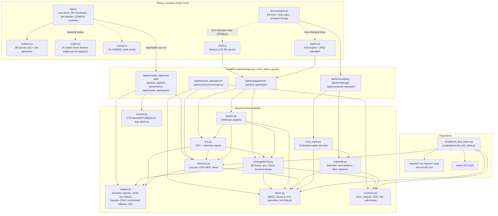
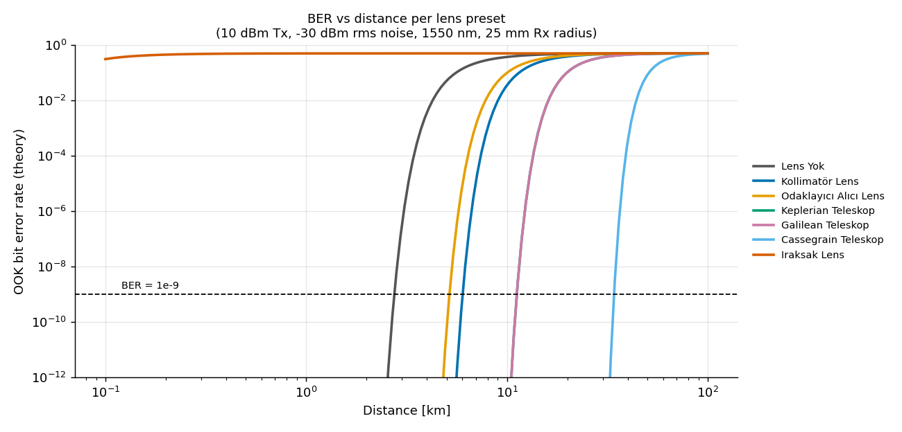
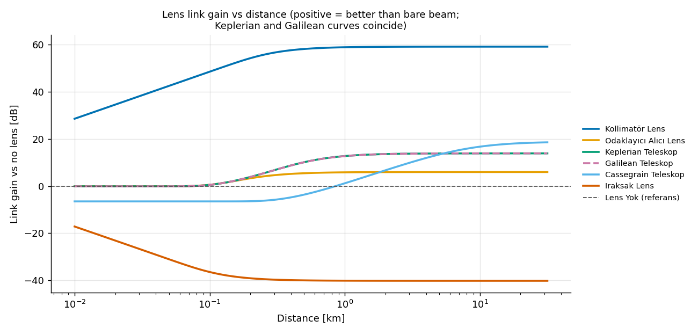
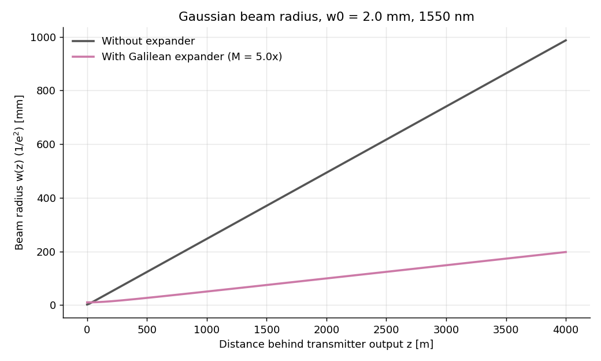
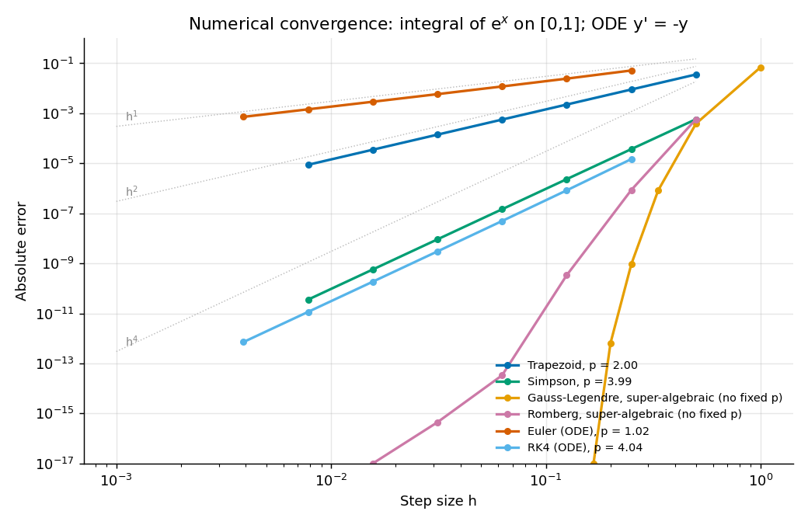
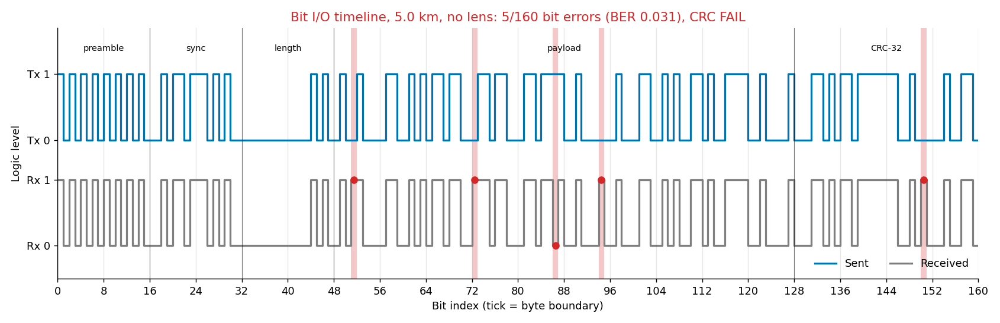
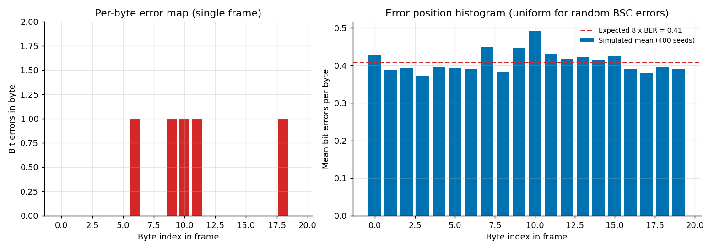
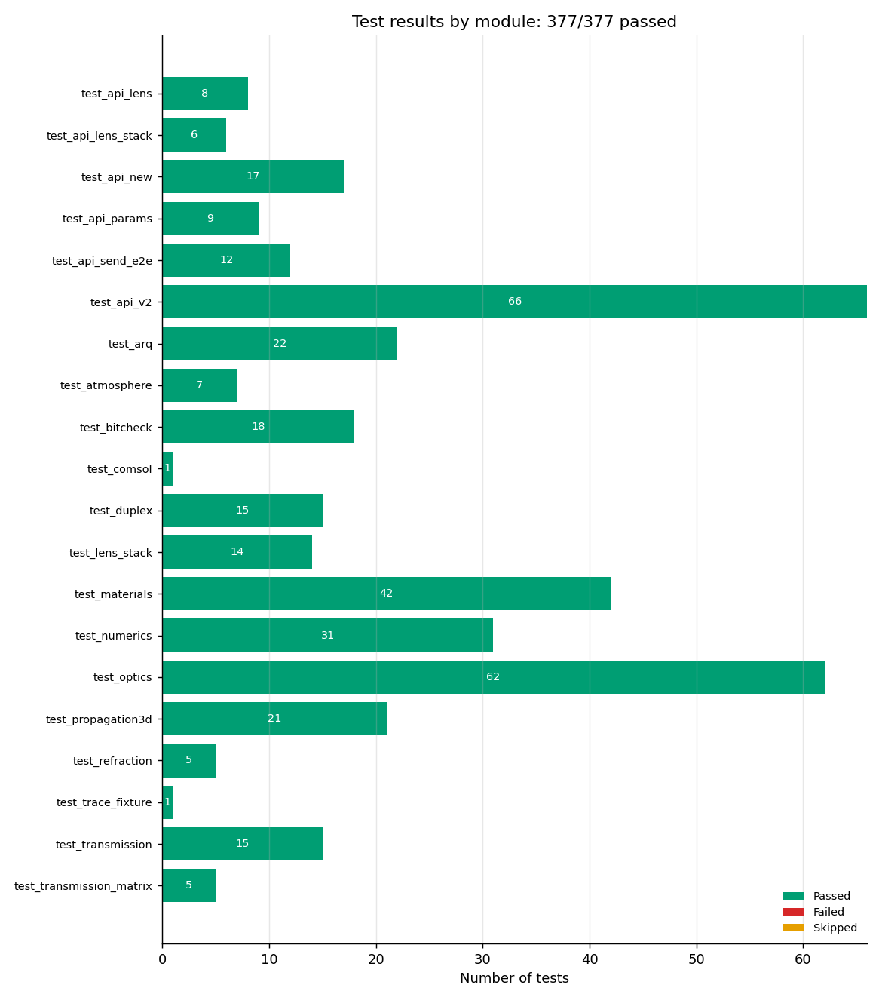

# FSO Fizik Simülatörü – Proje Tam Raporu (Mevcut Durum)

- Tarih: 2026-11-22 (`main` dalı, çalışma ağacı temiz iken alındı)
- Yöntem: Kodun tamamı okundu; `.venv/bin/python -m pytest -q`, `.venv/bin/python run.py --check` ve FastAPI `TestClient` ile süreç içi (port açmadan) örnek hesaplar çalıştırıldı. Rapordaki her sayı ya bu çalıştırmalardan ya da dosya okumalarından gelir; kaynak koduna dokunulmamıştır.
- Not: Bu rapor `reports/agent_audit_report.md` bulgularının **bugünkü kodda hâlâ geçerli olup olmadığını** da tek tek doğrular (Bölüm 9).

## İçindekiler

1. [Proje özeti](#1-proje-özeti)
2. [Mimari](#2-mimari)
3. [Modül modül açıklama](#3-modül-modül-açıklama)
4. [Fizik ve matematik modelleri](#4-fizik-ve-matematik-modelleri)
5. [API referansı](#5-api-referansı)
6. [Kullanıcı arayüzü](#6-kullanıcı-arayüzü)
7. [Test altyapısı](#7-test-altyapısı)
8. [Örnek sonuçlar](#8-örnek-sonuçlar)
9. [Kalite değerlendirmesi](#9-kalite-değerlendirmesi)
10. [Önerilen yol haritası](#10-önerilen-yol-haritası)
11. [Dizin yapısı](#11-dizin-yapısı)

---

## 1. Proje özeti

### 1.1 Amaç ve kapsam

Proje, **açık hava optik haberleşme (Free-Space Optics, FSO)** bağlantılarının fiziğini uçtan uca modelleyen bir simülatördür. Tek bir çalışma akışında şunlar bir araya gelir:

- Atmosfer modeli: 3B ızgara üzerinde sıcaklık/basınç/nem/rüzgâr, Edlén kırılma indisi, Cn² (Hufnagel-Valley), 6 sıcaklık profili, 7 ortam preseti.
- Işın fiziği: ızgara üzerinde vektörel Snell ile 3B ışın izleme (eski 2B panel), sürekli ortamda ışın denklemi (RK4) ile 3B Gauss ışını yayılımı (yeni 3B panel).
- Kayıplar: Beer–Lambert zayıflama (açık/pus/sis/yağmur/kar/fırtına), geometrik kayıp, pointing kaybı, Rytov/sintilasyon, uzun dönem ışın genişlemesi, ışın dalgalanması (beam wander).
- Optik tasarım: ABCD matrisleri, Gauss ışını q-parametresi, 14 malzemeli Sellmeier tabanlı lens kataloğu, tek lens tasarımı, 8 elemana kadar lens yığını, filtre ve AR kaplama modelleri, tam (vektörel) Snell ışın yelpazesi.
- Veri katmanı: bit düzeyinde çerçeveleme, CRC-16/CCITT-FALSE, OOK BER, seçici tekrar (selective repeat) ARQ, WDM tam dubleks (piggyback ACK).
- Sayısal analiz araç takımı: türev, integral, ODE, kök bulma, yakınsama mertebesi.
- COMSOL entegrasyonu: Java / MATLAB LiveLink / CSV / parametre dosyası dışa aktarma.
- Tarayıcı arayüzü: 2B canvas, three.js 3B görünüm, lens tasarımcısı, dubleks ve ARQ sekmeleri.

Proje deney/eğitim amaçlıdır; üretim sistemi tasarımı için değil. Bazı modeller (Bölüm 9) fiziksel olarak hâlâ yanlış/kaba kalmıştır.

### 1.2 Teknoloji yığını

| Katman | Teknoloji | Sürüm (bu makinede doğrulandı) |
|---|---|---|
| Dil | Python | 3.9.6 (`.venv`); CI matrisi 3.9 ve 3.13 |
| Web çatısı | FastAPI + Starlette + Uvicorn | fastapi 0.128.8, starlette 0.49.3, uvicorn 0.39.0 |
| Doğrulama | Pydantic v2 | 2.13.5 |
| Sayısal | NumPy | 2.0.2 (scipy kullanılmıyor) |
| Test | pytest, httpx | pytest 8.4.2, httpx 0.28.1 |
| Grafik (rapor) | matplotlib | 3.9.4 (yalnızca `--report` / scripts için) |
| Ön yüz | Saf JS/CSS/HTML, framework yok | – |
| 3B | three.js r128 (CDN: cdnjs) + OrbitControls (CDN: jsdelivr, three@0.128.0) | internet gerekir |
| JS sözdizimi kontrolü | Node | v24.21.0 yerelde; CI'da Node 22 |

Bağımlılık dosyaları: [backend/requirements.txt](../backend/requirements.txt) (fastapi>=0.100, uvicorn>=0.23, numpy>=1.24, pydantic>=2.0) ve [requirements-dev.txt](../requirements-dev.txt) (üstüne pytest>=8, httpx>=0.24, matplotlib>=3.7).

### 1.3 Kurulum ve çalıştırma

macOS'ta `python` komutu yoktur; `python3` veya `.venv/bin/python` kullanılır.

```bash
python3 -m venv .venv
.venv/bin/python -m pip install -r requirements-dev.txt
.venv/bin/python run.py            # sunucu + otomatik yeniden yükleme, http://127.0.0.1:8000
```

[run.py](../run.py) seçenekleri (kaynaktan okundu, `parse_known_args` ile kalan argümanlar pytest'e geçer):

| Bayrak | Etki |
|---|---|
| (yok) | Ortam kontrolü yapar, sunucuyu `127.0.0.1:8000` üzerinde başlatır (uvicorn `reload=True`) |
| `--host H` | Bağlanılacak adres (varsayılan `FSO_HOST` ortam değişkeni veya `127.0.0.1`) |
| `--port N` | Port (varsayılan `FSO_PORT` veya 8000) |
| `--no-reload` | Otomatik yeniden yüklemeyi kapatır |
| `--open` | Başlatıp tarayıcıda açar (1,5 sn gecikmeli) |
| `--check` | Yalnızca bağımlılık / ön yüz dosyası / 10 backend modülü içe aktarma kontrolü (sunucu başlamaz) |
| `--test` | `python -m pytest -q <ek argümanlar>` |
| `--report` | [scripts/run_test_report.py](../scripts/run_test_report.py): testler + grafikler + `reports/test_report.md` |
| `--exit` | `lsof -ti :PORT` ile bulunan süreçlere SIGTERM (varsayılan port 8000) |

`run.py --check` çıktısı (gerçek çalıştırma): `backend.engine`, `optics`, `numerics`, `materials`, `bitcheck`, `propagation3d`, `arq`, `duplex`, `comsol`, `app` modüllerinin **hepsi `[ok]`**; eksik paket/dosya uyarısı yok. (Not: kontrol listesi `lens_stack` ve `lens_stack_api` modüllerini ayrıca içe aktarmaz; `backend.app` bunları zaten içe aktardığı için dolaylı olarak doğrulanır.)

CORS varsayılan olarak **kapalıdır**; farklı origin'den kullanım için `FSO_CORS_ORIGINS="https://..."` ayarlanır ([backend/app.py](../backend/app.py) satır 35-43).

### 1.4 URL'ler

| URL | İçerik |
|---|---|
| `http://127.0.0.1:8000/` | Ana arayüz ([index.html](../index.html)) |
| `/api/health` | Sağlık kontrolü (`{"status":"ok","backend":"python"}`) |
| `/api/lens/catalog` | Malzeme / şekil / filtre / kaplama kataloğu |
| `/docs`, `/redoc`, `/openapi.json` | FastAPI'nin otomatik etkileşimli dokümantasyonu |
| `/style.css`, `/ui-v2.css`, `/engine.js`, ... | Beyaz listeli 9 statik dosya (path traversal yok) |

Uygulamada toplam 36 rota kayıtlıdır: 4 otomatik doküman rotası + 10 statik + 22 API ([Bölüm 5](#5-api-referansı)).

---

## 2. Mimari

### 2.1 Modül ve veri akışı diyagramı



Okuma notları:

- `engine.py` hem "eski dünya" (ızgara DDA ışın izleyici, sabit tablolu `LensSystem`) hem de paylaşılan yardımcıları (`crc16_ccitt`, `AtmosphericLoss.absorptionLoss`) barındırır. Yeni modüller (`bitcheck`, `arq`, `duplex`, `propagation3d`) `engine`'den yalnızca CRC ve hava durumu zayıflama katsayısını alır.
- İki ayrı lens modeli yan yana yaşar: `engine.LensSystem` (sabit tablo) ana panelde, `/api/simulate`, `/api/send-data`, `/api/test-transmission` içinde; `optics.py` + `materials.py` + `lens_stack.py` (fiziksel) lens tasarımcısında, 3B yayılımda, ARQ'da, dubleksde, `bitcheck`'te. Bölüm 9'da bunun sayısal sonucu gösterilmiştir.
- Zayıflama katsayısı her iki dünyada da `AtmosphericLoss.absorptionLoss`'tan gelir; dolayısıyla oradaki birim hatası (Bölüm 9, F1) tüm hatlara bulaşır.

### 2.2 JS yedek motor (`engine.js`) ile `engine.py` ilişkisi

- [engine.js](../engine.js) (1257 satır), [backend/engine.py](../backend/engine.py) (1167 satır) dosyasının JavaScript karşılığıdır: aynı sınıflar (`Vec3`, `AtmosphereGrid`, `AtmosphericLoss`, `RayTracer`, `DataTransmissionSimulator`, `LensSystem`, `EnvironmentPresets`, `ComprehensiveTransmissionTest`), aynı formüller, aynı sabit tablolar. `window.FSOEngine` olarak dışa verilir.
- Açılışta [app.js](../app.js) `GET /api/health` isteğini 1 sn zaman aşımıyla dener (satır 113-141). Yanıt `{"status":"ok","backend":"python"}` ise `usePythonBackend = true` olur, üst çubuktaki rozet yeşil "Backend: Python (FastAPI)" yazar; aksi hâlde kırmızı "Backend: JS Fallback" olur.
- Python backend varken ana panelin 6 işlemi (simülasyon, test, toplu iletim testi, veri gönder, 5 COMSOL dışa aktarma) sunucuya gider; hata olursa simülasyon için JS yedeğe düşülür (app.js satır 641).
- JS yedek modda yalnızca ana 2B panel çalışır. **Lens tasarımcısı, 3B yayılım, Full-Duplex, ARQ ve uçtan uca CRC/ARQ paneli yalnızca Python backend ile çalışır** (JS'te `crc16_ccitt` bile yoktur; [reports/ui_v2_notes.md](ui_v2_notes.md)).
- Eşleşme elle sürdürülür; otomatik parite testi yoktur. Bilinen sapma: atmosfer ızgarasındaki `hashVal` (Python: int32 sarmalama; JS: `Math.imul` olmadan double çarpımı) ([engine.py:212](../backend/engine.py), [engine.js:218](../engine.js)); ayrıntı Bölüm 9.

---

## 3. Modül modül açıklama

Satır sayıları `wc -l` çıktısıdır.

### 3.1 Backend (toplam 7297 satır)

| Dosya | Satır | Sorumluluk | Başlıca sınıf/fonksiyonlar | Bağımlılık (backend içi) |
|---|---:|---|---|---|
| [backend/app.py](../backend/app.py) | 1381 | FastAPI uygulaması, Pydantic istek modelleri, serileştirme, 22 API + 10 statik rota; lens tasarımı ışın yelpazesi yardımcıları | `SimParams`, `SendDataParams`, `Propagation3DParams`, `ArqParams`, `DuplexParams`, `LensDesignParams`, `run_simulation_backend`, `build_atmosphere`, `_send_data_end_to_end`, `design_lens_full`, `_surface_hit/_refract/_trace_ray` | hepsi |
| [backend/engine.py](../backend/engine.py) | 1167 | "Çekirdek" motor: CRC, Vec3, atmosfer ızgarası, vektörel Snell, kayıp hesapları, ızgara DDA ışın izleyici, paket simülatörü, eski lens tablosu, ortam presetleri | `crc16_ccitt`, `validate_crc`, `Vec3`, `AtmosphereGrid`, `vectorialSnellLaw`, `AtmosphericLoss`, `RayTracer`, `DataTransmissionSimulator`, `LensSystem`, `EnvironmentPresets`, `ComprehensiveTransmissionTest` | yok (numpy) |
| [backend/optics.py](../backend/optics.py) | 828 | Paraksiyel optik: ABCD matrisleri, Gauss ışını (q-parametresi), Fresnel, lens presetleri, link bütçesi, küresel sapma, Airy | `thin_lens`, `thick_lens`, `OpticalSystem`, `beam_radius`, `beam_through_system`, `LensPreset`, `FSO_LENS_PRESETS` (7), `lens_link_budget`, `received_power_fraction`, `airy_radius` | yok (numpy) |
| [backend/numerics.py](../backend/numerics.py) | 514 | Sayısal analiz: türev, integral, ODE, kök bulma, yakınsama, fizik yardımcıları | `central_diff`, `richardson_derivative`, `gradient`, `laplacian`, `trapezoid`, `simpson`, `romberg`, `gauss_legendre`, `adaptive_simpson`, `euler`, `rk4`, `rk45`, `ray_equation_rhs`, `bisection`, `newton`, `secant`, `brent`, `convergence_order`, `convergence_study` | yok (numpy) |
| [backend/materials.py](../backend/materials.py) | 851 | 14 malzemelik Sellmeier/polinom/tablo kataloğu, 13 lens şekli, 4 teleskop türü, 8 filtre, 7 kaplama; tek lens tasarımı | `refractive_index`, `dn_dlambda`, `group_index`, `abbe_number`, `dn_dT`, `coating_reflectance`, `filter_transmittance`, `design_lens`, `catalog` | `optics`, `numerics` |
| [backend/lens_stack.py](../backend/lens_stack.py) | 525 | N (≤8) lensin seri yığını: yerleşim, çakışma denetimi, ABCD, giriş gözbebeği, vinyetleme, Gauss ışını, tam Snell ışın yelpazesi, 4 preset | `design_stack`, `preset_elements`, `preset_list`, `_trace_exact`, `StackError` | `materials`, `optics` |
| [backend/lens_stack_api.py](../backend/lens_stack_api.py) | 82 | `APIRouter`: `POST /api/lens/stack`, `GET /api/lens/stack/presets` | `LensStackParams`, `StackElementParams` | `lens_stack` |
| [backend/bitcheck.py](../backend/bitcheck.py) | 311 | Bit düzeyinde G/Ç: çerçeve (preamble+sync+uzunluk+yük+CRC), BER karşılaştırma, OOK BER, tohumlu BSC kanal, link gücü, uçtan uca rapor | `build_frame`, `parse_frame`, `compare_bits`, `ook_ber`, `link_power_dBm`, `run_link_check`, `summary_rows` | `engine` (CRC), `optics` |
| [backend/propagation3d.py](../backend/propagation3d.py) | 389 | 3B Gauss ışını yayılımı: trilineer alanlar, ışın denklemi RK4, Rytov profili, uzun dönem yarıçap, wander, sintilasyon, bozulma bulutu, hotspot, anomaliler | `propagate_beam_3d`, `_Fields`, `scintillation_index_from_rytov`, `pointing_coupling`, `score_components`, `weather_alpha_dB_km` | `numerics`, `optics`, `engine` |
| [backend/arq.py](../backend/arq.py) | 518 | CRC tabanlı selective-repeat ARQ: segment çerçeveleme, log-normal sönümlenmeli kanal, AR(1) fading, uzamsal tekrar atfı, uçtan uca gönderim | `ArqChannel`, `FadingProcess`, `run_arq`, `run_end_to_end`, `channel_from_link`, `channel_from_propagation`, `spatial_retries`, `assemble_result` | `bitcheck`, `engine`, `propagation3d` |
| [backend/duplex.py](../backend/duplex.py) | 302 | WDM tam dubleks: iki terminal, her yönde ayrı dalga boyu, piggyback ACK/NACK, çapraz karışma, slot zaman çizgisi | `Terminal`, `link_budget`, `rescale_propagation`, `run_duplex` | `bitcheck`, `optics`, `arq`, `engine`, `propagation3d` |
| [backend/comsol.py](../backend/comsol.py) | 429 | COMSOL dışa aktarma (CSV ızgara, CSV ışın yolu, Java modeli, MATLAB LiveLink, parametre dosyası) | `COMSOLBridge` | yok |

Diğer: `backend/tests/` yalnızca iki izlenen `.pyc` dosyası içeren yetim dizindir (Bölüm 9).

### 3.2 Ön yüz (JS 5510 satır + CSS 964 + HTML 614)

| Dosya | Satır | Sorumluluk | Önemli yapılar |
|---|---:|---|---|
| [index.html](../index.html) | 614 | Sayfa iskeleti: üst çubuk, kenar çubuğu kontrolleri, sonuç kartları, 2 canvas, v2 sekme paneli, bit/CRC paneli, toplu test tablosu, link bütçesi tablosu, konsol; script sırası: engine, comsol, renderer, app, three.js (CDN), OrbitControls (CDN), lens-designer, viz3d, duplex | – |
| [app.js](../app.js) | 1324 | Ana denetleyici: parametre toplama (`getParams`), backend tespiti, `runSimulation`, `sendData`, `runFormulaTests`, toplu test, COMSOL dışa aktarma, animasyon, uçtan uca CRC/ARQ görselleştirmesi (`renderEndToEnd`), yerel 15 formül testi (`runLocalFormulaTests`) | `window.FSOApp = {log, BACKEND_URL, getParams}` |
| [engine.js](../engine.js) | 1257 | Python `engine.py`'nin JS yedeği (Bölüm 2.2) | `window.FSOEngine` |
| [renderer.js](../renderer.js) | 405 | İki canvas: üst (X-Y) ve yan (X-Z) kesit; atmosfer ısı/indis haritası, ışın yolu, kırılma noktaları, alıcı | `class FSORenderer` |
| [comsol.js](../comsol.js) | 482 | `comsol.py`'nin JS karşılığı (backend yokken COMSOL dosyaları) | `class COMSOLBridge` |
| [lens-designer.js](../lens-designer.js) | 868 | Lens Tasarımcısı: A/B terminali, tek lens ve lens yığını modları, katalog yükleme, lens kesit çizimi (`LensSection.draw`), ortak `window.FSOApi` fetch sarmalayıcısı, `lens-changed` olayı | `window.FSOLensDesigner`, `window.FSOApi`, `window.LensSection` |
| [viz3d.js](../viz3d.js) | 764 | three.js 3B sahne: ızgara, atmosfer kutusu, terminaller, ışın tüpü (halkalardan), bozulma bulutu (voksel), hotspot, anomali kutuları, lens kesitleri, ARQ bölge bantları | `window.Viz3D` |
| [duplex.js](../duplex.js) | 410 | Full-Duplex ve ARQ Demo sekmeleri: formlar, kartlar, animasyonlu slot çizgisi, segment tablosu, SVG grafikler | `/api/duplex`, `/api/arq` |
| [style.css](../style.css) | 886 | Ana tema (koyu, kart/slider/tablo/konsol) | – |
| [ui-v2.css](../ui-v2.css) | 78 | v2 panel stilleri (v2-card, v2-field, sekme, 3B legend) | – |

JS modülleri arası iletişim: `window.FSOBus` (EventTarget; `lens-changed`), `window.FSOState` (terminal durumu), `window.FSOApp`, `window.FSOApi`.

### 3.3 Betikler ve başlatıcı

| Dosya | Satır | İş |
|---|---:|---|
| [run.py](../run.py) | 165 | Başlatıcı (Bölüm 1.3) |
| [scripts/run_test_report.py](../scripts/run_test_report.py) | 114 | pytest'i JUnit XML ile çalıştırır, grafik üretir, `reports/test_report.md` yazar (bit kontrol tablosu + 7 şekil) |
| [scripts/generate_test_plots.py](../scripts/generate_test_plots.py) | 316 | 7 matplotlib grafiği üretir (`reports/figures/`) |

---

## 4. Fizik ve matematik modelleri

Her başlıkta formül, uygulandığı dosya:satır ve (varsa) bilinen sınırlama verilmiştir. "(!)" işareti Bölüm 9'daki doğrulanmış sorunlara işaret eder.

### 4.1 Atmosfer ızgarası ve kırılma indisi

- Izgara: `gridX × gridY × gridZ` hücre, hücre boyutu `cellSize`; düz diziler (`index = ix + gridX·(iy + gridY·iz)`) ([engine.py:107-135](../backend/engine.py)). Kaynak/hedef varsayılan olarak ızgaranın orta yüksekliğinde (y = z = gridY·cellSize/2).
- Standart atmosfer basıncı: $P(h) = P_0\,(1 - L h / T_0)^{gM/(R L)}$, $L = 6.5\ \mathrm{K/km}$ ([engine.py:150](../backend/engine.py)). Sıcaklık: $T(h) = T_\text{base} - L h$ (`temperatureAtAltitude`, satır 159).
- Edlén kuru hava indisi: $n_s - 1 = A + \dfrac{B}{C - \sigma^2} + \dfrac{D}{E - \sigma^2}$, $\sigma = 1/\lambda_{\mu m}$; basınç/sıcaklık ölçeği $n_{tp} - 1 = (n_s - 1)\,\dfrac{P}{P_0}\dfrac{T_0}{T}$; nem terimi $-4.15\times10^{-8}\, e$ ([engine.py:162-181](../backend/engine.py)). 1550 nm, 15 °C, 101325 Pa, %0 nem için $n = 1.00027327$. (!) Nem katsayısı Pa için ~100 kat büyüktür (F2).
- Su buharı kısmi basıncı: $e = (RH/100)\,611.21\,\exp\!\big[(18.678 - t/234.5)\,t/(257.14 + t)\big]$ (satır 175).
- Cn² profili – Hufnagel-Valley: $C_n^2(h) = 0.00594\,(v/27)^2 (10^{-5}h)^{10} e^{-h/1000} + 2.7\times10^{-16} e^{-h/1500} + C_0 e^{-h/100}$ ([engine.py:186](../backend/engine.py)); $C_0$ = zayıf/orta/güçlü için $10^{-17}/10^{-15}/10^{-13}$.
- Termal profiller (`applyThermalProfile`, [engine.py:192-318](../backend/engine.py)): `uniform` (adı yanıltıcıdır, lapse rate uygular), `gradient`, `turbulent` (3 ölçekli değer gürültüsü), `hotspot`, `layered`, `coastal`; gürültü: hash tabanlı trilineer değer gürültüsü (`noise3D`) + LCG (`1664525·x + 1013904223`) ile nem gürültüsü (±%5).
- Ortam presetleri: urban, maritime, desert, mountain, industrial, arctic, storm ([engine.py:958](../backend/engine.py)).
- 3B modülde alanlar hücre merkezleri arasında **trilineer enterpole** edilir ([propagation3d.py:112-165](../backend/propagation3d.py)); anomali kutuları için $dn/dT = -(n-1)/T$ (ideal gaz yoğunluğu).

### 4.2 Zayıflama

- Beer–Lambert: $T = e^{-\alpha d}$, $L_\text{dB} = \alpha_{dB/km}\,d_{km}$; $\alpha_{Np/m} = \alpha_{dB/km}\ln 10/(10\cdot 1000)$ ([engine.py:396-446](../backend/engine.py)).
- Sabit katsayılar: açık 0.2, yağmur 6.0, kar 20.0 dB/km. Pus ve sis için Kim/Kruse biçimi $\alpha = (3.91/V)(550/\lambda_{nm})^{q}$ (V pus=4 km, sis=0.5 km; $q = 0.585\,V^{1/3}$, V>6 → 1.3, V≤1 → 0) satır 412-424. Fırtına: sis(V=0.1) + 12 + 20 dB/km (satır 426-431). (!) Birim hatası F1.
- Hava durumu ayrıca 3B modülde `weather_alpha_dB_km` ile aynı fonksiyondan okunur ([propagation3d.py:91](../backend/propagation3d.py)) ve duplex'te ([duplex.py:97](../backend/duplex.py)); hata her yere yayılır.
- Anomali (sis yaması) ek zayıflaması dB/km olarak hücrelere eklenir; birikimli zayıflama yamuk kuralıyla $A(s) = \int \alpha\,ds$ ([propagation3d.py:278](../backend/propagation3d.py)).

### 4.3 Türbülans

- Rytov varyansı (düzlem dalga, homojen): $\sigma_R^2 = 1.23\,C_n^2\,k^{7/6}L^{11/6}$ ([engine.py:470-486](../backend/engine.py); arq/duplex'te aynı biçim).
- Düzgün olmayan profil (3B): $\sigma_R^2(s) = 2.25\,k^{7/6}\int_0^s C_n^2(s')\,(s-s')^{5/6}\,ds'$; homojen halde $1.23\,C_n^2 k^{7/6}s^{11/6}$'ya indirgenir ([propagation3d.py:280-284](../backend/propagation3d.py)).
- Sintilasyon indeksi (Andrews & Phillips, zayıftan doyuma): $\sigma_I^2 = \exp\!\Big[\dfrac{0.49\,\sigma_R^2}{(1+1.11\,\sigma_R^{12/5})^{7/6}} + \dfrac{0.51\,\sigma_R^2}{(1+0.69\,\sigma_R^{12/5})^{5/6}}\Big] - 1$ ([propagation3d.py:79-88](../backend/propagation3d.py)). ARQ ve duplex kanalları bunu kullanır.
- Eski link bütçesinde sintilasyon cezası `5·log10(1+σ_R²)` dB (σ_R² < 5), aksi hâlde sabit 10 dB ([engine.py:512](../backend/engine.py)); σ_R² = 5'te süreksizdir (!).
- Uzun dönem ışın yarıçapı: $w_{LT} = w\sqrt{1 + 1.33\,\sigma_R^2\,\Lambda^{5/6}}$, $\Lambda = 2s/(k w^2)$ ([propagation3d.py:287-288](../backend/propagation3d.py)).
- Işın dalgalanması (beam wander): $\langle r_c^2\rangle = 2.42\,C_{n,avg}^2\,s^3\,w_0^{-1/3}$ (satır 289).
- Sönümlenme: ARQ/duplex'te $I\sim$ log-normal, $E[I]=1$, $\sigma_{\ln I}^2 = \ln(1+\sigma_I^2)$; $P = P_{ort} + 10\log_{10} I$ ve seri korelasyon için AR(1): $z_t = \rho z_{t-1} + \sqrt{1-\rho^2}\,\xi$ ([arq.py:105-165](../backend/arq.py)). Fading ortalamalı BER Gauss-Hermite 40 noktalı kareleme ile hesaplanır (`faded_mean_ber`, satır 127).

### 4.4 Geometrik kayıp ve pointing

- Eski (engine): top-hat varsayımı $f = \min\!\big(1, (D_{rx}/D_{beam})^2\big)$, $D_{beam} = d_0 + 2\theta L$ ([engine.py:448-468](../backend/engine.py)); pointing: $\exp[-2(\Delta/w)^2]$, $\Delta = L\tan\theta_p$. (!) Gauss modeliyle tutarsız (F6).
- Yeni (optics): Gauss ışını, dairesel açıklıkta $1 - e^{-2a^2/w^2}$ ([optics.py:692](../backend/optics.py), `received_power_fraction`). Kayma varsa Farid & Hranilovic (2007) birleşik formülü: $A_0 = 1 - e^{-2a^2/w^2}$, $w_{eq}^2 = w^2\sqrt{\pi}\,\mathrm{erf}(v)/(2v\,e^{-v^2})$, $v = \sqrt\pi a/(\sqrt2 w)$, bağlaşım $= A_0\,e^{-2d^2/w_{eq}^2}$ ([propagation3d.py:96-109](../backend/propagation3d.py)).

### 4.5 Işın izleme ve vektörel Snell

- Vektörel Snell: $\mathbf t = r\,\mathbf i + (r\cos\theta_i - \cos\theta_t)\,\mathbf n$, $r = n_1/n_2$; $\sin^2\theta_t = r^2\sin^2\theta_i > 1$ ise tam iç yansıma (None) ([engine.py:349-376](../backend/engine.py)); doğrulama `verifySnellLaw` ($n_1\sin\theta_i - n_2\sin\theta_t$) satır 379.
- Izgara ışın izleyici (`RayTracer.trace`, [engine.py:537-668](../backend/engine.py)): Amanatides-Woo benzeri hücre sınırı DDA; hücre içinde indis sabit; her sınırda Snell, TIR'de yansıma (`d − 2(d·n)n`). `findNextBoundary` (satır 671). (!) Eksen hizalı ışın normal geliştiği için hiç sapmaz (F3).
- Sürekli ortamda ışın denklemi (3B modül): $\dfrac{d}{ds}\Big(n\dfrac{d\mathbf r}{ds}\Big) = \nabla n$; durum $y = [\mathbf r, \mathbf T]$, $\mathbf T = n\,\dot{\mathbf r}$; $\dot{\mathbf r} = \mathbf T/n$, $\dot{\mathbf T} = \nabla n$; $\nabla n$ yarım hücre adımlı merkezi farklarla ([numerics.py:344-358](../backend/numerics.py), [propagation3d.py:253-262](../backend/propagation3d.py)), RK4 ile entegre. Bu, ızgara DDA'dan farklı olarak gerçekten bükülme üretir (Bölüm 8.4: 6 km'de 1,72 m sapma).
- Bozulma bulutu skoru: $score = beam\_share\cdot(0.35 f_{att} + 0.40 f_{Cn^2} + 0.25 f_{\nabla n})$; $f_{att} = 1 - e^{-\alpha/10}$, $f_{Cn^2}$ = $\log_{10}C_n^2$'nin $[-17,-13]$ aralığında doğrusal haritası, $f_{\nabla n} = 1 - e^{-|\nabla n|/5\times10^{-8}}$ ([propagation3d.py:179-185, 337](../backend/propagation3d.py)).

### 4.6 Gauss ışını ve ABCD

- Matrisler $(y, \theta)$ üzerinde: boşluk $\begin{pmatrix}1&d\\0&1\end{pmatrix}$, ince lens $\begin{pmatrix}1&0\\-1/f&1\end{pmatrix}$, yüzey kırılması $\begin{pmatrix}1&0\\ (n_1-n_2)/(R n_2)& n_1/n_2\end{pmatrix}$, kalın lens = kırılma(R1)·kalınlık·kırılma(R2) ([optics.py:85-130](../backend/optics.py)); ayna $f = R/2$.
- Gauss: $z_R = \pi w_0^2/(M^2\lambda)$, $w(z) = w_0\sqrt{1 + (z/z_R)^2}$, $\theta = M^2\lambda/(\pi w_0)$, $q = z + i z_R$, $q' = (Aq + B)/(Cq + D)$, $w = \sqrt{-M^2\lambda/(\pi\,\mathrm{Im}(1/q))}$ ([optics.py:318-440](../backend/optics.py)). `beam_through_system` her eleman açıklığında kırpma ve merkez engel hesaplar: $\text{geçen} = (1 - e^{-2a^2/w^2}) - (1 - e^{-2b^2/w^2})$.
- Preset sistemleri: Keplerian ($M = f_2/f_1$), Galilean, kolimatör, odaklayıcı alıcı, ıraksak lens, Cassegrain ([optics.py:492-660](../backend/optics.py)).
- Birinci dereceden küresel sapma (Coddington): $LSA = -\dfrac{h^2}{8n(n-1)f}\Big[\dfrac{n+2}{n-1}q^2 - 4(n+1)q + (3n+2)(n-1) + \dfrac{n^3}{n-1}\Big]$, $q = (R_2+R_1)/(R_2-R_1)$ ([optics.py:782](../backend/optics.py)). Airy yarıçapı $1.22\lambda f/D$ (satır 823).

### 4.7 Lens tasarımı (Sellmeier, lensmaker, kalın lens, yığın)

- Dağılım formülleri ([materials.py:283-302](../backend/materials.py)): `sellmeier` $n^2 = 1 + K + \sum B_i\lambda^2/(\lambda^2 - C_i)$, `sellmeier_sq` ($C_i^2$), `polynomial_n2`, `cauchy_n2`, `tabulated` (doğrusal enterpolasyon). Geçerlilik aralığı dışında `ValueError`. 1550 nm'de N-BK7 $n = 1.500652$, erimiş silika $1.444024$; Abbe(N-BK7) $= 64.17$.
- Katalog: 14 malzeme (N-BK7, erimiş silika, CaF₂, BaF₂, MgF₂, safir, N-SF11, N-SF6, S-LAH64, ZnSe, Ge, Si, PMMA, polikarbonat), 13 şekil (11 tasarlanabilir; akromatik doublet ve GRIN yalnızca açıklayıcı), 4 teleskop (Kepler, Galile, Cassegrain, Ritchey–Chrétien), 8 filtre, 7 kaplama; opak malzeme+dalga boyu 422 verir (Ge < 1.8 µm, Si < 1.1 µm).
- İnce lens: $1/f = (n-1)(1/R_1 - 1/R_2)$; kalın lens: $1/f = (n-1)\big[1/R_1 - 1/R_2 + (n-1)d/(nR_1R_2)\big]$ ([optics.py:134-157](../backend/optics.py)). Şekil faktörü $q = (R_2+R_1)/(R_2-R_1)$; verilen $f, n, q$ için $R_1 = 2f(n-1)/(q+1)$, $R_2 = 2f(n-1)/(q-1)$.
- `design_lens` ([materials.py:683](../backend/materials.py)): kalın lens denklemini eğrilik ölçeği üzerinden çözer (`_solve_curvature_scale`), böylece kalın-lens EFL hedef $f$'e eşit olur (`efl_check_m`); konik yüzey sagitası $z = cy^2/(1+\sqrt{1-(1+k)c^2y^2})$; asferik için $k = -n^2$ (paralel ışıkta küresel sapmasız), top lens için $f = nR/(2(n-1))$; Fresnel eşdeğer düz-dışbükey olarak modellenir.
- Konik yüzey kesişimi Newton ile, kırılma 2B vektörel Snell ile (`_surface_hit`, `_refract` — app.py'de ve lens_stack.py'de **kopya**).
- Lens yığını ([lens_stack.py:290](../backend/lens_stack.py)): her eleman tasarlanır; boşluk ve sagita dahil çakışma denetimi; sistem matrisi $M = M_n\cdots M_1$; $EFL = -1/C$, $BFL = -A/C$, $FFL = -D/C$, asal düzlemler $(D-1)/C$ ve $(1-A)/C$; $|C| < 10^{-9}$ ise afokal (büyütme $A$). İki ince lens için bu, Gullstrand denklemi $\Phi = \Phi_1 + \Phi_2 - d\,\Phi_1\Phi_2/n$ ile aynı sonucu verir ve testle doğrulanır (`test_separated_lenses_follow_gullstrand`). Giriş gözbebeği: paraksiyel marjinal ışının eleman açıklıklarına oranlarının minimumu; f/# $= |EFL|/(2\,r_{EP})$; vinyetleme taraması alan açısına göre.

### 4.8 Filtre, kaplama, Fresnel

- Fresnel (normal geliş): $R = \big((n_1-n_2)/(n_1+n_2)\big)^2$; yüzey iletimi $1-R$; lens iletimi $(1-R)^{yüzey}$ (soğurma ihmal) ([optics.py:443-471](../backend/optics.py)).
- Kaplama: V-kaplama = tasarım dalga boyunda $R_{band}$, parabolik artış, çıplak Fresnel'e doyar; geniş bant = bant içinde $R_{band}$, dışında bant merkez dalga boyunun %10'u boyunca doğrusal artış ([materials.py:418](../backend/materials.py)). Model, tedarikçi başlık değerlerine kalibre edilmiş basit eğrilerdir; ölçülmüş spektrum değildir.
- Filtre: bant geçiren $T = T_{pk}\exp[-\ln 2\,(2|\Delta\lambda|/FWHM)^{2\,order}]$ (süper-Gauss), taban $10^{-OD}$; uzun/kısa geçiren: lojistik kenar (genişlik kenar dalga boyunun %0,3'ü); nötr yoğunluk $T = 10^{-OD}$ ([materials.py:496](../backend/materials.py)).

### 4.9 OOK BER ve SNR

- $BER = \tfrac12\,\mathrm{erfc}\!\big(\sqrt{SNR}/(2\sqrt2)\big) = Q(\sqrt{SNR}/2)$; elektriksel $SNR = (P_{rx}/P_{noise})^2$ ([bitcheck.py:191-210](../backend/bitcheck.py)). Doğrulama: SNR=0 → 0,5; SNR=16 → 0,02275; SNR=144 → $9.87\times10^{-10}$.
- `/api/send-data` gürültü tabanını duyarlılıkta $BER = 10^{-9}$ olacak biçimde seçer: $noise = P_{sens} - 10\log_{10}12$ (P/gürültü = 12 → SNR 144) ([app.py:331](../backend/app.py)).
- Dubleks çapraz karışması: $SNR = P_{rx}^2/(\sigma_n^2 + P_{xt}^2)$, $P_{xt} = P_{tx}(dst) - NEC - izolasyon$ ([duplex.py:103](../backend/duplex.py)).

### 4.10 CRC-16/CCITT-FALSE ve çerçeveleme

- CRC: polinom 0x1021, başlangıç 0xFFFF, yansıtma yok, XOR-out yok ([engine.py:7-30](../backend/engine.py)); `binascii.crc_hqx(x, 0xFFFF)` ile uyumlu. Doğrulama: `"123456789"` → `0x29B1` (standart kontrol değeri).
- Bit çerçevesi ([bitcheck.py:63](../backend/bitcheck.py)): `AA AA` (preamble) | `2D D4` (sync) | 16 bit uzunluk | yük | CRC-16. Başlık = 6 bayt. MSB-first. Alınan bit `None` = silinme; kopan kanalda tüm bitler hata sayılır (sessiz sıfır yok). `compare_bits`: BER, 0→1 / 1→0 dönüşleri, en uzun patlama, bayt başına hata haritası.
- ARQ segmenti: `seq(16) | len(8) | veri | CRC16` (5 bayt ek yük); geri bildirim `seq(16) | status(8) | CRC16` = 40 bit ([arq.py:46-53](../backend/arq.py)).
- Dubleks çerçevesi: `type(8) | seq(16) | fb(8) | len(8) | veri | CRC16` = K + 7 bayt ([duplex.py:43-46](../backend/duplex.py)).

### 4.11 Seçici tekrar (selective repeat) ARQ

Tur tabanlı ("topla ve yeniden gönder"): her turda bekleyen tüm segmentler gönderilir, alıcı her CRC'yi denetler (iyi → ACK, kötü → NACK); geri bildirim çerçevesi kendi BER'iyle bozulabilir. NACK **veya** bozuk geri bildirim (zaman aşımı) segmenti yeniden kuyruğa atar; alıcıda zaten olan segmentin ACK'i kaybolursa "spurious" (gereksiz) tekrar sayılır. Bir segment en fazla $1 + max\_retries$ kez denenir (≤200). Koruma: toplam ileri bit bütçesi 6 000 000 ([arq.py:51](../backend/arq.py)). Uzamsal atıf: bir CRC hatası bitin nerede bozulduğunu söylemez; başarısız denemeler, bağlantının eşit bölünmüş dilimlerine ortalama bozulma skoruyla orantılı dağıtılır (bilinçli bir sezgisel yöntem, modül dokümanında belirtilmiş). `run_end_to_end` ([arq.py:458](../backend/arq.py)) tüm mesajı önce ilk geçişte gönderir, sonra mesaj CRC'sini ve segment CRC'lerini denetleyip yalnızca hatalı segmentleri yeniden ister ve yerine koyar.

### 4.12 WDM tam dubleks

İki terminal farklı dalga boylarında (varsayılan A→B 1550 nm, B→A 1310 nm) aynı anda konuşur; ayrık zaman dilimlerinde her terminal bir çerçeve yollar. ACK/NACK karşı yöndeki çerçeveye bindirilir (piggyback), yani kötü bir ters çerçeve hem veriyi hem o dilimin ACK'ini kaybettirir. Fading yönler arasında `reciprocity_rho` korelasyonlu, aynı ortam iki yönde de geçildiği için. Dilim süresi $= (K + 7)\cdot 8/\text{bit hızı}$. `rescale_propagation`: 3B sonucun toplam zayıflaması $d/L$ ile doğrusal, $\sigma_R^2$'si $(d/L)^{11/6}$ ile ölçeklenir ([duplex.py:120-135](../backend/duplex.py)).

### 4.13 Sayısal yöntemler

| Konu | Yöntemler ([numerics.py](../backend/numerics.py)) | Doğrulanmış mertebe (gerçek çalıştırma) |
|---|---|---|
| Türev | ileri/geri/merkezi fark, ikinci türev, Richardson, gradyan, Laplasyen, `optimal_step` | merkezi fark O(h²) |
| Integral | yamuk, Simpson, Romberg, Gauss-Legendre (n≤64), uyarlamalı Simpson, 2B / disk / yol integrali | sin(x) [0,π]: yamuk **2.01**, Simpson **4.11**; hata Gauss-Legendre n=2..6: 6.4e-2 → 5.2e-10 (üstel yakınsama) |
| ODE | Euler, RK4, RK45 (Dormand–Prince, uyarlamalı) | y' = −y, [0,1]: Euler **1.04**, RK4 **4.07** |
| Işın denklemi | `ray_equation_rhs` (|T| = n korunumu) | – |
| Kök bulma | bisection, Newton, secant, Brent | – |
| Yakınsama | `convergence_order` (log h – log hata doğru uydurması), `convergence_study` | – |

`/api/numerics/convergence` bu yöntemlerin beşini (yamuk, Simpson, Gauss-Legendre, Euler, RK4) üç sınama integrali (sin, exp, gaussian) üzerinde çalıştırır.

---

## 5. API referansı

Tüm API gövdeleri JSON'dur. Doğrulama hataları 422, beklenmeyen hatalar 500 (`{"detail":"Internal server error"}`, ayrıntı sızdırmaz) döner. Aşağıdaki tablo 22 API rotasının hepsini ve 10 statik rotayı kapsar.

### 5.1 API rotaları

| # | Metod | Yol | Amaç | Ana parametreler ve sınırlar | Yanıt öne çıkanları |
|---|---|---|---|---|---|
| 1 | GET | `/api/health` | Sağlık | – | `{status:"ok", backend:"python"}` |
| 2 | POST | `/api/simulate` | Eski 3B ızgara simülasyonu: atmosfer + DDA ışın izleme + link bütçesi | `SimParams`: gridX 1-600, gridY/Z 1-100, **toplam hücre ≤ 1 000 000**, yükseklik ≤ 20 km; cellSize (0,5000]; thermalProfile (6), baseTemp −80..80, deltaT 0..100, humidity 0..100, weather (6), Cn2Level (3), windSpeed ≤100, wavelengthNm 200..10000 (int), laserPower_mW (0,1e5], receiverDiamM, receiverSensitivity_dBm, pointingErrorRad ≤0.1, beamDivRad ≤1, lensType (6, eski tablo), lensFocalLength_m/lensAperture_m (sınırsız, etkisiz), environmentPreset (7; verilirse profil/hava/Cn²/sıcaklık/nem/rüzgârı ezer) | `trace` (path, refractionEvents, exitPosition, avgCn2, steps), `linkBudget` (P_rx_dBm, linkMargin_dB, linkViable, scintillation, lensGain_dB), `sourcePos`, `targetPos`, `receiverRadius` |
| 3 | POST | `/api/send-data` | Veri gönderimi; `useArq=true` ise uçtan uca CRC + seçici tekrar | `simParams` (SimParams), `pattern` (alternating/all_ones/all_zeros/random/burst/prbs7/ascii_hello), `numBits` 1-10000, `useArq` (varsayılan true), `segmentBytes` 1-255, `maxRetries` 0-200, `seed` | `data`, `results[]` (sent/received/correct, son girdide `trace`), `bitErrorRate`, `successRate`, `link` (p_rx, BER, sigma_I2, beam_blocked), `sent_bits`, `first_pass_bits`, `reassembled_bits`, `rounds`, `final_check` (CRC gönderilen/alınan, ok), `arq` özet |
| 4 | POST | `/api/test` | Sunucu içi 15 formül/duman testi | gövdesiz | `allPassed`, `results[{name,pass,error}]` |
| 5 | POST | `/api/test-transmission` | 7 ortam × 6 lens = 42 kombinasyon başarı oranı | gridX ≤500, gridY/Z ≤100, cellSize, wavelengthNm, numBits ≤10000, pattern, laserPower_mW, receiverDiamM, beamDivRad, receiverSensitivity_dBm; hücre ≤1e6 (tek ızgara için; 7 ızgara kurulur) | `results[]` (successRate, lensGain_dB, P_rx_dBm, linkViable), `summary`, `byEnvironment` |
| 6 | GET | `/api/presets` | Ortam presetleri + eski lens tablosu | – | `environments`, `lensTypes` |
| 7 | POST | `/api/bitcheck` | Metin yükü çerçevele → kanaldan geçir → bit/CRC karşılaştır | payload ≤512 bayt, distanceM 0..1e6, lensPreset (7), seed, txPowerDbm −60..60, noiseRmsDbm −120..0, sensitivityDbm (opsiyonel), includeBits | `link` (p_rx_dBm, snr_linear, ber_theory, channel_dropped), `comparison` (errors, ber, flips, burst), `frame` (crc_ok, sync_ok), `payload_intact`, `sent_bits`/`received_bits` |
| 8 | GET | `/api/optics/presets` | 7 fiziksel lens preseti | – | key, name, role (none/transmit/receive), defaultW0M, magnification, params |
| 9 | POST | `/api/optics/link-gain` | Mesafe listesi için lens kazancı | lensPreset, distancesM 1-200 eleman (0..1e6), wavelengthM, rxRadiusM | `rows[]` (gain_dB, w_with_m, w_without_m, divergence_*, system_transmission) |
| 10 | POST | `/api/numerics/convergence` | Yakınsama mertebesi tablosu | method (trapezoid/simpson/gauss_legendre/euler/rk4), problem (sin/exp/gaussian), ns 2-20 farklı değer (1..4096; Simpson çift; GL ≤64) | `rows` (n, h, value, abs_error), `exact`, `order` |
| 11 | POST | `/api/export/csv-grid` | Atmosfer ızgarası CSV | SimParams | `{filename, content, mimeType}` |
| 12 | POST | `/api/export/csv-raypath` | Işın yolu CSV | SimParams | aynı biçim |
| 13 | POST | `/api/export/comsol-java` | COMSOL Java modeli | SimParams | aynı biçim |
| 14 | POST | `/api/export/comsol-matlab` | MATLAB LiveLink betiği | SimParams | aynı biçim |
| 15 | POST | `/api/export/comsol-params` | COMSOL parametre dosyası | SimParams | aynı biçim |
| 16 | POST | `/api/propagation3d` | 3B Gauss ışını yayılımı | `atmosphere` (SimParams, **hücre ≤ 40 000**), source/target [x,y,z], w0, lensPreset (TX presetleri; `focusing` 422), nSamples 20-400, nRays 3-24, seed, rxRadiusM, m2 1-10, maxVoxels ≤4000, anomalies ≤8 (box: center,size,cn2_factor,extra_alpha_dB_km,delta_T), distanceM 100-20000 (ızgarayı yeniden kurar) | `centerline[]` (s,x,y,z,w,w_lt,wander,power_frac,atten_dB,scint_index,sigma2_R,deflection,n,cn2,...), `rings`, `degradation_cloud` (voxels, hotspot), `summary`, `bounds`, `meta` |
| 17 | POST | `/api/arq` | Tek yönlü CRC + seçici tekrar ARQ | payload ≤2048 bayt (≤256 segment), segmentBytes, maxRetries ≤200, seed, ackBer ≤0.5, ber (sabit; kanal modelini devre dışı bırakır), distanceM, lensPreset, txPowerDbm, wavelengthNm, rxRadiusM, atmosDbPerKm, fixedLossDb, extraLossDb, noiseRmsDbm, cn2, fadingRho, spatialBins, `propagation` (opsiyonel 3B) | `delivered_ok`, `segments[]`, `rounds`, `retries_per_region`, `efficiency`, `goodput_ratio`, `spurious_retransmissions`, `channel` (p_rx_dBm, sigma_I2, mean_ber, effective_ber) |
| 18 | POST | `/api/duplex` | WDM tam dubleks | terminalA/B (txPowerDbm, wavelengthNm, txLens, rxLens, rxRadiusM, filterIsolationDb, sensitivityDbm, noiseRmsDbm, nearEndCouplingDb), payloadA/B ≤512 bayt ve ≤64 segment, distanceM ≤1e6, weather, cn2, segmentBytes, maxRetries, reciprocityRho, fadingRho, bitrateBps 1e3..1e12, seed, fixedLossDb, berOverride, propagation | `directions{A→B,B→A}` (link_budget, ber, arq_result, throughput_bps, goodput_bps), `timeline` (≤2000 dilim, kırpılır), `summary` (both_delivered, total_slots, asymmetry_dB) |
| 19 | GET | `/api/lens/catalog` | Malzeme/şekil/telescope/filtre/kaplama kataloğu | – | 14 malzeme, 13 şekil, 4 teleskop, 8 filtre, 7 kaplama |
| 20 | POST | `/api/lens/design` | Tek lens tasarımı + ABCD + tam Snell ışın yelpazesi + link etkisi | shape, material, focalLengthM (0,10], diameterM (0,1], wavelengthNm 200..20000, centerThicknessM, coating, filter, linkDistanceM, beamW0M, bareRxRadiusM, nPoints 41-401, nRays 3-21 | `design` (R1, R2, tc, n, transmittance, profil), `abcd`, `ray_fan` (bfd_m, lsa_m), `link` (gain_dB), `total_transmittance` |
| 21 | POST | `/api/lens/stack` | Lens yığını (8'e kadar) | `elements[]` veya `preset` (kepler/galileo/achromat_pair/cooke_triplet), wavelengthNm, linkDistanceM, beamW0M, sourceOffsetM, m2, nPoints 41-201, nRays 3-21, fieldAngleDeg ±20 | `system` (ABCD, EFL, BFL, FFL, f/#, afokal, giriş gözbebeği), `vignetting`, `gaussian`, `link` (alıcı + verici kazancı), `ray_fan` |
| 22 | GET | `/api/lens/stack/presets` | Yığın presetleri | `wavelengthNm` (200..20000) | `presets[]`, `maxElements` |

Ayrıntılı v2 sözleşmesi (3B/ARQ/dubleks alan alan): [reports/api_contract_v2.md](api_contract_v2.md). Not: o belge "tüm uç noktalar POST" der, oysa lens kataloğu ve stack presetleri GET'tir.

### 5.2 Statik rotalar (hepsi GET)

`/` (index.html), `/style.css`, `/ui-v2.css`, `/engine.js`, `/comsol.js`, `/renderer.js`, `/app.js`, `/viz3d.js`, `/duplex.js`, `/lens-designer.js`. Her biri için ayrı el yazımı işleyici vardır ([app.py:262-299](../backend/app.py)); kullanıcı girdisi yol olarak kullanılmaz.

### 5.3 Hangi uç nokta kim tarafından çağrılıyor?

`/api/bitcheck`, `/api/optics/presets`, `/api/optics/link-gain`, `/api/numerics/convergence` **hiçbir JS dosyası tarafından çağrılmaz**; yalnızca testler, `scripts/` ve doğrudan API kullanıcıları içindir. `/api/presets` da arayüzde kullanılmaz (ortam presetleri ve eski lens bilgisi JS `engine.js` içindeki kopyalardan okunur).

---

## 6. Kullanıcı arayüzü

Tek sayfa ([index.html](../index.html)); solda kenar çubuğu, sağda sonuçlar ve paneller.

### 6.1 Üst çubuk
- Başlık: "FSO Fizik Motoru v2.0 – COMSOL Entegrasyonu"; mesafe etiketi ızgaraya göre güncellenir (`data-dist-tpl`).
- Rozetler: **Backend** (yeşil: Python / kırmızı: JS Fallback), COMSOL Bridge, menzil.

### 6.2 Kenar çubuğu kontrolleri
| Bölüm | Kontroller | Etki / çağrı |
|---|---|---|
| Atmosfer Grid | Grid X (20-600, 60 varsayılan), Grid Z (5-30), Hücre Boyutu (10-200 m); toplam mesafe = X × hücre | `/api/simulate` gövdesine gridX/Z/cellSize; gridY sabit 10 |
| Termal & Atmosfer Profili | Profil (6), Baz Sıcaklık (−10..50), ΔT (0..50), Bağıl Nem, Hava Koşulu (6), Cn² (zayıf/orta/güçlü), Rüzgâr (0-30) | SimParams |
| Lazer & Alıcı | Dalga boyu (780-1600 nm), Lazer gücü (1-100 mW), Alıcı çapı (0,02-0,5 m), Işın diverjansı (0,1-5 mrad), Pointing hatası (0-1000 µrad) | SimParams |
| Lens Sistemi | Lens tipi (6: eski tablo) + bilgi kutusu (diverjans azalması, aperture çarpanı, iletim) | **Eski `LensSystem` tablosu**; `lensType` ile `/api/simulate` |
| Lens Tasarımcısı | Bölüm 6.5 | `/api/lens/*` |
| Ortam Presetleri | 7 düğme (urban, maritime, desert, mountain, industrial, arctic, storm); rozet "Preset seçilmedi" | `environmentPreset` alanı |
| Veri İletim | Veri deseni (7), Bit sayısı (8-128), ▶ Simülasyon, 🧪 Test, Segment (bayt), Maks. tekrar (≤200), 📡 Veri Gönder | `/api/simulate`, `/api/test`, `/api/send-data` (`useArq:true`) |
| COMSOL | Java, MATLAB, CSV Izgara, CSV Işın Yolu, Parametre dosyası | `/api/export/*` (JS fallback: `comsol.js`) |

### 6.3 Ana sonuç alanı
- Sonuç kartları: link marjı, alınan güç, atmosfer kaybı, sintilasyon, BER (ilerleme çubuğu), yanal sapma, kırılma sayısı, TIR sayısı, toplam mesafe, Snell doğrulama rozeti.
- İki canvas: **üst görünüm** (X-Y) ve **yan görünüm** (X-Z) ([renderer.js](../renderer.js)); ısı/indis haritası, ışın yolu animasyonu, kırılma noktaları, alıcı dairesi.
- Bit panelleri: gönderilen ve alınan bit ızgarası; **uçtan uca panel** (rozet, turlar, CRC gönderilen/alınan, segment yeniden gönderimleri) – `renderEndToEnd`.
- Doğrulama tablosu: tüm Snell olayları için n₁ sinθᵢ ile n₂ sinθₜ karşılaştırması.
- Toplu iletim testi paneli ("Ortam × lens"): özet kartları (ortalama, en iyi, en kötü) ve 42 satırlık tablo → `/api/test-transmission` (backend yoksa JS `ComprehensiveTransmissionTest`).
- Link bütçesi tablosu ve **konsol** (zaman damgalı günlük, temizle düğmesi).

### 6.4 v2 sekme paneli (`#v2-tabs`)
**3B Yayılım** ([viz3d.js](../viz3d.js)) – `POST /api/propagation3d`
- Düğmeler: 3B Yayılımı Hesapla, Kamerayı sıfırla, Tekrar bantlarını temizle.
- Kontroller: yayılım mesafesi (0,1-20 km; "Ana ızgarayla eşitle"), bozulma bulutu eşiği, dikey ölçek abartma (otomatik), ışın tüpü rengi (güç kaybı / bozulma skoru / uzun dönem yarıçap), katman anahtarları (bulut, ışın tüpü, lens yatay kesit düzlemi).
- Sahne: zemin ızgarası, atmosfer kutusu, Terminal A/B, ışın tüpü, merkez hat, voksel bulutu, hotspot, anomali kutuları, köşelerde A/B lens kesiti. Ölçek 1 sahne birimi = 100 m; yalnızca ışın tüpünün sapması abartılır.
- Kartlar: yayılım özeti, hotspot ipucu, **anomali düzenleyici** (sis yaması / türbülans cebi / sıcak-soğuk kabarcık; konum, uzunluk, genişlik, şiddet; en çok 8).
- three.js yüklenemezse alan uyarı gösterir, diğer paneller çalışır.

**Full-Duplex İletişim** ([duplex.js](../duplex.js)) – `POST /api/duplex`
- Terminal A/B: güç (dBm), dalga boyu (850/1310/1550), filtre izolasyonu, gönderilecek metin; alıcı lensi tasarımcıdan gelir.
- Ortak: mesafe (m), hava, Cn², bit hızı, segment, maks. tekrar, seed, sabit BER (boş = kanal modeli), "3B yayılımı kullan", "Tasarlanan lens/filtre iletimini bağlantı kaybına ekle".
- Çıktı: A→B ve B→A kartları, oynatılabilir slot çizgisi (Oynat/Hızlı/Hepsini göster), segment tablosu (yön sekmeli), "bölge başına tekrar" ve uzamsal bölge grafikleri (3B görünümde renkli bantlar olarak da çizilir).

**ARQ Demo** – `POST /api/arq`
- Yük metni, segment, maks. tekrar, ACK BER, ileri BER (boş = kanal modeli), mesafe, güç, dalga boyu, seed, "3B yayılım kullan"; kartlar, segment tablosu ve grafikler.

### 6.5 Lens Tasarımcısı ([lens-designer.js](../lens-designer.js))
- Terminal A/B seçimi, "A'nın tasarımını B'ye kopyala", dalga boyu (850/1310/1550), mod: **Tek lens** / **Lens yığını**.
- Tek lens: şekil, malzeme (seçili dalga boyunda opak olanlar "— opak" işaretli, seçilemez), filtre, kaplama, odak uzaklığı (10-1000 mm), çap (5-300 mm), merkez kalınlığı (otomatik/elle). 250 ms gecikmeli `POST /api/lens/design`.
- Yığın: ön ayar (Kepler, Galile, akromatik çift, Cooke üçlüsü), alan açısı (0-10°), eleman listesi (≤8; şekil/malzeme/f/D/kalınlık/kaplama/filtre/boşluk), "Lens ekle" → `POST /api/lens/stack`; katalog ve presetler `GET` ile.
- Okumalar: n(λ), EFL, R1/R2, f/#, NA, tc/te, BFD, iletimler, küresel sapma, Airy yarıçapı, çıplak alıcıya göre link kazancı; gerçek Snell kırılmalı lens kesit canvas'ı.
- Sonuç `lens-changed` olayı ile 3B görünüm ve dubleks paneline iletilir.

---

## 7. Test altyapısı

### 7.1 Sonuç (bu çalıştırma)

`.venv/bin/python -m pytest -q` → **371 passed in 7.92s** (0 başarısız, 0 atlanan).

Toplama: `pytest --collect-only -q`. Yapılandırma: [pytest.ini](../pytest.ini) (`testpaths = tests`, `pythonpath = .`, `-ra`, `junit_family = xunit2`).

### 7.2 Dosya bazında sayılar

| Grup | Dosya | Test | Neyi kapsar |
|---|---|---:|---|
| Matematik | [tests/unit/math/test_numerics.py](../tests/unit/math/test_numerics.py) | 31 | Türev/integral/ODE/kök/yakınsama doğruluğu ve mertebeleri |
| | [tests/unit/math/test_refraction.py](../tests/unit/math/test_refraction.py) | 5 | Vec3, vektörel Snell (30°, TIR, karşılıklılık, teğet bileşen) |
| Fizik | [tests/unit/physics/test_arq.py](../tests/unit/physics/test_arq.py) | 22 | Segment CRC, tekrar mantığı, sahte ACK, determinizm, bütçe sınırları |
| | [tests/unit/physics/test_atmosphere.py](../tests/unit/physics/test_atmosphere.py) | 7 | Beer–Lambert (yalnız clear), geometrik kayıp+pointing, Edlén yönü, Rytov, presetler, Cn² yol ortalaması, nem aralığı |
| | [tests/unit/physics/test_bitcheck.py](../tests/unit/physics/test_bitcheck.py) | 17 | Çerçeve, CRC, bit karşılaştırma, OOK BER, kanal |
| | [tests/unit/physics/test_duplex.py](../tests/unit/physics/test_duplex.py) | 15 | Dubleks teslimat, çapraz karışma, piggyback, simetri |
| | [tests/unit/physics/test_lens_stack.py](../tests/unit/physics/test_lens_stack.py) | 14 | Temas/boşluk güç toplama (Gullstrand), Kepler/Galile, ışın yelpazesi, vinyetleme |
| | [tests/unit/physics/test_materials.py](../tests/unit/physics/test_materials.py) | 42 | Sellmeier değerleri, Abbe, dn/dT, kaplama/filtre, `design_lens` |
| | [tests/unit/physics/test_optics.py](../tests/unit/physics/test_optics.py) | 62 | ABCD, kalın lensmaker, Gauss q, preset kazançları, sapma, Airy |
| | [tests/unit/physics/test_propagation3d.py](../tests/unit/physics/test_propagation3d.py) | 21 | Düz merkez hat, Rytov profili, anomaliler, hotspot, sınırlar |
| | [tests/unit/physics/test_transmission.py](../tests/unit/physics/test_transmission.py) | 11 | CRC round-trip, **eski** lens tablosu yönleri, paket simülatörü, toplu test |
| API | [tests/unit/test_api_params.py](../tests/unit/test_api_params.py) | 9 | Parametre sınırları, CORS kapalı, 500'de sızıntı yok |
| | [tests/unit/test_api_new.py](../tests/unit/test_api_new.py) | 17 | bitcheck, optics presets/link-gain, yakınsama mertebeleri (2/4/1/4) |
| | [tests/unit/test_api_lens.py](../tests/unit/test_api_lens.py) | 8 | Katalog, tasarım sözleşmesi, asferik, opak 422, statik rotalar |
| | [tests/unit/test_api_lens_stack.py](../tests/unit/test_api_lens_stack.py) | 6 | Presetler, Türkçe 422, ışın yelpazesi boyutu, Cooke |
| | [tests/unit/test_api_send_e2e.py](../tests/unit/test_api_send_e2e.py) | 11 | Uçtan uca send-data/ARQ/duplex, en kötü durum zaman-boyut sınırları, seed determinizmi, `useArq=false` eski davranış |
| | [tests/unit/test_api_v2.py](../tests/unit/test_api_v2.py) | 66 | propagation3d / arq / duplex sözleşme ve doğrulama |
| | [tests/unit/test_comsol.py](../tests/unit/test_comsol.py) | 1 | Izgara CSV basıncı |
| Regresyon | [tests/regression/test_trace_fixture.py](../tests/regression/test_trace_fixture.py) | 1 | 800 m gradient için deterministik ışın izi ([tests/fixtures/gradient_trace.json](../tests/fixtures/gradient_trace.json)) |
| | [tests/regression/test_transmission_matrix.py](../tests/regression/test_transmission_matrix.py) | 5 | 7×6 matris alan/boyut/sıralama |
| **Toplam** | 20 dosya | **371** | (2654 satır test kodu) |

Test kapsamı boşlukları (Bölüm 9): Kim/Kruse ve Edlén nem mutlak değerleri için nicel test yok; JS tarafı için sıfır test; `/api/test`'in kendi içindeki kontroller üretim API'sinde duruyor.

### 7.3 CI: `.github/workflows/tests.yml`

Gerçekte çalıştırdığı ([tests.yml](../.github/workflows/tests.yml)): `push` ve `pull_request` tetikler; `ubuntu-latest`; Python **3.9 ve 3.13** matrisi; Node 22; adımlar:
1. `pip install -r requirements-dev.txt`
2. `python -m pytest -q`
3. `for file in app.js engine.js renderer.js comsol.js; do node --check "$file"; done`

Yani JS için yalnızca **sözdizimi kontrolü** vardır ve yalnızca 4 dosya için; `viz3d.js`, `duplex.js`, `lens-designer.js` hiç kontrol edilmez. Python↔JS parite testi, JS birim testi, lint veya tür kontrolü yoktur.

### 7.4 Test raporu betikleri ve şekiller

- `python run.py --report` ≡ [scripts/run_test_report.py](../scripts/run_test_report.py): pytest'i JUnit XML ile (`reports/test-results.xml`, git'te yok sayılır) koşturur, [scripts/generate_test_plots.py](../scripts/generate_test_plots.py) ile 7 şekil üretir, `reports/test_report.md` yazar (özet, bit kontrol tablosu, şekiller). matplotlib yoksa rapor yine üretilir, şekiller atlanır.
- **Uyarı:** repoda duran [reports/test_report.md](test_report.md) eski bir çalıştırmadan kalmadır (165 test, 2026-11-21); güncel sayı 371'dir. Yeniden üretmek için `--report` gerekir.

Şekiller (rapor dosyası `reports/` altında olduğu için göreli bağlantılar):

| | |
|---|---|
|  |  |
| BER vs mesafe (lens presetlerine göre) | Lens link kazancı vs mesafe |
|  |  |
| Gauss ışın yarıçapı, Galilean genişleticili/siz | Sayısal yakınsama (log-log, uydurulmuş mertebeler) |
|  |  |
| Marjinal mesafede bit G/Ç zaman çizelgesi | Hata konumu histogramı / bayt başına hata haritası |
|  | |
| Modül başına test sonuçları | |

---

## 8. Örnek sonuçlar

Aşağıdaki değerlerin hepsi bu oturumda `.venv/bin/python` ile süreç içinde hesaplanmıştır (sunucu portu açılmadan, `TestClient`).

### 8.1 Eski link bütçesi (`AtmosphericLoss.linkBudget`)
Girdi: 10 mW, 1550 nm, ışın çapı 4 mm, diverjans 1 mrad, alıcı çapı 0,1 m, Cn² = 1e-15 (sabit), duyarlılık −40 dBm.

| Hava | Mesafe | α [dB/km] | Atmosfer [dB] | Geometrik [dB] | Sintilasyon cezası [dB] | σ_R² | P_rx [dBm] | Marj [dB] |
|---|---:|---:|---:|---:|---:|---:|---:|---:|
| clear | 1 km | 0,200 | 0,20 | 26,04 | 0,043 | 0,020 | −16,28 | +23,72 |
| clear | 6 km | 0,200 | 1,20 | 41,59 | 0,926 | 0,532 | −33,71 | +6,29 |
| haze | 6 km | 0,373 | 2,24 | 41,59 | 0,926 | 0,532 | −34,75 | +5,25 |
| fog | 1 km | 7,820 | 7,82 | 26,04 | 0,043 | 0,020 | −23,90 | +16,10 |
| fog | 6 km | 7,820 | 46,92 | 41,59 | 0,926 | 0,532 | −79,43 | −39,43 |

(Sis α = 7,82 dB/km; Bölüm 9'daki F1 bulgusuna göre doğrusu ≈ 33,96 dB/km.)

### 8.2 Varsayılan `POST /api/simulate` (6 km, gradient, clear)
Başarılı; 60 adım, 59 kırılma olayı; çıkış (6000, 500, 500) m — **yanal sapma 0**; P_rx = −33,00 dBm; marj +7,00 dB; σ_R² = 0,102 (yol ortalama Cn² ile). Altı termal profilin hepsinde çıkış y,z tam 500/500'dür.

### 8.3 İki lens modelinin karşılaştırması (6 km)

| Lens | Eski tablo kazancı [dB] (`engine.LensSystem`) | Fiziksel `optics.lens_link_budget` kazancı [dB] |
|---|---:|---:|
| kolimatör | 17,87 | 59,15 (taban çizgisi: çıplak fiber, w₀ = 5,2 µm) |
| galilean | 29,41 | 13,86 |
| cassegrain | 37,45 | 14,46 (iletim 0,765, merkez engelli) |
| ıraksak | −5,82 | −40,16 |

Fiziksel model 1 km'de Keplerian için +12,75 dB, Galilean için +12,73 dB, Cassegrain için +1,20 dB verir; 6 km'de sırasıyla +13,86, +13,86, +14,46. Işın yarıçapı 6 km'de çıplak 1,480 m iken Keplerian ile 0,296 m'dir (diverjans 2,47e-4 → 4,93e-5 rad). İki modelin birbirinden bu denli uzak olması, ana paneldeki "Lens Tipi" listesinin fiziksel olmadığının ölçülmüş kanıtıdır.

### 8.4 3B yayılım (`POST /api/propagation3d`, 6 km, varsayılan gradient, clear)
Süre ≈ 0,1 s; ızgara 60×10×10, hücre 100 m. Zayıflama 1,20 dB; son ışın yarıçapı 1,48014 m (uzun dönem 1,48057 m); wander 0,0289 m; **ışın sapması 1,717 m**; σ_R² = 0,1067; σ_I² = 0,1056; 927 voksel; hotspot baskın etken "gradient". (1 km'lik eski ızgara DDA bu sapmayı 0 verir.)

Aynı hesapta Edlén nem katsayısı bellekte 100 kat küçültülürse (deney; dosya değiştirilmedi) sapma 1,717 m → **0,197 m**, güç kaybı 39,3 → 27,8 dB olur; yani F2 hatası 3B sonuçlarını belirleyecek düzeydedir.

Sis + Keplerian teleskop (aynı gradient atmosfer): zayıflama 46,92 dB, ışın yarıçapı 0,296 m, ama sapma 1,7 m ışın yarıçapını aştığı için `power_at_rx_dB` = 340,65 dB (ışın alıcıyı tamamen ıskalıyor); bu değer yukarıdaki nem hatasıyla şişmiş sapmanın sonucudur.

### 8.5 bitcheck ("Merhaba FSO", seed 1, 10 dBm, gürültü −30 dBm)

| Lens | Mesafe | P_rx [dBm] | BER (teori) | Bit hatası | CRC |
|---|---:|---:|---:|---:|:---:|
| none | 1 km | −10,12 | 0 | 0/152 | ok |
| none | 3 km | −20,02 | 3,25e-7 | 0/152 | ok |
| none | 4,5 km | −23,84 | 1,95e-2 | 5/152 | **hata** |
| none | 6 km | −26,64 | 1,39e-1 | 24/152 | **hata** |
| keplerian | 6 km | −12,78 | 1,45e-153 | 0/152 | ok |

### 8.6 Lens tasarımı
Düz-dışbükey, N-BK7, f = 100 mm, D = 50 mm, 1550 nm, geniş bant telekom AR kaplama: n = 1.500652; R1 = 50.065 mm, R2 = ∞; merkez kalınlığı 8.689 mm, kenar 2.000 mm; kalın lens EFL kontrolü = 100.000 mm; iletim 0,988. Varsayılan `/api/lens/design` (kaplamasız): iletim 0,915, ışın yelpazesi BFD = 94,21 mm, LSA = −6,19 mm, çıplak alıcıya göre kazanç +5,60 dB.

Lens yığını: **Kepler** (f = 50 mm + 200 mm): afokal, ışın büyütmesi −4, toplam uzunluk 257,2 mm, giriş gözbebeği yarıçapı 12,5 mm (sınırlayıcı Lens 1), iletim 0,973, verici kazancı +11,70 dB. **Cooke üçlüsü**: EFL 72,36 mm, BFL 53,68 mm, f/# 2,89, toplam uzunluk 32,31 mm, LSA = −4,40 mm.

### 8.7 Seçici tekrar ARQ ve dubleks
- ARQ (varsayılan yük, sabit BER = 0,01, ACK BER = 0,01, seed 1): 6 tur, 32 toplam iletim, 24 yeniden gönderim, verim 0,25, gereksiz yeniden gönderim 8, **teslim edilemedi** (maks. 5 tekrar tükendi).
- ARQ link modeli, 5 km, lens yok: P_rx = −24,86 dBm, σ_I² = 0,345, ortalama BER 0,051, fading-ortalamalı BER 0,102; 6 tur, teslim edilemedi.
- Dubleks varsayılan (2 km, A 1550 nm, B 1310 nm, seed 1): her iki yön teslim edildi, 5 dilim; A→B P_rx = −16,31 dBm, marj +23,69 dB, BER 6,87e-9, SIR 43,7 dB; B→A P_rx = −14,85 dBm, BER 1,93e-10; asimetri −1,46 dB; verim A→B 853 Mb/s, goodput 387 Mb/s.
- Dubleks 6 km: A→B P_rx = −26,64 dBm, "marj" **+13,36 dB, viable = True**, ama BER 0,184 ve **teslim edilemedi** → marj ile BER tutarsızlığı (Bölüm 9.3, R1).

### 8.8 `/api/send-data` ölçümleri
Varsayılan, 32 bit, seed 1: P_rx −32,997 dBm, etkin BER 2,8e-14, ilk geçişte hata 0, 1 tur, nihai CRC ok, 0,10 s, yanıt 63,7 KB. 1000 bit, 600×4×4 ızgara: `useArq=true` → 2,0 s ve 457 KB; `useArq=false` → **37,3 s ve 316 MB** (Bölüm 9.2, send-data satırı).

### 8.9 Toplu test ve sayısal sonuçlar
`/api/test-transmission` (varsayılan): 42 kombinasyon, ortalama başarı %57,1, **başarı değerleri yalnızca {0,0; 100,0}**. Yakınsama mertebeleri: yamuk 2,01; Simpson 4,11 (API: 4,106); Euler 1,04; RK4 4,07. CRC-16/CCITT-FALSE("123456789") = 0x29B1.

---

## 9. Kalite değerlendirmesi

### 9.1 Güçlü yönler

- **Test disiplini:** 371 test, ~8 sn'de yeşil; Python 3.9 ve 3.13 CI matrisi; saf fonksiyon + API düzeyi + regresyon fixture ayrımı; determinizm (seed) testleri; en kötü durum boyut/zaman sınırı testleri (`test_api_send_e2e.py`).
- **Fiziksel olarak temelli yeni katman:** ABCD + Gauss q, Sellmeier tabanlı katalog (kaynak URL'li), kalın lens çözümü, tam vektörel Snell ışın yelpazesi, Rytov profil integrali + doygun sintilasyon, Farid-Hranilovic pointing, log-normal fading + Gauss-Hermite BER.
- **Veri katmanı gerçekten bağlandı:** CRC-16 artık `bitcheck`, `arq`, `duplex` ve `/api/send-data` içinde fiilen kullanılıyor (audit raporunda "bağlı değil" demişti). Silinme (`None`) semantiği sessiz sıfır hatasını önler.
- **API hijyeni:** kapsamlı Pydantic sınırları, 422 Türkçe mesajlar (lens), 500'de ayrıntı sızıntısı yok, CORS varsayılan kapalı, statik rotalarda path traversal yok, sınırlı çıktı boyutları (timeline/segment geçmişi kırpma).
- **Dürüst belgeleme:** modül docstring'leri varsayımları açıkça yazıyor (ör. ARQ uzamsal atıfın sezgisel olduğu, filtre/kaplamanın ölçülmüş eğri olmadığı); `reports/api_contract_v2.md`, `ui_v2_notes.md`, `lens_materials_research.md` mevcut.
- **Tek komutla başlatma/kontrol:** `run.py` (`--check`, `--test`, `--report`, `--exit`).
- **Backend yokken bile ana panel çalışıyor** (JS yedek).

### 9.2 `agent_audit_report.md` bulgularının bugünkü durumu (doğrulandı)

| # | Bulgu (audit) | Şimdiki durum | Kanıt |
|---|---|---|---|
| F1 | Kim/Kruse 3.91/V birim hatası (dB/km için ×4.343 eksik), ölü sabitler | **Hâlâ var** | [engine.py:424](../backend/engine.py) ve [engine.js:482](../engine.js): `alpha_dB_km = 3.91 / V * ...`; fog 7,82 dB/km (doğrusu ≈ 33,96); haze 0,373 (doğrusu ≈ 1,54 Kim q = 0.16V+0.34 ile); [engine.py:397-410](../backend/engine.py) haze/fog sabitleri ölü kod; storm yorumu "~62" iken hesap 71,1 dB/km |
| F2 | Edlén nem katsayısı ~100× | **Hâlâ var** | [engine.py:179](../backend/engine.py) `-4.15e-8 * e`; 15 °C, %100 nem: Δn = −7.08e-5 (n−1'in %26'sı); [engine.js:163](../engine.js) aynı |
| F3 | Izgara ışın izleyici eksenel ışında hiç sapmıyor | **Hâlâ var** (eski 2B panel) | 6 termal profilde çıkış y,z = 500,0/500,0, 58-59 kırılma olayı hep normal geliş. *Hafifleme:* `/api/propagation3d` sürekli ortamda RK4 ile gerçek bükülme üretir (1,72 m) |
| F5 | Rytov: ağırlıksız yol ortalaması, 5'te süreksiz ceza, yalnız düzlem dalga | **Kısmen** | [engine.py:512](../backend/engine.py) süreksiz ceza duruyor; 3B/ARQ/dubleks yolları artık profil integrali + doygun σ_I² kullanıyor ([propagation3d.py:79-88, 284](../backend/propagation3d.py)) |
| F6 | Geometrik kayıp top-hat vs Gauss pointing | **Hâlâ var** (engine); optics/3B Gauss | [engine.py:452](../backend/engine.py) `min(1, (D_rx/D_beam)²)`; 6 km'de 41,59 dB |
| F7 | `LensSystem` sabit tablo, difraksiyon sınırını ihlal | **Hâlâ var** ve hâlâ kullanılıyor | `/api/simulate`, `/api/send-data`, `/api/test-transmission`, ana panel "Lens Tipi"; `lensFocalLength_m/lensAperture_m` hâlâ sınırsız ve etkisiz ([app.py:67-68](../backend/app.py)). Fiziksel alternatif `optics.py` var ama ana yola bağlı değil |
| F8 | `DataTransmissionSimulator` ikili (0/%100), tohumsuz `random`, `ascii_hello` uzunluğu | **Kısmen** | Sınıf aynı; `random` deseni **tekrarlanamaz** (iki çağrıda farklı), `ascii_hello`+`numBits=5` → 40 bit (doğrulandı). Ancak `/api/send-data` artık `useArq=true`'da gerçek BER/ARQ kanalını kullanıyor; `/api/test-transmission` çıktısı hâlâ yalnızca {0, 100} |
| – | CRC veri simülasyonuna bağlı değil | **Giderildi** | `bitcheck`, `arq`, `duplex`, `send-data` içinde kullanılıyor |
| – | `/api/send-data` 289 MB / 70 sn | **Kısmen giderildi** | `useArq=true` (UI'ın gönderdiği): 1000 bit → 457 KB / 2,0 s (iz bir kez gönderilir). `useArq=false`: **316 MB / 37,3 s** (aynı yapılandırma, ölçüldü); `numBits` üst sınırı hâlâ 10000 |
| – | CPU DoS (1M hücre) | **Hâlâ var** | `MAX_GRID_CELLS = 1_000_000` ([app.py:19](../backend/app.py)); 960 000 hücre `/api/simulate`: gradient **14,6 s**, turbulent **51,8 s**; zaman aşımı/oran sınırı yok. `/api/test-transmission` tek ızgara sınırıyla 7 ızgara kurar |
| – | `AtmosphereGrid.__init__` ızgarayı iki kez dolduruyor | **Hâlâ var** | [engine.py:124, 137](../backend/engine.py) |
| – | Python/JS hash sapması (5,4 mm çıkış farkı) | **Hâlâ var** | [engine.js:218-222](../engine.js) `Math.imul` yok; [engine.py:212](../backend/engine.py) int32 sarmalama; Python yorumu hâlâ "Perfect JS ... replication" diyor |
| – | CI yalnızca `node --check` | **Hâlâ var** (ve 3 yeni JS dosyası kapsam dışı) | [tests.yml](../.github/workflows/tests.yml): `app.js engine.js renderer.js comsol.js` |
| – | `.pyc` izleniyor | **Hâlâ var** | `git ls-files \| grep pyc` → 3 dosya: `backend/__pycache__/comsol.cpython-313.pyc`, `backend/tests/__pycache__/test_engine.cpython-313-pytest-9.1.1.pyc`, `backend/tests/__pycache__/test_engine.cpython-313.pyc` |
| – | `datetime.utcnow()` | **Hâlâ var** | [comsol.py](../backend/comsol.py) 5 yerde (satır 11, 37, 71, 282, 406); Python 3.12+'da deprecated |
| – | Kullanılmayan import `StaticFiles` | **Hâlâ var** | [app.py:3](../backend/app.py) |
| – | `/api/test` üretim API'sinde "test" koşturuyor | **Hâlâ var** | [app.py:427](../backend/app.py) |

### 9.3 Yeni / ek riskler (doğrulandı)

- **R1 – Dubleks marj ↔ BER tutarsızlığı:** `margin_dB = P_rx − sensitivity` ([duplex.py:112](../backend/duplex.py)) ve `viable` bayrağı gürültü tabanından bağımsızdır; BER ise gürültü tabanından (−30 dBm) hesaplanır. Varsayılan duyarlılık −40 dBm olduğundan 6 km'de "marj +13,4 dB, viable" iken BER 0,18 ve teslimat başarısızdır. (Karşıt: `/api/send-data` gürültü tabanını duyarlılıktan türeterek tutarlıdır; `bitcheck` ve dubleks bunu yapmıyor.)
- **R2 – İki lens modeli, iki gerçeklik:** ana panel (eski tablo) Cassegrain'e 6 km'de +37,45 dB, fiziksel model +14,46 dB verir (Bölüm 8.3). Kullanıcı aynı sayfada iki çelişen sonuç görebilir.
- **R3 – Zayıflama hatası bulaşıyor:** `weather_alpha_dB_km` `engine.absorptionLoss`'u çağırır; 3B yayılım, dubleks ve eski bütçe sis/pus kaybını ~4,3 kat eksik hesaplar.
- **R4 – CDN bağımlılığı:** three.js r128 (cdnjs) ve OrbitControls (jsdelivr) internetsiz çalışmaz; 3B alan uyarı verir, diğer paneller çalışır. `run.py` bu uyarıyı konsola yazar. Sürüm sabitli (r128 / 0.128.0) ama bütünlük (SRI) denetimi yok.
- **R5 – Çift ışın yelpazesi yardımcısı:** `_surface_hit/_refract` ([app.py:1201-1242](../backend/app.py)) ile `lens_stack.py:156-199` aynı algoritmanın kopyası (döngüsel içe aktarma gerekçesiyle bilinçli bırakılmış, docstring'de yazıyor).
- **R6 – `app.py` büyük (1381 satır):** istek modelleri, serileştirme, iş mantığı (`design_lens_full`, `_send_data_end_to_end`), statik rotalar tek dosyada; 10 statik rota için el yazımı tekrar.
- **R7 – Sistem Python'unda paket kirliliği:** macOS'un `/usr/bin/python3`'ü (Command Line Tools, 3.9.6) üzerinde fastapi, numpy, matplotlib 3.9.4, pytest global olarak kurulu (`.venv` dışında); yanlışlıkla venv'siz çalıştırma sessizce çalışır ve bağımlılık sorunlarını maskeleyebilir. `.claude/launch.json` da `python3` kullanıyor.
- **R8 – Bayat rapor çıktıları:** `reports/test_report.md` 165 test diyor (gerçek 371); README `uvicorn backend.app:app --reload` öneriyor, `run.py`'den ve yeni modüllerin çoğundan söz etmiyor (arq, duplex, 3B, lens tasarımcısı).
- **R9 – Yetim dizin:** `backend/tests/` yalnızca izlenen iki `.pyc` içeriyor (kaynak yok).
- **R10 – Serileştirme maliyeti:** `useArq=true` olsa da `/api/send-data` her bit için `serialize_trace` çağırır, sonra son girdi dışındakini atar ([app.py:384-391, 343-346](../backend/app.py)); CPU israfı (sınırsız bellek değil).
- **R11 – 3B sapma hassasiyeti:** nem hatası (F2) gradyan gürültüsünü şişirdiği için 3B yayılımda dar ışınlı lenslerle (Keplerian) alıcı ıskalaması yapay biçimde oluşuyor (Bölüm 8.4); düzeltme olmadan 3B sonuçları nicel yorumlanmamalı.
- **R12 – Testlerin bazıları hataları kilitliyor:** `test_cassegrain_gain_exceeds_unassisted_link` ve `test_transmission_matrix` eski tablo sabitlerine bağlı; `tests/fixtures/gradient_trace.json` Edlén hatalı n değerlerini kilitliyor — düzeltme yapıldığında fixture yeniden üretilmelidir.

### 9.4 Doğrulanan en önemli 5 risk (öncelik sırasıyla)
1. **F1 – Kim/Kruse birim hatası** (sis/pus ~4,3× eksik; 3B/dubleks/eski bütçe hepsi etkileniyor).
2. **F2 – Edlén nem katsayısı ~100×** (3B ışın sapmasını 1,72 m'ye şişirdiği ölçüldü).
3. **R1 – Dubleks marj/BER tutarsızlığı** ("viable" bağlantı %18 BER ile teslim edemiyor).
4. **F7/R2 – Eski lens tablosu hâlâ ana yolda** (fiziksel olarak imkânsız +37 dB kazanç; iki model çelişiyor).
5. **DoS ve CPU:** `useArq=false` ile 316 MB / 37 s yanıt; 960 000 hücrede 14-52 sn bloklayıcı hesap; zaman aşımı yok.

(Ek: **JS/CI açığı** — `viz3d.js`, `duplex.js`, `lens-designer.js` hiç doğrulanmıyor, JS'te sıfır test.)

---

## 10. Önerilen yol haritası

Çaba: S ≈ yarım gün, M ≈ 1-2 gün, L ≈ 3-5 gün.

| Öncelik | İş | Dokunulacak dosyalar | Çaba |
|---|---|---|---|
| **P0 – kritik fizik** | Kim/Kruse düzeltmesi: `α = 4.343·(3.91/V)·(λ/550)^−q`, Kim q tablosu (V>50: 1.6; 6-50: 1.3; 1-6: 0.16V+0.34; 0.5-1: V−0.5; <0.5: 0), V'yi API parametresi yap, ölü sabitleri ve `ATM_CONSTANTS["alpha_*"]` sil, storm değerini/yorumunu hizala; fog V=0.5 → ≈34 dB/km testi | [backend/engine.py](../backend/engine.py), [engine.js](../engine.js), [backend/app.py](../backend/app.py) (V alanı), `tests/unit/physics/test_atmosphere.py` | M |
| P0 | Edlén nem katsayısını düzelt (Pa için ≈ −4.3e-10·e veya tam Ciddor/Edlén), `gradient_trace.json` ve etkilenen sınır değerlerini yeniden üret; 15 °C/%100 nem → ≈ −7e-7 testi | [backend/engine.py:179](../backend/engine.py), [engine.js:163](../engine.js), `tests/fixtures/gradient_trace.json`, test_atmosphere | S |
| P0 | `/api/send-data`: `useArq=false` yolunda bit başına iz serileştirmeyi kaldır (tek `trace`), toplam yanıt boyutu sınırı; her zaman bit başına `serialize_trace`'i atla | [backend/app.py:375-425](../backend/app.py), `test_api_send_e2e.py` | S |
| P0 | CPU sınırları: `MAX_GRID_CELLS` 100-200k'ya indir, `/api/test-transmission` için 7× çarpanı hesaba kat, `applyThermalProfile` ve `initializeDefault`'u NumPy ile vektörize et (çift doldurmayı kaldır), sunucu zaman aşımı | [backend/engine.py:124-148, 256-318](../backend/engine.py), [backend/app.py:19-27](../backend/app.py) | M |
| **P1 – tutarlılık** | Dubleks/bitcheck marj ve BER'i tek bir gürültü modeline bağla (gürültü tabanını duyarlılıktan türet veya `viable`'ı BER eşiğine bağla); UI'da tek tanım | [backend/duplex.py:80-118](../backend/duplex.py), [backend/bitcheck.py](../backend/bitcheck.py), test_duplex | M |
| P1 | Ana yolu `engine.LensSystem` yerine `optics.lens_link_budget` ile besle (`/api/simulate`, `/api/send-data`, `/api/test-transmission`, `lensType` enum'u `optics.FSO_LENS_PRESETS`'e), `lensFocalLength_m/lensAperture_m` alanlarını kaldır veya kullan; eski tabloyu ve ilgili testleri emekli et; UI "Lens Tipi" listesini tasarımcıyla birleştir | [backend/app.py:217-260](../backend/app.py), [backend/engine.py:848-955](../backend/engine.py), [app.js](../app.js), `test_transmission.py`, `test_transmission_matrix.py` | L |
| P1 | Geometrik kaybı Gauss'a çevir (`1−exp(−2a²/w²)`), sintilasyon cezasını σ_I² tabanlı fading marjinine ve süreksizliği kaldıracak biçimde değiştir | [backend/engine.py:448-518](../backend/engine.py), [engine.js](../engine.js) | M |
| P1 | Eski ızgara ışın izleyiciyi sürekli-n ışın denklemiyle (propagation3d RK4) değiştir veya yalnız çapraz doğrulama için tut; kaynak/hedefi hücre sınırından kaçır, eksen dışı senaryo testleri | [backend/engine.py:532-720](../backend/engine.py), [backend/propagation3d.py](../backend/propagation3d.py) | L |
| P1 | `DataTransmissionSimulator`: tohumlu RNG (`seed`), `ascii_hello` uzunluğu, `signalPower` birimi, olasılıksal BER | [backend/engine.py:723-846](../backend/engine.py), [backend/app.py:78-87](../backend/app.py) | M |
| **P2 – JS ve CI** | Python↔JS parite: hash'i `Math.imul` ile int32'ye sar (Python yorumunu düzelt) ve ortak test vektörleri; CI'a `viz3d.js duplex.js lens-designer.js` için `node --check` ekle; `node:test` ile `engine.js` birim/parite testleri | [engine.js:218](../engine.js), [.github/workflows/tests.yml](../.github/workflows/tests.yml), yeni `tests/js/` | M |
| P2 | `/api/test` içindeki kontrolleri gerçek pytest'e taşı ve üretim API'sinden çıkar; `app.js`'teki ikinci kopya (`runLocalFormulaTests`) ile çift yazımı bitir | [backend/app.py:427-615](../backend/app.py), [app.js:710-858](../app.js) | M |
| P2 | `wavelengthNm` tipini birleştir (int vs float), `environmentPreset` ezmesini yanıtta bildir | [backend/app.py:59, 87, 182-190](../backend/app.py) | S |
| **P3 – yapı/hijyen** | `git rm --cached` ile `.pyc` dosyalarını çıkar, yetim `backend/tests/` dizinini sil | `backend/__pycache__/…`, `backend/tests/` | S |
| P3 | `app.py`'yi bölmek: `routers/` (simulate, v2, lens, export), `schemas.py`, `lens_ray_fan.py` (lens_stack ile ortak ışın yelpazesi yardımcısı — kopya biter), statik rotaları tek `StaticFiles` veya tek yardımcıya indir; kullanılmayan import'lar | [backend/app.py](../backend/app.py), [backend/lens_stack.py](../backend/lens_stack.py) | L |
| P3 | `datetime.utcnow()` → `datetime.now(datetime.UTC)` (3.9 uyumlu: `timezone.utc`) | [backend/comsol.py](../backend/comsol.py) | S |
| P3 | three.js'i yerel `vendor/` altına al (CDN bağımlılığını kaldır) veya SRI ekle | [index.html:607-608](../index.html) | S |
| P3 | README'yi `run.py` ve yeni modüllerle güncelle; `reports/test_report.md`'yi yeniden üret (`run.py --report`); CI'a rapor üretimini ekle; sistem Python'unda paket temizliği / `.claude/launch.json`'ı `.venv/bin/python`'a yönlendirme | [README.md](../README.md), [.claude/launch.json](../.claude/launch.json) | S |

Önerilen sıra: P0'ın dört kalemi (fizik + güvenlik) → P1 tutarlılık → JS/CI → yapı. P0 düzeltmeleri `gradient_trace.json` ve bazı sınır testlerini değiştireceği için tek bir PR'da fixture yenilemesiyle yapılmalıdır.

---

## 11. Dizin yapısı

(`.venv`, `__pycache__`, `.git`, `.pytest_cache`, `.DS_Store` hariç; `.idea/` IDE yapılandırması olup izlenmez.)

```
optical-fso-physics/
├── .claude/launch.json              # geliştirme sunucusu tanımı (python3 -m uvicorn, port 8000)
├── .github/workflows/tests.yml      # CI: pytest (py3.9/3.13) + node --check (4 dosya)
├── .gitignore
├── README.md
├── pytest.ini
├── requirements-dev.txt             # -r backend/requirements.txt + pytest, httpx, matplotlib
├── run.py                           # başlatıcı (--open/--port/--no-reload/--check/--test/--report/--exit)
│
├── backend/
│   ├── requirements.txt             # fastapi, uvicorn, numpy, pydantic
│   ├── app.py                       # FastAPI: 22 API + 10 statik rota (1381 satır)
│   ├── engine.py                    # atmosfer ızgarası, Snell, ışın izleyici, kayıplar, eski LensSystem, CRC
│   ├── optics.py                    # ABCD, Gauss q, lens presetleri, link bütçesi
│   ├── numerics.py                  # türev/integral/ODE/kök/yakınsama
│   ├── materials.py                 # Sellmeier kataloğu, lens/filtre/kaplama, design_lens
│   ├── lens_stack.py                # seri lens yığını
│   ├── lens_stack_api.py            # /api/lens/stack router'ı
│   ├── bitcheck.py                  # bit çerçeve, OOK BER, CRC kontrol
│   ├── propagation3d.py             # 3B Gauss ışını yayılımı
│   ├── arq.py                       # CRC + selective repeat ARQ
│   ├── duplex.py                    # WDM tam dubleks
│   ├── comsol.py                    # COMSOL dışa aktarma
│   ├── __pycache__/comsol.cpython-313.pyc          # (git'te izleniyor — temizlenmeli)
│   └── tests/__pycache__/*.pyc                     # (yetim dizin, 2 izlenen .pyc)
│
├── index.html                       # tek sayfa arayüz
├── app.js                           # ana denetleyici
├── engine.js                        # JS yedek motor
├── renderer.js                      # 2B canvas
├── comsol.js                        # JS COMSOL üretici
├── lens-designer.js                 # lens tasarımcısı + FSOApi
├── viz3d.js                         # three.js 3B görünüm
├── duplex.js                        # dubleks + ARQ sekmeleri
├── style.css
├── ui-v2.css
│
├── scripts/
│   ├── run_test_report.py           # pytest + grafik + test_report.md
│   └── generate_test_plots.py       # 7 matplotlib grafiği
│
├── tests/                           # 371 test, 20 dosya
│   ├── fixtures/gradient_trace.json
│   ├── regression/
│   │   ├── test_trace_fixture.py
│   │   └── test_transmission_matrix.py
│   └── unit/
│       ├── math/        test_numerics.py, test_refraction.py
│       ├── physics/     test_arq.py, test_atmosphere.py, test_bitcheck.py, test_duplex.py,
│       │                test_lens_stack.py, test_materials.py, test_optics.py,
│       │                test_propagation3d.py, test_transmission.py
│       └── test_api_lens.py, test_api_lens_stack.py, test_api_new.py, test_api_params.py,
│           test_api_send_e2e.py, test_api_v2.py, test_comsol.py
│
└── reports/
    ├── agent_audit_report.md        # önceki denetim (Bölüm 9'da doğrulandı)
    ├── api_contract_v2.md           # 3B / ARQ / dubleks API sözleşmesi
    ├── lens_materials_research.md   # malzeme/filtre/kaplama kaynak araştırması
    ├── optical_fso_crc_report.md/.pdf   # eski CRC raporu (Ekim)
    ├── ui_v2_notes.md               # v2 arayüz kullanım notları
    ├── test_report.md               # (bayat: 165 test)
    ├── test-results.xml             # JUnit (git'te yok sayılır)
    ├── son_degisiklikler_raporu.md  # ayrı bir ajanın yazdığı rapor
    ├── proje_tam_raporu.md          # bu dosya
    └── figures/  beam_radius, ber_vs_distance, bit_io_timeline, error_position_map,
                  lens_gain_vs_distance, numerical_convergence, test_results_summary (.png)
```

Boyut özeti: backend 7297 satır, ön yüz JS 5510 satır, CSS 964, HTML 614, betikler 430 (scripts/) + run.py 165, test 2654 satır; git'te 70 dosya, 8 commit.
