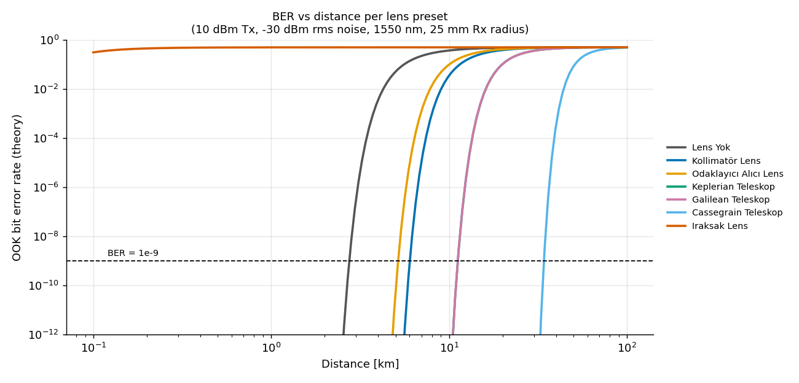
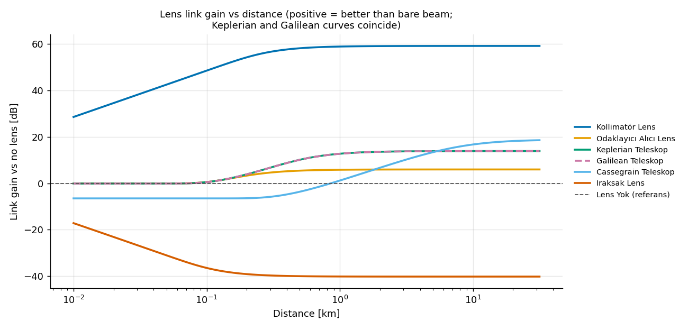
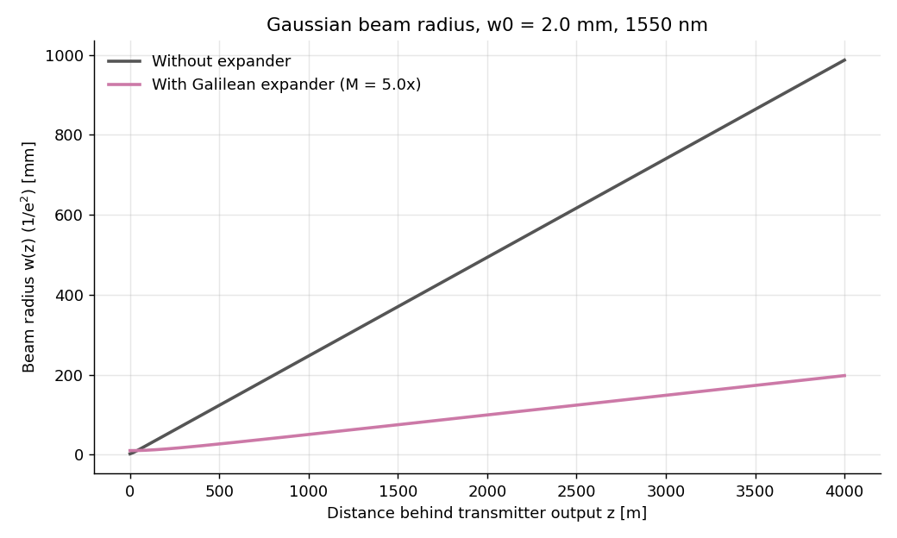
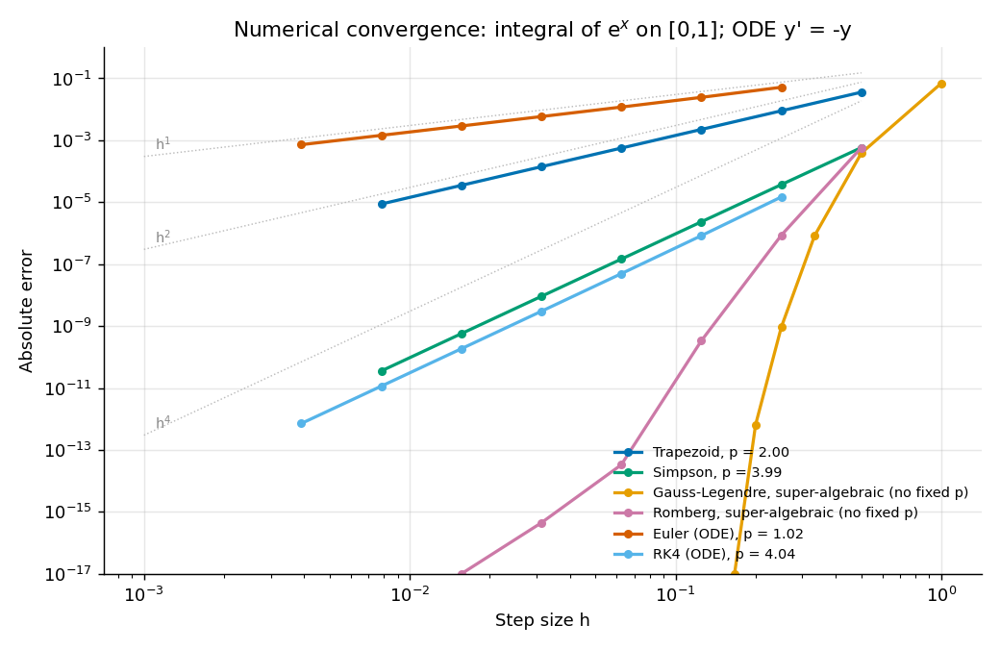
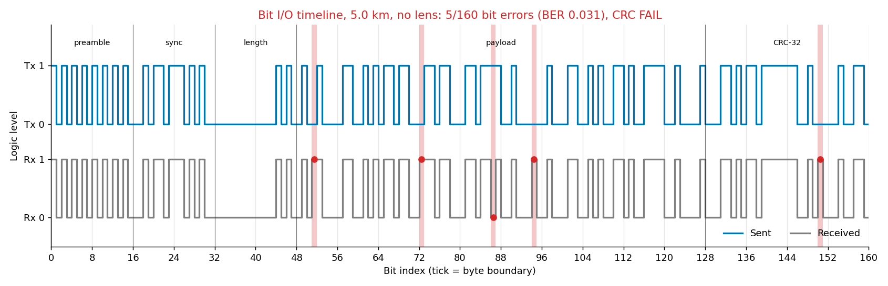
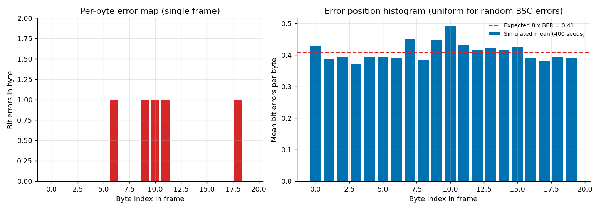
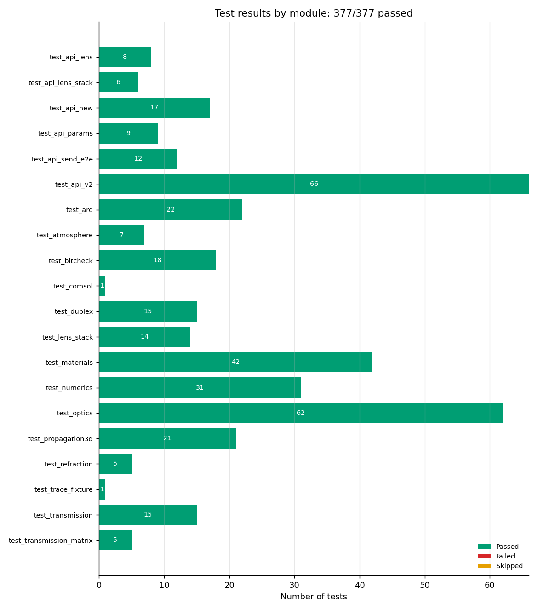

# Son Değişiklikler Raporu (commit 897b4e6, ebeveyn cadaaeb)

Kapsam: `git show 897b4e6` / `git diff cadaaeb 897b4e6`. Tüm sayılar `git diff --numstat`, `pytest` çalıştırması veya doğrudan dosya okuma ile doğrulanmıştır. Bu rapor yalnızca okuma yapılarak üretilmiştir; kod, test veya yapılandırma dosyasına dokunulmamıştır.

---

## 1. Özet

Commit `897b4e6` ("feat: run.py başlatıcı, --exit flag, yeni backend modülleri, testler ve raporlar"), orkestre edilmiş bir ajan zincirinin çalışmasını tek commit olarak toplar. Projeye sekiz yeni backend modülü (optik, sayısal analiz, bit kontrolü, malzemeler, 3B yayılım, ARQ, dubleks, lens yığını), bunlara bağlı yeni REST uç noktaları, dört yeni tarayıcı modülü (3B sahne, lens tasarımcısı, dubleks/ARQ, ek CSS), `run.py` başlatıcısı, test raporu/grafik üretim betikleri ve araştırma/denetim raporları eklenmiştir. Mevcut fizik motoruna (`engine.py`/`engine.js`) yalnızca küçük bir sayısal sağlamlaştırma (clamp) yapılmıştır.

| Ölçü | Değer |
|---|---|
| Değişen dosya | **53** |
| Eklenen / silinen satır | **+11 048 / −78** (git `--stat`; PNG ve PDF dahil değil olarak metin satırları) |
| Yeni backend modülü | 8 (`optics`, `numerics`, `bitcheck`, `materials`, `propagation3d`, `arq`, `duplex`, `lens_stack`) + `lens_stack_api` |
| Yeni arayüz dosyası | `viz3d.js`, `lens-designer.js`, `duplex.js`, `ui-v2.css` |
| Yeni test dosyası | 13 (+ `test_api_params.py` içinde 1 satır değişiklik) |
| Test sayısı | **39 → 371** (ebeveyn commit çıkarılıp çalıştırıldı: 39 passed; şimdiki çalışma: aşağıda) |
| Mevcut pytest sonucu | **371 passed in 8.08s** (`.venv/bin/python -m pytest -q`), 0 başarısız |
| Şekil | 7 PNG (`reports/figures/`) |

Not: `git status` temizdir (commit sonrası çalışma ağacında değişiklik yok).

---

## 2. Değişiklik zaman çizelgesi

Değişiklikler tek commit içinde olduğundan aşağıdaki faz ayrımı, ajan zincirinin sırasına göre yapılmış bir okuma kılavuzudur; her madde kodda doğrulanmıştır.

### Faz 1 — Denetim ve temel modüller
- **Denetim raporu:** [reports/agent_audit_report.md](agent_audit_report.md) (154 satır). Mevcut `engine.py`/`app.py`/`comsol.py`/`engine.js` incelenmiş; kritik/yüksek bulgular listelenmiştir (bkz. Bölüm 8).
- **[backend/optics.py](../backend/optics.py)** (828 satır): ABCD matrisleri, Gauss ışını (q-parametresi), FSO lens ön ayarları, Fresnel, küresel aberasyon, Airy yarıçapı.
- **[backend/numerics.py](../backend/numerics.py)** (514 satır): türev, integral, ODE (Euler/RK4/RK45), ışın denklemi, kök bulma, yakınsama mertebesi.
- **[backend/bitcheck.py](../backend/bitcheck.py)** (311 satır): çerçeveleme, CRC-16, `compare_bits`, OOK BER kanalı.
- **[scripts/generate_test_plots.py](../scripts/generate_test_plots.py)**, [scripts/run_test_report.py](../scripts/run_test_report.py), `reports/figures/*.png`, [reports/test_report.md](test_report.md) ve [reports/optical_fso_crc_report.md](optical_fso_crc_report.md) entegrasyonu; `requirements-dev.txt` içine `matplotlib>=3.7` eklendi.
- API: `POST /api/bitcheck`, `GET /api/optics/presets`, `POST /api/optics/link-gain`, `POST /api/numerics/convergence`.

### Faz 2 — Malzemeler, 3B, ARQ, dubleks, arayüz v2
- **[backend/materials.py](../backend/materials.py)** (851 satır) + [reports/lens_materials_research.md](lens_materials_research.md): 14 malzeme (Sellmeier verileri), 13 lens şekli, 8 filtre, 7 kaplama, 4 teleskop türü, `design_lens`.
- **[backend/propagation3d.py](../backend/propagation3d.py)** (389 satır): 3B Gauss ışını yayılımı, bozunum bulutu, hotspot.
- **[backend/arq.py](../backend/arq.py)** (518 satır): CRC tabanlı seçici tekrar (selective repeat) ARQ.
- **[backend/duplex.py](../backend/duplex.py)** (302 satır): WDM tam dubleks (1550/1310 nm), piggyback ACK, çapraz konuşma.
- Arayüz: [viz3d.js](../viz3d.js) (three.js sahnesi), [lens-designer.js](../lens-designer.js), [duplex.js](../duplex.js), [ui-v2.css](../ui-v2.css); [index.html](../index.html) ve [app.js](../app.js) bağlantıları; notlar [reports/ui_v2_notes.md](ui_v2_notes.md); API sözleşmesi [reports/api_contract_v2.md](api_contract_v2.md).
- Hata düzeltmeleri: dubleks/yayılım mesafe uyuşmazlığı, Snell tablosu NaN, lens kesitinde etiket örtüşmesi (Bölüm 6).
- API: `POST /api/propagation3d`, `/api/arq`, `/api/duplex`, `GET /api/lens/catalog`, `POST /api/lens/design`.

### Faz 3 — Genişletmeler
- `maxRetries` üst sınırı 10 → **200**; geçmiş/zaman çizelgesi kırpma ve çalışma-bütçesi koruması (`MAX_WIRE_BITS`, `MAX_SLOTS`).
- **Uçtan uca veri gönderimi:** `/api/send-data` artık varsayılan olarak `useArq=true` ile mesajı önce tam mesafeye gönderir, alıcı segment ve mesaj CRC'sini kontrol eder, hatalı segmentler tekrar istenir ve yerlerine yerleştirilir (`arq.run_end_to_end`).
- Sabit "6 km" etiketleri yerine dinamik mesafe etiketleri (`data-dist-tpl`, `distLabel()`).
- **Çok lensli yığın:** [backend/lens_stack.py](../backend/lens_stack.py), [backend/lens_stack_api.py](../backend/lens_stack_api.py), arayüzde "Lens yığını" modu; ön ayarlar `kepler`, `galileo`, `achromat_pair`, `cooke_triplet`.
- 3B yayılım mesafesi ayarlanabilir (`distanceM`, 100–20 000 m).
- **[run.py](../run.py)** başlatıcı ve [.claude/launch.json](../.claude/launch.json).

---

## 3. Yeni modüller

### 3.1 [backend/optics.py](../backend/optics.py) — paraksiyel optik ve Gauss ışını
**Amaç:** `engine.LensSystem`'deki elle yazılmış çarpan tablosunun yerine fiziksel (ABCD tabanlı) lens/teleskop modeli.

**Ana API:** `free_space`, `thin_lens`, `refraction_interface`, `curved_mirror`, `thick_lens`, `thin_lens_focal_length`, `thick_lens_focal_length`; sınıflar `OpticalElement`, `RayState`, `OpticalSystem`; Gauss ışını: `rayleigh_range`, `beam_radius`, `radius_of_curvature`, `far_field_divergence`, `q_from_waist`, `q_beam_radius`, `propagate_q`, `beam_through_system`; Fresnel: `fresnel_reflectance`, `surface_transmittance`, `lens_transmittance`; hazır sistemler: `keplerian_expander`, `galilean_expander`, `collimator`, `focusing_receiver`, `diverging_lens`, `cassegrain_telescope`, `cassegrain_expander`; ön ayarlar `FSO_LENS_PRESETS` (`none, collimating, focusing, keplerian_telescope, galilean_telescope, cassegrain, diverging`), `build_preset`; bütçe: `received_power_fraction`, `geometric_loss_dB`, `lens_link_budget`, `lens_link_gain_dB`; `thin_lens_longitudinal_spherical_aberration`, `airy_radius`.

**Modeller ve formüller**
- Işın vektörü (y, θ), M = Mₙ···M₂M₁, q' = (Aq + B)/(Cq + D).
- Gauss ışını: q = z + i·z_R, z_R = π·w₀²/(M²·λ); 1/q = 1/R − i·M²λ/(π w²); uzak alan ıraksama θ = M²λ/(π w₀).
- İnce lens: 1/f = (n−1)(1/R₁ − 1/R₂). Kalın lens: 1/f = (n−1)[1/R₁ − 1/R₂ + (n−1)d/(n R₁ R₂)].
- Fresnel: R = ((n₁−n₂)/(n₁+n₂))², yüzey iletimi (1−R) (AR kaplamada verilen yansıma).
- Küresel aberasyon: ince lens için boyuna küresel sapma yaklaşımı; Airy yarıçapı 1.22 λ f / D.
- Ayna "açılmış" geometride işlenir (içbükey R>0, f=R/2).

**Doğrulama:** [tests/unit/physics/test_optics.py](../tests/unit/physics/test_optics.py) (62 test): ABCD birleşimi, lensmaker eşitlikleri, Gauss ışını (zR, w(z), q yayılımı) analitik değerlerle, difraksiyon sınırı (θ ≥ λ/πw₀), Fresnel, ön ayarlar ve bütçe monotonluğu. Şekiller: `beam_radius.png`, `lens_gain_vs_distance.png`.

### 3.2 [backend/numerics.py](../backend/numerics.py) — sayısal analiz araç takımı
**Ana API:** türev `forward_diff/backward_diff/central_diff/second_derivative/richardson_derivative/gradient/laplacian/optimal_step`; integral `trapezoid/simpson/romberg/gauss_legendre/adaptive_simpson/integrate_2d/integrate_disk/path_integral`; ODE `euler/rk4/rk45`; `ray_equation_rhs`; kök bulma `bisection/newton/secant/brent`; `convergence_order/convergence_study`; fizik: `optical_path_length`, `total_attenuation_dB`, `gaussian_power_in_aperture`. Yalnızca NumPy (scipy yok).

**Modeller:** ışın denklemi d/ds(n·dr/ds) = ∇n (RK4 ile); yakınsama mertebesi p = log(e₁/e₂)/log(h₁/h₂) (log-log eğim); `gaussian_power_in_aperture` 1 − exp(−2a²/w²) analitik değeri ile sayısal disk integralini karşılaştırır.

**Doğrulama:** [tests/unit/math/test_numerics.py](../tests/unit/math/test_numerics.py) (31 test): yakınsama mertebeleri, analitik integraller, kök bulma (ayrıntılı beklenen değerler test dosyasındadır). Şekil: `numerical_convergence.png`.

### 3.3 [backend/bitcheck.py](../backend/bitcheck.py) — bit düzeyi doğrulama
**Ana API:** `bytes_to_bits`, `bits_to_bytes`, `bits_to_str`, `build_frame`, `parse_frame`, `compare_bits`, `ook_ber`, `snr_from_received_power`, `ber_from_received_power`, `apply_channel`, `link_power_dBm`, `link_ber`, `run_link_check`, `summary_rows`.

**Çerçeve:** preamble `0xAA 0xAA` | sync `0x2D 0xD4` | 16 bit uzunluk | yük | CRC-16/CCITT. Alınan bit `None` = silinme (erasure) ve her zaman hata sayılır (eski simülatör kopan kanalda 0 raporlayıp sıfırları "doğru" gösteriyordu; burada bilerek yapılmaz).

**BER modeli (OOK/IM-DD):**
- SNR = (P_rx / P_gürültü)² (elektriksel), P dBm→mW.
- BER = ½ erfc(√SNR / (2√2)) = Q(√SNR/2). SNR = 144 için BER = 9.87e-10 (doğrulandı).
- Kanal: tohumlu ikili simetrik kanal (`random.Random(seed)`), yeniden üretilebilir.

**Doğrulama:** [tests/unit/physics/test_bitcheck.py](../tests/unit/physics/test_bitcheck.py) (17 test), `/api/bitcheck` testleri; şekiller `ber_vs_distance.png`, `bit_io_timeline.png`, `error_position_map.png`; `reports/test_report.md` içindeki "Bit-level I/O check" tablosu.

### 3.4 [backend/materials.py](../backend/materials.py) — malzeme, lens şekli, filtre, kaplama
**İçerik (`catalog()` çıktısı ile doğrulandı):** 14 malzeme (`n_bk7, fused_silica, caf2, baf2, mgf2, sapphire, n_sf11, n_sf6, s_lah64, znse, germanium, silicon, pmma, polycarbonate`), 13 lens şekli (`plano_convex, plano_convex_flat_front, biconvex, plano_concave, biconcave, positive_meniscus, negative_meniscus, aspheric, ball, fresnel, cylindrical, achromatic_doublet, grin`), 4 teleskop (`keplerian, galilean, cassegrain, ritchey_chretien`), 8 filtre, 7 kaplama.

**Ana API:** `refractive_index`, `is_transparent`, `dn_dlambda`, `group_index`, `abbe_number`, `dn_dT`, `coating_reflectance`, `filter_transmittance`, `telescope_parameters`, `design_lens`, `catalog`.

**Modeller:**
- Sellmeier (iki biçim): n² = 1 + Σ Bᵢλ²/(λ² − Cᵢ²) ("formül 1") ve n² = 1 + K + Σ Bᵢλ²/(λ² − Cᵢ) ("formül 2"); λ µm cinsinden.
- Şekil faktörü q = (R₂+R₁)/(R₂−R₁); verilen f, n, q için R₁ = 2f(n−1)/(q+1), R₂ = 2f(n−1)/(q−1) (lensmaker ile tutarlı).
- `design_lens`: R₁, R₂, merkez/kenar kalınlığı, profil, iletim (Fresnel/kaplama + malzeme); kalın lens EFL'si hedef f ile eşitlenir. "Betimleyici" şekiller (ball, fresnel, achromatic_doublet, grin vb.) tasarlanamaz ve hata verir.
- Filtre ve kaplama spektrumları basit modellerdir (süper-Gauss bant geçiren, kenar filtreler, parabolik V-kaplama); ölçülmüş eğri değildir (modül başlığında belirtilmiştir).
- Dalga boyu kapsamı dışında kalan malzemeler `is_transparent` ile opak işaretlenir.

**Doğrulama:** [tests/unit/physics/test_materials.py](../tests/unit/physics/test_materials.py) (42 test), `test_api_lens.py` (8). Araştırma/doğrulama tablosu: [reports/lens_materials_research.md](lens_materials_research.md) (hesaplanan ve yayımlanmış 1550 nm indeksleri).

### 3.5 [backend/propagation3d.py](../backend/propagation3d.py) — 3B ışın yayılımı
**Ana API:** `propagate_beam_3d`, `scintillation_index_from_rytov`, `weather_alpha_dB_km`, `pointing_coupling`, `score_components`.

**Algoritma:** ışın kaynaktan hedefe örneklenir; her örnekte n, Cn², T, nem ve hava durumu sönümü hücre merkezleri arasında trilineer enterpole edilir. Çıktı: merkez hattı, 1/e² halkaları, bozunum bulutu (vokseller), hotspot, özet.
- Kümülatif sönüm A(s) = ∫α ds (trapez).
- Düzgün olmayan Cn² için Rytov: σ_R²(s) = 2.25 k^(7/6) ∫₀ˢ Cn²(s′)(s−s′)^(5/6) ds′ (homojen Cn²'de 1.23 Cn² k^(7/6) s^(11/6)'ya iner).
- Uzun dönem ışın yarıçapı: w_LT = w·√(1 + 1.33 σ_R² Λ^(5/6)), Λ = 2s/(k w²).
- Işın savrulması: ⟨r_c²⟩ = 2.42 Cn²ₒₜₗ s³ w(0)^(−1/3).
- Sintilasyon indeksi (Andrews–Phillips doyumlu model): σ_I² = exp(0.49σ²/(1+1.11σ^(12/5))^(7/6) + 0.51σ²/(1+0.69σ^(12/5))^(5/6)) − 1.
- Kırılma sapması: ışın denklemi `numerics.rk4` ile, ∇n `numerics.gradient` ile; ışın yüksek n'ye doğru eğilir.
- Bozunum skoru: sönüm, Cn² ve ∇n bileşenlerinin doyumlu [0,1] haritaları (referanslar `ALPHA_REF_DB_KM=10`, `GRAD_REF=5e-8`) ağırlıklı toplanır; `hotspot` = en yüksek yerel skor, `worst_segment` = `0.1·nSamples` pencerenin ortalaması en yüksek dilim.
- Limitler: `MAX_SAMPLES=2000`, `MAX_RAYS=64`, `MAX_VOXELS=4000`.

**Doğrulama:** [tests/unit/physics/test_propagation3d.py](../tests/unit/physics/test_propagation3d.py) (21 test), `test_api_v2.py`.

### 3.6 [backend/arq.py](../backend/arq.py) — seçici tekrar ARQ
**Ana API:** `frame_segment/parse_segment`, `frame_ack/parse_ack`, `ArqChannel`, `FadingProcess`, `channel_from_link`, `channel_from_propagation`, `split_payload`, `spatial_weights`, `spatial_retries`, `assemble_result`, `run_arq`, `run_end_to_end`.

**Protokol:** segment = seq(16) | len(8) | veri | CRC-16/CCITT; geri besleme = seq(16) | durum(8) | CRC-16 (40 bit) ve kendi `ack_ber`'i ile bozulabilir. Alıcı CRC iyi → ACK, kötü → NACK. Segment, NACK veya bozuk geri besleme çerçevesi (zaman aşımı) durumunda yeniden gönderilir; alıcıda zaten bulunan segmentin ACK'ı kaybolursa "gereksiz (spurious) tekrar" sayılır. Segment başına en çok 1 + `max_retries` deneme.

**Kanal:** P_rx = P_ort + 10 log₁₀(I), I log-normal, E[I]=1, σ²_lnI = ln(1+σ_I²); AR(1) Gauss dizisi (`fading_rho`) ile denemeler arası ilişki; BER = `bitcheck.ook_ber(SNR)` (dubleksde girişim terimiyle).

**Sınırlar (kodda):** `MAX_PAYLOAD_BYTES=4096`, `MAX_SEGMENTS=256`, `MAX_RETRIES=200`, `HISTORY_KEEP=8` (segment geçmişi: ilk 8 + son 8 deneme), `ROUND_DETAIL_KEEP=20`, `MAX_WIRE_BITS=6 000 000` (tükenince `budget_exhausted`).

**Bölge başına tekrar:** yayılım sonucundaki yerel skorlardan `spatial_weights` ve `spatial_retries` ile hataların uzamsal dağılımı (heuristik: CRC hatasının gerçek yeri bilinmez; skorla orantılı dağıtılır).

**Uçtan uca (`run_end_to_end`):** bitler bayta tamamlanır (`pad_bits`), segment boyutu 256 segmenti aşmayacak şekilde otomatik büyütülür (`segment_bytes_used`), tüm mesaj önce tam mesafeye gönderilir (tur 0), alıcı segment CRC'lerini ve tüm mesajın CRC-16'sını (`final_check`: `message_crc_sent/received`, `ok`, `residual_errors`) kontrol eder; hatalı segmentler yeniden istenir ve `rounds` listesinde `became_ok` bitleriyle yerine konur.

**Doğrulama:** [tests/unit/physics/test_arq.py](../tests/unit/physics/test_arq.py) (22 test), [tests/unit/test_api_send_e2e.py](../tests/unit/test_api_send_e2e.py) (11 test).

### 3.7 [backend/duplex.py](../backend/duplex.py) — WDM tam dubleks
**Ana API:** `Terminal`, `link_budget`, `rescale_propagation`, `run_duplex`.

**Model:** A→B 1550 nm, B→A 1310 nm; ayrık zaman dilimlerinde her terminal bir çerçeve gönderir: tip(8) | seq(16) | fb(8) | len(8) | veri | CRC-16 (K+7 bayt). `fb` alanı, karşı taraftan önceki dilimde alınan çerçevenin ACK/NACK'ını taşır (piggyback; ayrı ACK kanalı yok). Gönderilecek verisi kalmayan terminal yalnızca geri besleme çerçevesi yollar. Bozuk ters çerçeve hem veriyi hem de ACK'ı kaybettirir; tekrarlar yeni veriden önceliklidir. `MAX_SLOTS=10000`; zaman çizelgesi ilk 1000 + son 1000 dilim ile kırpılır (`timeline_truncated`).

**Kanal (yön başına):**
- P_rx = P_tx − lens/açıklık kaybı (`optics.lens_link_budget`, kaynak dalga boyunda) [− alıcı lens iletimi] − α(hava, λ)·d − sabit − ek kayıp.
- Sintilasyon: σ_R² = 1.23 Cn² k^(7/6) d^(11/6) → σ_I² → log-normal sönümleme.
- Yakın uç çapraz konuşma: P_xt = P_tx(hedef) − `nearEndCouplingDb` − `filterIsolationDb`; SNR = P_rx² / (σ_gürültü² + P_xt²).
- Bütçe sözlüğü: `margin_dB = P_rx − sensitivity_dBm`, `sir_dB`, `ber_no_crosstalk`, `ber_mean_power`, `ber_faded_mean`.

**3B yayılım bağlama:** `rescale_propagation(summary, d)`: mesafe dubleks ayarından alınır (yetkili); yayılımın sönümü Beer–Lambert ile doğrusal (`total_atten_dB · d/L`), σ_R² ise `(d/L)^(11/6)` ile ölçeklenir. Lens/açıklık kaybı her zaman d'de optik modelle hesaplanır.

**Doğrulama:** [tests/unit/physics/test_duplex.py](../tests/unit/physics/test_duplex.py) (15 test), `test_api_v2.py`.

### 3.8 [backend/lens_stack.py](../backend/lens_stack.py) ve [backend/lens_stack_api.py](../backend/lens_stack_api.py) — çok lensli yığın
**Amaç:** en çok `MAX_ELEMENTS=8` lensi optik eksende seri dizmek. Her eleman `materials.design_lens` ile tasarlanır; gerçek kalın-lens ABCD matrisi (kırılma → cam kalınlığı → kırılma, n(λ)) ve hava boşlukları tek bir `optics.OpticalSystem` içinde birleştirilir. İlk elemanın ön tepe noktası z=0'dır; `spacingM` bir sonraki elemanın ön tepe noktasına olan hava boşluğudur (son elemanda yok sayılır). Negatif boşluk ve çakışma Türkçe 422 ile reddedilir.

**Ana API:** `design_stack`, `preset_list`, `preset_elements`, `normalize_element`, `StackError`. Işın yelpazesi: tüm yüzeylerden konik yüzey kesişimi (Newton) + vektörel Snell ile (`_surface_hit`, `_refract`, `_trace_exact`); `nRays`, `fieldAngleDeg` (−20…20°) desteklenir. Çıktıda giriş gözbebeği yarıçapı (`entrance_pupil_radius_m`), sınırlayıcı eleman (`stop_element`), odak (`focus_z`), BFD, iletim, bağlantı kazancı yer alır.

**Ön ayarlar:** `kepler`, `galileo`, `achromat_pair`, `cooke_triplet` (Kepler/Galileo için `spacingM`, f₁+f₂ ve ana düzlem konumlarından hesaplanır).

**Doğrulama:** [tests/unit/physics/test_lens_stack.py](../tests/unit/physics/test_lens_stack.py) (14), [tests/unit/test_api_lens_stack.py](../tests/unit/test_api_lens_stack.py) (6): tek elemanlı yığının `/api/lens/design` ile eşitliği, Türkçe 422 mesajları, ışın yelpazesi sözleşmesi ve boyutu, Cooke triplet okumaları.

Not: Birleşik odak, kalın lens/ABCD matris çarpımından (C = −1/f) elde edilir; ayrı bir "Gullstrand" fonksiyonu yoktur. Gullstrand formülü (1/f = 1/f₁ + 1/f₂ − d/(f₁f₂)) testlerle doğrulanır: [test_optics.py:54](../tests/unit/physics/test_optics.py) ve [test_lens_stack.py:41](../tests/unit/physics/test_lens_stack.py).

---

## 4. API değişiklikleri

Tüm yeni uç noktalar [backend/app.py](../backend/app.py) içindedir; lens yığını uç noktaları `app.include_router(lens_stack_router)` ile dosya sonunda bağlanır. Doğrulama hataları (aralık dışı sayı, bilinmeyen enum, aşırı büyük ızgara/yük) 422, beklenmeyen hatalar 500 (ayrıntı sızdırmadan) döner. Ayrıntılı sözleşme: [reports/api_contract_v2.md](api_contract_v2.md).

| Yöntem ve yol | Amaç | Ana parametreler ve sınırlar |
|---|---|---|
| `POST /api/send-data` **(değişti)** | Uçtan uca veri gönderimi + CRC + seçici tekrar | `simParams`, `pattern`, `numBits` 1–10000, **yeni:** `useArq` (varsayılan **true**), `segmentBytes` 1–255 (4), `maxRetries` 0–**200** (20), `seed`. Yanıta `arq`, `final_check`, `rounds`, `link`, `sent_bits/first_pass_bits/reassembled_bits` eklendi |
| `POST /api/simulate` (değişmedi) | 2B ışın izleme | `SimParams`; içte `build_atmosphere` ayrıştırıldı. Olay sözlüklerine artık `cosTheta_i/cosTheta_t` eklenir |
| `POST /api/bitcheck` | Metin → çerçeve → kanal → bit/CRC raporu | `payload` ≤512 bayt, `distanceM` 0–1e6, `lensPreset`, `seed`, `txPowerDbm` −60…60, `noiseRmsDbm` −120…0, `sensitivityDbm`, `includeBits` |
| `GET /api/optics/presets` | Lens ön ayarı listesi | — |
| `POST /api/optics/link-gain` | Mesafe listesi için lens bütçesi | `lensPreset`, `distancesM` (1–200 değer, her biri 0–1e6), `wavelengthM` 200 nm–20 µm, `rxRadiusM` ≤10 |
| `POST /api/numerics/convergence` | Hata tablosu ve yakınsama mertebesi | `method` ∈ {trapezoid, simpson, gauss_legendre, euler, rk4}, `problem`, `ns` |
| `POST /api/propagation3d` | 3B ışın yayılımı | `atmosphere` (SimParams; **gridX·gridY·gridZ ≤ 40 000**), `source/target`, `w0`, `lensPreset`, `nSamples` 20–400, `nRays` 3–24, `rxRadiusM`, `m2` 1–10, `maxVoxels` ≤4000, `anomalies` ≤8, **`distanceM` 100–20 000 m** (verilirse ızgara bu mesafeye göre yeniden kurulur) |
| `POST /api/arq` | Tek yönlü seçici tekrar ARQ | `payload` ≤2048 bayt, `segmentBytes` 1–255, `maxRetries` 0–**200**, `ackBer` ≤0.5, `ber` (sabit BER), mesafe/güç/dalga boyu/kayıp/Cn² alanları, `fadingRho` [0,1), `spatialBins` 2–20, `propagation`; ≤256 segment |
| `POST /api/duplex` | WDM tam dubleks | `terminalA/B` (güç, dalga boyu, `txLens/rxLens`, `filterIsolationDb`, `sensitivityDbm`, `noiseRmsDbm`, `nearEndCouplingDb`), `payloadA/B` ≤512 bayt, `distanceM`, `weather`, `cn2`, `segmentBytes`, `maxRetries` ≤200, `reciprocityRho`, `fadingRho`, `bitrateBps`, `berOverride`, `propagation`; yön başına ≤64 segment. `propagation` verilirse `propagation_rescale` döner |
| `GET /api/lens/catalog` | Malzeme/şekil/filtre/kaplama/teleskop kataloğu | — |
| `POST /api/lens/design` | Tek lens tasarımı + ışın yelpazesi | `shape`, `material`, `focalLengthM` ≤10, `diameterM` ≤1, `wavelengthNm` 200–20000, `centerThicknessM`, `coating`, `filter`, `linkDistanceM`, `beamW0M`, `bareRxRadiusM`, `nPoints` 41–401, `nRays` 3–21 |
| `POST /api/lens/stack` | Lens yığını tasarımı | `elements` (1–8) veya `preset`; `wavelengthNm`, `linkDistanceM`, `beamW0M`, `bareRxRadiusM`, `sourceOffsetM`, `m2` 1–20, `nPoints` 41–201, `nRays` 3–21, `fieldAngleDeg` ±20 |
| `GET /api/lens/stack/presets` | Yığın ön ayarları | `wavelengthNm` 200–20000 |
| `GET /viz3d.js`, `/duplex.js`, `/lens-designer.js`, `/ui-v2.css` | Statik dosyalar (beyaz liste) | — |

**Geriye dönük uyumsuz / dikkat edilmesi gerekenler**
1. `/api/send-data` artık varsayılan olarak ARQ yolunu çalıştırır (`useArq=true`). Eski alanlar (`correctBits`, `bitErrorRate`, `successRate`, `missedOnes/Zeros`, `results[i].received/correct`) **ilk geçişi** (tekrarlardan önce alınanı) anlatır. Eski davranış için `useArq:false` gerekir (bu durumda `arq: null`). Mevcut test `test_send_data_endpoint_returns_json_safe_zero_bit_results` bu nedenle `useArq: False` ile güncellendi (commit içindeki tek mevcut test değişikliği: +1 satır).
2. ARQ yolunda ışın izi yalnızca son `results` girdisinde döner (diğerlerinde `trace=None`); 512'den fazla bit için `linkBudget` de yalnız son girdidedir (yanıt boyutu denetimi).
3. Ağ gürültü tabanı `receiverSensitivity_dBm − 10·log₁₀(12)` olarak seçilir: duyarlılıkta P/gürültü = 12, SNR 144, BER ≈ 1e-9.
4. `maxRetries` üst sınırı 200'dür (201 → 422; `test_max_retries_200_accepted_201_rejected`). Bu sınır `/api/arq`, `/api/duplex` ve `/api/send-data` için geçerlidir.
5. `/api/propagation3d`: `lensPreset="focusing"` reddedilir (alıcı lensidir). `distanceM` verildiğinde `atmosphere.gridX/cellSize` yeniden hesaplanır (hücre boyutu uyarlanır).
6. `/api/duplex` içinde `propagation` varsa mesafe dubleks ayarından alınır; yayılım sonucu bu mesafeye ölçeklenir.

---

## 5. Arayüz değişiklikleri

[index.html](../index.html) yeni stil/betikleri yükler (`ui-v2.css`, `lens-designer.js`, `viz3d.js`, `duplex.js`; three.js r128 ve OrbitControls CDN'den). [app.js](../app.js) `window.FSOApp` köprüsünü (log, BACKEND_URL, getParams) sunar.

**Dinamik mesafe etiketleri.** Sabit "6 km" yazıları `data-dist-tpl="… {d} …"` ile işaretlendi; `updateDistanceLabels()` gridX × cellSize değerinden `X.Y km` üretir (başlık, "Menzil", grid bölümü, "Veri Gönder" düğmesi, üstten görünüm, alınan bitler, link bütçesi, konsol mesajları, `document.title`).

**Uçtan uca gönderim paneli** (`#e2e-panel`, `renderEndToEnd`): `send-seg-bytes` (segment bayt, 1–255) ve `send-max-retries` (0–200) girdileri; alınan/gönderilen bit hücrelerine segment boşlukları; ilk geçişteki hatalı bitler gösterilir, sonra her yeniden gönderim turu animasyonla düzeltilen segmentleri yerine yerleştirir ("recv-fix" → "recv-ok"). Rozet: `uçtan uca CRC: ✓/✗ gönderilen = alınan`. Özet: tur sayısı, yeniden gönderim, verimlilik, segment sayısı, maks. tekrar, "iletim bütçesi doldu" uyarısı; BER kutusu artık kalıcı (ARQ sonrası) hatayı gösterir.

**Lens Tasarımcısı** ([lens-designer.js](../lens-designer.js), sol çubukta "Lens Tasarımcısı"): Terminal A/B seçimi, "A'nın tasarımını B'ye kopyala", dalga boyu (850/1310/1550), mod (Tek lens / Lens yığını), şekil, malzeme (opak olanlar işaretli), filtre, kaplama, odak uzaklığı, çap ve merkez kalınlığı (otomatik/elle) kaydırıcıları; 250 ms bekletmeli `/api/lens/design` çağrısı. Okumalar: n(λ), EFL, R₁, R₂, f/#, NA, tc/te, BFD, iletim, küresel sapma, Airy yarıçapı, bağlantı kazancı; Snell kırılmasıyla ışın yelpazeli kesit (canvas).
- **Yığın modu:** ön ayar seçimi (Kepler / Galile / yakın çift / Cooke triplet), alan açısı kaydırıcısı (±20°), eleman kartları (şekil, malzeme, f, çap, kalınlık, kaplama, filtre, boşluk), ekle/sil (en çok 8); tüm yüzeylerden geçen ışın yelpazesi ve sınırlayıcı (stop) eleman gösterimi. Sonuç, dubleks/3B ile uyumlu bir `design` kılıfına çevrilir (`stackShim`).

**3B Yayılım sekmesi** ([viz3d.js](../viz3d.js), "Yayılım · Full-Duplex · ARQ" panelinde): "3B Yayılımı Hesapla"; **yayılım mesafesi** kaydırıcısı ve sayı kutusu (0.1–20 km, "Ana ızgarayla eşitle"), bozunum bulutu eşiği, dikey ölçek abartma (otomatik/elle), ışın tüpü rengi, katman düğmeleri (bulut, ışın tüpü, lens yatay kesit düzlemi); sahne: yer ızgarası, atmosfer kutusu, terminaller, ışın tüpü + merkez hattı, bozunum bulutu, hotspot halkası/etiketi, anomali kutuları, lens profilleri (LatheGeometry), dubleks bölge bantları. Anomali düzenleyici: sis yaması, türbülans cebi, sıcak/soğuk kabarcık (≤8). Özet satırları arasında "En kötü dilim" ve hotspot (konum, skor, baskın neden).

**Full-Duplex İletişim sekmesi** ([duplex.js](../duplex.js)): terminal güç/dalga boyu/izolasyon/metin girişleri, "3B yayılımı kullan", "Lens/filtre iletimini ekle"; A→B ve B→A kartları (P_rx, marj, BER, throughput, goodput, verimlilik, tekrar, teslim edilen metin, CRC rozeti), oynatılabilir slot zaman çizelgesi (DATA/RETX/yalnız ACK, piggyback ACK/NACK), segment tablosu, bölge başına tekrar grafikleri, seçili yönün bölgelerinin 3B sahnede renkli bantları.

**ARQ Demo sekmesi:** tek yönlü ARQ, aynı tablo/grafikler, isteğe bağlı 3B yayılım.

[ui-v2.css](../ui-v2.css) (78 satır) ve [style.css](../style.css) (+22 satır) yeni bileşen stillerini içerir. Not: `reports/ui_v2_notes.md` 3B mesafe kaydırıcısı ve yığın modu eklenmeden önceki durumu anlatır (güncel değildir).

**Başlatıcı:** [run.py](../run.py) (165 satır): `python run.py` (uvicorn, varsayılan 127.0.0.1:8000, otomatik yeniden yükleme, `watchfiles` varsa `*.py/*.js/*.html/*.css` filtreli), `--open`, `--port`, `--host`, `--no-reload`, `--check` (bağımlılık + 10 backend modülü + 10 arayüz dosyası denetimi), `--test` (pytest; ek argümanlar iletilir), `--report` (`scripts/run_test_report.py`), **`--exit`** (verilen portta — varsayılan 8000 — `lsof -ti :PORT` ile bulunan süreçlere SIGTERM gönderir; sunucu başlatmaz). Ortam değişkenleri `FSO_HOST`, `FSO_PORT`. [.claude/launch.json](../.claude/launch.json) `fso-backend` yapılandırması: `python3 -m uvicorn backend.app:app --port 8000`.

---

## 6. Düzeltilen hatalar

| Hata | Kök neden | Düzeltme |
|---|---|---|
| Dubleks/yayılım mesafe uyuşmazlığı ve BER | 3B yayılım kendi uzunluğunda (ör. ızgara) hesaplanıyor, dubleks ayrı mesafe kullanıyordu; sönüm/sintilasyon farklı uzunluğa ait olduğundan bütçe tutarsızdı. Kart BER'i için ortalama güç BER'i ile sönümlü ortalama BER ayrı alanlardır (`ber_mean_power` / `ber_faded_mean`) | `duplex.rescale_propagation` (sönüm ∝ d/L, σ_R² ∝ (d/L)^(11/6)); dubleks mesafesi yetkili; yanıtta `propagation_rescale`; kart BER'i `ber_faded_mean` (sönümlü ortalama BER) alır |
| Snell doğrulama tablosunda NaN | `backend/app.py` olay sözlüğüne `cosTheta_i/cosTheta_t` kopyalanmıyordu (arayüz `acos(undefined)`); ayrıca yuvarlama normal gelişte cos = 1+ε → `sqrt` negatif | `app.py` iki cos alanını iletir; [engine.py](../backend/engine.py) ve [engine.js](../engine.js) içinde `adjustedCos = min(1, …)`, `max(0, …)` clamp'leri; `app.js` içinde `angleDeg()` NaN-güvenli |
| Üst üste binen lens etiketleri | Lens kesiti canvas'ında bilgi etiketleri çizimle çakışıyordu | `lens-designer.js`: etiket kutusu yüksekliği (`labelH`) hesaplanıp üst boşluk (`padT`) buna göre ayrılır, "F/F′" etiketleri kenarlara sıkıştırılır (kod incelemesiyle doğrulandı; ayrı bir otomatik test yok) |
| "6 km" sabit etiketleri | Başlıklar ve mesajlar sabit metindi | `data-dist-tpl` + `distLabel()` |
| `/api/send-data` kopuk kanalda yanıltıcı sıfırlar | Eski simülatör kopan kanalı 0 olarak alıyordu | Yeni yolda alınmamış bit silinme sayılır; blokaj durumunda `ber_override=0.5` kullanılır |
| `/api/send-data` yanıt boyutu (denetim F: DoS) | Her bit için aynı ışın izi serileştiriliyordu | ARQ yolunda iz yalnız son girdide; 512 bit üstü `linkBudget` de tek kopya. **Not:** `useArq:false` eski yol değişmedi (bit başına iz hâlâ gönderilir) |

---

## 7. Test ve doğrulama

**Sonuç:** `371 passed in 8.08s` (`.venv/bin/python -m pytest -q`). Ebeveyn commit (`git archive cadaaeb` ile çıkarılıp çalıştırıldı): 39 passed. Artış: **+332 test**.

`pytest --collect-only -q` dosya başına sayılar:

| Dosya | Test |
|---|---:|
| tests/regression/test_trace_fixture.py | 1 |
| tests/regression/test_transmission_matrix.py | 5 |
| tests/unit/math/test_numerics.py (yeni) | 31 |
| tests/unit/math/test_refraction.py | 5 |
| tests/unit/physics/test_arq.py (yeni) | 22 |
| tests/unit/physics/test_atmosphere.py | 7 |
| tests/unit/physics/test_bitcheck.py (yeni) | 17 |
| tests/unit/physics/test_duplex.py (yeni) | 15 |
| tests/unit/physics/test_lens_stack.py (yeni) | 14 |
| tests/unit/physics/test_materials.py (yeni) | 42 |
| tests/unit/physics/test_optics.py (yeni) | 62 |
| tests/unit/physics/test_propagation3d.py (yeni) | 21 |
| tests/unit/physics/test_transmission.py | 11 |
| tests/unit/test_api_lens.py (yeni) | 8 |
| tests/unit/test_api_lens_stack.py (yeni) | 6 |
| tests/unit/test_api_new.py (yeni) | 17 |
| tests/unit/test_api_params.py (1 satır değişti) | 9 |
| tests/unit/test_api_send_e2e.py (yeni) | 11 |
| tests/unit/test_api_v2.py (yeni) | 66 |
| tests/unit/test_comsol.py | 1 |
| **Toplam** | **371** |

Yeni testlerin odağı: bilinen analitik değerler (Gauss ışını, lensmaker, Sellmeier yayımlanmış indeksler), yakınsama mertebeleri, CRC/ARQ doğruluğu (aynı tohumla deterministik), en kötü durumda yanıt boyutu/süre sınırları (`test_arq_worst_case_bounded_size_and_time`, `test_duplex_worst_case_bounded_and_timeline_truncated`), 422 doğrulama davranışları, yığın–tekil lens eşdeğerliği.

**Şekiller** ([scripts/generate_test_plots.py](../scripts/generate_test_plots.py) ile; `python run.py --report` bunları ve test raporunu üretir):

Uyarı: [reports/test_report.md](test_report.md) commit içinde "Total: 165" olarak üretilmiştir; bu, tam paketin (371) değil, rapor üretildiği andaki ara durumun sayısıdır. Güncel sayı için `python run.py --report` yeniden çalıştırılmalıdır.

---

## 8. Bilinen sınırlamalar ve açık konular

### 8.1 Denetim raporundaki hâlâ açık kritik/yüksek bulgular
`engine.py` bu commit'te yalnızca Snell clamp'i değişti (+3/−2 satır); aşağıdakiler kodda **hâlâ mevcut** olarak doğrulanmıştır.

| Bulgu (agent_audit_report) | Durum | Kanıt |
|---|---|---|
| Kritik F1: Kim/Kruse `3.91/V` birimi (km⁻¹) dB/km gibi kullanılıyor, 4.34× eksik | **Açık** | [backend/engine.py](../backend/engine.py) satır 424 ve 429: `3.91 / V * pow(550/λ, q)`; `engine.js` aynı |
| Kritik F2: Edlén nem terimi ~100× fazla | **Açık** | `engine.py:179` `humidity_correction = -4.15e-8 * e` |
| Yüksek F3: Işın izleyicide gerçek kırılma yok (parçalı sabit n, eksen-hizalı ışında normal geliş, `lateralDeviation=0`) | **Açık** (yeni `propagation3d.py` sürekli n alanında ışın denklemini RK4 ile çözerek yan modeli sunar, ancak ana 2B izleyici değişmedi) | `engine.py` RayTracer değişmedi |
| Yüksek F7: `LensSystem` çarpan tablosu (difraksiyon sınırı ihlali) | **Açık** (ana panel hâlâ bu tabloyu kullanır; yeni `optics.py` ana simülasyona bağlanmadı, yalnızca yeni uç noktalar/paneller kullanır) | `engine.py:848` `class LensSystem` |
| Yüksek F8: `DataTransmissionSimulator` deterministik/ikili BER | **Kısmen** (`/api/send-data` ARQ yolu kanal modeli olarak `bitcheck`/`arq` OOK+fading kullanır, ancak bit başına `results[]` ve `useArq:false` eski yolu değişmedi) | `app.py` `send_data` |
| Orta F5/F6: σ²_R ağırlıksız, `scintPenalty` süreksizliği, düz-tepe geometrik kayıp | **Açık** (ana linkte); yeni modüllerde Rytov ağırlıklı ve Gauss tabanlıdır | `engine.py:511` |
| Python/JS atmosfer hash farkı, JS testi yok | **Açık** | commit'te değişmedi |
| `/api/send-data` DoS | **Hafifledi** (ARQ yolunda tek iz); `useArq:false` ve `/api/simulate` 1M hücre sınırı, `/api/test-transmission` 7× hücre bulgusu açık | `app.py` |

### 8.2 Yeni kodla gelen tutarsızlıklar ve sınırlamalar
- **Dubleks kart: marj ile BER çelişkisi.** `margin_dB = P_rx − sensitivity_dBm` (varsayılan duyarlılık −40 dBm) iken BER gürültü tabanından (varsayılan −30 dBm) hesaplanır. Doğrulama: `ber_from_received_power(−40, −30) = 0.48`, `(−30, −30) = 0.31`, `(−20, −30) = 2.9e-7`. Yani marj pozitif ("bağlantı uygun") görünen bir kanal ~%48 BER verebilir. Gönderim yolunda (`/api/send-data`) gürültü tabanı duyarlılığa bağlandığından (BER = 1e-9 duyarlılıkta) bu tutarsızlık yoktur; dubleks ve `/api/arq` varsayılanlarında vardır.
- **"En kötü dilim" ve hotspot farklı metrikler.** Hotspot: tek örnekteki en yüksek yerel skorun konumu (en uzun eşit-tepe koşusunun ortası). "En kötü dilim" (`worst_segment`): 0.1·nSamples genişlikli kayan pencerenin ortalama skoru en yüksek aralığı. Bu yüzden hotspot, en kötü dilimin içinde olmayabilir; arayüz ikisini ayrı satırlarda gösterir ama farkı açıklamaz.
- **three.js CDN bağımlılığı.** r128 ve OrbitControls `cdnjs`/`jsdelivr`'den yüklenir; çevrimdışıyken 3B alan uyarı gösterir, diğer paneller çalışır (run.py başlangıç mesajı da bunu belirtir).
- **matplotlib kurulumu.** `requirements-dev.txt`'ye eklenmiştir ve `.venv` içinde kuruludur; ayrıca sistem Python'unun kullanıcı site-packages dizinine (`~/Library/Python/3.9`) de kurulmuştur (`python3 -c "import matplotlib"` oradan çözülür). Bu, proje ortamı dışı bir yan etkidir; matplotlib yoksa rapor üretimi şekilleri atlar.
- **Lens yığını:** 2B meridyonel izleme (eğik/sagital ışınlar yok); sınırlayıcı (stop) paraksiyel oranlarla seçilir (`stop_ratio_m` en küçük oran), gerçek bir diyafram modeli yok; kenar karartması (vignetting) yalnızca bildirilir; filtre/kaplama basit modellerdir; en çok 8 eleman; achromatic_doublet, GRIN, fresnel, ball, cylindrical, aspheric tasarlanamaz veya yaklaşıktır (`designable` bayrağı).
- **Işın yelpazesi yardımcısı iki yerde.** `_surface_hit/_refract` hem [backend/app.py](../backend/app.py) (satır 1201, 1231) hem [backend/lens_stack.py](../backend/lens_stack.py) (satır 156, 188) içinde yinelenir (döngüsel içe aktarmayı önlemek için bilinçli kopya; ortak modüle çıkarılabilir).
- **Uzamsal bölge ataması heuristiktir** (hatanın yeri bilinemez; yerel skorla orantılı dağıtılır).
- **Dubleks/ARQ'da lens/filtre** ortalama sabit kayıp ve alıcı çapı olarak uygulanır; ışın hattına (verici optiği) girmez.
- **Dokümantasyon:** `reports/ui_v2_notes.md` ve `README.md` Faz 3 özelliklerinin (yığın modu, 3B mesafe, `/api/send-data` ARQ alanları, `run.py`) tamamını içermez; `README.md` yalnızca Faz 1 uç noktalarını listeler.
- **`run.py --exit`** varsayılan olarak 8000 numaralı porttaki *tüm* süreçlere SIGTERM gönderir; farklı portta çalışan sunucu için `--port` verilmelidir.
- **Test raporu bayat:** `reports/test_report.md` (165) güncel pakete (371) göre yenilenmemiştir.

---

## 9. Dosya listesi (commit 897b4e6, `git diff --numstat cadaaeb`)

| Dosya | + | − |
|---|---:|---:|
| .claude/launch.json | 11 | 0 |
| README.md | 24 | 0 |
| app.js | 117 | 13 |
| backend/app.py | 734 | 2 |
| backend/arq.py | 518 | 0 |
| backend/bitcheck.py | 311 | 0 |
| backend/duplex.py | 302 | 0 |
| backend/engine.py | 3 | 2 |
| backend/lens_stack.py | 525 | 0 |
| backend/lens_stack_api.py | 82 | 0 |
| backend/materials.py | 851 | 0 |
| backend/numerics.py | 514 | 0 |
| backend/optics.py | 828 | 0 |
| backend/propagation3d.py | 389 | 0 |
| duplex.js | 410 | 0 |
| engine.js | 5 | 4 |
| index.html | 59 | 11 |
| lens-designer.js | 868 | 0 |
| reports/agent_audit_report.md | 154 | 0 |
| reports/api_contract_v2.md | 312 | 0 |
| reports/figures/*.png (7 dosya) | ikili | ikili |
| reports/lens_materials_research.md | 181 | 0 |
| reports/optical_fso_crc_report.md | 145 | 3 |
| reports/optical_fso_crc_report.pdf | 63 | 38 |
| reports/test_report.md | 49 | 4 |
| reports/ui_v2_notes.md | 49 | 0 |
| requirements-dev.txt | 2 | 1 |
| run.py | 165 | 0 |
| scripts/generate_test_plots.py | 316 | 0 |
| scripts/run_test_report.py | 52 | 0 |
| style.css | 22 | 0 |
| tests/unit/math/test_numerics.py | 160 | 0 |
| tests/unit/physics/test_arq.py | 162 | 0 |
| tests/unit/physics/test_bitcheck.py | 150 | 0 |
| tests/unit/physics/test_duplex.py | 121 | 0 |
| tests/unit/physics/test_lens_stack.py | 187 | 0 |
| tests/unit/physics/test_materials.py | 245 | 0 |
| tests/unit/physics/test_optics.py | 312 | 0 |
| tests/unit/physics/test_propagation3d.py | 178 | 0 |
| tests/unit/test_api_lens.py | 74 | 0 |
| tests/unit/test_api_lens_stack.py | 87 | 0 |
| tests/unit/test_api_new.py | 87 | 0 |
| tests/unit/test_api_params.py | 1 | 0 |
| tests/unit/test_api_send_e2e.py | 139 | 0 |
| tests/unit/test_api_v2.py | 242 | 0 |
| ui-v2.css | 78 | 0 |
| viz3d.js | 764 | 0 |

Toplam: 53 dosya, +11 048 / −78 (git `--shortstat`; PNG/PDF kısmen ikili olduğundan satır toplamı yaklaşıktır).
