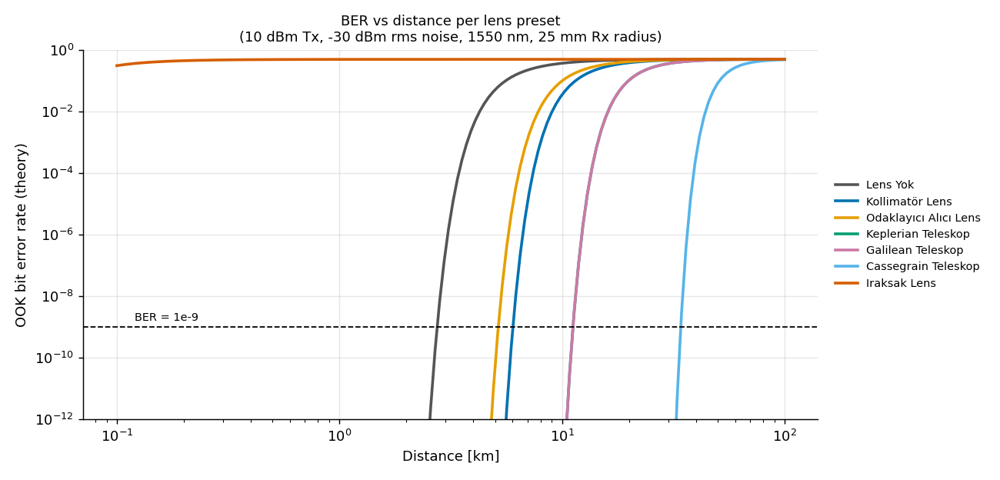
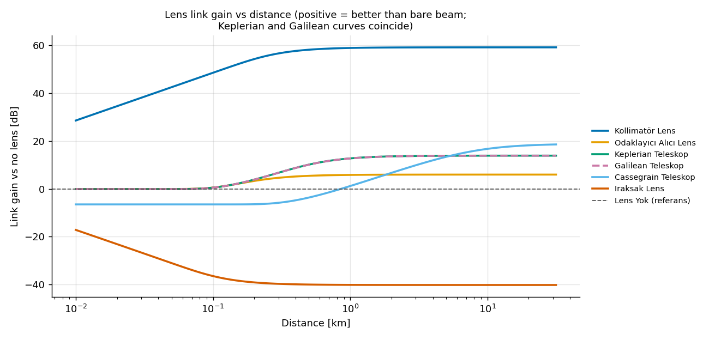
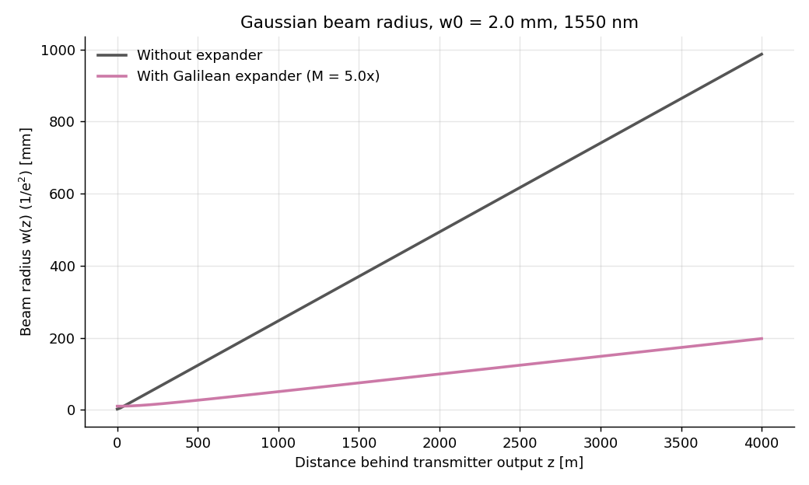
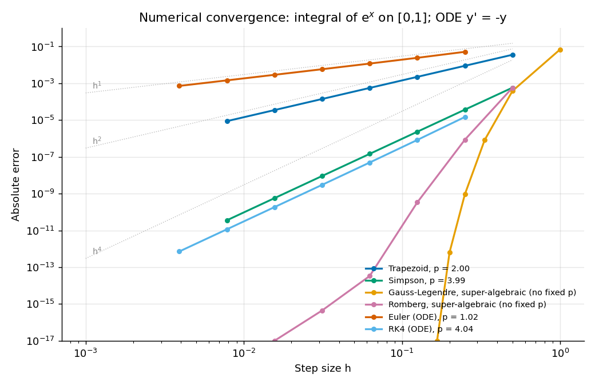
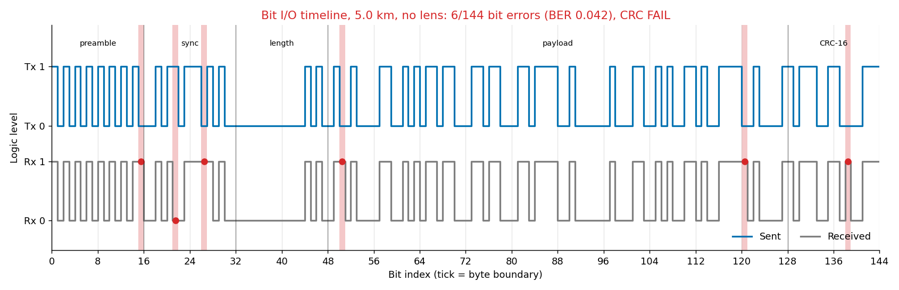
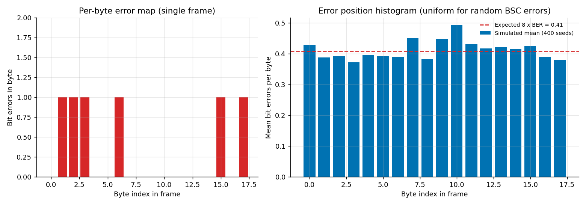
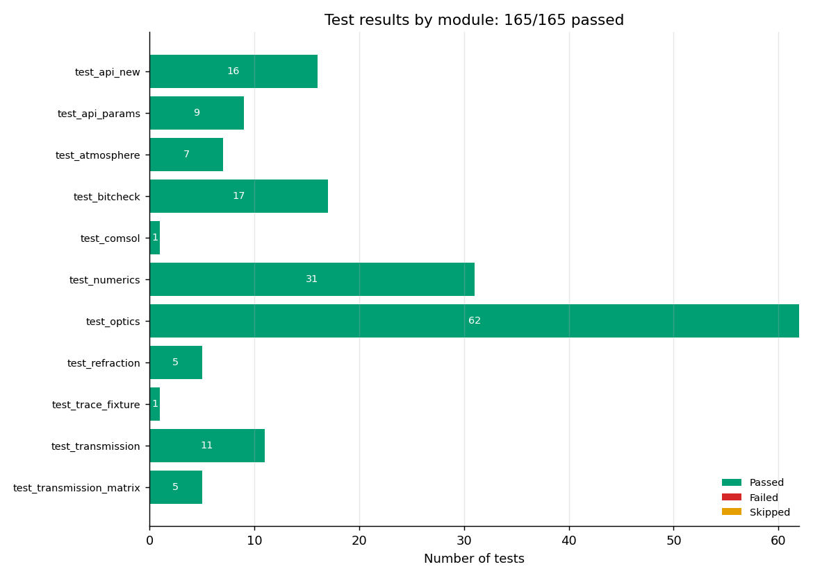

# Automated Physics Test Report

- **Status:** PASSED
- **Generated:** 2026-11-21T12:33:17.062583+00:00
- **Total:** 165
- **Passed:** 165
- **Failed:** 0
- **Errors:** 0
- **Skipped:** 0
- **Duration:** 1.060s

## Scope

The headless suite covers physics primitives, API validation/serialization, and COMSOL export data.
Regression tests cover transmission matrices and deterministic ray traces; browser UI and licensed COMSOL solver execution are separate checks.

## Bit-level I/O check

Frame = preamble + sync + length + payload + CRC-16/CCITT, sent through a seeded OOK channel (seed 1, 10 dBm Tx, -30 dBm rms noise).

| Payload | Lens | Distance [m] | P_rx [dBm] | BER (theory) | Bit errors | BER (measured) | CRC ok |
|---|---|---:|---:|---:|---:|---:|:---:|
| Merhaba FSO | none | 100 | 6.4 | 0.00e+00 | 0/152 | 0.0000 | yes |
| Merhaba FSO | none | 3000 | -20.0 | 3.25e-07 | 0/152 | 0.0000 | yes |
| Merhaba FSO | none | 4500 | -23.8 | 1.95e-02 | 5/152 | 0.0329 | NO |
| Merhaba FSO | none | 6000 | -26.6 | 1.39e-01 | 24/152 | 0.1579 | NO |
| Merhaba FSO | keplerian_telescope | 6000 | -12.8 | 1.45e-153 | 0/152 | 0.0000 | yes |
| Merhaba FSO | keplerian_telescope | 15000 | -22.5 | 2.51e-03 | 1/152 | 0.0066 | yes |
| Merhaba FSO | diverging | 1000 | -50.2 | 4.98e-01 | 78/152 | 0.5132 | NO |

## Figures

### BER vs distance per lens preset

### Lens link gain vs distance

### Gaussian beam radius with/without Galilean expander

### Numerical convergence (log-log, fitted orders)

### Bit I/O timeline at a marginal distance

### Error position histogram / per-byte error map

### Test results per module

## Artifacts

- `reports/test-results.xml`: JUnit XML for CI systems
- `reports/figures/*.png`: plots from `scripts/generate_test_plots.py`
- `tests/fixtures/gradient_trace.json`: deterministic ray-trace baseline
